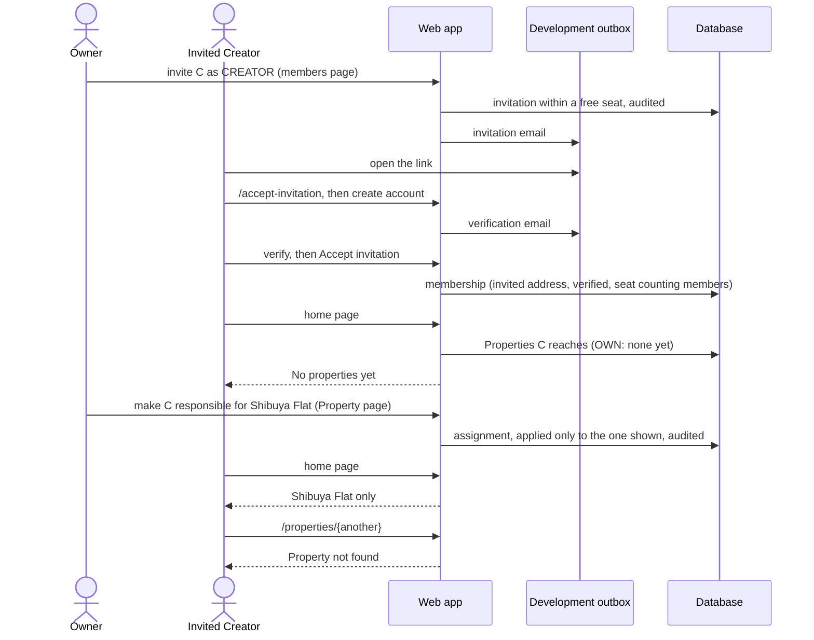

# Completion — accounts and team

Branch: `claude/project-thread-az06z2`
Plan: `/mnt/project-files/cto/accounts-team-proposal.md`, approved by the
product owner on 2026-11-09 with its defaults
Gap analysis: `docs/accounts-team-gap-analysis.md`
ADRs: ADR-0126 to ADR-0149, one for each milestone (listed below)

The product owner approved sending email, email verification and password
reset (ADR-0052 Decision 18), and screens for the members, invitations,
groups, Property assignment and permissions built in Phases 6C to 6I, with
the seat limit and a browser test, in about twelve pull requests (AT-1 to
AT-12), each merged only with their yes. Each milestone recorded itself in
its ADR, its API change summary, the Roadmap, the architecture table and the
migration notes; this record closes the plan. The plan is not a Roadmap
phase, so it receives no `phase-N-complete` tag.

## AT-12 — the browser test of what invited members reach

Base: `0338be1` (PR #172 merge commit on `main`).
ADR: `docs/decisions/0149-the-browser-test-of-what-invited-members-reach.md`

**No migration, and no product change**: only a browser test and documents.

### What AT-12 does

- **A tenth browser test**,
  `tests/e2e/members-see-only-their-properties.spec.ts`. An owner creates
  two Properties and a group and invites a Creator and a Manager. Each joins
  in their own browser from the emailed link, with a new account verified
  from the outbox, and sees no Property yet.
- The owner makes the Creator responsible for one Property, adds the Manager
  to the group and creates a third Property in it. The Creator's home page
  then lists only its own Property, the Manager's only the group's, and the
  owner's all three.
- The Creator uploads its Property's three photos, which are processed.
- Every Property a member does not reach answers "Property not found" from
  its address as well (ADR-0064 Decision 3).

### Joining and reaching a Property

### Verification

Run on this branch against a local PostgreSQL 16, after
`prisma migrate reset`:

| Check | Result |
| --- | --- |
| `pnpm run typecheck` | exit 0 |
| `pnpm run lint` | exit 0 |
| `pnpm run test` | exit 0: 7,852 tests in 307 files |
| `pnpm run test:db` | exit 0: 1,940 tests in 78 files |
| `pnpm run test:media` | exit 0: 172 tests in 5 files |
| browser tests (`playwright test`) | exit 0: 10 tests |
| `pnpm run build` | exit 0 |

The new test was also run against a break: with a `MANAGER` given the
`ORGANIZATION` scope in `ROLE_SCOPE`, it fails at the Manager's first home
page, which lists the owner's two Properties instead of none. The file was
restored and checked unchanged.

### Review

REVIEW_SUMMARY

### Required documentation

| Item | Where |
| --- | --- |
| Architecture diagram | `docs/architecture.md`: its runtime diagram, and the status table's rows for AT-1 to AT-11c and the browser test row |
| Entity-relationship diagram | `docs/er-diagram.md`, *AT-3a* (`users.emailVerifiedAt`, `account_links`) and *AT-6a* (one pending invitation per address); AT-12: not applicable, no entity changes |
| Critical sequence diagram | the diagram above; each milestone's ADR and API change summary carries its own |
| OpenAPI / API change summary | `docs/api-changes-at-1.md` to `docs/api-changes-at-11c.md`; AT-12: not applicable, no route or page changes |
| Change log / release notes | the milestone table and "What a company can do now" below, and each pull request's description |
| Database migration notes | `docs/migration-notes.md`, *AT-1* to *AT-12* |
| Completion report | this file |

Also updated: `docs/Roadmap.md` and `docs/accounts-team-gap-analysis.md`.

### Activation status

Nothing paid or scheduled is activated. No email leaves a development
machine: the outbox is refused in production, and no production email
service is chosen. Paid Provider Activation, production Provider
credentials, production paid AI calls, production scheduler activation and
live Stripe charges remain BLOCKED.

## The plan — complete

Approved by the product owner on 2026-11-09, from `be4363e`. Its goal, from
the gap analysis: on a development machine, with no paid service and no
email leaving it, an owner invites a colleague, who opens the emailed link,
creates an account, verifies the email and joins with the role they were
given; the colleague sees only the Properties assigned to them; the owner
assigns a Property, and the colleague works on it. A person who forgets a
password can reset it.

It is met, and proved in a browser on every push:

| Part of the goal | Browser test |
| --- | --- |
| invite, create an account, verify, join with the role given | `join-by-invitation.spec.ts` (ADR-0138) |
| see only the Properties assigned to them, by responsible user or group; the owner assigns; the member works on it | `members-see-only-their-properties.spec.ts` (ADR-0149) |
| reset a forgotten password | `reset-a-forgotten-password.spec.ts` (ADR-0133) |
| change a member's role, give and take back a permission, remove a member | `join-by-invitation.spec.ts` (ADR-0139, ADR-0147, ADR-0140) |
| groups: create, give and take back a permission, add and remove a member, rename, delete | `organize-a-team-into-groups.spec.ts` (ADR-0141 to ADR-0143, ADR-0148) |
| a Property's assignment, on its page and at creation | `assign-a-property.spec.ts` (ADR-0144, ADR-0145) |
| a member's permissions page | `see-a-members-permissions.spec.ts` (ADR-0146) |

### What a company can do now

- **Accounts.** A new account verifies its email address before anything
  else; a forgotten password is reset from an emailed link that ends every
  session. Email goes to the development outbox.
- **Members and seats.** The members page shows the seats taken out of the
  plan's included users. A holder of `member.manage` invites within the
  free seats and its role ceiling, and cancels an invitation; an `OWNER` or
  `ADMIN` changes a member's role and removes a member. Only the invited,
  verified address accepts.
- **Groups.** The groups page lists the groups with their members and what
  each gives them. Members are added and removed, and permissions given and
  taken back, within the grant ceiling for the viewer and every member.
- **Property assignment.** An `OWNER` or `ADMIN` chooses a Property's
  responsible user and group when creating it or later; a `MANAGER` creates
  in its own groups and a `CREATOR` for itself.
- **Permissions.** Each member's permissions page says what is in effect and
  where it comes from, and a holder of `permission.manage` gives and takes
  back individual permissions within the ceiling.

### Milestone pull requests

Each merged with the product owner's yes. Times are UTC.

| Milestone | PR | ADR | Merge commit | Merged |
| --- | --- | --- | --- | --- |
| AT-1 the product sends email through a port | #150 | 0126 | `01fc0a2` | 2026-11-09 04:44 |
| AT-2 an organization is created in one transaction | #151 | 0127 | `0a5857e` | 2026-11-09 06:46 |
| AT-3a email verification links (migration 33) | #152 | 0128 | `41fafb1` | 2026-11-09 08:12 |
| AT-3b email verification is required | #153 | 0129 | `007799c` | 2026-11-09 23:42 |
| AT-4a an account is registered in one transaction | #154 | 0130 | `60239d1` | 2026-11-10 00:56 |
| AT-4b-1 password reset links, and a sign-in with a replaced password | #155 | 0131 | `1d4dbae` | 2026-11-10 02:14 |
| AT-4b-2 resetting a password with a link | #156 | 0132 | `9e16477` | 2026-11-10 14:38 |
| AT-4c the password reset pages | #157 | 0133 | `975122a` | 2026-11-10 23:52 |
| AT-5 the members page and an organization's seats | #158 | 0134 | `3e60005` | 2026-11-11 01:52 |
| AT-6a invitations within the seats (migration 34) | #159 | 0135 | `5280040` | 2026-11-11 02:59 |
| AT-6b invite and cancel from the members page | #160 | 0136 | `8018f26` | 2026-11-11 08:59 |
| AT-7a accepting an invitation needs the invited, verified address and a seat | #161 | 0137 | `c38661c` | 2026-11-11 12:27 |
| AT-7b open and accept an invitation from its emailed link | #162 | 0138 | `d094fbb` | 2026-11-11 13:45 |
| AT-8a change a member's role from the members page | #163 | 0139 | `a8796ee` | 2026-11-12 06:18 |
| AT-8b remove a member from the members page | #164 | 0140 | `32998c9` | 2026-11-12 23:48 |
| AT-9a list an organization's groups and create one | #165 | 0141 | `0fab87e` | 2026-11-14 11:43 |
| AT-9b rename and delete a group | #166 | 0142 | `efd9f68` | 2026-11-15 11:38 |
| AT-9c add and remove a group's members | #167 | 0143 | `90165f3` | 2026-11-15 13:09 |
| AT-10a change a Property's responsible user and group on its page | #168 | 0144 | `ff88fc0` | 2026-11-15 14:10 |
| AT-10b choose them when creating a Property | #169 | 0145 | `d62c754` | 2026-11-15 23:46 |
| AT-11a a member's permissions page | #170 | 0146 | `ea303f8` | 2026-11-16 01:11 |
| AT-11b give and take back a member's individual permissions | #171 | 0147 | `cab5999` | 2026-11-16 02:50 |
| AT-11c a group's permissions on the groups page | #172 | 0148 | `0338be1` | 2026-11-16 05:10 |
| AT-12 the browser test of what invited members reach, and this report | this | 0149 | reported at merge | |

No other pull request merged during the plan. Two migrations:
`00000000000033_account_links` (AT-3a) and
`00000000000034_one_pending_invitation` (AT-6a). The proposal's twelve rows
became 24 pull requests, each kept near 500 changed lines where it could be.

### Test results

On this pull request's code, as measured above: 7,852 unit tests in 307
files, 1,940 database tests in 78 files, 172 media tests in 5 files and 10
browser tests, all passing, and the production build. On `main`
after the last merge, `0338be1`, CI's `verify`, `media` and `e2e` jobs
passed (run 971). Its `database` job failed on the first attempt: the test
runner's worker process crashed (`ERR_IPC_CHANNEL_CLOSED`) after 61 of the 78
files had passed, with no test failing. The same tree had passed that job
twice on the pull request, and its one re-run passed.

### Known limitations

- **Email reaches only the development outbox.** No production email
  service is chosen, so invitations, verification and reset links cannot
  reach a real inbox yet (the proposal's default 1).
- **No rate limiting** on sign-in, sign-up, verification, reset or
  invitations (the proposal's default 7; ADR-0054).
- **Seats are the plan's included users** (3, 10 or 30). Seat purchase is
  not built, so a full organization cannot grow (default 5).
- **No account deletion**, and a member cannot leave an organization or
  change their own role from the product (default 6).
- **`disclosure.none` is not offered** on a member's permissions page before
  Mode C exists (ADR-0147).

### Remaining work

Open in `docs/decisions/TODO.md` from this plan, each awaiting a decision or
its own milestone:

- choose the production email service (AT-1);
- add rate limiting as one cross-cutting milestone;
- guard organization creation against a double submit (AT-2);
- take back an account someone else made with your address (AT-4);
- decide whether a member can change their own role or leave an
  organization (AT-8a);
- decide whether removing a member also cancels the invitations they sent,
  and whether a role change or removal should lock the actor's own
  membership (AT-8b);
- confirm that `group.view` alone shows a group's members without their
  addresses (AT-9a);
- audit a role change or removal posted without the role the page showed
  (AT-9b);
- confirm that `disclosure.none` is not offered before Mode C, and refuse
  before reading the member when the poster's role reaches no one (AT-11b);
- confirm that a holder of `permission.manage` whose role reaches no one
  may change the permissions of a group with no members (AT-11c).

After this plan, as the proposal lists (each a separate proposal):
pre-activation readiness (the Google Cloud Storage adapter, the webhook and
mandatory polling, the internal recovery budget, operator recovery tooling,
a real content-moderation vendor, the production email service and rate
limits); Disclosure Mode B and Mode C, the company logo and recomposition
from the Clean Master; the data lifecycle (project settings and deletion,
the 30-day trash, storage quota and account deletion); and billing
(subscriptions, seat purchase and storage blocks). Paid Provider Activation,
production Provider credentials, production paid AI calls, the production
scheduler and live Stripe charges remain BLOCKED until the product owner
authorizes each.
