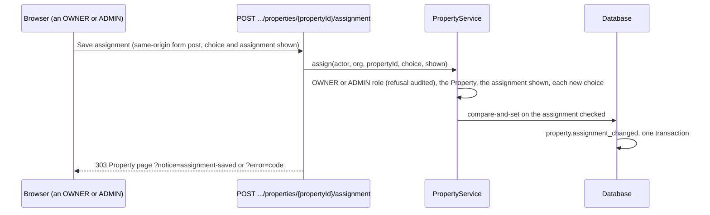

# API Changes — AT-10a

The Property page changes a Property's responsible user and group
(ADR-0144). **No migration, permission or audit action.**

## HTTP

### Changed: `GET /properties/{propertyId}`

For an `OWNER` or `ADMIN`, the page also shows:
- the Property's responsible user and group, each "None" when unset;
- a closed **Change assignment…** form with a **Responsible user** list (any
  member but a `BILLING` one, and the current one) and a **Group** list,
  each starting at the current choice;
- the sentence of each code below.

Anyone else sees neither the assignment nor the form.

### Added: `POST /api/organizations/{organizationId}/properties/{propertyId}/assignment`

A form post from the Property page. Fields: `responsibleUserId`, `groupId`,
`shownResponsibleUserId`, `shownGroupId`, each empty for none.

| Answer | When |
| --- | --- |
| `403` JSON `FORBIDDEN` | the `Origin` is not this site; nothing is read |
| `303` to `/login` | signed out, or a sign-in that is not complete |
| `303` to the Property page, `notice=assignment-saved` | changed (`property.assignment_changed`) |
| `303` to the Property page, `notice=assignment-unchanged` | the choice is the assignment shown; nothing written |
| `303` to the Property page, `error=<code>` | `property-gone` (`NOT_FOUND`, or a Property id over 64 characters), `responsible-user-gone` (`RESPONSIBLE_USER`, or a member id over 64 characters), `assignment-group-gone` (`GROUP`, or a group id over 64 characters), `assignment-changed` (`STALE`), `may-not-assign` (`FORBIDDEN`, audited for a member), `assign-failed` |

## Internal API

### Changed: `@app/domain`

| Export | Shape |
| --- | --- |
| `PropertyService.assign` | takes an optional fifth argument, the assignment shown; a Property whose assignment is no longer that is not changed (`STALE`). An invalid responsible user or group, at creation or reassignment, and an assignment that changed meanwhile, now carry `details.reason`, a `PropertyAssignmentProblem` |
| `PropertyService.assignmentChoices` | new: for an `OWNER` or `ADMIN`, a `PropertyAssignmentChoices`; `null` for anyone else |
| `PropertyAssignmentProblem` | new: `"RESPONSIBLE_USER" \| "GROUP" \| "STALE"` |
| `PropertyAssignmentChoices`, `AssignableMember` | new: the current assignment, the members who may be chosen and the groups |

### Added: `apps/web` (`lib/property-assignment.ts`)

| Export | Shape |
| --- | --- |
| `assignProperty(actor, organizationId, propertyId, form)` | the route's work, a notice or an error code |
| `ASSIGNMENT_NOTICES`, `ASSIGNMENT_ERRORS` | each code's sentence |
| `ASSIGNMENT_ID_MAX_LENGTH` | 64: the longest id read from the form or the address |

## Sequence

