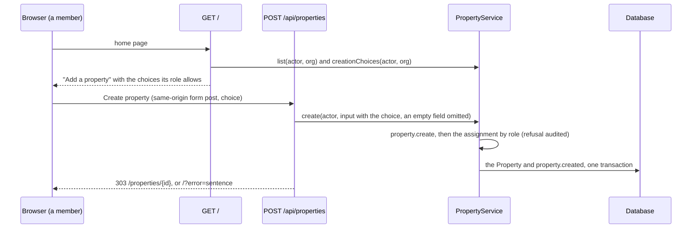

# API Changes — AT-10b

A member chooses a Property's responsible user and group when creating it,
as far as its role allows (ADR-0145). **No migration, permission or audit
action.**

## HTTP

### Changed: `GET /`

For each organization, the "Add a property" form now offers what the member
may choose for the new Property:

| Member | The form |
| --- | --- |
| `OWNER`, `ADMIN` | **Responsible user** (any member but a `BILLING` one) and **Group** lists, each starting at "None" |
| `MANAGER` | a required **Group** list of its own groups, its only one already chosen; it is responsible |
| `MANAGER` in no group | no form; a sentence saying why |
| `CREATOR` | no list; it is responsible, in no group |
| without `property.create` (`VIEWER`, `BILLING`) | no form |

A member without `property.view` (a `BILLING` one) sees "Your role does not
include Properties." where the list was; the page no longer fails for them.

### Changed: `POST /api/properties`

A form post from the home page. Added fields: `responsibleUserId` and
`groupId`, each empty for none chosen; an empty one is not passed on.

| Answer | When |
| --- | --- |
| `403` JSON `FORBIDDEN` | **new:** the `Origin` is not this site; nothing is read |
| `303` to `/login` | signed out, or a sign-in that is not complete |
| `303` to `/properties/{id}` | created, with the assignment the service decided |
| `303` to `/?error=<sentence>` | refused, with the service's sentence as before; **new:** a member or group id over 64 characters, answered unread with the sentence for one that is not this organization's |

## Internal API

### Changed: `@app/domain`

| Export | Shape |
| --- | --- |
| `PropertyService.creationChoices(actor, organizationId)` | new: a `PropertyCreationChoices`, or `null` without `property.create`; `FORBIDDEN` for a non-member |
| `PropertyCreationChoices` | new: `{ kind: "ANY", members, groups }`, `{ kind: "OWN_GROUP", groups }` or `{ kind: "SELF" }` |
| `GroupChoice` | new: `{ id, name }`, now also the type of `PropertyAssignmentChoices.groups` |

### Changed: `apps/web`

| Export | Shape |
| --- | --- |
| `memberLine` (`lib/role-names.ts`) | moved from the Property page's assignment section: a member's name, address where shown, and role |

## Sequence

