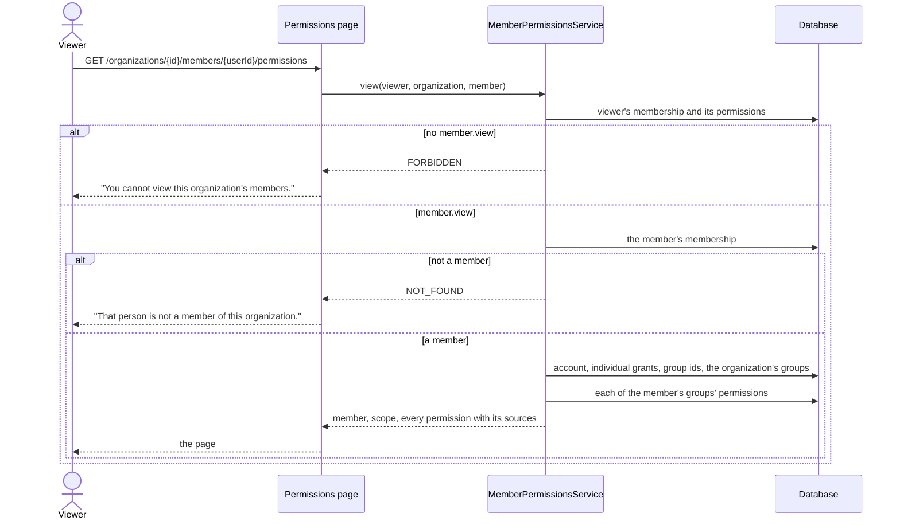

# API Changes — AT-11a

A member's permissions page (ADR-0146). **No migration, API route,
permission or audit action.** One page; the members page links to it.

## HTTP

### Added

| Route | Who | Does |
| --- | --- | --- |
| `GET /organizations/{organizationId}/members/{userId}/permissions` | a member holding `member.view` | The member's name, address and role, which Properties their permissions over Properties apply to (by the scope their role fixes), and every permission a member can hold (all but `video.share`) in five areas: its name, its key, whether it is in effect, and whether their role, an individual grant or their groups give it. The groups are named for a viewer holding `group.view`, and counted for anyone else. `property.create` given to a `VIEWER` or `BILLING` member says it is never in effect for one; `member.manage`, `group.manage` and `permission.manage` held by any role but `OWNER` and `ADMIN` say the role reaches no other member. A permission nothing in the product uses yet says so. Writes nothing. Without `member.view`, or not a member: "You cannot view this organization's members.", without the organization's name. A `userId` that is not a member: "That person is not a member of this organization." Signed out: redirect to `/login` |

### Changed

| Route | Change |
| --- | --- |
| `GET /organizations/{organizationId}/members` | Each member links to their permissions page ("Permissions") |

## Domain

| Export | What |
| --- | --- |
| `MemberPermissionsService.view(actorUserId, organizationId, memberUserId)` | The page's reading. `FORBIDDEN` without `member.view`; `NOT_FOUND` for someone who is not a member |
| `MemberPermission`, `MemberPermissions` | What it answers: per permission, `effective`, `fromRole`, `granted`, `groupCount` and `groupNames` (`null` without `group.view`) |

### Sequence

