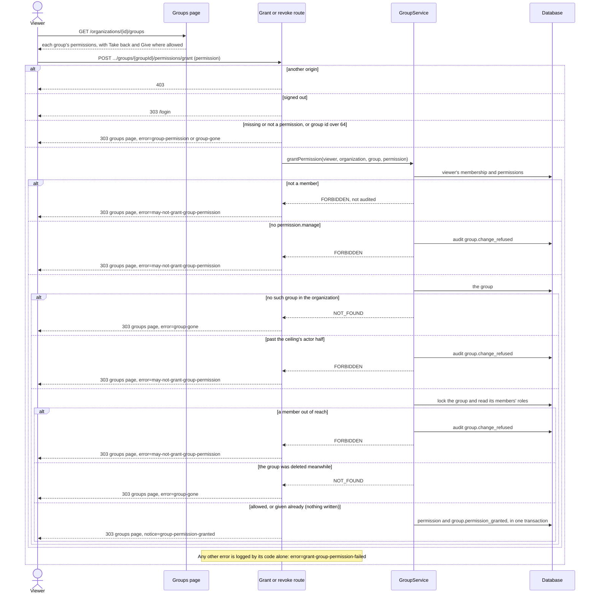

# API Changes — AT-11c

A group's permissions on the groups page (ADR-0148). **No migration,
permission, audit action or refusal reason**; one repository read and one
`NOT_FOUND` reason. Two form posts; the groups page shows each group's
permissions and gains their forms.

## HTTP

### Added

| Route | Who | Does |
| --- | --- | --- |
| `POST /api/organizations/{organizationId}/groups/{groupId}/permissions/grant` | a member holding `permission.manage`, within the grant ceiling for itself and every member of the group | Form field `permission`. `GroupService.grantPermission`: the group gives the permission to each of its members, audited as `group.permission_granted` with the members it reaches; one the group gives already writes nothing. `303` to the groups page with `notice=group-permission-granted`, or `error=group-permission` (missing or not a permission; the service is not asked), `may-not-grant-group-permission` (refused; a member's refusal is audited as `group.change_refused`), `group-gone` (no such group in the organization, or a `groupId` over 64 characters, refused unread) or `grant-group-permission-failed`. Another origin: `403`, nothing read. Signed out: `303` to `/login` |
| `POST /api/organizations/{organizationId}/groups/{groupId}/permissions/revoke` | as above | Form field `permission`. `GroupService.revokePermission`: the group no longer gives it, audited as `group.permission_revoked`. `303` to the groups page with `notice=group-permission-revoked`, or `error=group-permission`, `may-not-revoke-group-permission` (refused; a member's refusal is audited), `group-permission-not-granted` (the group does not give it), `group-gone` or `revoke-group-permission-failed`. Origin and sign-in as above |

### Changed

| Route | Change |
| --- | --- |
| `GET /organizations/{organizationId}/groups` | Each group says what it gives each of its members (of `property.create`, that it is never in effect for a `VIEWER` or `BILLING` member), or that it gives none. A viewer the ceiling allows sees "Take back" on each, and a closed "Give a permission…" form listing what it may give, which says before its list what giving brings (which Properties each role reaches, two-step sign-in for `permission.manage` and `billing.manage`, `property.create` never in effect for a `VIEWER` or `BILLING` member, only an `OWNER` or `ADMIN` acting on other members). Delete, and the members offered to add or remove, are decided per group under the ceiling of what the group gives. Shows the new `notice` and `error` codes, and nothing for any other code |

## Domain

| Export | What |
| --- | --- |
| `GroupsOverviewGroup.permissions`, `.givable`, `.revocable` | What the group gives each of its members, what the viewer may give it, and what it may take back, as `GroupService` decides (`permission.manage`, `groupGrantRefusal`, every member's role within the viewer's) |
| `GroupsOverviewGroup.mayDelete` | Replaces `GroupsOverview.mayDelete`: `group.manage`, the `OWNER` or `ADMIN` role, and, for a group giving any permission, the ceiling on taking each from each member |
| `GroupsOverviewGroupMember.mayRemove`, `GroupsOverviewGroup.addable` | Now also need the ceiling on each permission the group gives |
| `GroupRepository.listPermissionsOfGroups` | The permissions of the organization's groups among the given ids, in one read |
| `GroupNotFoundReason` `NOT_GRANTED` | `GroupService.revokePermission` of a permission the group does not give |

### Sequence

