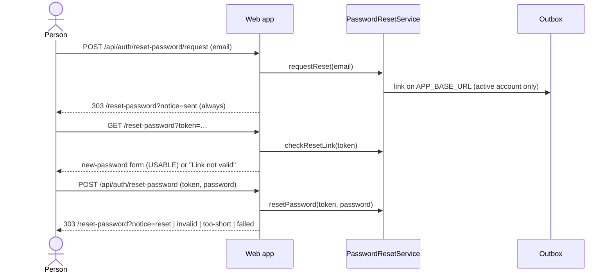

# API Changes — AT-4c

The password reset pages (ADR-0133). **No migration, permission or audit
action.** One page and two routes; the sign-in page links to them.

## HTTP

### Added

| Route | Who | Does |
| --- | --- | --- |
| `GET /reset-password` | anyone | A form asking for the account's email address, posting to `/api/auth/reset-password/request` |
| `GET /reset-password?token=…` | anyone; the token is the proof | `checkResetLink(token)`, writing nothing. `USABLE`: a new-password form (at least 10 characters) posting the token to `/api/auth/reset-password`. Anything else, including an empty, repeated or over-long token: "Link not valid" and the form to ask again. An error while checking: the form to ask, with `failed`. `Referrer-Policy` `strict-origin` by meta tag |
| `GET /reset-password?notice=…` | anyone | `sent`, `invalid`, `too-short` or `failed` above the form to ask; `reset` with a link to `/login`. Any other value shows nothing |
| `POST /api/auth/reset-password/request` (form `email`) | anyone | `requestReset(email)`, then 303 to `/reset-password?notice=sent`, whatever the address and whatever failed. A body that is not a form is read as an empty one |
| `POST /api/auth/reset-password` (form `token`, `password`) | anyone; the token is the proof | `resetPassword(token, password)`, then 303 to `/reset-password?notice=reset`, `invalid` (any link that resets nothing), `too-short` (link still usable) or `failed` (any other error; nothing written). A body that is not a form answers `invalid`. Never carries the token |

### Changed

| Route | Change |
| --- | --- |
| `GET /login` | The sign-in form links to `/reset-password` ("Forgot your password?") |

### Sequence

## Internal API

### Added: web app

| Module | Exports |
| --- | --- |
| `apps/web/src/lib/mailer.ts` | `getMailer()` (the outbox sender and `link(path, token)` on `APP_BASE_URL`, both `CONFIGURATION_ERROR` when either setting is unset) and `tokenLink(baseUrl, path, token)` |
| `apps/web/src/lib/password-reset.ts` | `getPasswordResetService()`, `askForResetLink(address)` (resolves the same whatever happened), `openResetLink(token)` (`usable`, `invalid` or `failed`; writes nothing), `resetPasswordWith(token, password)` (the notice), `resetUrl(baseUrl, token)`, `resetPasswordPage(requestUrl, notice)`, `RESET_PASSWORD_NOTICES`, `resetPasswordNotice(param)`. Failures are logged by error code alone |
| `apps/web/src/lib/http.ts` | `formOf(request)`: the request's form, or an empty one when the body is not a form |

### Changed: web app

`getEmailVerificationService()` mails through `getMailer()`, with the same
behavior.

### Changed: browser test helpers

`tests/e2e/support/owner.ts` adds `signUpPerson(page)` (signed up and
verified, a member of nothing; returns the email and password) and
`newPassword()`; `signUpOwner` starts from `signUpPerson`.
`tests/e2e/support/outbox.ts` adds `passwordResetLink(to)`.
