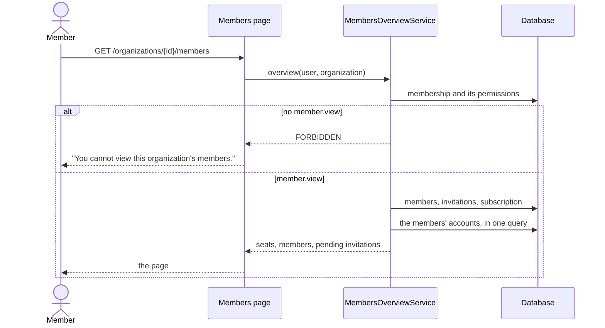

# API Changes — AT-5

The members page (ADR-0134). **No migration, route, permission or audit
action.** One page; the dashboard links to it.

## HTTP

### Added

| Route | Who | Does |
| --- | --- | --- |
| `GET /organizations/{organizationId}/members` | a member holding `member.view` | The seats taken out of the plan's included users (or that there is no plan yet), the members (name, email address, role, joined; by role, then longest-standing first; the viewer marked "(you)"), and the pending invitations that have not expired (email address, role, sent, expires; oldest first). Writes nothing. Anyone else: "You cannot view this organization's members.", without the organization's name. Signed out: redirect to `/login` |

### Changed

| Route | Change |
| --- | --- |
| `GET /` | Each organization links to its members page ("Members"), beside "Units and plan" |

## Domain

| Export | What |
| --- | --- |
| `MembersOverviewService.overview(actorUserId, organizationId)` | The page's reading. `FORBIDDEN` without `member.view` |
| `includedSeats(subscription)` | The plan's included users; `null` without a plan |
| `holdsSeat(invitation, now)` | `PENDING` and expiring after `now` |

### Sequence

