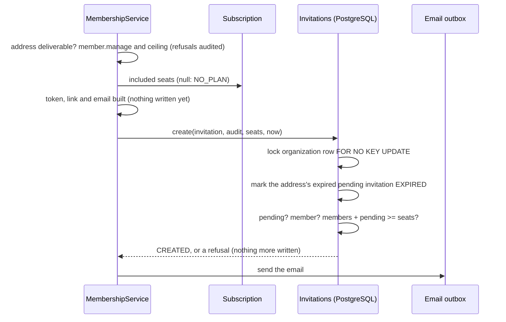

# API Changes — AT-6a

An invitation needs a plan and a free seat, one pending invitation per
address, and is mailed; a pending invitation can be cancelled (ADR-0135).
**Migration 34; no route, page or permission. Nothing in either application
invites or cancels yet.**

## HTTP

No change.

## Internal API

### Changed: `@app/domain`

| Export | Shape |
| --- | --- |
| `MembershipServiceOptions` | adds `includedSeats(organizationId)` (`number` or `null` without a plan), `email: EmailSender` and `invitationUrl(token)`; all required |
| `MembershipService.invite(actor, input)` | as before, then: `VALIDATION_FAILED` with `details.reason` `INVALID_EMAIL` (before anything), `NO_PLAN`, `ALREADY_INVITED`, `ALREADY_MEMBER` or `NO_SEAT`. Mails the link after the invitation and its audit entry are kept; still returns `{ invitation, token }` |
| `InvitationRepository.create(input, audit, { includedSeats, now })` | was `(invitation, audit)` returning the invitation. Takes a `NewInvitation` (no status, acceptance or creation time) and returns an `InvitationCreation`: `CREATED` with the invitation, or `ALREADY_INVITED`, `ALREADY_MEMBER`, `NO_SEAT`, writing nothing more |
| `InvitationRepository.findPending` | removed; it read the status alone |

### Added: `@app/domain`

| Export | Shape |
| --- | --- |
| `MembershipService.cancelInvitation(actor, organizationId, invitationId)` | `void`. `FORBIDDEN` without `member.manage` or past the ceiling of the invited role (audited, operation `cancel_invitation`); `NOT_FOUND` unless the organization's invitation is pending and not expired |
| `InvitationRepository.find(organizationId, invitationId)` | the organization's invitation or `null` |
| `InvitationRepository.revoke(organizationId, invitationId, now, audit)` | `"REVOKED"` or `"STALE"` |
| `InvitationRefusal` | the five reasons above |
| `NewInvitation`, `InvitationCreation` | the repository's input and answer |
| `isOpenInvitation(invitation, now)` | `PENDING` and expiring after `now`; `holdsSeat` now answers with it |
| `invitationMessage(to, organizationName, role, url, ttlSeconds)` | the invitation email, kind `INVITATION` |
| `INVITATION_TTL_SECONDS` | 7 days |
| `includedSeatsFrom(subscriptions)` | the `includedSeats` option, read from the organization's subscription |
| `AuditAction.InvitationRevoked` | `invitation.revoked`, with the actor, the invitation as resource and `metadata: { email, role }` |

### Changed: `@app/database`

`invitations.create` locks the organization's row `FOR NO KEY UPDATE`, marks
the address's expired pending invitation `EXPIRED`, checks and counts, then
writes with the audit entry, in one transaction; a refusal by migration 34's
index answers `ALREADY_INVITED`. `invitations.revoke` moves a pending
invitation not expired to `REVOKED` with its audit entry, in one transaction.

### Changed: `apps/web`

`getIdentityServices()` no longer builds a `MembershipService`: nothing called
it, and it now needs the seats, a mailer and the link. AT-6b builds it for its
routes.

### Changed: `@app/domain/testing`

`membershipTestOptions(overrides)` gives tests a membership service's options:
30 seats, a `RecordingEmailSender` and `invite:` links. The in-memory
invitations gain `put(invitation)` for fixtures, and check and write with no
`await` in between.

## Sequence

