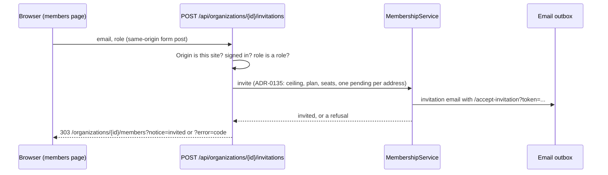

# API Changes — AT-6b

The members page invites with the roles the viewer may assign and cancels
those roles' pending invitations, through two form posts (ADR-0136).
**No migration, permission or audit action.** The invitation link's page,
`/accept-invitation`, is built in AT-7.

## HTTP

### Added: `POST /api/organizations/{id}/invitations`

A form post from the members page. Fields: `email`, `role`.

| Answer | When |
| --- | --- |
| `403` JSON `FORBIDDEN` | the `Origin` is not this site; nothing is read |
| `303` to `/login` | signed out |
| `303` to `/organizations/{id}/members?notice=invited` | invited, and the link mailed |
| `303` to `/organizations/{id}/members?error=<code>` | `role`, `email`, `no-plan`, `already-invited`, `already-member`, `no-seat`, `may-not-invite`, `unavailable` or `invite-failed` (ADR-0136 Decision 3) |

### Added: `POST /api/organizations/{id}/invitations/{invitationId}/cancel`

A form post from the members page. No fields.

| Answer | When |
| --- | --- |
| `403` JSON `FORBIDDEN` | the `Origin` is not this site; nothing is read |
| `303` to `/login` | signed out |
| `303` to `/organizations/{id}/members?notice=cancelled` | cancelled |
| `303` to `/organizations/{id}/members?error=<code>` | `may-not-cancel`, `gone` or `cancel-failed` |

### Changed: `GET /organizations/{id}/members`

The page reads `notice` and `error` and shows the fixed sentence a known code
names, and nothing for any other value. For a member who may invite with
some role, it shows the invite form, or says why there is none (no plan, or
every seat taken). It shows a **Cancel invitation** button on each pending
invitation whose role the viewer may assign.

## Internal API

### Changed: `@app/domain`

| Export | Shape |
| --- | --- |
| `MembersOverview` | adds `invitableRoles: readonly Role[]`: the roles `mayAssignRole` allows the viewer's role, when the viewer holds `member.manage`, in `ROLES` order; else `[]` |
| `MembersOverviewInvitation` | adds `id`, which names the invitation for cancelling and accepts nothing |
| `linkLifetime(seconds)` | now exported: how long a link works, as the invitation email words it ("7 days"), for the members page to say it the same way |

### Added: `apps/web` (`lib/members.ts`)

| Export | Shape |
| --- | --- |
| `getMembershipService()` | a `MembershipService` with the plan's seats, the mailer and links to `ACCEPT_INVITATION_PATH` on `APP_BASE_URL`; a send failing after the invitation is kept is told apart from missing configuration |
| `ACCEPT_INVITATION_PATH` | `/accept-invitation` |
| `INVITATION_LIFETIME` | `linkLifetime(INVITATION_TTL_SECONDS)`, the page's wording of the link's lifetime |
| `MEMBERS_NOTICES`, `MEMBERS_ERRORS`, `membersNotice`, `membersError` | the codes and their sentences, and the lookup of a query parameter |
| `membersPage(requestUrl, organizationId, outcome)` | the members page with one code |
| `inviteMember(actor, organizationId, { email, role })`, `cancelMemberInvitation(actor, organizationId, invitationId)` | the routes' work: a `MembersOutcome`, a failure logged by its code alone |

## Sequence

