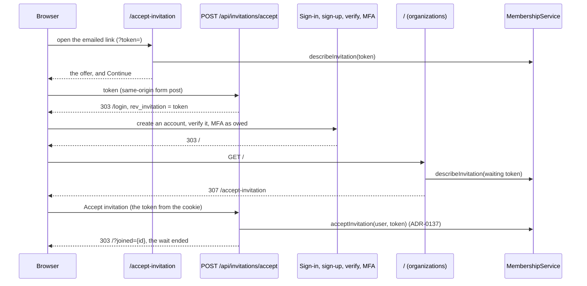

# API Changes — AT-7b

The invitation link's page, `/accept-invitation`, shows what an invitation
offers and accepts it, the invitation waiting in the browser while its person
signs in, creates an account, verifies it or finishes MFA (ADR-0138).
**No migration, permission or audit action.**

## HTTP

### Added: `GET /accept-invitation`

| Query | Shows |
| --- | --- |
| `token` of an open invitation | "Join {organization}", the offer, and one button posting the token: **Accept invitation** (with **Not now** and **Sign out**) to a complete sign-in, else **Continue** |
| `token` of anything else | "Link not valid", no button |
| none, an open invitation waiting | the waiting invitation, with no token in the form and the same buttons, and the sentence `error` names if it is a known code |
| none, nothing open waiting, a known `error` | "Invitation not accepted" and the code's sentence |
| none, nothing open waiting, no known `error` | "No invitation is waiting here." |

Referrer policy `strict-origin`. Opening it writes nothing. It never shows the
invited address or who invited.

### Added: `POST /api/invitations/accept`

A form post from that page. Field: `token`, optional: without it, the token
waiting in the `rev_invitation` cookie.

| Answer | When |
| --- | --- |
| `403` JSON `FORBIDDEN` | the `Origin` is not this site; nothing is read |
| `303` to `/accept-invitation?error=invalid`, the wait ended | the token is empty or longer than 128 characters |
| `303` to `/login`, the token waiting | signed out, or a sign-in that owes an MFA code, verification or MFA set-up, which `/login` sends on to that step |
| `303` to `/?joined={organizationId}`, the wait ended | accepted (ADR-0137) |
| `303` to `/accept-invitation?error=<code>` | refused: `invalid`, `expired`, `already-member`, `withdrawn`, `no-plan`, `no-seat` (the wait ended), or `wrong-account`, `unverified`, `failed` (the token waiting) |

The token waits in `rev_invitation`: `HttpOnly`, `SameSite=Lax`, `Secure` in
production, path `/`, `Max-Age` 86400.

### Added: `POST /api/invitations/dismiss`

**Not now.** No fields. `403` JSON `FORBIDDEN` from another origin; otherwise
`303` to `/`, the wait ended. The invitation stays pending.

### Changed: `GET /`

A complete sign-in with an open invitation waiting goes to
`/accept-invitation` (`307`). `joined={organizationId}` of an organization
the account is in shows "You joined {organization} as {ROLE}."; any other
value shows nothing.

### Changed: `GET /login`

With an open invitation waiting, it says "To join {organization}, sign in or
create an account with the email address your invitation was sent to."

## Internal API

### Changed: `@app/domain`

| Export | Shape |
| --- | --- |
| `MembershipService.describeInvitation(token)` | new: `InvitationOffer` (`organizationName` as the invitation email quotes it, `role`, `invitedAs` as the email words it) for a token of an open invitation of an organization that exists, else `null`; reads only, marks nothing |
| `InvitationOffer` | new |

### Added: `apps/web` (`lib/invitations.ts`)

| Export | Shape |
| --- | --- |
| `INVITATION_COOKIE`, `INVITATION_WAIT_SECONDS`, `invitationCookieOptions()` | the cookie the invitation waits in, and its attributes |
| `isInvitationToken(value)`, `waitingInvitationToken()` | 1 to 128 characters; the waiting token, or `null` |
| `ACCEPT_ERRORS`, `acceptError(param)`, `keepsInvitationWaiting(error)` | the codes and their sentences, the lookup of a query parameter, and whether the wait goes on |
| `acceptInvitationPage(requestUrl, error?)`, `joinedPage(requestUrl, organizationId)` | where the route answers |
| `openInvitation(token)`, `waitingInvitation()` | what an invitation offers, `invalid` or `failed` (logged by its code alone); the waiting one's offer while it is open |
| `acceptInvitationAs(userId, token)` | the route's work: `{ joined }` or `{ error }`, a failure that is not a refusal logged by its code alone |

## Sequence

