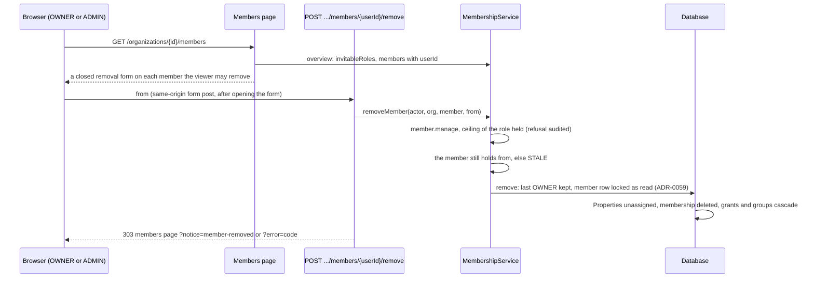

# API Changes — AT-8b

The members page removes another member, within the viewer's ceiling
(ADR-0140). **No migration, permission or audit action.**

## HTTP

### Added: `POST /api/organizations/{organizationId}/members/{userId}/remove`

A form post from the members page. Field: `from`, the role the page showed.

| Answer | When |
| --- | --- |
| `403` JSON `FORBIDDEN` | the `Origin` is not this site; nothing is read |
| `303` to `/login` | signed out, or a sign-in that is not complete |
| `303` to the members page, `notice=member-removed` | removed (`member.removed`, with `unassignedPropertyCount`) |
| `303` to the members page, `error=<code>` | `may-not-remove` (`FORBIDDEN`, audited for a member), `not-a-member` (also an id over 64 characters, refused unread), `last-owner`, `removal-member-changed` (the member no longer holds `from`, or is gone; or `from` is not a role), `removal-failed` |

### Changed: `GET /organizations/{organizationId}/members`

On each other member whose role is among the roles the viewer may invite
with, a closed **Remove…** disclosure (`Remove {email}…`). Opened, it says
what removing does and offers a form with the role shown as a hidden `from`
and a **Remove member** button (`Remove member {email}`). Never on the
viewer's own row. It shows the sentence of each new code.

## Internal API

### Changed: `@app/domain`

| Export | Shape |
| --- | --- |
| `MembershipService.removeMember(actor, organizationId, member, seenRole?)` | new optional `seenRole`: a member holding another role is refused `STALE`, after the ceiling |
| `MembersOverview.invitableRoles` | unchanged; now also the roles whose members the viewer may remove |

### Changed: `apps/web` (`lib/members.ts`)

| Export | Shape |
| --- | --- |
| `removeOrganizationMember(actor, organizationId, memberUserId, { from })` | new: the route's work, a notice or an error code; a failure that is not a refusal logged by its code alone |
| `MEMBERS_NOTICES`, `MEMBERS_ERRORS` | the codes above and their sentences |

## Sequence

