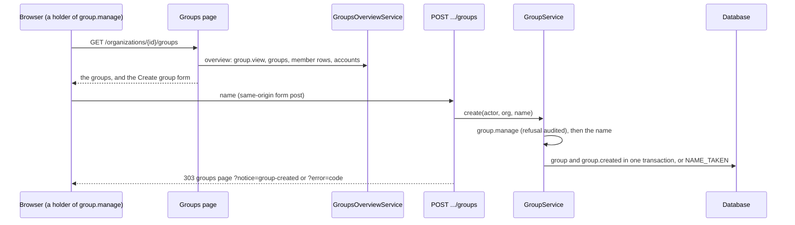

# API Changes — AT-9a

The groups page lists an organization's groups and creates one (ADR-0141).
**No migration, permission or audit action.**

## HTTP

### Added: `GET /organizations/{organizationId}/groups`

For a holder of `group.view`. It shows:
- the groups by name, each with its members (name and role, and the
  address for a viewer who also holds `member.view`) and how many there are;
- for a holder of `group.manage`, a **Create group** form;
- the sentence of each code below.

Anyone else sees "You cannot view this organization's groups." A signed-out
visitor goes to `/login`.

### Added: `POST /api/organizations/{organizationId}/groups`

A form post from the groups page. Field: `name`.

| Answer | When |
| --- | --- |
| `403` JSON `FORBIDDEN` | the `Origin` is not this site; nothing is read |
| `303` to `/login` | signed out, or a sign-in that is not complete |
| `303` to the groups page, `notice=group-created` | created (`group.created`, with the name) |
| `303` to the groups page, `error=<code>` | `group-name` (`INVALID_NAME`, or no field), `group-name-taken` (`NAME_TAKEN`), `may-not-create-group` (`FORBIDDEN`, audited for a member), `create-group-failed` |

### Changed: `GET /`

Each organization's card links **Groups** next to **Members**.

## Internal API

### Added and changed: `@app/domain`

| Export | Shape |
| --- | --- |
| `GroupsOverviewService.overview(actor, organizationId)` | new: `{ groups, mayManage, mayDelete }`, each group `{ id, name, members }`, each member `{ userId, name, email, role }`, `email` `null` without `member.view`; `group.view` to read; reads only |
| `GroupRepository.listMembersByOrganization(organizationId)` | new: every member row of the organization's groups, by group id and then user id, in one read |
| `GroupNameRefusal` | new: `"INVALID_NAME" \| "NAME_TAKEN"` |
| `GroupService.create`, `.rename` | a refused name's `VALIDATION_FAILED` now carries `details.reason`, a `GroupNameRefusal`; a name holding a NUL character is `INVALID_NAME` |

### Added: `apps/web` (`lib/groups.ts`)

| Export | Shape |
| --- | --- |
| `getGroupsOverviewService()` | the overview, on the identity repositories |
| `createGroup(actor, organizationId, { name })` | the route's work, a notice or an error code; a failure that is not a refusal logged by its code alone |
| `GROUPS_NOTICES`, `GROUPS_ERRORS`, `groupsNotice`, `groupsError`, `groupsPage` | the codes above, their sentences, and the page's address with one code |

`ROLE_NAMES` moves from the members page to `lib/role-names.ts`, and the
parsing of a page's code (`codeOf`) to `lib/page-codes.ts`.

## Sequence

