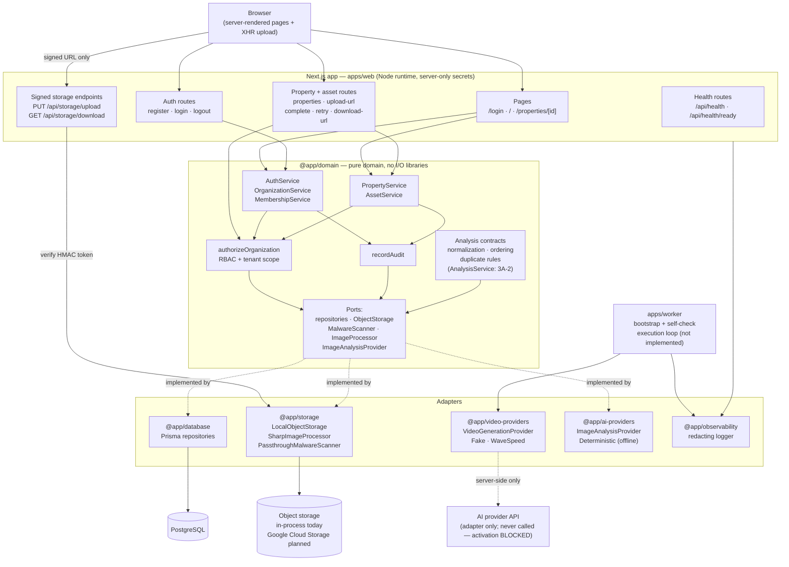

# Architecture Diagram

Version: 1.1 (as implemented through Phase 3A-1)
Status: Describes **implemented** behavior only. Components that do not exist yet
are marked `(not implemented)`.

See `docs/SystemArchitecture.md` for the target architecture and
`docs/decisions/` for the decisions behind this shape.

## Runtime architecture

## Key boundaries

- **Domain never imports an SDK.** `@app/domain` depends only on ports; Prisma,
  sharp, and provider SDKs live in adapter packages.
- **Secrets are server-only.** `DATABASE_URL`, `SESSION_SECRET`,
  `STORAGE_SIGNING_SECRET`, and `WAVESPEED_API_KEY` are read through the
  validated server env and are never referenced from client components. No
  `NEXT_PUBLIC_*` variable exists.
- **The browser never receives a storage key.** It receives only short-lived,
  single-purpose signed URLs.
- **Tenant scope is enforced twice**: repository lookups filter by
  `organizationId`, and `authorizeOrganization` requires a membership (plus a
  permission for writes).

## Phase status of each component

| Component | Status |
| --- | --- |
| `apps/web` pages, auth, property/asset, storage, health routes | Implemented |
| `@app/domain` identity + property/media services | Implemented |
| `@app/database` Prisma repositories | Implemented |
| `@app/storage` object storage, signing, image pipeline, scan hook | Implemented (in-process storage) |
| `@app/video-providers` Fake + WaveSpeed adapters | Implemented; WaveSpeed not invoked |
| `@app/domain` analysis contracts, normalization, ordering/duplicate rules | Implemented (Phase 3A-1) |
| `@app/domain` storyboard module: entities, persistence ports, eligibility, ordering, duration allocation, fingerprint, `CompiledPrompt`, `StoryboardService` | Implemented (Phase 3C) |
| `PromptModerator` port + offline documented-rules default | Implemented (Phase 3C-3, ADR-0014); **no real moderation vendor** |
| `@app/ai-providers` `ImageAnalysisProvider` + deterministic offline adapter | Implemented (Phase 3A-1); **no real vision vendor** (ADR-0009) |
| `AnalysisService`, `AssetAnalysis` persistence | Implemented (Phase 3A-2) |
| **Source-photo analysis review**: `approve` / `reject` on an `AssetAnalysis`, immutable per revision — the `analysis.review` permission, **not** final-video approval, which does not exist (ADR-0052 Decision 2) | Implemented (Phase 3B). Since ADR-0063 each photo is approved on its own: no near-duplicate cluster, primary choice or one-approved-per-group index |
| Human corrections: room override and order priority, separate from the decision | Implemented (Phase 3D, ADR-0015) |
| Analysis review UI, storyboard UI | Implemented (Phases 3B-3, 3C-6, 3D-4b) |
| `@app/domain` generation module: state machine, request identity, immutable request snapshot, capability contract, `GenerationService.startScene` | Implemented (Phases 4A, 4B-1; ADR-0016, 0017, 0018) |
| `@app/domain` `renderPrompt` — the one place a structured `CompiledPrompt` becomes a provider prompt string | Implemented (Phase 4B-2b, ADR-0020); **nothing submits it yet** |
| `@app/video-providers` verified OpenVideo capability descriptor | Implemented (Phase 4B-2a, ADR-0019) |
| `@app/video-providers` `ProviderSubmissionOutcome` + `VideoGenerationSubmissionProvider` | Implemented (Phase 4C-3B-2C-1, ADR-0035); submission reports certainty as a returned value, not an exception |
| `@app/video-providers` fal / MiniMax H3 Max submission adapter | Implemented and **dormant** (Phase 4C-3B-2C-2, ADR-0035 §7); `VIDEO_PROVIDER` refuses `fal`, no fal key in the env schema, no factory branch, zero production callers |
| `@app/domain` scene-delivery + `@app/database` Transaction F — atomic validated Scene delivery (request `DELIVERED`, Scene `READY`, delivered pointer, Job `SCENES_READY`) | Implemented and **dormant** (Phase 4C-3B-2H-3B-6A, ADR-0046); consumes a durable `VALID` media verdict only, nothing constructs or schedules the runner |
| `@app/observability` redacting logger | Implemented |
| `apps/worker` execution loop, generation orchestration | **Not implemented** (Phase 4) |
| `@app/queue` | **Placeholder.** No transport exists: the `QUEUED` generation row is the durable queue (ADR-0024) |
| `@app/domain` deliverable-composition + `@app/database` Transaction I — the durable composition plan (deliverable version, frozen per-scene input rows, Job `COMPOSITION_PENDING`) | Implemented and **dormant** (Phase 5A, ADR-0049); database-only, no runner, no scheduler, no candidate query, and `currentDeliverableVersionId` is never moved. Since DS-3 each version copies its job's disclosure mode, bound into the v2 input fingerprint (ADR-0073) |
| `@app/domain` deliverable-composition-execution + `@app/database` Transactions J1/J2 + the FFmpeg composer, source materializer and first-wins publisher | Implemented and **dormant** (Phase 5B, ADR-0050); the composition profile frozen per work row (v2 since DS-5b-2b-1), no runner constructed, no scheduler, and the deliverable pointer is never moved. Since DS-2 (ADR-0072) the composer and inspector are run on real FFmpeg in CI's `media` job, by tests only. Since DS-5a (ADR-0075) the composer can also encode the Clean Master and lay the disclosure over it, checking the image against its pinned SHA-256 before every run and handing FFmpeg a private copy of those bytes, and no input's tags or chapters reach any file it composes; the runner calls both from DS-5b-2b-1. Since DS-5b-1 (ADR-0076) a Clean Master store keeps the master first-wins under the internal namespace and copies back the stored bytes with their receipt, and an `ffprobe` inspector reads a master's size and frame rate for comparison with the profile, refusing one that asks to be shown turned; nothing constructs either. Since DS-5b-2a (ADR-0077, migration 31) the claim carries the version's disclosure mode and its master's key, Transaction J2 records the master's receipt in the same commit as the video's, and discovery offers only work frozen under the build's profile and planned under a disclosure mode it draws. Since DS-5b-2b-1 (ADR-0078) the runner runs profile v2: it makes the master first, or reuses the stored one, inspects the stored copy, makes the customer's video from it with the version's disclosure, and finalizes with both receipts. Since DS-5b-2b-2 (ADR-0079) Transaction J2 refuses a finalize that names no master, the composer has no encode of the scenes straight into a video, and CI's `media` job runs the runner end to end on real FFmpeg and the real storage adapters, over an in-memory object store and a scripted repository, in a test |
| `@app/domain` disclosure + `assets/disclosure/` + `@app/storage` renderer — the AI-generated disclosure layer v1: the exact text, Mode A's geometry, and six committed transparent images (one per composable size) pinned by SHA-256, rendered by hand from a bundled Noto Sans JP subset | Built (DS-1, ADR-0071). DS-2 lays each image over a real encode in CI (ADR-0072). DS-3 freezes the mode on each job and deliverable version, Mode A only (ADR-0073, migration 29). DS-5a lets the composer lay it over a Clean Master (ADR-0075). Since DS-5b-2b-1 the runner lays it over every video it makes (ADR-0078); **nothing in production runs the runner** |
| `@app/domain` clean-master + `@app/database` `generation_deliverable_clean_masters` + `@app/storage` signing — the Clean Master's record and its internal location, `org/{organizationId}/internal/…`, which no signed URL reaches | Record and refusal built (DS-4, ADR-0074, migration 30); its store built (DS-5b-1, ADR-0076); Transaction J2 writes the record with the video's receipt (DS-5b-2a, ADR-0077); the runner makes and records a master for every video (DS-5b-2b-1, ADR-0078) and J2 records no video without one (DS-5b-2b-2, ADR-0079), and **nothing in production runs it**. The signer refuses an internal key and the verifier ignores a token for one, so the storage routes never serve or accept one |
| `@app/domain` deliverable-validation + `@app/database` Transaction G — the deliverable media verdict and the publication boundary (Job `DELIVERABLE_READY`, `currentDeliverableVersionId`, reservation `CONSUMED`) | Implemented and **dormant** (Phase 5C, ADR-0051); nothing constructs the repository or the runner and no scheduler exists. Since DS-6a (ADR-0080) Transaction G publishes a version only when its composition's frozen profile drew the version's disclosure mode (ADR-0052 Decision 8) and its Clean Master is recorded (Decision 17), and discovery and the claim no longer offer or validate a version it would refuse; the verdict does not yet require the planned size and length (DS-6b). **No final-video human approval is required** — that gate was removed by ADR-0052 Decision 2 |
| `@app/domain` entitlement + `@app/database` Unit entitlement ledger — periods with a frozen plan snapshot, quality-tagged add-on blocks, frozen multi-source reservation allocations; Transaction B funds every reservation, Transaction G spends the frozen set | Implemented and **dormant** (Phase 6A, ADR-0055); no production caller opens a period or grants a block, and no payment is taken |
| `@app/domain` subscription + `@app/database` subscription repository — one subscription per organization (plan, channel, anchor, commercial reference); monthly periods derived from the anchor and opened on demand through the ledger | Implemented (Phase 6B, ADR-0056). Since UP-1 the operator command provisions and the Units page reads; no application code renews, and renewal runs with no scheduler |
| `@app/domain` identity — the six ADR-0052 role templates, the 27-permission matrix, each template's fixed Scope as data, and the role-assignment ceiling on invitation, acceptance, role change and removal, with every refusal audited | Implemented (Phase 6C, ADR-0057). Row Scope, individual grants and groups are **not implemented**: every role reaches every Property of its organization |
| `@app/domain` identity — individual permission grants (`PermissionGrantService`) under the grant ceiling, `OWNER`-only protected authority, effective permissions (template ∪ grants, `property.create` ceiling) in every authorization check and in the web control gates | Implemented and dormant (Phase 6D, ADR-0058): no route or page grants or revokes. Groups and MFA are **not implemented** |
| `@app/domain` identity + `@app/database` identity repositories — each membership change (invitation, acceptance, role change, removal) committed with its audit entry in one transaction; a role change or removal applies only to the role its ceiling saw; taking an `OWNER` away counts the `OWNER`s under a `FOR UPDATE` lock | Implemented and dormant (Phase 6E, ADR-0059): no route or page calls these changes |
| `@app/domain` identity + `@app/database` group repository — groups and group membership (`GroupService`, migration 21): `group.manage` to change, deletion `OWNER`/`ADMIN`-only, membership changes under the role-assignment ceiling, each change committed with its audit entry, organization-bound composite foreign keys | Implemented and dormant (Phase 6F, ADR-0060): no route or page calls it; a group confers no permission and no row access. Group permissions, row Scope and MFA are **not implemented** |
| `@app/domain` identity + `@app/database` group repository — group permissions (migration 22): effective permissions add each group's, never `disclosure.none` or `video.share`; giving or taking a group permission, changing the members of a group that carries any, and deleting it each checked as a direct grant or revocation to every member reached, under a lock on the group row (`FOR UPDATE` / `FOR SHARE`), each committed with its audit entry | Implemented and dormant (Phase 6G, ADR-0061): no route or page gives a group a permission. Row Scope and MFA are **not implemented**: every role reaches every Property of its organization |
| `@app/domain` property + `@app/database` property, group and membership repositories — Property assignment (migration 23): a responsible user and a group per Property, each foreign key carrying the organization; creation-time assignments by creator role; `OWNER`/`ADMIN`-only reassignment by compare-and-set; group deletion and member removal releasing and counting their Properties under a lock on the referenced row; each change committed with its audit entry | Implemented and dormant (Phase 6H, ADR-0062): no route or page assigns a Property. Reach on these assignments is enforced from Phase 6I-1 (below). MFA is **not implemented** |
| Near-duplicate rule removal (migration 24): approval ignores the duplicate group, the one-approved-per-group index is dropped, storyboard selection admits approved look-alikes, and no response or page carries look-alike data | Implemented (ADR-0063, ADR-0052 Decision 14). The perceptual hash and `duplicateGroup` stay, internal only |
| `@app/domain` property + `@app/database` property repository — Property reach: `reachOf` (scope fixed by role; a `MANAGER`'s current groups), `reaches` (the Property's organization and assignments, never `createdBy`), the Property list filtered in the query, and every Property and photo path answering a Property or photo out of reach exactly as one that does not exist, after the permission check and before any state check | Implemented (Phase 6I-1, ADR-0064). Every live organization has only `OWNER` members, so nothing visible changes |
| `@app/domain` analysis + storyboard — Property reach on the content under a Property: starting, refreshing, listing, reading, approving, rejecting and correcting an analysis judge the photo's own Property; creating and listing video projects judge the Property, and composing, reading a storyboard and the freshness check generation admission runs first judge the project's Property; out of reach is answered as the missing row, after the permission and before any state check; a deleted Property takes no new video project and lists none | Implemented (Phase 6I-2, ADR-0064). Every live organization has only `OWNER` members, so nothing visible changes |
| `@app/domain` mfa + `@app/database` MFA repository — authenticator-app MFA and recovery codes (migration 25): TOTP (RFC 6238, one step either side, each code once), the secret sealed with AES-256-GCM under `MFA_SECRET_KEY`, 10 hashed recovery codes, `MfaService` (set up or move to a new authenticator, pass a sign-in, replace the codes, turn off when optional), who must use MFA (`OWNER`, `ADMIN`, `permission.manage`, `billing.manage` from any source), five wrong codes end the sign-in, each change committed with its audit entry | Implemented (MFA-1, ADR-0065). Used by the web app from MFA-2 (next row); the worker never calls it |
| `apps/web` — the two-step sign-in and the security page: `getCurrentUser()` returns a user only once the sign-in has passed MFA (`mfaSignInStep`), the code page `/login/mfa` and `POST /api/auth/mfa`, the page `/security` and `POST /api/mfa/setup`, `/setup/confirm`, `/recovery-codes` and `/disable`, each `no-store`; the set-up QR code drawn on the server; without `MFA_SECRET_KEY` MFA fails closed | Implemented (MFA-2, ADR-0065 Decisions 12 to 14) |
| `apps/web` — mandatory MFA: a sign-in whose user must use MFA (`isMfaRequired`) and has none is `SETUP_REQUIRED`, signed in nowhere; it reaches only `/security` in its set-up-first form, `POST /api/mfa/setup` and `/setup/confirm` (`mfaRoute`'s `duringSetup`) and sign-out; `nextPageFor(step)` sends each step to its page; the readiness probe's `mfa` check reports whether `MFA_SECRET_KEY` is set | Implemented (MFA-3, ADR-0065 Decisions 15 to 17). No grace period |
| `@app/domain` identity + `@app/database` organization repository + `apps/web` — an organization's requirement for all members (migration 26): `organizations.mfaRequired` adds every member to who must use MFA; changed only by an `OWNER` or `ADMIN`, by role, through `POST /api/organizations/{id}/mfa-requirement` and the dashboard button; refusals audited; each change committed with its audit entry, by compare-and-set on the value and under a `FOR SHARE` lock on the actor's membership | Implemented (MFA-4, ADR-0065 Decisions 18 and 19). Off for every organization until turned on |
| `apps/ops` — the operator command `provision-subscription`: gives an organization the `SALES_ASSISTED` subscription its contract names (`sub_<organization id>`), the operator and the reason in the audit entry; its own package, which neither application depends on | Implemented (UP-1, ADR-0066 Decisions 1 and 2). The only application code that provisions a subscription |
| `@app/domain` entitlement + `apps/web` — the Units overview (`UnitsOverviewService`) and the page `/organizations/{id}/units`, linked from the dashboard: the plan, the period, the Base Units left and how many can fund HQ, each add-on block, withdrawn if its purchase was cancelled, and with `billing.view` how the plan is paid and the period's purchases with their approvers and any cancellation; read only, opening no period | Implemented (UP-1, ADR-0066 Decision 3; the purchases since UP-4, ADR-0069 Decision 1; cancellations since UP-5, ADR-0070 Decision 7) |
| `@app/domain` entitlement + `@app/database` Unit purchase repository — the approved package prices in the catalog; `UnitPurchaseService` approving one package for a `billing.manage` holder, idempotent by the confirmation step's key; the purchase (`unit_purchases`, migration 27), its block and both audit entries written in one transaction under the period's cost-admission lock, with the price, the period and the approver's permission re-checked there; refusals audited | Implemented (UP-2, ADR-0067). Since UP-3 the purchase route is its only caller |
| `apps/web` — the purchase screen `/organizations/{id}/units/buy` and its confirmation step, for a `billing.manage` holder, offering what `UnitPurchaseService.offers` decides with the same check a purchase is written under; `POST /api/organizations/{id}/unit-purchases`, refusing a post whose `Origin` is not this host before anything is read, then approving through the service; the Units page links to the screen for a `billing.manage` holder | Implemented (UP-3, ADR-0068). Invoice-paid Standard and Premium only: Enterprise is through sales, card payment is not built |
| `apps/ops` + `@app/database` invoicing repository — the operator command `export-unit-purchases`: the invoice-paid purchases approved in a half-open window that ended at least ten minutes ago, read under a lock that waits for purchases still being recorded, by organization, contract and approval, written to a new CSV file with spreadsheet formulas neutralised; each organization listed audited `unit_purchase.exported` in the same transaction as the read | Implemented (UP-4, ADR-0069 Decisions 2 to 6). Card-paid purchases are never listed |
| `apps/ops` + `@app/database` cancellation repository — the operator command `cancel-unit-purchase`: shows a purchase and its usage, and only with `--confirm` cancels it (`unit_purchase_cancellations`, migration 28, one per purchase, recording whose mistake it was: VTaVision's whenever it is found, the customer's only within 10 hours of approval with no Unit used), audited `unit_purchase.cancelled`, in one transaction under the period's cost-admission lock; a block whose purchase is cancelled is withdrawn, funding no new reservation; the export marks it cancelled with nothing to invoice | Implemented (UP-5, ADR-0070). Invoice-paid purchases only |
| Billing, Stripe, card checkout, cancellation and plan changes, overage purchase | **Not implemented** (later Phase 6 packages). The unit consume is an entitlement-ledger fact, not a charge |
