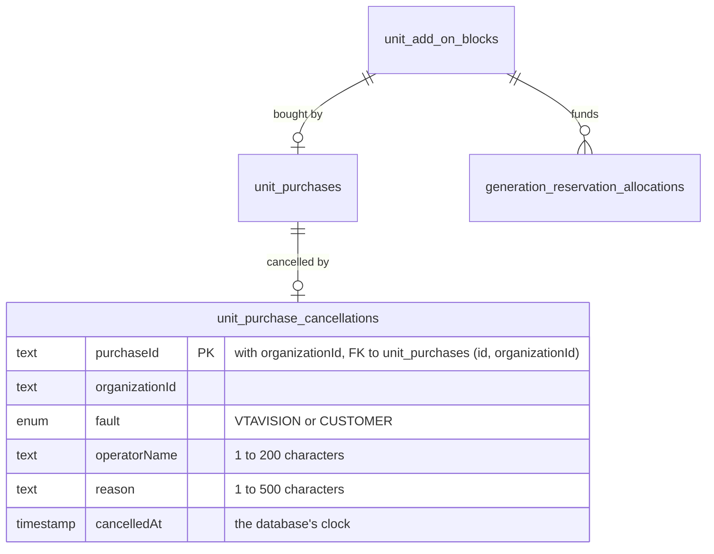

# ADR-0070 — Cancelling a mistaken Unit purchase

Status: Accepted (UP-5, 2026-10-19).
Implements: the product owner's decision of 2026-10-19 on correcting a purchase
made in error, as revised the same day, recorded in
`/mnt/project-files/cto/unit-purchase-correction-proposal.md`. **Only
VTaVision's own mistake is free**: such a purchase is cancelled whenever it is
found, its unused Units are withdrawn, its used Units stay used, and it is not
invoiced, used Units included. **A purchase the customer made by mistake is
charged**, unless it is cancelled within 10 hours of its approval with none of
its Units used; then it is withdrawn whole and not invoiced. An operator judges
whose mistake it was.
Supersedes in part: ADR-0069 Decision 7, its first bullet (a purchase made in
error could not be corrected, and the recommendation to leave its Units in
place).
Builds on: ADR-0067 (the purchase record), ADR-0069 (the invoicing export),
ADR-0066 (the operator command pattern) and ADR-0055 (the Unit ledger).

## Context

After UP-4, a purchase approved by mistake is invoiced like any other, and its
Units stay usable. Nothing in the product can say otherwise: the purchase
record is never rewritten (ADR-0067 Decision 2), and an export lists it again
whenever its window is exported. The product owner decided how such a purchase
is corrected, first:

- *VTaVision側でのミスは考えずらい。当社がミスをして追加をしてしまったら、使用していない場合は、没収。使用をしている場合は、そのまま。追加の請求もしない。*
- On the decision card, **両方**: the same rule for the customer's mistakes as
  for VTaVision's, an operator deciding each case.

and then, the same day, replacing the second point:

- *当社のミスのみ無償にします。お客様側のミスは基本的に費用発生。発注後10時間以内＋未使用であれば返金可能にします。*

So VTaVision's own mistake withdraws what is unused, keeps what was used, and
invoices nothing for the purchase. The customer's mistake is paid for, except
for a purchase caught within 10 hours of its approval before any of it was
used, which is withdrawn and not invoiced.

This leaves ADR-0053 Decision 3A as it is. Cancelling a subscription still
refunds no purchased Units, and a customer's choice to cancel is still not a
refund event. For VTaVision's own mistake a cancellation here is the
correction of a billing error that Decision 3A keeps possible; for the
customer's, it is the narrow refund the product owner allowed, and nothing
wider.

---

## Decision 1 — An operator cancels, with a confirmation step

```bash
pnpm --filter @app/ops cancel-unit-purchase \
  --purchase upur_... --fault customer \
  --operator "Your name" --reason "Bought by mistake, as the customer wrote on 2026-10-19"
```

- **Without `--confirm` it writes nothing.** It shows the purchase: the
  organization (its name printed as a quoted string, control characters
  escaped), the package, the price excluding tax, the contract, when it was
  approved and when it expires, and how its Units stand: delivered, still
  generating and unused. It says what cancelling would do and that it cannot
  be undone, or why it would be refused.
- **With `--confirm` it cancels**, and says what was withdrawn, kept and left
  to finish.
- **Every other option is required**, as with the other operator commands
  (ADR-0066 Decision 1): the purchase id from the CSV or the support request,
  whose mistake it was (`--fault vtavision` or `--fault customer`, Decision 3),
  the operator's name (up to 200 characters) and the reason (up to 500).
- Exit codes: 0 shown, cancelled or already cancelled; 1 refused; 2 unusable
  arguments.

Only an operator cancels: the command runs with the database credentials of
whoever runs it, which is the privilege, and neither application can reach it.
A customer who bought by mistake asks VTaVision, and the operator judges the
case. Reading one purchase to show it is not audited, as the provisioning
command's reading of an existing subscription is not; the cancellation is.

## Decision 2 — What a cancellation is

`unit_purchase_cancellations` (migration 28) holds one row per cancelled
purchase: the purchase, its organization, whose mistake it was, the operator's
name, the reason and when it was cancelled.

- **One per purchase.** The purchase id is the key; a second cancellation finds
  the first and writes nothing.
- **Inside the purchase's organization**, by a composite foreign key to
  `unit_purchases` (`id`, `organizationId`), which needs a unique index on that
  pair. `RESTRICT`: a cancelled purchase cannot be deleted.
- **Whole purchases only.** There is no partial cancellation, credit or
  refund amount, and no undo.
- **The purchase and its block are never changed.** The purchase stays the
  record of what was approved (ADR-0067 Decision 2), and the block keeps its
  quantity; withdrawing is how the ledger reads the cancellation (Decision 4).
- **No count of Units is stored.** How many were delivered, still generating
  and withdrawn at the moment of cancelling is in the audit entry (Decision 6).
  The ledger derives what remains from allocations alone and stores no count
  (ADR-0055); the cancellation does not start one.
- **Stamped with the database's clock** when the cancelling transaction
  started, the same reading the customer's refund window is checked against
  (Decision 3), not the clock of the machine that ran the command.
- **A refusal writes nothing.** No row records a cancellation that was refused.

A card-paid purchase is refused: its payment processor charged it, so not
invoicing it would refund nothing. None exists while card payment is not built.



## Decision 3 — Whose mistake it was

The operator judges whose mistake the purchase was and says so with
`--fault`. The cancellation and its audit entry record it.

| | `vtavision` | `customer` |
| --- | --- | --- |
| When | whenever it is found | within 10 hours of its approval |
| Units used | any: delivered ones stay used | none: nothing delivered and nothing still generating |
| Withdrawn | the unused Units | all of them |
| Invoiced | nothing, used Units included | nothing |
| Otherwise | — | refused: invoiced as bought, its Units still usable |

- **The 10 hours run from the purchase's approval**, the moment its
  `billing.manage` holder ordered it, to the moment the operator cancels it, by
  the database's clock. Exactly 10 hours is still inside. They do not run to
  when the customer asked: the command cannot know that, and the operator
  cancels while the window is open.
- **"Unused" means no Unit of it delivered and none held by a generation still
  running.** A generation that failed and released its Units used nothing. A
  purchase partly used is not refunded at all: the rule refunds an unused
  purchase, not the unused part of one.
- **Both are decided in the cancelling transaction**, on the usage and the
  clock read under the period's lock (Decision 5), so no generation can start
  using the Units between the check and the cancellation. The preview without
  `--confirm` applies the same rule to what it read, and shows the deadline.
- **Past the window comes first.** A purchase both late and used is refused as
  late.

## Decision 4 — The unused Units are withdrawn

**A block whose purchase is cancelled is withdrawn: it funds no new
reservation.** The ledger's balance gives a withdrawn block 0 remaining, so the
eligibility-first plan passes over it to the next eligible block, oldest first,
or refuses the reservation if nothing else can fund it (ADR-0053 Decision 3).
Passing over it is not a FIFO violation: it was never eligible.

- **Generations it already funded settle as they would have.** Their
  allocations are frozen on their reservations (ADR-0055), so one delivered
  consumes its Units from the block as before, and the customer keeps the
  video. Only VTaVision's own mistake can be cancelled with generations
  running (Decision 3).
- **Units a failed one releases are not returned.** A withdrawn block has 0
  remaining whatever its allocations, so a release after the cancellation frees
  nothing to spend. It is withdrawn with the rest: unused Units are withdrawn.
- **Nothing else is touched**: Base Units, the HQ ceiling and every other block
  are as they were.

The balance every reservation plans against (`loadPeriodBalance`) reads each
block's purchase and whether it is cancelled, in the same read as the blocks.

## Decision 5 — One transaction, under the period's lock

The cancellation and its audit entry are written in one transaction that takes
the purchase's period's cost-admission lock first, as a purchase and a
reservation do (ADR-0067 Decision 4):

```text
cost-admission advisory lock -> the purchase, its block's allocations and now() -> inserts
```

- A reservation admitted before the cancellation commits is counted as in
  flight, and keeps its funding; for the customer's mistake it makes the
  purchase used, and the cancellation is refused.
- A reservation admitted after it plans against a balance that reads the
  cancellation, and cannot draw on the block.
- Two cancellations of one purchase are ordered, and the second finds the
  first.

The purchase is located before the lock only to name the lock's key: a
purchase never changes period, and nothing is decided on that read.

## Decision 6 — The audit

One `unit_purchase.cancelled` entry on the purchase, in the cancelling
transaction:

- no actor user, because the operator is not a member;
- whose mistake it was, and the operator's name and the reason, trimmed;
- the package, the price excluding tax, the contract and when it was approved;
- `unitsConsumed`, `unitsInFlight` and `unitsWithdrawn` at that moment.

A refusal is not audited: nothing changed.

## Decision 7 — Not invoiced

**A cancelled purchase is not invoiced, used Units included.**

- **The export** (ADR-0069) still lists a cancelled purchase approved in its
  window, so a window exported again reconciles with an earlier export. Two
  columns are added at the end: `cancelled_at`, in Japan time or empty, and
  `to_invoice_yen_ex_tax`, the price excluding tax or 0 once cancelled. The
  command's total counts `to_invoice_yen_ex_tax` and says how many cancelled
  purchases it left out. Each export audit entry adds `cancelled` and
  `toInvoiceYenExTax` beside its count and total.
- **A purchase already invoiced** is refunded or offset by hand: the product
  has no payment integration. The command says so when it cancels.

## Decision 8 — What the customer sees

On the Units page:

- each add-on block withdrawn this way reads "withdrawn, purchase cancelled"
  instead of what is left, for every `unit.view` holder, and counts 0 towards
  what is left of its quality;
- for a `billing.view` holder, the purchase's line in "Purchases this period"
  adds "cancelled by VTaVision on" its date, and "not invoiced". The card says
  a cancelled purchase is not invoiced and its unused Units are withdrawn.

The customer is told of the cancellation, or of its refusal, by whoever
handled the request; the product sends no message. The purchase screen does
not mention the 10-hour window; how customers learn of it is the product
owner's decision.

---

## Decision 9 — What stays out

- **A customer cancelling its own purchase.** The operator judges each case.
- **Partial cancellation, credits and refunds of an amount.** A cancellation
  covers the whole purchase.
- **Undoing a cancellation.** A purchase cancelled by mistake is bought again.
- **Automatic refunds and card payment.**
- **Cancelling a subscription**, which is a different decision (ADR-0053
  Decision 3A).

## Consequences

- A purchase VTaVision made by mistake stops funding new videos at once,
  keeps the videos it already funded, and is not invoiced.
- A purchase the customer made by mistake is refunded only when caught within
  10 hours and before any of it was used; otherwise it is paid for, and its
  Units stay usable.
- The export shows which purchases in a window were cancelled, so an invoice
  can be corrected from the file.
- The ledger stays derived: one fact, the cancellation, decides what a block
  can still fund.

Paid Provider Activation, production Provider credentials, production paid AI
calls, production scheduler activation and live Stripe charges remain BLOCKED.
Nothing here touches them.
