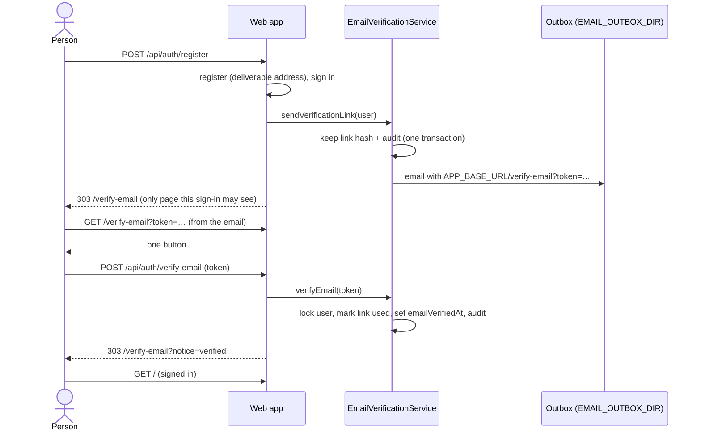

# ADR-0129 — Email verification is required

Status: Accepted (AT-3b, 2026-11-09). Second half of the accounts-and-team
plan's AT-3, which the product owner approved on 2026-11-09
(`/mnt/project-files/cto/accounts-team-proposal.md`, default 2: an unverified
account can sign in but sees only the verify page; its link lasts 24 hours).
Completes ADR-0052 Decision 18's mandatory email verification. Builds on:
ADR-0126 (the email port and the development outbox), ADR-0128 (the links and
the service that sends and checks them), ADR-0065 Decisions 12 and 15 (the
sign-in steps).

## Context

AT-3a recorded whether an address is verified and built a service that mails a
one-time link and checks it, used by nothing. Sign-up still signed the person
in at once, and nothing asked for verification.

---

## Decision 1 — Verifying the address is a sign-in step

A sign-in goes through its steps in this order:

1. **The MFA code**, for a user with MFA on (ADR-0065 Decision 12). A sign-in
   that owes a code has proven only the password, so it may not even ask for a
   verification email.
2. **The email address** (`EMAIL_VERIFICATION_REQUIRED`), while
   `users.emailVerifiedAt` is null.
3. **MFA set-up**, for a user who must use MFA and has none (ADR-0065
   Decision 15).
4. **Signed in.**

`signInStep` (`@app/domain`) answers the step; the web app's session gate
(`lib/auth.ts`) asks it on every request, so a change applies from the next
one. A sign-in at step 2 is not signed in: every page and route that needs a
user refuses it, as for the other steps. Such a page sends it to the sign-in
page, which, like the code and security pages, sends it on to the verify page;
a route refuses it as it refuses no sign-in, and the MFA routes answer 401.
Only the verify page, its resend route and sign-out serve it.

The plan says an unverified account sees only the verify page, so the address
comes before MFA set-up, which is another page.

## Decision 2 — Sign-up mails the link

Sign-up refuses an address no email can be sent to (`isDeliverableEmailAddress`,
ADR-0126), with `VALIDATION_FAILED` "Enter an email address that can receive
email", before anything is written. Such an account could never be verified.

Otherwise sign-up creates the account and signs it in as before, then mails a
verification link and goes to the verify page. A link that was not sent does
not undo the account: the verify page says the email could not be sent and
sends another on request. The failure is logged by its error code and the
user's id alone, never the address, the link or the message.

## Decision 3 — Opening a link takes one press

The link opens `/verify-email?token=…`, which shows one button. Pressing it
posts the token to `POST /api/auth/verify-email`, which verifies the address
(ADR-0128 Decision 4) and returns to the verify page, saying it is verified or
that the link does not work. A mail scanner that fetches the link therefore
verifies nothing. No sign-in is needed, so the link can be opened on another
device.

- A token longer than 128 characters is refused before it is hashed or looked
  up, by the page and by `verifyEmail`. A mailed one is 43.
- Every link that verifies nothing gets the same answer (ADR-0128 Decision 4).
- The page's address holds the token, so requests from the page carry at
  most its origin, never its path or query
  (`<meta name="referrer" content="strict-origin">`). Not `no-referrer`, which
  would also make the page's own forms post `Origin: null`.
- The page tells someone who did not create an account with the address to
  close it (see Consequences).
- The page shows only notices it knows by code (`?notice=sent`, `not-sent`,
  `invalid`, `verified`), never text the address carries.

## Decision 4 — Sending the link again

The verify page names the address and has a button that mails a new link,
`POST /api/auth/verify-email/resend`. It serves only a sign-in at step 2;
another sign-in is sent where it belongs, and no sign-in to the sign-in page.
An earlier link keeps working until it is used or expires (ADR-0128
Decision 3). How often it may be asked is rate limiting, still out of scope and
listed in `docs/decisions/TODO.md`.

## Decision 5 — Where links start and where email goes

Every emailed link starts with `APP_BASE_URL`, never a request's `Host`
header: an http(s) origin with no user, path, query or fragment, and https in
production. It is optional in the schema because the worker shares it and
emails nothing.

Email goes to the development outbox in `EMAIL_OUTBOX_DIR` (ADR-0126). Without
the outbox or the base address, sending fails with `CONFIGURATION_ERROR`
before a link is made, so no link is recorded that no email carries. Opening a
link needs neither.

Production has no email service yet, and the outbox is refused there, so no
account could be verified in production. Choosing the service is already a
pre-launch decision in `docs/decisions/TODO.md`; it now blocks launch.

## Decision 6 — Accounts that already exist

Every account made before migration 33 reads as unverified (ADR-0128
Decision 1) and meets the verify page at its next sign-in. **No production
database holds users:** ADR-0054 Decision 7's gates are all still BLOCKED,
`infra/` holds no deployment, and ADR-0126 Decision 3 records production as
not running. Development and CI accounts verify through the outbox
(`docs/local-setup.md`, section 3c), except one whose address no email can
reach, which sign-up accepted before AT-3b: it can never be sent a link and
must be made again.

## Sequence

## Consequences

- Sign-up, sign-in and every page now require a verified address. The browser
  tests open the link from the outbox; the unit and route tests of signed-in
  pages mark their users verified (`markEmailVerified`).
- Signing up writes the user, the password and `user.registered` in separate
  steps, as before. Making it one transaction stays in
  `docs/decisions/TODO.md`.
- Someone can still sign up with another person's address. Since opening a
  link needs no sign-in, the address's owner verifies that account if they
  press the button in its email; the email and the page tell them not to
  unless they created the account. Password reset (AT-4) is how they take it
  back, recorded in `docs/decisions/TODO.md`.
- **No migration**, permission or audit action. Two routes and one page.
