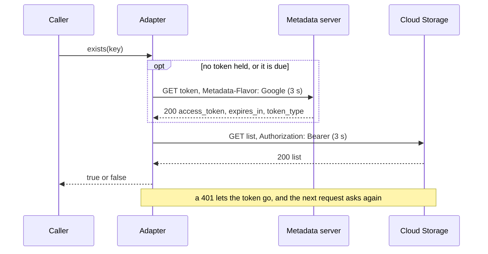

# ADR-0158 — Google Cloud Storage: the credential, and connections of its own

Status: Accepted (RD-3c, 2026-11-18). The third part of the third milestone
of production readiness, part 1, which the product owner approved on
2026-11-16 (`/mnt/project-files/cto/production-readiness-proposal.md`). It
gives the Google Cloud Storage adapter the token Google's store asks for,
and sends every request it makes straight to its origin. Nothing constructs
the adapter yet.

Builds on: ADR-0153 Decision 1 (a client's own limit is set without asking,
under the product owner's answer of 2026-11-16), ADR-0156 (the adapter, its
client and its codes), ADR-0157 (the streamed read).

## Context

Google's store takes a request only with an OAuth 2.0 bearer token. On Cloud
Run, the process's service account has one from the metadata server: a `GET`
of `http://metadata.google.internal` and the path
`/computeMetadata/v1/instance/service-accounts/default/token`, with
`Metadata-Flavor: Google`, answers `{access_token, expires_in, token_type}`.
Google documents that the server keeps a token, and hands it back, until
five minutes of it remain; that more than 50 requests a second for tokens it
cannot keep may be limited; and that it routinely answers `429` and `503`.
RD-3 ruled out Google's own libraries (ADR-0156 Decision 1), so the token is
asked for over gaxios, as the store is.

Five investigations measured the token, proxies, the web app's wiring, the
production build and the records, and a sixth checked the others against
each other and the sources. What decides this record:

- gaxios sends a request through the proxy a variable names, and its
  `noProxy` keeps out only the proxy agent gaxios adds itself. With Node.js
  22's own switch, `NODE_USE_ENV_PROXY=1`, a request so marked went to the
  proxy all the same, in clear for an `http` origin such as the metadata
  server's, and the proxy's `502` read as the origin's answer. A request
  given an HTTP agent of its own went straight to its origin in every case
  measured, the switch on or off.
- In a production build, node-fetch's error for an aborted request is named
  after its minified class (`P`), so ADR-0156's reading of a timeout by the
  error's name logged it `STORAGE_UNREACHABLE`. Its `type` stays `aborted`.
- A client that renews more than five minutes before a token's end is handed
  the same token while the server still holds it, and asks again on every
  request: simulated over two hours at a request a second, a margin of 600
  seconds made 603 to 605 token requests, 240 seconds 3.
- The whole of RD-3c as planned measured 1,150 to 1,700 changed lines.

## Decision 1 — The token, from the metadata server

The token is asked for at `http://metadata.google.internal`, the form Cloud
Run's documentation gives, with that path and `Metadata-Flavor: Google`.
Google's own Node.js client also tries the address `169.254.169.254` and the
name with a trailing dot; neither is used. Whether a lookup of the name
passes through search domains first on Cloud Run is a check for the first
deployment. The adapter reads nothing from the environment: not
`GCE_METADATA_HOST`, not `GOOGLE_APPLICATION_CREDENTIALS`, not
`STORAGE_EMULATOR_HOST`, nor any other variable.

An answer is a token only when it is `200`; says `Metadata-Flavor: Google`,
which something else answering, such as a proxy, does not; is a JSON object;
names `token_type` `bearer`, in any case (RFC 6749 §5.1); names `expires_in`
as a positive safe integer; and names an `access_token` that is an RFC 6750
b64token, so nothing a header could be split by. A redirect is no token and
is never followed. Anything else is no token.

## Decision 2 — Google's store alone is sent it

The adapter decides from its own origin. A token is sent only when the
endpoint's origin is exactly `https://storage.googleapis.com`, however its
case or a `:443` is written. No option passes a credential or a token
source, so nothing that builds the adapter can hand a token to another
origin. `http`, a trailing dot, another port, another host, Google's
regional endpoints and Private Service Connect's are sent none; such a store
would answer `401`, `STORAGE_FORBIDDEN`. Regional endpoints stay open
(`docs/decisions/TODO.md`).

Nothing is sent to Google's store without a token. When none can be had, the
request fails with `STORAGE_CREDENTIAL_UNAVAILABLE`, one code for every way:
a failed or silent request, a status, an answer that is not a token.
Google's own `@google-cloud/storage` sent such a request with no credential
(measured in RD-3). A signed link asks nothing, and needs no token.

## Decision 3 — When it is asked for, and how long it is kept

- **When a request needs it.** The token is asked for by the first request
  to the store, not at start: the start check loads no adapter (ADR-0151).
  Readiness's question will ask for it as any other (RD-3d).
- **Once for all who wait.** One request at a time: a request that needs the
  token while it is being asked for waits for the same answer.
- **Kept by the clock.** From when it was asked for, against the adapter's
  `now()`, the clock by default: it is asked for again
  `GOOGLE_CLOUD_STORAGE_TOKEN_MARGIN_MS` (240,000 ms) before its end, under
  the five minutes in which the server hands back the token it holds. A
  token that lives less than twice that is asked for again at half its life,
  so a short-lived token does not cost a request to the metadata server for
  each request to the store.
- **A failed renewal.** The request that finds the token due waits for the
  new one. If none comes and the held token has not reached its end, the
  held token is sent; after its end, none is. So a `429` or `503` at a
  renewal fails no request while the old token lasts. No renewal is left
  running after the request that asked for it: nothing repeats, schedules or
  runs in the background.
- **Nothing kept from a failure, nothing retried.** The next request asks
  again. A retry would need a wait written in the repository's code, which
  the product owner's rule puts to them first; it is recorded as open.

## Decision 4 — How long the token is waited for

The token's request is given `GOOGLE_CLOUD_STORAGE_CREDENTIAL_LIMIT_MS`,
3,000 milliseconds of gaxios's own `timeout`: a client's own limit on one
request, set without asking under the product owner's answer of 2026-11-16
(ADR-0153 Decision 1). It has a constant of its own, so a change to
ADR-0156's question limit does not move it. Every request that waits for it
is bounded by that one request: twenty that waited on a silent metadata
server ended together at 3.0 seconds, having asked once.

So a question to Google's store, `exists` or the list after a `404`, waits
at most two such limits, about six seconds, when a token must be asked for,
and three seconds otherwise. A put, a delete, a whole object's read and a
streamed read's bytes wait at most three seconds for their token, then as
before (ADR-0156, ADR-0157).

## Decision 5 — A 401 lets the token go

A `401` from the store lets go of the token that request carried, if it is
still the one held, so the next request asks for another. The request itself
fails with `STORAGE_FORBIDDEN`, as before, and is not sent again. A `403`
answers what a valid token may not do, and keeps it. This also heals a token
kept too long after the process's clock moved back.

## Decision 6 — Connections of its own, and no proxy

Every request the adapter makes, to the store and for the token, is sent on
an HTTP agent of the adapter's own, one for each protocol, made once in the
process with the options Node.js 22 gives its global agents: `keepAlive:
true`, `scheduling: "lifo"`, `timeout: 5000`.

- **No proxy.** Given an agent, gaxios adds no proxy agent, and Node.js's
  own proxy switch (`NODE_USE_ENV_PROXY`, `--use-env-proxy`) changes only
  its global agents. So no variable can send the token, or the customers'
  objects, elsewhere. The proxy agent and `debug` are never loaded for these
  requests, so ADR-0156's `DEBUG` that writes a proxy's password does not
  reach them. Node.js's own `NODE_DEBUG` still does: naming `https`, or
  `net` for an `http` origin, it writes each new connection's request, its
  `Authorization` header and the object's path included, to the process's
  error output (measured in review). Production must not set it; recorded
  as open, for RD-3d's start check.
- **The idle limit.** `timeout: 5000` lets a pooled connection go once it
  has been idle for five seconds; it ends no request. It is the agent's own
  setting, a limit that ends one connection, which the product owner's
  answer of 2026-11-16 puts outside the rule on timers. It is what Node.js's
  global agent did to these connections until now: measured, 5.0 seconds for
  both. Without it, a connection would be kept until Google closed it, and a
  request written onto it as it closed would fail, with no retry.
- **Proxy variables are not refused at start.** A refusal would forbid a
  proxy to every other client of the process, and would not see Node.js's
  switch, a variable set later, or a start the check does not see
  (ADR-0154). A deployment that means a proxy cannot send storage through
  it: it fails with the transport's code or `STORAGE_TIMEOUT`. Recorded as
  open.
- **What it costs.** The adapter's connections leave Node.js's shared pool,
  and are shared by every adapter in the process. ADR-0157 Decision 4 named
  such an agent as the way to a limit on the headers of a read's bytes; that
  limit is still not set.

## Decision 7 — A production build's timeout

The code of a failed request also reads node-fetch's `type: "aborted"`,
which a production build does not rename, so a limit that ends a request is
`STORAGE_TIMEOUT` in the build as under test. The adapter is not in a build
until it is wired in; RD-3d proves this in one.

## Decision 8 — The split, and where it stands

RD-3 planned one part, RD-3c, for the credential and the web app's wiring
together, under this record's number. Measured at 1,150 to 1,700 changed
lines, it is split, as RD-2 was:

- RD-3c, this record: the adapter's credential and connections.
- RD-3d (ADR-0159): the web app's settings, choice, start check, readiness
  label, the production build with gaxios, and the production endpoint
  rule's settings half. Its plan: no endpoint setting in production, where
  Google's origin and the metadata server's name are constants; outside
  production, a bucket needs an endpoint, so development never asks Google
  or a metadata server.

The credential comes first, so the wiring never offers an adapter that
cannot authenticate. ADR-0156 and ADR-0157 are records and are not
rewritten: where they say RD-3c wires the adapter in, RD-3d does.

- Nothing in either application constructs the adapter. The test that holds
  this now also holds that the token and the connections are made only
  inside the adapter's folder, that the subpath exports neither, and that
  nothing in the folder reads the environment.
- `GoogleCloudStorageError` gains `STORAGE_CREDENTIAL_UNAVAILABLE`, and
  `STORAGE_TIMEOUT` now also names a timeout in a production build.
- The subpath's exports are unchanged.

## What was measured

- **The stand-in suite**, 52 tests, 13 of them new. The token: asked for
  once, at the path, with `Metadata-Flavor: Google` and no credential; kept
  until the margin, counted from when it was asked for, then asked again; a
  token of 300 seconds kept for half its life, and one of 600 seconds until
  the margin; each of twenty answers that are not a token refused and not
  kept, a `203` and a redirect to a token among them, the redirect not
  followed;
  twenty waiters on a silent metadata server ending at 3.0 seconds with one
  request; fifty waiters sharing one answer; a due token sent while it lasts
  when its renewal fails, and never after its end or once let go; only the
  token named let go. Google's store, answered by the test in its place with
  nothing sent: every request carries the token, asked for once on the
  store's own client, and signing asks nothing; the origin's spellings that
  are Google's and five that are not; a `401` to a put, a read, a streamed
  read's bytes, a delete or a list letting go, a `403` keeping; no token,
  nothing sent and nothing named. A production build's renamed abort read as
  `STORAGE_TIMEOUT`, as itself and as a cause.
- **No proxy, no global agent.** Every test of the suite runs with the four
  proxy variables naming a proxy that records what reaches it, which saw
  nothing. The adapter's requests and the token's are made on its own
  agents, for `http` and for `https`, never on Node.js's global ones, and
  the two have the global agents' options, less a proxy. A request to
  anywhere but this machine fails the test unsent.
- **The emulator suite**, 15 tests, with the proxy variables naming a proxy
  that is not there; the connections it counts are now the adapter's own.
- **By name, over TLS.** The adapter, unchanged, in a network namespace that
  holds loopback alone, whose `/etc/hosts` names `storage.googleapis.com`
  and `metadata.google.internal` `127.0.0.1`: the emulator served `https` on
  port 443 with a test certificate the process trusted through
  `NODE_EXTRA_CA_CERTS`, and a stand-in metadata server answered on port 80.
  A put of 3 MiB, `exists`, a ranged read, a whole read and a delete were
  right, and the token was asked for once, with `Metadata-Flavor: Google`
  and no credential. The same with `NODE_USE_ENV_PROXY=1` and the four
  variables naming a recording proxy: the proxy saw nothing; against the
  emulator over `http` likewise; two rounds each. With the agent taken off
  each request, as a control, the proxy saw 8 `CONNECT`s against the `http`
  emulator, and the token's request went to it, so the run's first request,
  the put, failed with `STORAGE_CREDENTIAL_UNAVAILABLE`. A connection past
  the namespace failed `ENETUNREACH`. Records:
  `/mnt/project-files/cto/rd-3/rd-3c-measured.md`.

## What cannot be shown here

What Google answers is not measured: the token's real lifetime and scopes on
Cloud Run (`devstorage.read_write` or `cloud-platform`); a `401` once a
token has ended; whether a token that ends during a long upload or read cuts
it; the metadata server's name on Cloud Run's resolver; anything over TLS to
Google. They are checks for the first deployment (`docs/decisions/TODO.md`).

## Consequences

- No production behaviour changes: nothing constructs the adapter, and no
  migration is added.
- An instance asks the metadata server once for each token's life less the
  margin, about 56 minutes for a token of an hour, and again after a `401`.
- Not applicable: the change log and release notes, which no RD milestone
  writes (RD-11 reports); the entity-relationship diagram, since no schema
  changes; a phase completion report and tag, which this plan does not have.
- Nothing is activated: no timer, loop or schedule, no paid call, no
  production credential, no deploy, no Google account.
