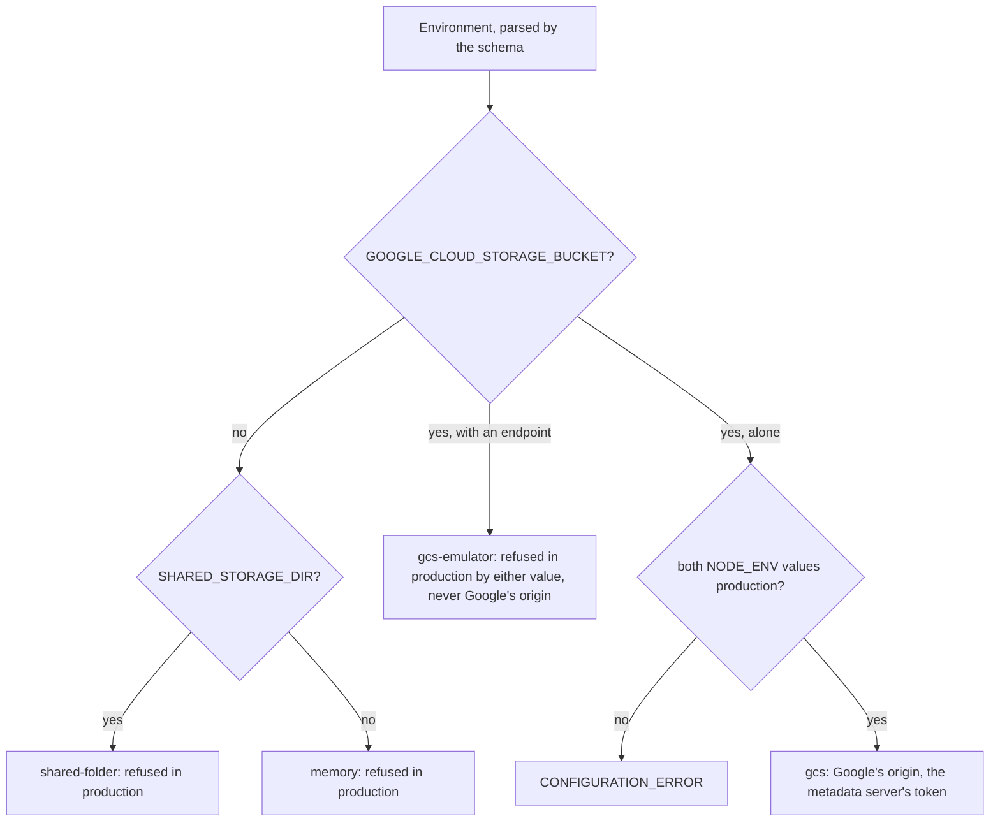

# ADR-0159 — Google Cloud Storage in the web app

Status: Accepted (RD-3d, 2026-11-18). The fourth and last part of the third
milestone of production readiness, part 1, which the product owner approved
on 2026-11-16 (`/mnt/project-files/cto/production-readiness-proposal.md`).
It wires the Google Cloud Storage adapter into the web app: in production
the web app keeps its objects in Google's own store, and in development and
CI it may keep them in the Cloud Storage emulator. The worker does not use
the adapter yet (RD-4).

Builds on: ADR-0085 (the shared folder), ADR-0150 (the web app's adapters in
one place; Decision 2, a guard reads both `NODE_ENV` values), ADR-0151 (the
production start check), ADR-0152 and ADR-0153 (readiness asks the chosen
storage, within its adapter's limits), ADR-0156 to ADR-0158 (the adapter).

## Context

ADR-0156 to ADR-0158 wrote the adapter and gave it a credential, and nothing
constructed it. A production start of the web app was refused for object
storage whatever its environment: its two adapters, memory and the shared
folder, are for development only (ADR-0151).

The adapter sends the token of the service account the process runs as to
Google's own store, and to no other origin (ADR-0158 Decision 2). So the
questions are which settings may name what, and where a store that could be
Google's may be built. Three investigations measured the wiring, the rules
on the settings and a real production build, and a fourth checked them
against each other and the sources. What decides this record:

- An endpoint setting is how a development machine names an emulator, and
  how a production process could be sent somewhere other than Google. Some
  spellings of Google's own origin, such as
  `https://STORAGE.googleapis.com:443/`, a percent-encoded dot or a
  trailing tab, pass a check of the text and parse to the origin the token
  is sent to.
- A test process parses environments it builds itself, `production` among
  them. With rules on the settings alone, a test process given a valid
  production environment with a bucket built Google's store, and its first
  question asked the metadata server for a token and sent it to Google's
  origin (measured, both answered by a stand-in).
- Node.js reads `NODE_DEBUG` once, as the process starts: removed or set
  later, it changes nothing (measured). Naming `https`, it writes the
  token's `Authorization` header (ADR-0158 Decision 6).
- The production start check reads no setting but `NODE_ENV` itself: a test
  of the MFA key's boundary holds it to that (ADR-0151).

## Decision 1 — Two settings, and no address in production

`@app/shared`'s environment schema gains two optional settings:

- `GOOGLE_CLOUD_STORAGE_BUCKET`: the bucket, named by Cloud Storage's rules,
  3 to 63 lowercase letters, digits, `.`, `-` or `_`, beginning and ending
  with a letter or a digit. The schema and the adapter apply the same rule,
  `isCloudStorageBucketName()`, which moves to `@app/shared`.
- `GOOGLE_CLOUD_STORAGE_ENDPOINT`: an emulator's origin, `http` or `https`,
  with no user, path, query or fragment, the rule an application base
  address already follows (ADR-0129), `https` not required.

In production a bucket alone is set. The endpoint is refused there, so no
setting names where the token goes. Google's origin is a constant,
`GOOGLE_CLOUD_STORAGE_ORIGIN`, which moves from the adapter to
`@app/shared`: the web app's adapters need it too, and `@app/storage`
depends on `@app/shared`, not the reverse. The metadata server's address
stays the adapter's own constant (ADR-0158 Decision 1). Everywhere, an
endpoint needs a bucket.

## Decision 2 — Development never asks Google

Three rules, each where a mistake would otherwise pass:

- **The schema.** Outside production a bucket needs an endpoint, and an
  endpoint whose host is `googleapis.com` or a name below it, with a final
  dot or not, is refused. The host is read from the parsed address, so
  case, `:443`, percent-encoding and a tab do not get past it.
- **Building Google's store.** The web app builds it only where both the
  configured and the ambient `NODE_ENV` say production, and refuses with
  `CONFIGURATION_ERROR` otherwise. Neither value vouches for the other
  (ADR-0150 Decision 2): a configured `production` in a test process, and
  an ambient one under a configured `development`, both build nothing.
- **Building an emulator.** It is refused where either value says
  production, with `NonProductionAdapterError`, as memory, the shared folder
  and the outbox are (ADR-0085). An endpoint whose origin is Google's is
  refused with `CONFIGURATION_ERROR`, for an environment the schema did not
  parse.

So a token is asked for only by a production build configured for
production, and sent only to Google's origin.

## Decision 3 — The choice, and one store for the process

The web app's choice of storage (`adapter-choice.ts`):

| Settings | Choice | Readiness's storage check |
| --- | --- | --- |
| a bucket, no endpoint | `gcs`, Google's store | `adapter=gcs` |
| a bucket and an endpoint | `gcs-emulator` | `adapter=gcs-emulator` |
| `SHARED_STORAGE_DIR` | `shared-folder`, as before | `adapter=shared-folder` |
| none | `memory`, as before | `adapter=memory` |

The choice imports no adapter, so the start hook still loads none
(ADR-0151 Decision 5). `apps/web/src/lib/adapters.ts` is the one place that
constructs the adapter, and the web app reaches its storage only through
`getWebAdapters()`, which keeps one set of adapters for the process: one
store, one token and one pair of connections. Tests hold both.

## Decision 4 — A production start may use Google's store

The start check's list of what production may run with gains `gcs` for
object storage, and only it. A production start with a bucket, the
database, the MFA key and the application's address is now refused only for
malware scanning and email, which RD-5 and RD-6 add. An endpoint is refused
by the schema. A production build given another `NODE_ENV` is refused for
that, and its emulator by the list.

## Decision 5 — `NODE_DEBUG` is refused in production

The schema refuses any non-empty `NODE_DEBUG` where the configured
`NODE_ENV` is production. Any value: which names write what is Node.js's to
change, and a wildcard such as `*` or `h*` names `https`. Node.js reads it
only as the process starts, so nothing can turn it off later, and the start
is refused instead, before any request.

It is the schema's rule, not the start check's, so that the start check
still reads no setting but `NODE_ENV`, and so that the worker, which parses
the same schema and holds a token from RD-4, is covered too. The web app
builds Google's store from the environment the schema parsed, and only
where the configured value says production (Decision 2), so no web process
that holds a token runs with it set.

## Decision 6 — Not beside the shared folder

A bucket beside `SHARED_STORAGE_DIR` is refused: the web app would keep
objects in the bucket and the worker look for them in the folder, which its
development pipeline reads (ADR-0106). Until RD-4 gives the worker Cloud
Storage, the development pipeline runs with the folder, not the emulator.

## Decision 7 — The production build, measured

ADR-0158 Decision 7 left to this milestone the proof that a production
build reads a timeout as one. With the adapter now in the web app's server
bundle, real production builds were started in a network namespace that
holds loopback alone, with Google's two names pointed at stand-ins: the
emulator over `https` with a test certificate, and a stand-in metadata
server. The records are in `/mnt/project-files/cto/rd-3/rd-3d-measured.md`;
what they show is under "What was measured".

It is recorded, not run in CI. A round needs a network namespace, ports 80
and 443, a test certificate and the emulator inside the namespace, and the
start check refuses a production start until RD-5 and RD-6, so a round can
run only with the start hook skipped. CI builds the production bundle on
every run (`verify`), and a unit test holds the renamed abort. Running the
production image with Google's names redirected is RD-11's, recorded as
open.

## Decision 8 — What stays

- Readiness asks the chosen store, as before (ADR-0152). With `gcs`, that
  is Google's: one list in the bucket per readiness request, an operation
  Google charges for, waiting up to about six seconds when a token must be
  asked for (ADR-0158 Decision 4). How often readiness is asked is the
  deployment's, recorded as open.
- The worker parses the same schema, so its environment follows these
  rules, and it constructs no Cloud Storage adapter. RD-4 gives it one,
  under the same construction rules, recorded as open.
- No change to the health and readiness code, the start hook, Next.js's
  configuration, a package or CI. The web app's emulator suite runs in the
  existing `storage` job.
- `LocalObjectStorage`'s refusal names the Google Cloud Storage adapter as
  what production uses, in place of "S3/Azure".
- The adapter is imported by the web app's adapters, so every web process,
  development included, loads gaxios and makes the adapter's two agents;
  neither opens a connection before a request.
- ADR-0156 to ADR-0158 are records and are not rewritten: what they leave to
  RD-3d is done here.

## What was measured

To be completed from `/mnt/project-files/cto/rd-3/rd-3d-measured.md`.

## What cannot be shown here

What Google answers is not measured, as for ADR-0158: the token, the
bucket's permissions, and anything over TLS to Google. Nor is the
production image, which RD-10 builds and RD-11 runs. They are checks for
the first deployment and for RD-11 (`docs/decisions/TODO.md`).

## Consequences

- In production the web app can store objects. Its start is still refused
  until RD-5 and RD-6 add a malware scanner and email.
- No migration, route or page is added, and no customer sees a change.
- Not applicable: the change log and release notes, which no RD milestone
  writes (RD-11 reports); the entity-relationship diagram, since no schema
  changes; a phase completion report and tag, which this plan does not have.
- Nothing is activated: no timer, loop or schedule, no paid call, no
  production credential, no deploy, no Google account.
