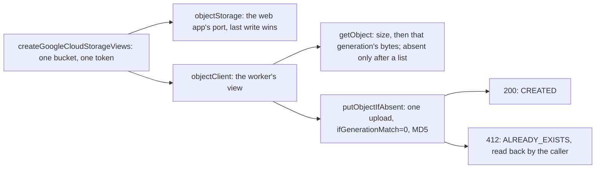

# ADR-0160 — The worker's reads and first-wins writes in Google Cloud Storage

Status: Accepted (RD-4a, 2026-11-18). The first of three parts of the fourth
milestone of production readiness, part 1, which the product owner approved
on 2026-11-16 (`/mnt/project-files/cto/production-readiness-proposal.md`).
It gives the Google Cloud Storage adapter the worker's view of a bucket: the
reads the worker's managed output makes, and the write that stores a file
only where nothing is stored yet. The worker is not given that view yet.

Builds on: ADR-0043 and ADR-0050 (the managed output's seams and their
first-wins rule), ADR-0076 (the Clean Master store), ADR-0085 (the shared
folder, which gives the worker these seams today), ADR-0106 (the development
pipeline that constructs it), ADR-0156 to ADR-0159 (the adapter, in the web
app).

## Context

The worker's managed output speaks to storage through six calls. The
staging sink, which copies a provider's scene video into storage, uses five:
a multipart upload's create, part, complete and abort, and a read. The
composition's sources and published video, media validation and the Clean
Master store use two: a read, `getObject`, and `putObjectIfAbsent`, which
stores a local file at a key only if nothing is stored there. Every caller
reads the object back whatever that write answers. Only the shared folder
implements all six (a mapping onto S3's client implements the sink's five,
ADR-0043, and nothing constructs it), and only the development pipeline
gives the worker its view (ADR-0106); the worker has no production runtime
yet, which is part 2's.

Five investigations, recorded in `/mnt/project-files/cto/rd-4/`, read the
seams and Cloud Storage's API, measured both on the emulator, and checked
each other. What decides this record:

- The seams' contract. A read's `null` body means one thing: the store
  proved nothing is at the key. A body that ends short must fail, never end,
  or a truncated object reads as a whole one. A lost race is the store's to
  decide, never a read and then a write in the process.
- A Cloud Storage write that names `ifGenerationMatch=0` stores an object
  only where none is stored, and answers `412` otherwise, in the same
  request. Generation 0 is no object.
- Cloud Storage takes an MD5 or a CRC-32C of an upload in `X-Goog-Hash`, and
  by its documents refuses a body that does not match with `400`; it takes
  no SHA-256. MD5 is
  `node:crypto`'s. CRC-32C is not: `zlib.crc32` is CRC-32, another sum. The
  emulator ignores the header.
- Cloud Storage has no check of a bucket's owner, which the seams' input
  carries for S3 (`expectedBucketOwner`). The shared folder refuses a
  defined owner and another bucket than its own.
- The construction guard, a test, lists every file that constructs the
  adapter, by the name `createGoogleCloudStorage(`.

## Decision 1 — One constructor, two views, one token

`createGoogleCloudStorageViews(options)` returns `{ objectStorage,
objectClient }`, as `createSharedFolderStorage` does: the web app's port,
unchanged, and the worker's view, `GoogleCloudStorageObjectClient`, which is
the seams' `DeliverableObjectClient`. Both are on one set of connections and
one token: on Google's origin, the metadata server is asked once for both.
`createGoogleCloudStorage(options)` returns its `objectStorage`, so the web
app's adapters are unchanged. Both are in the adapter's own file, under its
subpath, so nothing that loads `@app/storage` loads gaxios.

The construction guard's pattern widens to `createGoogleCloudStorage\w*\(`,
so the new name is caught, and its list is unchanged: only the web app's
adapters construct the adapter.

## Decision 2 — The worker's read is the web app's

`getObject` reads a whole object through the port's `readObject` (ADR-0157):
its size and generation first, within gaxios's own 3-second limit, then that
generation's bytes as a stream, taken one chunk for each `read` the worker
makes. So:

- **Absence needs its bucket proved.** A key is absent, the seam's `null`
  body, only once a list in the bucket answers (ADR-0156 Decision 2). A
  missing bucket is `STORAGE_BUCKET_MISSING`, never an absent object.
- **A short answer fails.** A stream that ends short of the size fails with
  a code (ADR-0157), so the worker's count never meets an end it could take
  for the object's.
- **The read is of one generation.** An object written again between the
  size and the bytes is `STORAGE_OBJECT_CHANGED`, never another object's
  bytes.
- **A cancelled body is not read again.** A `read` after `cancel`, or one
  still waiting when `cancel` is called, is refused with a new code,
  `STORAGE_BODY_CANCELLED`, not answered with an end, which would read as an
  object shorter than it is. The answer is let go. A second `cancel` does
  nothing, and a stream that has already failed is let go quietly.

`contentLength` is the size read first; the seams count the bytes
themselves, as they do for the folder.

## Decision 3 — The first-wins write is one conditional upload

`putObjectIfAbsent` sends one media upload, `POST …?uploadType=media` with
`ifGenerationMatch=0`, and nothing else:

- **`200` is `CREATED`; `412` is `ALREADY_EXISTS`.** Not a failure: every
  caller reads back what is stored. `404` is the bucket's, as for the web
  app's put, since an upload names no object that could be missing; any
  other status is its code alone (ADR-0156).
- **The file is streamed.** Its size is read, and then its bytes from the
  first to that size's last, with that `content-length`. The worker's files
  are a deliverable of up to 512 MiB and a Clean Master of up to 1 GiB.
- **Its MD5 travels with it.** The file is read once for its MD5 before it
  is sent, and the sum goes in `X-Goog-Hash`. By Google's documents, an
  upload whose bytes do not match is refused, so bytes changed between the
  two reads, or on the way, are refused before first-wins makes them
  permanent. MD5 rather than CRC-32C, which Google prefers: the hash is
  `node:crypto`'s, and CRC-32C would need a table written here.
- **No more bytes are sent than were hashed.** A file shorter, as it is
  sent, than when it was hashed fails the upload with a new code,
  `STORAGE_FILE_CHANGED`, where the store would wait for the bytes its
  length promised: the request is cut before it is whole. A file read
  short of its size as it is hashed fails with the same code before
  anything is sent. A file longer, as it is hashed or sent, sends only as
  many bytes as were hashed. A file rewritten in place, its length kept, is
  sent with an MD5 that no longer matches, which Google refuses by its
  documents and the emulator does not check.
- **The file is held open only while it is sent.** It is opened to be sent
  only when its first bytes are asked for, and let go however the request
  ends: a put refused before anything is sent, for want of a token, holds
  nothing open, and one answered or cut partway lets the rest go.
- **The content type is the caller's,** as the seam gives it.
- **A file that cannot be read is refused** with its transport code, such
  as `ENOENT`, naming no path, and nothing is sent.

## Decision 4 — Another bucket, and an owner, are refused

A worker's request that names another bucket than the store's, or any
`expectedBucketOwner`, is refused with `CONFIGURATION_ERROR` and nothing is
sent: Cloud Storage cannot check an owner, and a caller that asks for one is
not given an object the check would not have covered. The shared folder
refuses both too. A key the adapter cannot name is refused as the web app's
are, with `INTERNAL_ERROR`.

## Decision 5 — No limit on the bytes

A put and a read's bytes are given no limit, as every request of the
adapter's that carries bytes (ADR-0156 Decision 3, ADR-0157 Decision 4): a
deliverable is as long as it is, and a put given up leaves its caller not
knowing whether it happened. Only the read's size, and a list, are
questions with gaxios's own 3-second limit. How long the worker's transfers
may take is for part 2, which owns the worker's leases and concurrency, and
any deadline in the repository's own code goes to the product owner first.
Its open item gains the worker's transfers (`docs/decisions/TODO.md`).

## Decision 6 — RD-4 in three parts

RD-4 was planned as one pull request. It is split by seam into three, each
about the size of one of RD-3's parts:

- **RD-4a** (this record): the views, the worker's read and the first-wins
  write.
- **RD-4b**: the staging sink's multipart upload over one resumable upload
  session, started with `ifGenerationMatch=0`, which leaves nothing visible
  until it is finished; the sink is unchanged.
- **RD-4c**: the development pipeline beside the emulator, building the
  worker's view under the web app's construction rules (ADR-0159 Decision 2).

The worker's production construction is part 2's, with its runtime.

## What was measured

- **Unit tests, on a stand-in for the store** (18 new): a generation read as
  the worker pulls it; absence only once the bucket is proved, and a missing
  bucket never; a short answer failing with a code, and its body let go
  quietly; a read after cancel, and one waiting when it came, refused; the
  answer let go on a cancel partway through 64 MiB; another bucket, an
  owner, an empty owner and a non-canonical key refused before the file is
  read, sending nothing; the put's precondition, length, content type and
  MD5; the MD5 of every byte of an empty file, a one-byte file and one of 1
  MiB and 3 bytes; a file shortened after its MD5 failing with a code, its
  upload cut before it is whole, one read short of its size as it is hashed
  failing before anything is sent, and one lengthened as it is hashed or
  after, or empty and then written to, sending only as many bytes as were
  hashed; the file opened to send only as it is sent, and closed when a put
  is refused before sending, answered partway or cut partway with no answer;
  `412` as `ALREADY_EXISTS` and every other status, `201` and `204`
  included, as its code; a missing file naming no path; the put with no
  limit; on Google's origin, one token for both views, sent on the worker's
  requests. Beside them, each of the two callers is tested with a put that
  stores nothing and answers `CREATED`, and one that answers
  `ALREADY_EXISTS`: both retryable.
- **On the emulator** (12 new, beside the web app's): a missing key absent;
  a 3 MiB object streamed in several chunks; an empty object; a read after
  cancel refused; a missing bucket refused for both calls; a file stored
  first-wins; 24 MiB stored whole; eight writers racing for one key,
  exactly one `CREATED`; and the worker's existing seams on the view:
  composition's materializer and publisher, media validation, the Clean
  Master store, and a photo the web app stored read by the worker.
- **A 256 MiB put on the emulator**, twice before the file was opened only
  as it is sent and twice after: `CREATED` in 1.4 to 2.7 seconds, the
  process's memory rising by 36 MiB at most and its buffers by 64 MiB; the
  same key again answered `ALREADY_EXISTS`. The file is streamed, not held.
- **Mutation.** 56 mutants of the new code were run against these tests; 41
  failed them at first. Tests were added for the gaps the survivors showed:
  the MD5 of a file longer than one read, the answer let go on a cancel, a
  failed body's cancel, an empty owner, a `2xx` other than `200`, and the
  bytes sent bounded by those hashed, an empty file's included. The fixes
  the review asked for, the file held open only while it is sent, the
  shortened file and the waiting read, each have a test that fails without
  them. Run again on the fixes, every mutant that survives is equivalent.

## What cannot be shown here

- The emulator ignores `X-Goog-Hash`, so that Google refuses a wrong MD5 is
  read in Google's documents, not measured; the stand-in shows it is sent.
- Whether Google answers `412` before the whole file is sent is not
  measured: either way nothing is stored, but a writer that loses its race
  may send its file first.
- What Google's `412` names is not measured. The emulator's names the
  condition not met; Google's documents list another, an organization's
  policy. The adapter reads any `412` as an object already stored, so every
  caller reads the key back, and one that finds nothing fails as retryable,
  as both callers' tests show with a put that answers `ALREADY_EXISTS` and
  stores nothing: a refused write is never taken for a stored file.
- The emulator has no permissions. The worker's account needs
  `storage.objects.get` and `storage.objects.list` to read and
  `storage.objects.create` to write; a write that never replaces an object
  should need no `storage.objects.delete` (inferred from Google's
  documents). What Google answers an account without one of these is a
  check for the first deployment, as for the web app (ADR-0156): a `403`
  fails safely, but a `404` for an object the account may not read would be
  called absent once the list answers, and for the worker absence means
  work done again or a Clean Master missing.

## Consequences

- The worker's composition, media validation and Clean Master store can run
  on Cloud Storage once they are given the view: RD-4c in development,
  part 2 in production.
- No migration, setting, route, page, package or CI job is added; the
  emulator suite runs in the existing `storage` job.
- Not applicable: the change log and release notes, which no RD milestone
  writes (RD-11 reports); the entity-relationship diagram, since no schema
  changes; a phase completion report and tag, which this plan does not have.
- Nothing is activated: no timer, loop or schedule, no paid call, no
  production credential, no deploy, no Google account.
