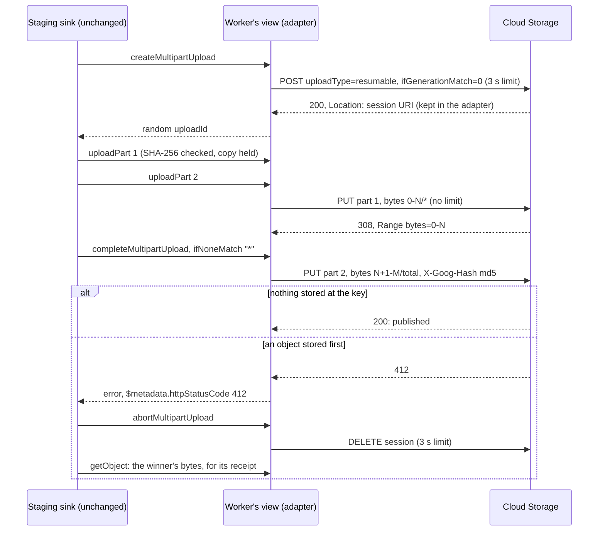

# ADR-0161 — The staging sink's upload in Google Cloud Storage

Status: Accepted (RD-4b, 2026-11-18). The second of three parts of the
fourth milestone of production readiness, part 1, which the product owner
approved on 2026-11-16
(`/mnt/project-files/cto/production-readiness-proposal.md`).
It gives the worker's view of a Cloud Storage bucket the four calls the
staging sink makes to store a provider's scene video, a multipart upload's
create, part, complete and abort, as one resumable upload. The sink is
unchanged, and the worker is not given the view yet.

Builds on: ADR-0043 (the staging sink, whose upload is published only by a
completion that a stored object refuses with `412`), ADR-0085 (the shared
folder, which gives the sink these calls today), ADR-0156 and ADR-0158
(the adapter's requests, its 3-second question limit and its token),
ADR-0160 (the worker's view, its reads, its first-wins write and its
refusals).

## Context

The staging sink stores a provider's scene video as it is downloaded. It
cuts the bytes into parts of the size it is given, 8 MiB by default and 5
MiB at least, and makes these calls one at a time, each awaited:

- `createMultipartUpload`, before its first part is sent;
- `uploadPart`, with the part's number, bytes and SHA-256. The bytes are a
  view of the caller's chunk or of the sink's own array, which it fills
  again once the call returns;
- `completeMultipartUpload`, with every part's number, tag and SHA-256, and
  `ifNoneMatch: "*"`: publish only where nothing is stored;
- `abortMultipartUpload`, once, on every way out but a publish.

It learns that it lost a race only from the completion. An error whose
`$metadata.httpStatusCode` is the number `412` makes it read the object
stored and return that object's receipt; any other failure is retryable.
It knows which part is the last only at its commit.

Cloud Storage has no multipart upload that takes a precondition: its XML
API's refuses one, and its completion replaces what is stored. Composing
temporary objects is limited to 32 of them and leaves billed objects
behind a crash. A resumable upload, in the JSON API, is one session:

- started with a `POST`, which may name `ifGenerationMatch=0`, and
  answered with the session's URI in `Location`;
- written in chunks, each a `PUT` with its `Content-Range`. Every chunk but
  the last is a whole number of 256 KiB, names no total and is answered
  `308` with the range kept so far; the last names the total and finishes
  the object;
- invisible until it is finished, and ended by Google a week after it
  started;
- cancelled with a `DELETE`, answered `499`.

Its URI lets anyone who holds it write to the bucket, with no other
credential, for that week.

Five investigations (`/mnt/project-files/cto/rd-4/`) measured this on the
emulator and drove the unchanged sink through a prototype. What decides
this record:

- On the emulator, the precondition is checked when the last chunk comes. A
  start against a stored key is answered `200` and its last chunk `412`; of
  two sessions on one key, the first finished wins; a writer that stores
  the key while a session is open makes its last chunk `412`. **Google's
  documents do not say when the precondition is checked.** Its own Node.js
  client names it on the start alone.
- Google checks an MD5 sent with the last chunk against the whole object.
  No chunk can be checked alone.
- The emulator does not refuse a chunk that is not a whole number of 256
  KiB. It finishes an object when asked for an upload's status, stores a
  chunk sent twice twice, and stores chunks sent out of order or at once
  wrongly. Its `DELETE` cancels nothing.

## Decision 1 — One resumable upload, each part sent when the next comes

`createMultipartUpload` starts one resumable upload with
`ifGenerationMatch=0` and gives the sink a random id in place of its URI.
Then:

- **Each part is held until the next comes.** `uploadPart` keeps a copy of
  its part. When the next part comes, the one held is sent as a chunk with
  no total, from where the store's bytes end, and the new one is held. The
  last part is sent by `completeMultipartUpload` with the object's size,
  since the sink names its last part only there. The copy is one part more
  per upload, 8 MiB at the default size, beside the sink's own array.
- **One request at a time, in order, each sent once.** A part must be the
  next by number. A call on an upload while another on it is unanswered is
  refused (new code `STORAGE_UPLOAD_BUSY`). No chunk is sent again and no
  status is asked for.
- **A chunk must be kept whole.** It must be answered `308` with the range
  of every byte sent so far; anything else fails the upload, with
  `STORAGE_UNEXPECTED_ANSWER` or the status's code. A store that kept fewer
  bytes cannot be sent the rest: the sink no longer holds them. Once a
  request on an upload fails, every later call on it but a cancel is
  refused (new code `STORAGE_UPLOAD_FAILED`), and the sink starts again.
- **The last chunk finishes it.** `200` or `201` is a publish, and the
  upload is let go.
- **The 256 KiB rule is the adapter's.** A part that is not a whole number
  of 256 KiB is refused when another follows it (new code
  `STORAGE_PART_REFUSED`), before anything is sent. The sink's 8 MiB
  default and 5 MiB floor are whole numbers of 256 KiB; another configured
  size fails every transfer of more than one part as retryable.
- **What is completed is what was taken.** A completion that names other
  parts than those taken, in another order or none, is refused with
  `STORAGE_PART_REFUSED`, and one without `ifNoneMatch: "*"` with
  `INTERNAL_ERROR`, before anything is sent.
- **The seam names no content type,** so a scene's video is stored as
  `application/octet-stream`. The web app types what it serves by its key.

## Decision 2 — A lost race reaches the sink as it does today

A `412` from the store, whether at the start, on a chunk or on the last
chunk, is thrown by the completion as an error whose
`$metadata.httpStatusCode` is the number `412` (new code
`STORAGE_PRECONDITION_FAILED`). The sink and the shared folder already use
that shape. The sink is unchanged: it cancels the upload, reads what is
stored and returns its receipt, or retries where nothing is stored.

An upload refused at its start, or on a chunk, **takes every later part and
drops it**, sending nothing, and its completion throws the same error. If
the start threw it, the sink would count it as a storage failure, download
the video again and meet the same refusal on every run.

## Decision 3 — Integrity

- **Each part's SHA-256 is checked** against the copy the adapter keeps, as
  S3 and the shared folder check it. A part whose bytes do not match is
  refused with `STORAGE_PART_REFUSED`.
- **The object's MD5 goes with its last chunk,** in `X-Goog-Hash`, summed
  over every part in order. By Google's documents, an upload whose bytes do
  not match it is refused before it is finished, so a corrupted object
  never becomes the one first-wins keeps. The emulator does not check it.

## Decision 4 — The session's URI never leaves the adapter

- **It is held in the adapter's memory alone,** under the sink's id, and
  let go at a publish or a cancel. No error carries it: every failure is
  one code, and a transport's error is reduced to its own code, so gaxios's
  error, whose message names the URL, never leaves. The adapter writes no
  log.
- **Only a session at the store's own origin and upload path is taken.** A
  `Location` at another origin or path, with credentials or a fragment, or
  with no `upload_id`, is refused with `STORAGE_UNEXPECTED_ANSWER`, naming
  nothing of it, and nothing is sent there.
- **Its requests go through the adapter's own request function,** on its
  own connections, with the store's token where the store is Google's
  (ADR-0158). Google says a session's requests need none. Its own client
  sends one, and one path keeps one set of rules.
- **Part 2's tracing must not record these requests' URLs.** A tracer of
  HTTP clients usually records the whole URL of each request.

## Decision 5 — The start and the cancel are questions; the bytes have no limit

The start and the cancel move no object's bytes. Each is given gaxios's own
3-second limit, set under the standing rule for a library's own limit on
one query (ADR-0156 Decision 3). A start that runs out of time after Google
opened a session leaves one nobody holds: it is invisible, and Google ends
it after a week.

A chunk carries bytes and is given no limit, as every request of the
adapter's that carries bytes (ADR-0160 Decision 5). A chunk that stalls
holds its upload, its part and its connection until it ends. How long the
worker's transfers may take is part 2's to decide, and a deadline in the
repository's own code goes to the product owner first.

## Decision 6 — The cancel

`abortMultipartUpload` lets the upload go, then sends its session one
`DELETE`. `499`, Google's answer to a cancel, and `404` or `410`, a session
already ended, are success. Any other answer fails with its code, which
the sink ignores. A second cancel, or a cancel of an upload finished, sends
nothing, and an upload refused at its start has no session to cancel.

Under S3, an abandoned multipart upload is left to the bucket's lifecycle
rule (ADR-0043). Under Cloud Storage, a session nobody finishes is
invisible and ended by Google a week after it started. Whether its bytes
are billed meanwhile is not documented: a check for the first deployment.

## Decision 7 — Another bucket, an owner, another upload

As for the worker's reads and write (ADR-0160 Decision 4), a call that
names another bucket or any `expectedBucketOwner` is refused with
`CONFIGURATION_ERROR`, and nothing is sent. A call that names an upload
this store did not start, or started for another key, is refused (new code
`STORAGE_UNKNOWN_UPLOAD`). A cancel of an upload it does not hold does
nothing.

## If Google checks the precondition only at the start

Then two sessions started before either is finished would both finish, the
later replacing the earlier, and first-wins would fail without a sign. This
is the first check on a real bucket, and part 2 may not let the worker
store a scene until it passes (`docs/decisions/TODO.md`). If it fails, the
fallback is to store the scene as a staging object, then `rewrite` it to
its key with `ifGenerationMatch=0`, which Google documents as refused where
an object is stored and as one request within a bucket, and then delete
the staging object. That costs a staging key, the `storage.objects.delete`
permission and a lifecycle rule for what a crash leaves; the emulator
ignores that precondition too.

## What was measured

- **Unit tests, on a stand-in for the store** (22 new):
  - the start, with its precondition, content type and limit;
  - each part sent when the next comes, from where the store's bytes end,
    and the last with the size and the whole object's MD5;
  - a single part sent whole at completion, and the copy kept;
  - no limit on the chunks, the question limit on the start and the
    cancel, and a start not answered given up within it;
  - parts out of order, sent again, empty or not their checksum's refused,
    and the upload going on;
  - a part after one that is not a whole number of 256 KiB refused, and
    such a part sent as the last;
  - completions naming other parts, none, or not conditional, refused;
  - uploads of another store, or for another key, unknown;
  - another bucket and any owner refused on every call;
  - a `412` at the start, on a chunk and at the end, each reaching the
    completion as the sink's lost race, with the parts after it dropped;
  - a short range, none, an early finish and refusals each failing the
    upload, with nothing sent on it after but the cancel;
  - a call while another is unanswered refused;
  - a session at another origin or path, with credentials, with a
    fragment, or with no `upload_id` refused, and no failure naming the
    session;
  - the start's and the cancel's answers;
  - on Google's origin, the token on every request of a session, and
    nothing sent to a session elsewhere;
  - the unchanged sink reading the winner back when the start is refused.
- **On the emulator** (6 new, beside RD-4a's), the unchanged sink:
  - publishes an object of several parts only once its last is sent;
  - publishes one of whole parts, and one of a single byte;
  - reads the winner back when the key was stored before it began, and
    when another upload finished first while it was sent;
  - stores nothing when aborted, and a later upload then publishes;
  - is retryable where the bucket is missing.

## What cannot be shown here

- When Google checks a resumable upload's precondition (above).
- That Google refuses a last chunk whose MD5 does not match.
- What Google answers a chunk that breaks the 256 KiB rule, and the form
  of its `308` answers and of its `Location`.
- That a `DELETE` cancels a session. The emulator's cancels nothing, so CI
  shows only that the sink did not finish the upload. What a `DELETE` is
  answered after a last chunk refused with `412` is not known either.
- Whether an abandoned session's bytes are billed.
- What the worker's account needs. By Google's documents an upload needs
  `storage.objects.create`; that a cancel needs nothing more is inferred.

## Consequences

- The staging sink can store a provider's scene video in Cloud Storage
  once the worker is given the view: RD-4c in development, part 2 in
  production, after the precondition check above.
- An upload holds one part more than under S3, beside the sink's own
  array: about 16 MiB per transfer at the default part size. How many
  transfers a worker runs at once is part 2's.
- No migration, setting, route, page, package or CI job is added; the
  emulator suite runs in the existing `storage` job.
- Not applicable: the change log and release notes, which no RD milestone
  writes (RD-11 reports); the entity-relationship diagram, since no schema
  changes; a phase completion report and tag, which this plan does not
  have.
- Nothing is activated: no timer, loop or schedule, no paid call, no
  production credential, no deploy, no Google account.
