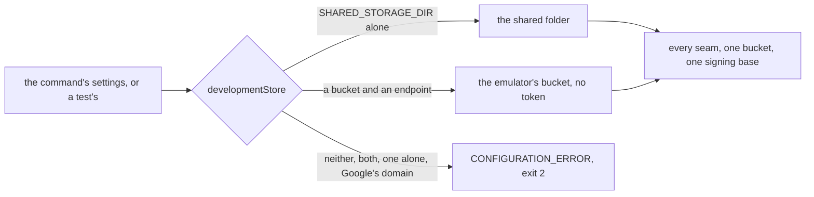

# ADR-0162 — The development pipeline beside the Cloud Storage emulator

Status: Accepted (RD-4c, 2026-11-19). The third and last of three parts of
the fourth milestone of production readiness, part 1, which the product
owner approved on 2026-11-16
(`/mnt/project-files/cto/production-readiness-proposal.md`). It gives the
development pipeline the worker's view of a bucket in the Cloud Storage
emulator, in place of the shared folder, under the web app's construction
rules. Nothing builds Google's own store for the worker.

Builds on: ADR-0085 (the shared folder), ADR-0106 to ADR-0108 (the
pipeline's assembly, its steps and its command), ADR-0150 Decisions 2 and 3
(both `NODE_ENV` values; the worker's adapters are part 2's), ADR-0156
Decision 8 (the emulator in CI), ADR-0159 Decisions 2 and 6 (the
construction rules; no bucket beside the folder), ADR-0160 and ADR-0161
(the worker's view).

## Context

The development pipeline is the only place the worker's steps are built
(ADR-0106), and it built them on the shared folder alone: without
`SHARED_STORAGE_DIR` it was refused. The settings refuse a bucket beside
that folder (ADR-0159 Decision 6), so a development machine whose web app
keeps its photos in the emulator could not run the pipeline on them. RD-4a
and RD-4b gave the adapter's worker view every call the pipeline's seams
make.

Four investigations, recorded in `/mnt/project-files/cto/rd-4/`
(`rd-4c-*.md`), read the pipeline and its tests, ran each seam and then the
whole pipeline on the emulator with a database, and checked each other.
What decides this record:

- Every seam the pipeline builds makes only calls the views implement: the
  staging sink, media validation, the composition's materializer and
  publisher, the Clean Master store, the submission's photo check and the
  test provider's photo reader. Each ran on the emulator.
- The views refuse a bucket other than their own, sending nothing, and the
  seams take that refusal for a failure worth trying again. A seam given the
  folder's bucket name stops the command at its second cycle, with the
  failures counted and exit 1, and the job waits with its Unit reserved.
- With the same base, secret and clock, the folder and the views sign the
  same URL, so the photo reader and the test provider redeem the pipeline's
  URLs unchanged.
- Every kind of key the pipeline writes passes the adapter's key rule, and
  the staging sink writes no temporary object.
- A test builds the pipeline from an environment no schema parsed; the
  command parses its own (ADR-0108).

## Decision 1 — The folder or the emulator, never both

| The environment names | The pipeline |
| --- | --- |
| `SHARED_STORAGE_DIR` alone | keeps its objects in the folder, as before |
| a bucket and an endpoint, and no folder | keeps them in the emulator's bucket |
| neither | is refused |
| the folder and either Cloud Storage setting | is refused |
| an endpoint without a bucket | is refused |
| a bucket without an endpoint | is refused: that is Google's own store |
| an endpoint at Google's API domain | is refused |

Each refusal is a `CONFIGURATION_ERROR` that names settings, never a value,
and the command exits 2 (ADR-0108 Decision 1). They come after the
refusals of production and of another provider, and before anything is
opened. The endpoint's form and the bucket's name are left to the adapter,
which refuses them as it is built, before anything is asked, with messages
that name no value either.

The web app's photos and the pipeline's copies are then in one store: a
development machine gives the web app and the pipeline the same two
settings, with the emulator running between them.

## Decision 2 — The web app's construction rules, in the assembly

ADR-0159 Decision 2 holds for the pipeline:

- **Production** by the configured or the ambient `NODE_ENV` is refused
  first, as it was (ADR-0106 Decision 2).
- **Google's own store is never built.** A bucket without an endpoint is
  refused, and so is an endpoint whose host is `googleapis.com` or a name
  below it, read from the parsed address, so case, a port, a final dot,
  percent-encoding and a tab do not get past it. The adapter makes a token
  only for the origin `https://storage.googleapis.com`, whose host that
  rule refuses, so the pipeline never asks for one.
- **One rule for Google's API domain.** The settings' own, now exported
  from `@app/shared` as `isGoogleApiAddress`. It answers `false` for text
  that is not an address, which the adapter then refuses. The web app's
  check of Google's exact origin is not widened: the web app is built only
  from parsed settings, which apply the domain rule.

## Decision 3 — One bucket for every seam

The staging sink, the validator, the composition's materializer and
publisher, and the Clean Master store are given the store's own bucket from
one value: the folder's fixed name, or the configured bucket. The views
sign under the pipeline's own base (`DEVELOPMENT_SIGNED_URL_BASE`, ADR-0106
Decision 3), as the folder does, so the photo reader and the test provider
are unchanged. The test provider keeps its clips in its own folder
(`--provider-folder`) on either store.

## Decision 4 — The construction guard admits the assembly

The guard that lists every file building the adapter or naming its path
gains the pipeline's assembly, one entry in each list. This amends ADR-0160
Decision 1, whose lists held the web app's adapters alone. The guard now
also lists who names Google's origin, `GOOGLE_CLOUD_STORAGE_ORIGIN`: the
settings, the adapter and the web app's adapters, never the pipeline.

Every other guard is unchanged: the pipeline's own, which keeps it out of
every start-up, route, root script and workflow (ADR-0106 Decision 8,
ADR-0108 Decision 8); the scheduler guard; the signer guard; the Clean
Master's and the managed output's.

## Decision 5 — CI runs the pipeline on the emulator

The `database` job, which runs the pipeline's suite on PostgreSQL with
FFmpeg (ADR-0107), gains the emulator as a second service, as the `storage`
job has it (ADR-0156 Decision 8), and names it in
`GOOGLE_CLOUD_STORAGE_TEST_ENDPOINT`. The suite runs each of its cases on
the folder and again on the emulator, in a fresh bucket. One environment,
parsed by the settings' schema as the command's is, opens the web app's
store through the web app's own adapters, where the photo is put, and
assembles the pipeline.

On both stores, the case that makes the video now also reads the video a
range at a time, as the web app serves it. On the emulator it checks that
the bucket holds exactly the photo, the two clips, the video and its Clean
Master. In CI a missing endpoint fails the file rather than dropping its
emulator cases; a local run without one runs the folder's cases alone.

Both jobs' emulators log warnings only (`FAKE_GCS_LOG_LEVEL: warn`). At its
default level the emulator logs each upload session's id, and a job prints
its services' logs when it ends; a session's address is a credential with
Google (ADR-0161 Decision 4).

## Decision 6 — What stays

- No new setting: the pipeline reads the web app's two, and the settings'
  rules are unchanged, a bucket beside the folder included.
- The command (`cli.ts`), the photo reader, the adapter and the web app's
  adapters are unchanged. The command's usage names the emulator's
  settings.
- The browser test (ADR-0121) keeps its folder and refuses both Cloud
  Storage settings (ADR-0159). Running it on the emulator is left open.
- Building Google's store for the worker, where both `NODE_ENV` values say
  production, is part 2's, with the worker's runtime (ADR-0150 Decision 3).
- ADR-0106 to ADR-0108 and ADR-0159 are records and are not rewritten.
  Where they say the pipeline needs `SHARED_STORAGE_DIR`, opens the shared
  folder or copies clips into it, it now takes the folder or the emulator's
  bucket. ADR-0159 Decision 6's "until RD-4 gives the worker Cloud Storage"
  ends here, for development.

## Considered and not done

- **An emulator constructor shared with the web app.** It would move the web
  app's rules out of its adapters for one more caller, and the guard's
  lists would grow by the same entry.
- **A rule that the emulator be on this machine**, as the pipeline's
  database must be (ADR-0108 Decision 6). ADR-0159 accepts any host outside
  Google's domain for the web app, and no such host is sent a token. The
  rule would be new for the web app too.
- **The browser test on the emulator.** Its helpers would change and it
  would need a second server or run. The database suite already runs the
  assembled pipeline there.
- **A persistent emulator**, on its file system backend. The adapter has
  never been run against it.

## What was measured

- **Unit tests** (24 new): no store, each mix of the folder with a Cloud
  Storage setting, an endpoint without a bucket and a bucket without an
  endpoint; nine spellings of Google's API domain; five endpoints that are
  no http origin and a bucket no store can name; each refused before any
  folder is made. Production refused with an emulator, by either value.
  Every step built on an emulator's bucket while a stand-in at its endpoint
  is asked nothing. The shared rule answering for text that is no address.
- **The construction guard** fails without the assembly's entries, and its
  origin list fails if the assembly names Google's origin.
- **The pipeline end to end on the emulator**, on a local PostgreSQL 16 and
  fake-gcs-server 1.56.1, the version CI runs: the suite's 7 cases on the
  folder and 7 on the emulator pass, in about 36 seconds of tests, 18 more
  than the folder's alone. With `CI=true` and no endpoint the file fails;
  without `CI` the folder's 7 pass. The emulator at `warn` logged nothing.
- **The command, unchanged**, given the emulator's settings and a local
  database: one quiet cycle and exit 0. Given a bucket alone, Google's
  endpoint or no store: exit 2, with the refusal printed.
- **Mutation.** MUTATION-TBD

## What cannot be shown here

- Nothing new about Google: the pipeline never builds Google's store.
  ADR-0160's and ADR-0161's first-deployment checks stand, and pass before
  part 2 lets the worker store anything there.
- The emulator keeps its objects in memory. After it restarts, the
  database still names objects it no longer holds, and the bucket must be
  made again: a waiting job whose photo is gone then fails and its Unit is
  released (measured on an emptied bucket).
- CI does not run the command itself, the web app's routes or the browser
  on the emulator; the command was run by hand.

## Consequences

- RD-4 is complete. The worker's managed output runs on Cloud Storage in
  development; part 2 builds it on Google's store, in production.
- The `database` job runs the pipeline's suite on both stores. No
  migration, setting, route, page or package is added.
- TODO: "Let the development pipeline run beside the emulator" is closed.
  "Give the worker the same construction rules", "Replace
  `LocalObjectStorage`" and "Build the Google Cloud Storage adapter" are
  amended and stay open, for part 2. A new item leaves the browser test on
  the emulator open.
- Not applicable: the change log and release notes, which no RD milestone
  writes (RD-11 reports); the entity-relationship diagram, since no schema
  changes; a phase completion report and tag, which this plan does not have.
- Nothing is activated: no timer, loop or schedule, no paid call, no
  production credential, no deploy, no Google account.
