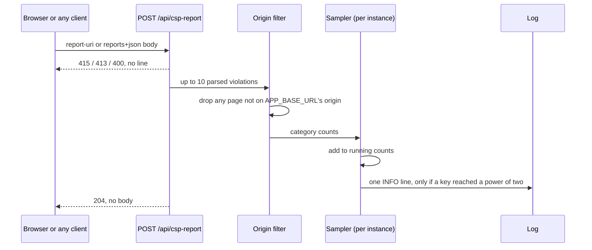

# ADR-0189 — Browsers report page policy violations to an endpoint that logs only categories

Status: Accepted (PT-7c2, 2026-11-26). A milestone of production
readiness, part 2, approved by the product owner on 2026-11-26
(`docs/production-readiness-part2-gap-analysis.md`); the CTO decided
the plan's open questions the same day (origin filter, one line per
request, the count-based sampler, a reader that never throws, `zod`).
No customer surface, charge, business rule or stored value changes.

**Amends ADR-0174 Decision 1 by citation (a second route outside the
origin check, within that decision's own scope) and ADR-0177
Decision 5's guard (it now also reads `lib/csp-report.ts`).**

## Context

A refusal under the page policy (ADR-0174 Decision 10) is seen by no
one: nothing receives a browser's report (`TODO.md`, "No CSP violation
report endpoint"). Browsers send two shapes *(from the CSP3 and
Reporting API specifications, not yet captured from a browser)*:
`report-uri` posts one violation as `application/csp-report`, and
`report-to` posts a batch as `application/reports+json`.

What a report carries is not ours to log. The page's address holds
`?token=` on the reset, verification and invitation pages (ADR-0129)
and tenant ids in its path; the blocked address can be a signed link
or any outside host an extension loaded; `original-policy` holds the
request's nonce; `referrer`, `user_agent` and `script-sample` are free
text. The plan's lab measured that a route handler's
`request.text()` under `next start` read a 30,000,000-byte body whole:
nothing bounds a route's body. The rate limiter counts in PostgreSQL
on a pool sign-in shares (ADR-0171 Decision 6).

## Decision 1 — One unauthenticated endpoint, both shapes

`POST /api/csp-report` (`apps/web/src/app/api/csp-report/route.ts`,
the work in `apps/web/src/lib/csp-report.ts`) answers, in this order:

1. `415` unless `Content-Type`, parameters ignored, is
   `application/csp-report` or `application/reports+json`.
2. `413` for a `Content-Length` over 16 KiB, without reading the body.
3. Otherwise the body is read chunk by chunk and cancelled once it
   passes 16 KiB: `413`.
4. `400` for a body that cannot be read, is not JSON, or does not have
   the shape its type names.
5. `204` with no body otherwise, whether or not anything is counted
   or written.

A `reports+json` batch is read for `type` `csp-violation` entries
only, at most 10; the rest are counted as `dropped`. A refusal writes
no line: it tells a sender nothing, and a line would only add volume.
Nothing points at the endpoint in this PR (Built in PT-7c3).

## Decision 2 — The reader never throws

`readBounded` returns `ok` with the text, `tooLarge` or `unreadable`.
A stream that errors (a client that goes away mid-body, *inference*
for `next start`) is `unreadable`, and a `JSON.parse` failure is read
as no body; both answer `400` with no line, never an `ERROR`. PT-7b3
measured that a body read failing outside a route's `try` writes
Next.js's print and an `onRequestError` `ERROR` line; on an
unauthenticated route that would let anyone write `ERROR` lines, which
PT-10b's alerts are expected to read (*inference*). Anything else that
throws still reaches the route's `catch`, `appErrorToResponse` and
ADR-0177's `request` line. The failure-log guard reads
`lib/csp-report.ts` and lists its three catches by their text.

No deadline bounds a slow sender: that would be a clock. Cloud Run's
request limit, once T8g sets it, does (*inference*); every
unauthenticated `POST` shares that today (sign-in's `formData()` is
unbounded too), so it is existing, not new.

## Decision 3 — Reports from other sites' pages are dropped

A violation whose page origin (`document-uri`; `body.documentURL`,
else `url`) is not `APP_BASE_URL`'s origin is dropped before anything
is counted: `204`, no line. With no `APP_BASE_URL`, every report is
dropped.

**What it stops:** another site sending `Content-Security-Policy: ...;
report-uri https://<our host>/api/csp-report` makes its visitors'
browsers post genuine reports to us, spread over their addresses and
needing no cookie or preflight (*inference*, critique B1). A browser
fills `document-uri` with the page it reports on, so those reports name
the other site and are dropped. **What it does not stop:** a client
that is not a browser can send any body, our origin included. Every
line is therefore untrusted data, and no alert may fire on one line.

## Decision 4 — Categories only, at most one line per request

Each kept violation becomes a key of five categories, each from a
fixed list:

- `mechanism`: `report-uri` or `report-to`;
- `directive`: the effective directive if it is one of our policy's
  twelve or `script-src-elem`, `script-src-attr`, `style-src-elem`,
  `style-src-attr`, `worker-src`, `manifest-src`, else `other`;
- `blocked`: `inline`, `eval`, `wasm-eval`, `data`, `blob`, `self`
  (`APP_BASE_URL`'s origin), `extension` (`chrome-extension`,
  `moz-extension`, `safari-web-extension`), `external` (another
  `http(s)` origin) or `other`; never the address, host or path;
- `disposition`: `enforce`, `report`, or `other` when the report
  names neither;
- `source`: `next-static` (our origin, `/_next/static/` and a plain
  path), `extension`, `none` (not named) or `other`.

**Never logged:** the page address, `referrer`, the blocked address,
`original-policy` (the nonce), `user_agent`, `script-sample` and
`sample`, `status-code`, line and column, a header, a cookie, the
client address and any outside host (critique NIT 18: an outside host
would record which tools customers run, the product owner's call).

**The sampler (R4).** The process keeps a map from key to the number
of reports seen. A request adds its counts; if a key's count reaches a
power of two (1, 2, 4, 8 ...) with it, the request writes one `INFO`
line, component `csp-report`, message "Browsers reported page policy
violations", listing each such key with this request's `count` and the
running `total`, plus `dropped`. Otherwise it writes nothing. Nothing
reads a clock.

**The key space is finite:** 2 mechanisms × 19 directives × 9 blocked
× 3 dispositions × 4 sources = **4,104** keys, so the map is bounded
whatever is sent. A key writes at most ⌊log₂ n⌋ + 1 lines for n
reports: a million forged reports spread over every key write at most
about 4,104 × 8 = 33,000 lines, and on one key 20. Each Cloud Run
instance has its own map and multiplies this; a restart clears it.
A flood on a key also folds a later real report into its `total`
without a line; the count still shows it.

## Decision 5 — No limiter; R1 rejected, R2 and R3 left

The endpoint reads no cookie, session, database or limiter. A limiter
would add a database statement per report and let a flood queue on
sign-in's pool (ADR-0171 Decision 6). R1 (no bound until PT-10's edge
rule) is rejected: R4 bounds the lines without a value. R2 (a limit
per client address) and R3 (a line budget per time window) need values
that are the product owner's, offered as CTO defaults (proposal PT-12b;
a window is a recurring value under T8): an edge rule belongs to PT-10.
The CTO accepts the remaining log cost until PT-10.

## Decision 6 — Outside the origin check, complete though reachable

ADR-0174 Decision 1 covers every change "that a session cookie can
authorize". This route reads no cookie and authorizes nothing, so it
is outside that scope, beside `PUT /api/storage/upload`; the decision's
webhook clause ("which no browser sends") is not the ground, since
browsers send this. `tests/api/same-origin-coverage.test.ts` lists it
with its reason (46 handlers). Not audited: a report is none of
CLAUDE.md's audited actions.

It is reachable by anyone from this PR on, with nothing pointing at
it. It is complete and bounded: it changes nothing but the in-process
map, reads at most 16 KiB and 10 violations a request, writes no line
for a refusal or another site's report, and at most the lines above
for the rest.

## Decision 7 — `zod` in the web app

Each shape is a `zod` schema (CLAUDE.md: schema validation for all
input). `zod` is added to `apps/web` at 4.6.7, the version
`packages/shared` pins since PT-6d. Unknown keys are dropped, an
address is capped at 4,096 characters and a name at 256.

## Built in PT-7c3

- Both page policies gain `report-uri /api/csp-report` and
  `report-to csp`, and the middleware sends `Reporting-Endpoints`
  (the API policy gets no report directive).
- The `page` category, the document's route pattern from a fixed list
  held to `apps/web/src/app/**/page.tsx`, moved here from PT-7c2 by the
  plan's split trigger (PT-7c2 passed its size); the key space then
  grows by the number of patterns plus one.
- A browser test captures real bodies; the production-mode job posts
  one of each shape and proves no run-unique value reaches the log; a
  page on a second origin aiming `report-uri` here writes no line.

## The request

## What holds it

- `apps/web/src/lib/csp-report.test.ts`: the line's fields and that no
  token, nonce, path, id or host reaches it; ten read and the rest
  dropped; other origins and no `APP_BASE_URL` write nothing; the
  sampler writes on the 1st, 2nd, 4th and 8th report only, and on a
  request that passes 16; each category; an erroring stream is
  `unreadable`.
- `tests/api/csp-report-route.test.ts`: `204` with no body for each
  shape; `415` for `text/plain` and `application/json`; `400` for a
  body that is not JSON or not the shape; `413` by `Content-Length`
  without pulling the body, and streamed past 16 KiB with the stream
  cancelled; another site's report writes nothing; the two files
  import nothing that reads a cookie, session, database or limiter.
- `tests/api/failure-log-coverage.test.ts`: the catches listed, and a
  stream that errors after one chunk answers `400` with no line.

## Consequences and known gaps

- The upload `PUT` still reads its whole body (`TODO.md`); the reader
  may serve it later.
- The bodies follow the specifications until PT-7c3 captures real
  ones; a browser whose shape differs gets `400`.
- An edge rule for this path is PT-10's (`TODO.md`).
