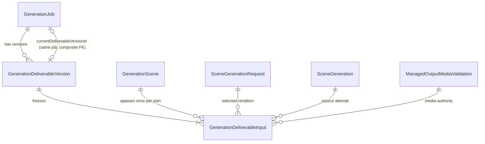
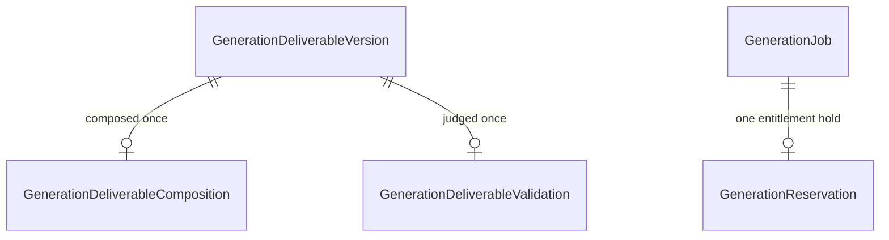
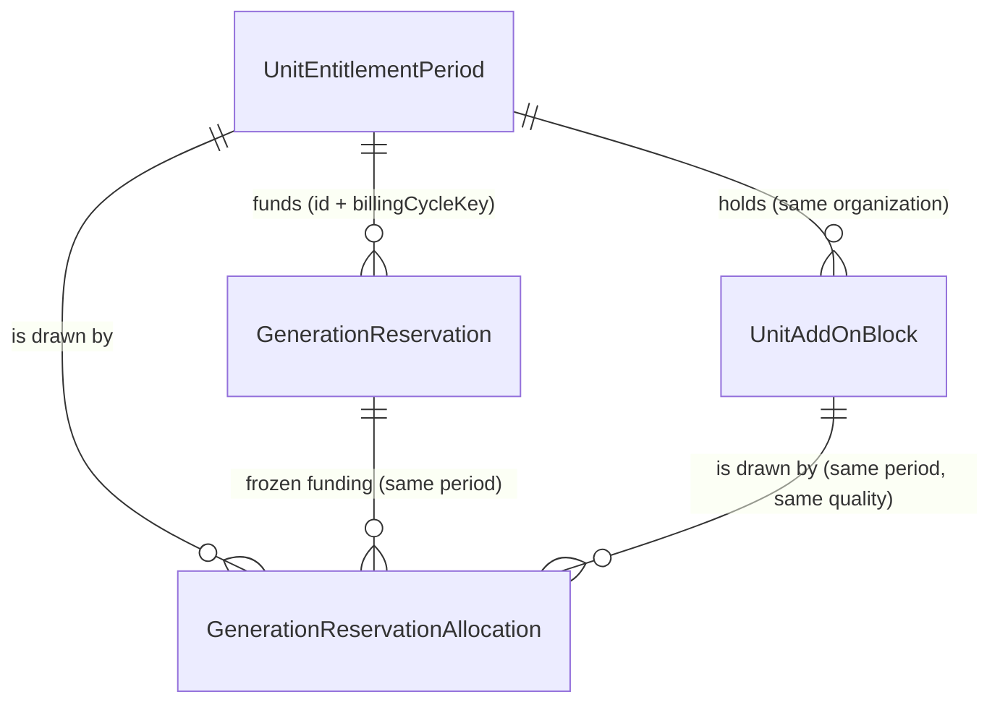
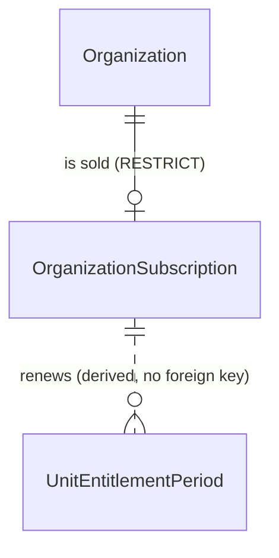
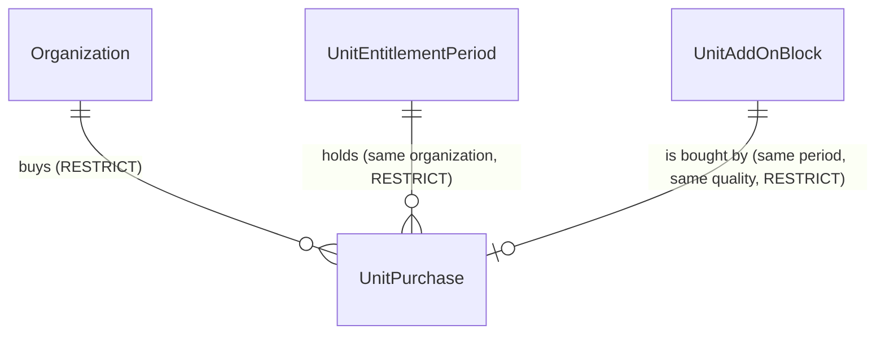
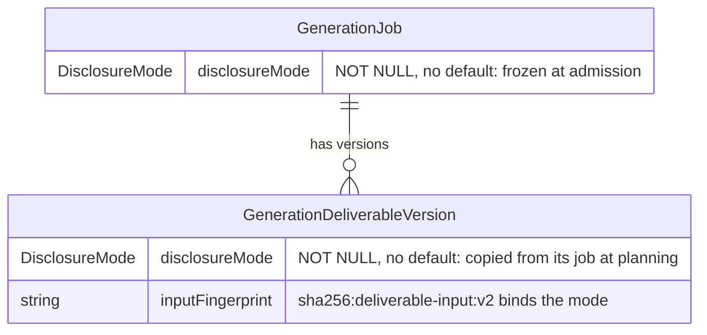
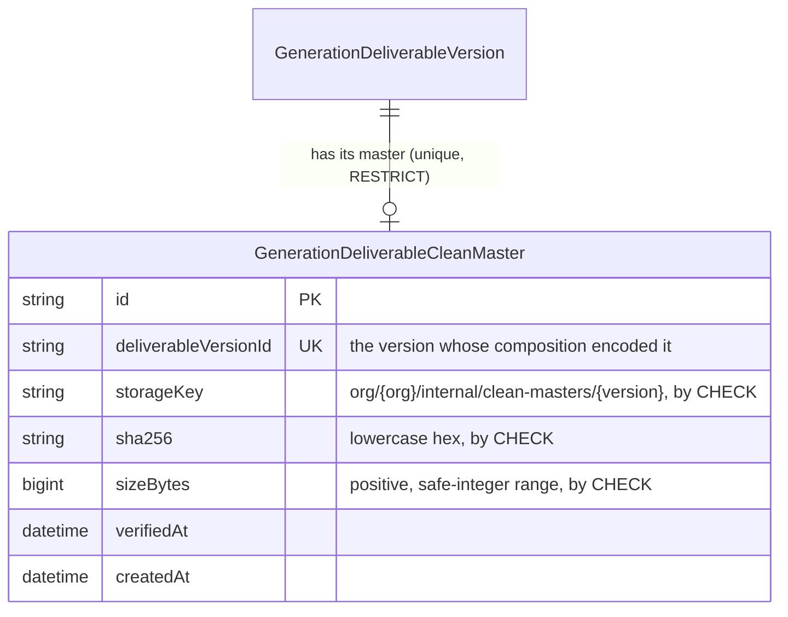

# Entity-Relationship Diagram

Version: 1.4 (as implemented through Phase 3C-1)
Source of truth: `packages/database/prisma/schema.prisma`
Status: Describes **implemented** tables only. Entities from
`docs/DataModel.md` that belong to later phases are listed at the bottom.

## Implemented schema

```mermaid
erDiagram
  ORGANIZATIONS ||--o{ MEMBERSHIPS : has
  ORGANIZATIONS ||--o{ INVITATIONS : issues
  ORGANIZATIONS ||--o{ AUDIT_LOGS : scopes
  ORGANIZATIONS ||--o{ PROPERTIES : owns
  USERS ||--o| CREDENTIALS : "authenticates with"
  USERS ||--o{ MEMBERSHIPS : joins
  MEMBERSHIPS ||--o{ MEMBER_PERMISSION_GRANTS : "is granted (CASCADE)"
  ORGANIZATIONS ||--o{ GROUPS : "has (CASCADE)"
  GROUPS ||--o{ GROUP_MEMBERS : "contains (CASCADE)"
  MEMBERSHIPS ||--o{ GROUP_MEMBERS : "belongs to (CASCADE)"
  GROUPS ||--o{ GROUP_PERMISSIONS : "carries (CASCADE)"
  MEMBERSHIPS |o--o{ PROPERTIES : "is responsible for (NO ACTION)"
  GROUPS |o--o{ PROPERTIES : "groups (NO ACTION)"
  USERS ||--o{ SESSIONS : holds
  USERS ||--o| USER_MFA_FACTORS : "protects with (CASCADE)"
  USER_MFA_FACTORS ||--o{ USER_MFA_RECOVERY_CODES : "falls back to (CASCADE)"
  PROPERTIES ||--o{ MEDIA_ASSETS : contains
  MEDIA_ASSETS ||--o| ASSET_ANALYSES : "is analyzed by"
  PROPERTIES ||--o{ VIDEO_PROJECTS : "is filmed by"
  VIDEO_PROJECTS ||--o{ STORYBOARD_SCENES : sequences
  MEDIA_ASSETS ||--o{ STORYBOARD_SCENES : "is the source of"
  VIDEO_PROJECTS ||--o{ SCENE_GENERATIONS : "attempts (RESTRICT)"

  ORGANIZATIONS {
    string id PK
    string name
    string slug UK
    enum   status "ACTIVE|SUSPENDED"
    boolean mfaRequired "every member must use MFA (MFA-4)"
    datetime createdAt
    datetime updatedAt
  }

  USERS {
    string id PK
    string email UK
    string name
    enum   status "ACTIVE|DISABLED"
    datetime createdAt
    datetime updatedAt
  }

  CREDENTIALS {
    string userId PK_FK
    string passwordHash "scrypt, salted"
    datetime createdAt
    datetime updatedAt
  }

  MEMBERSHIPS {
    string organizationId PK_FK
    string userId PK_FK
    enum   role "OWNER|ADMIN|MANAGER|CREATOR|VIEWER|BILLING"
    datetime createdAt
  }

  MEMBER_PERMISSION_GRANTS {
    string organizationId PK_FK
    string userId PK_FK
    string permission PK "CHECK: grantable vocabulary, never video.share"
    string grantedByUserId
    datetime grantedAt
  }

  GROUPS {
    string id PK "UK (id, organizationId)"
    string organizationId FK
    string name "UK (organizationId, name); CHECK: trimmed, 1-100"
    string createdByUserId
    datetime createdAt
    datetime updatedAt
  }

  GROUP_MEMBERS {
    string groupId PK_FK "FK (groupId, organizationId) to GROUPS"
    string organizationId FK "FK (organizationId, userId) to MEMBERSHIPS"
    string userId PK_FK
    string addedByUserId
    datetime addedAt
  }

  GROUP_PERMISSIONS {
    string groupId PK_FK "FK (groupId, organizationId) to GROUPS"
    string organizationId FK
    string permission PK "CHECK: grantable vocabulary, never disclosure.none or video.share"
    string grantedByUserId
    datetime grantedAt
  }

  INVITATIONS {
    string id PK
    string organizationId FK
    string email
    enum   role
    string tokenHash UK "SHA-256 only"
    enum   status "PENDING|ACCEPTED|REVOKED|EXPIRED"
    string invitedByUserId
    datetime expiresAt
    datetime acceptedAt "nullable"
    datetime createdAt
  }

  SESSIONS {
    string id PK
    string userId FK
    string tokenHash UK "SHA-256 only"
    datetime expiresAt
    datetime mfaVerifiedAt "nullable; when this sign-in passed MFA"
    int    mfaFailedAttempts "default 0; the fifth wrong code deletes the row"
    string mfaPendingSecret "nullable; sealed set-up secret"
    datetime createdAt
  }

  USER_MFA_FACTORS {
    string userId PK "FK users, CASCADE"
    string secret "AES-256-GCM sealed, key id prefix"
    int    lastUsedStep "a code for it or earlier is refused"
    datetime enabledAt
    datetime updatedAt
  }

  USER_MFA_RECOVERY_CODES {
    string userId PK "FK user_mfa_factors, CASCADE"
    string codeHash PK "SHA-256 hex only (CHECK)"
    datetime createdAt
  }

  PROPERTIES {
    string id PK
    string organizationId FK "tenant scope"
    string name
    enum   propertyType "APARTMENT|HOUSE|OFFICE|RETAIL|OTHER"
    string addressMasked "nullable"
    string description "nullable"
    enum   status "ACTIVE|ARCHIVED|DELETED"
    string createdBy "authorship history; authorizes nothing"
    string responsibleUserId FK "nullable; FK (organizationId, responsibleUserId) to MEMBERSHIPS"
    string groupId FK "nullable; FK (groupId, organizationId) to GROUPS"
    datetime createdAt
    datetime updatedAt
  }

  MEDIA_ASSETS {
    string id PK
    string organizationId FK "tenant scope"
    string propertyId FK
    string storageKey UK "org-prefixed, opaque"
    string originalFilename "sanitized"
    string mimeType "nullable, from magic bytes"
    int    sizeBytes "nullable"
    int    width "nullable"
    int    height "nullable"
    string sha256 "nullable"
    string perceptualHash "nullable, 16 hex"
    enum   status "10-state lifecycle"
    string failureReason "nullable, sanitized"
    string thumbnailKey "nullable"
    string createdBy
    datetime deletionRequestedAt "nullable"
    datetime retentionExpiresAt "nullable"
    datetime createdAt
    datetime updatedAt
  }

  ASSET_ANALYSES {
    string id PK
    string organizationId "tenant scope"
    string assetId FK_UK "one analysis per asset"
    string provider "adapter name, not a secret"
    enum   status "PENDING|SUCCEEDED|FAILED"
    enum   roomType "nullable, 15 values"
    float  confidence "nullable, 0..1"
    float  qualityScore "nullable, 0..1"
    float  brightnessScore "nullable, 0..1"
    float  blurScore "nullable, 0..1"
    string duplicateGroup "nullable, groups near-identical photos; internal only"
    json   detectedObjects "bounded list, normalized"
    json   safetyFlags "bounded list, BLOCKING|WARNING"
    int    suggestedOrder "nullable, walkthrough rank"
    string failureReason "nullable, sanitized"
    enum   roomTypeOverride "nullable, reviewer's corrected room; AI roomType preserved"
    int    orderOverride "nullable, reviewer's sort priority (not a fixed position)"
    string correctedBy "nullable, who corrected this revision"
    datetime correctedAt "nullable"
    int    analysisRevision "persisted result, increments on successful refresh"
    enum   reviewStatus "UNREVIEWED|APPROVED|REJECTED"
    string reviewNote "nullable, required for rejection"
    string reviewedBy "nullable, human approver"
    datetime reviewedAt "nullable"
    datetime createdAt
    datetime updatedAt
  }

  VIDEO_PROJECTS {
    string id PK
    string organizationId "tenant scope"
    string propertyId FK
    string name
    enum   status "DRAFT|STORYBOARD_READY|STORYBOARD_STALE"
    int    durationSeconds "requested; provider validation is Phase 4"
    string aspectRatio "provider-neutral"
    string targetOutputResolution "column `resolution`; CHECK 720p|1080p"
    string stylePreset "nullable"
    string cameraMotion "nullable"
    string prompt "nullable, untrusted user text"
    string negativePrompt "nullable, untrusted user text"
    boolean includeMusic
    boolean includeCaptions
    string brandTemplateId "nullable"
    string compositionFingerprint "nullable, digest of the APPROVED input set"
    string createdBy
    datetime createdAt
    datetime updatedAt
  }

  STORYBOARD_SCENES {
    string id PK
    string videoProjectId FK "composite with propertyId"
    string propertyId "half of both composite FKs"
    string assetId FK "composite with propertyId"
    int    position "UK with videoProjectId"
    enum   roomType "nullable, 15 values"
    int    durationSeconds
    string cameraMotion "nullable"
    string compiledPrompt "nullable until Phase 3C-3"
    int    sourceAnalysisRevision "provenance"
    datetime createdAt
    datetime updatedAt
  }

  SCENE_GENERATIONS {
    string id PK
    string videoProjectId FK "ON DELETE RESTRICT"
    string sourceStoryboardSceneId "provenance, NO FK"
    string assetId "provenance, NO FK"
    int    sourceAnalysisRevision "provenance"
    string requestHash "active-UK with videoProjectId; sha256:v2: since 4C-3B-2B"
    string providerName "internal"
    string providerModelId "internal"
    string requestResolution "nullable; V1 only, never written again"
    string requestModelKey "nullable; V2 snapshot, all-or-none"
    string requestTargetOutputResolution "nullable; CHECK 720p|1080p"
    string requestNativeGenerationResolution "nullable; provider token, opaque"
    string requestResolutionNormalization "nullable; CHECK NONE|DOWNSCALE|UPSCALE"
    boolean requestNativeMeetsTarget "nullable; false = upscaled, not native"
    enum   state "8 values, default QUEUED"
    string providerPredictionId "nullable, internal only"
    datetime submittedAt "nullable"
    datetime lastPolledAt "nullable"
    string normalizedErrorCode "nullable, internal"
    string normalizedErrorMessage "nullable, internal"
    string outputStorageKey "nullable; derived from org+attempt, extensionless; legacy repository may not write it on an orchestrated row"
    string outputSha256 "nullable; CHECK canonical lowercase 64-hex"
    bigint outputSizeBytes "nullable; CHECK > 0 AND <= Number.MAX_SAFE_INTEGER"
    datetime outputVerifiedAt "nullable; the single post-lock verification instant"
    datetime createdAt
    datetime updatedAt
  }

  AUDIT_LOGS {
    string id PK
    string organizationId FK "nullable"
    string actorUserId "nullable"
    string action
    string resourceType
    string resourceId
    json   metadata "sanitized"
    datetime createdAt
  }
```

## Tenant-scope and index notes

- Every tenant-owned table carries `organizationId` — **except
  `storyboard_scenes`**, which inherits tenant scope through its project (see
  below). All repository reads filter on the organization either directly or
  through that relation, so another tenant's row is simply not found.
- Composite/indexed for tenant queries:
  `properties(organizationId, status)`,
  `media_assets(organizationId, propertyId, status)`,
  `media_assets(organizationId, sha256)`,
  `asset_analyses(organizationId, status)`,
  `asset_analyses(organizationId, duplicateGroup)`,
  `asset_analyses(organizationId, reviewStatus)`,
  `audit_logs(organizationId)`, `audit_logs(createdAt)`,
  `memberships(userId)`, `invitations(organizationId, email)`,
  `sessions(userId)`.
- `media_assets.storageKey` is unique, preventing two rows from claiming the
  same object.
- `asset_analyses.assetId` is unique, so an asset can never accumulate more than
  one analysis row; a re-run updates the existing row in place.
- The four correction columns (`roomTypeOverride`, `orderOverride`,
  `correctedBy`, `correctedAt`) are **unindexed by design**: a correction is
  read as part of the analysis row already being loaded by primary key or by the
  unique `assetId`, and is never searched by. `orderOverride` carries **no**
  uniqueness or range constraint — duplicate priorities are legitimate and
  resolve deterministically during ordering, and which values are *valid* is a
  product rule owned by the correction service, not by the schema (ADR-0015).
- **No uniqueness on approved duplicate-group members.** Migration 3's partial
  unique index `asset_analyses_org_dupgroup_approved_key` allowed one approved
  analysis per duplicate group; migration 24 dropped it (ADR-0063, ADR-0052
  Decision 14). Any number of look-alikes may be approved.
- **`storyboard_scenes` carries no `organizationId`.** A scene is owned by its
  project, and duplicating the column would create a second source of truth that
  application code could let drift. Reads filter through the parent
  (`videoProject: { organizationId }`), and writes are constrained by two
  composite foreign keys — `(videoProjectId, propertyId) → video_projects(id,
  propertyId)` and `(assetId, propertyId) → media_assets(id, propertyId)` — so a
  scene whose project and asset belong to different properties, and therefore
  different organizations, **cannot be inserted at all**. The supporting unique
  keys `video_projects(id, propertyId)` and `media_assets(id, propertyId)` exist
  only to make those foreign keys possible.
- `storyboard_scenes(videoProjectId, position)` is unique: two scenes cannot
  claim the same position in one project. Composition therefore replaces a
  project's scenes wholesale rather than diffing them.
- **`scene_generations` carries no `organizationId` either**, for the same
  reason: it is owned by its `video_projects` row, and reads resolve the tenant
  through `videoProject: { organizationId }`.
- **Two of its id columns are deliberately not foreign keys.**
  `sourceStoryboardSceneId` points at a row `replaceForProject` deletes and
  recreates on every recomposition, and `assetId` points at a photo the
  retention pipeline may remove. A generation row can record a *paid* provider
  attempt, so a cascade from either would destroy that record during an ordinary
  user action, and a restrict would block recomposition. Both are provenance
  (ADR-0016).
- **Partial unique index** `scene_generations_active_request_key` on
  `(videoProjectId, requestHash) WHERE state IN ('QUEUED', 'SUBMITTING',
  'PROCESSING', 'FAILED_RETRYABLE', 'SUBMISSION_UNKNOWN')`. The database is
  authoritative for "at most one **active** attempt per request identity", so
  two concurrent submissions cannot both produce a billed provider call.
  Terminal states release the identity, allowing deliberate regeneration.
  Hand-written in the migration, and guarded against drift from the domain's
  `ACTIVE_SCENE_GENERATION_STATES` by
  `tests/schema/active-generation-states.test.ts`.
- Cascade behavior: deleting an organization cascades memberships, invitations,
  and properties (and thus assets, and thus analyses); `audit_logs.organizationId`
  is `SetNull` so audit history survives. **`scene_generations` is the one
  exception**: its foreign key to `video_projects` is `ON DELETE RESTRICT`, so a
  project cannot be physically deleted while an attempt exists. That is
  fail-closed on purpose — no physical deletion path exists today, and a future
  one must resolve retention policy for paid-attempt history deliberately rather
  than inheriting a cascade.

### Request-identity versioning (Phase 4C-3B-2B, ADR-0034)

Six CHECK constraints, added by raw SQL because Prisma cannot express them:

- `video_projects_resolution_target_check` — the project's product target is
  `720p` or `1080p`. Applied to the existing physical `resolution` column, which
  the Prisma model now maps as `targetOutputResolution`. **The migration fails
  closed** on any pre-existing value outside that set rather than rewriting a
  customer's stated request.
- `scene_generations_request_identity_version_check` — **one** physical
  constraint carrying three properties, keyed off the version the `requestHash`
  itself states: V2 snapshot completeness, V1/V2 vocabulary mutual exclusion,
  and hash-version consistency. A `sha256:v2:` row carries all five V2 delivery
  columns and no `requestResolution`; any other row carries none of the five.
  The three are branches of one `CASE` rather than three constraints because
  they constrain each other — split apart, a row could satisfy each in
  isolation while still contradicting itself overall.
- `scene_generations_target_output_resolution_check` and
  `scene_generations_resolution_normalization_check` — the two closed
  vocabularies, checked only when a value is present so legacy rows stay valid.
- `scene_generations_model_key_nonblank_check` and
  `scene_generations_native_resolution_nonblank_check` — both are identifiers,
  and an empty string is not one. Checked as non-blank rather than merely
  non-null because the all-or-none rule is satisfied by `''`. There is
  deliberately no syntax rule on the native token beyond that: it is the
  vendor's, and this system does not parse it.

None of the V2 columns is indexed: they are reconstruction payload, and identity
lookups still use the `(videoProjectId, requestHash)` partial unique index.

`requestResolution` is **retained and never written again**. V1 rows were hashed
over it, so it is the only surviving record of what those attempts were admitted
for; the V2 columns are never backfilled from it, because deciding which of its
two meanings applied is exactly the ambiguity ADR-0034 removes.

## Deliberately not stored

- Raw passwords, raw session tokens, and raw invitation tokens — only salted
  scrypt hashes / SHA-256 hashes.
- **Temporary provider output URLs** and signed URLs. A generation attempt never
  stores a URL that expires. Phase 4C-3B-2H-1 settled how the managed copy is
  recorded instead: `outputStorageKey` is **derived** from the organization and
  the attempt id — never from a provider URL, provider file name or customer
  file name — and is written together with `outputSha256`, `outputSizeBytes` and
  `outputVerifiedAt` when the copy is proved. Both the service and the
  persistence boundary derive it independently; neither accepts one, so there is
  no parameter through which a caller could supply a path. A live test asserts no
  `scene_generations` column name contains `url`. The copy itself, and the
  hashing that produces the receipt, belong to a later phase.
- **A media-format claim on the managed key.** The key is extensionless. A
  verification receipt proves a digest and a byte count; it does not prove an MP4
  container, a codec or a MIME type, and no closed generated-video format
  vocabulary exists to check one against. Legacy keys written before this phase
  may carry a suffix and are left alone.

## Written once, then immutable

`outputStorageKey`, `outputSha256`, `outputSizeBytes` and `outputVerifiedAt` are
written together exactly once, on `OUTPUT_INGESTING → OUTPUT_VERIFIED`, and never
again.

The database CHECKs make an *incomplete or malformed* verified row impossible —
completeness, digest format, size range. They cannot make a *second* write
impossible: a CHECK evaluates one row against one predicate and has no memory of
what the row said before. That half is enforced by the application: the Phase 2H
compare-and-set can only match an `OUTPUT_INGESTING` row, a re-presented receipt
replays or conflicts rather than writing again, and the legacy tenant-facing
`SceneGenerationRepository.update` may write `outputStorageKey` only on rows with
`orchestrationState IS NULL`.
- Retry counters on `scene_generations` — no worker exists yet to have a retry
  policy, and a speculative column would be a guess at an unreviewed design.

  **Changed in Phase 4A-2a:** provider prediction ids *are* now stored, in
  `scene_generations.providerPredictionId`. They have to be — `PROCESSING`
  asserts a known prediction, and polling needs it. They remain **internal
  only**: never in a customer-facing DTO, never logged (ADR-0016 §9). This entry
  previously listed them as not stored at all.

## Phase 5A — the deliverable composition plan



Two relationships between `GenerationJob` and `GenerationDeliverableVersion`, and
they mean different things. The one-to-many is *history*: every version a job has
ever planned. The optional one-to-one is *publication*: the single version the
customer currently holds, which composition planning never writes — it moves only
when a validated deliverable is published, and that is Transaction G's fact
(Phase 5C, ADR-0051). Transaction G is the pointer's only writer.

The publication pointer is a **composite** foreign key,
`(currentDeliverableVersionId, id) -> (id, generationJobId)`, so a job can only
ever name a version belonging to itself. The same shape
`GenerationScene.currentDeliveredRequestId` already uses, and for the same reason:
a single-column key would let one customer's deliverable name another's.

`GenerationDeliverableInput` is the only place in the schema that duplicates a
receipt. `sourceSha256` and `sourceSizeBytes` repeat the attempt's verified
values so a plan is self-describing — which bytes were planned is answerable
without joining four tables, and a receipt that ever disagreed with the attempt's
becomes visible rather than assumed away. No other media metadata is copied:
duration, dimensions and container stay on the validation that measured them.

## Phase 5B/5C — composition execution and the deliverable verdict



Both children hang off the **version**, and both are optional: a version carries
no composition row until a worker claims it, and no validation row until one is
claimed for validation. An absent row is an eligible state, never a gap, so
neither phase backfills anything.

The split between them is the difference between *execution state* and a
*verdict*. `GenerationDeliverableComposition` carries a lease, an attempt count,
a retry code and a block code — the things Phase 5B rewrites on every attempt.
`GenerationDeliverableValidation` carries a frozen byte binding and, once
terminal, a permanent answer about those exact bytes. Hanging the verdict off the
execution row would have made it a verdict about an attempt rather than about the
deliverable a customer's pointer names.

`GenerationDeliverableValidation` reuses `ManagedOutputMediaInvalidReason` and
`ManagedOutputContainerFamily` rather than declaring its own. It does **not**
reuse `ManagedOutputMediaValidation` itself: that table's `sceneGenerationId` is
unique with a required foreign key, so it is one-to-one with a provider attempt
by construction.

There is no publication column on either. A deliverable is published when the job
says `DELIVERABLE_READY`, the job's pointer names the version, and the hold is
`CONSUMED` — three facts Transaction G writes in one commit. A fourth copy would
be a fourth thing to disagree.

## Phase 6A — the Unit entitlement ledger



A period is one organization's entitlement for one renewal period, with the plan
snapshot frozen on it. A block is one purchased package, quality-locked for life.
An allocation is one frozen slice of a reservation's funding — Base when
`addOnBlockId` is null, otherwise one named block.

Every relationship into an allocation is a **composite** foreign key, and each
one carries a rule: `(reservationId, entitlementPeriodId)` keeps an allocation on
its own reservation's period; `(entitlementPeriodId, organizationId)` keeps it,
and every block, inside the period's organization; `(addOnBlockId,
entitlementPeriodId, quality)` lets a block allocation name only a block of the
same period **and the same quality**. A reservation names its period through
`(entitlementPeriodId, billingCycleKey)`, so its cycle — and the cost-admission
lock every settlement takes for it — is always its period's.

There is no balance column. What remains is derived from the allocations of
reservations that still occupy entitlement (held or consumed, never released),
so the reservation's own state is the only thing that settles an allocation.
Reservations written before migration 17 are `UNALLOCATED_LEGACY`, with no
period and no allocation.

## Phase 6B — the organization subscription



One subscription per organization: plan, channel, renewal anchor and commercial
reference. Its periods are opened on demand in the ledger with a deterministic id
`uep_<subscription>_<n>` and commercial reference `subscription:<subscription>:<n>`;
the link is that derivation, not a foreign key, because a period may also be
opened by hand for a contract the subscription does not describe.

## Phase 6C — the role templates

No new entity. `memberships.role` and `invitations.role` carry the six ADR-0052
templates; `REVIEWER` is gone (migration 19 mapped it to `VIEWER`). Groups,
individual permission grants and the Property responsible-user and group
assignments that row Scope needs are later packages, so none appears here yet.

## Phase 6D — individual permission grants

`member_permission_grants` holds a permission granted to one member on top of
its role template, one row per (organization, user, permission), cascading from
the membership. A CHECK admits the 26 grantable permissions. Groups and the
Property responsible-user and group assignments are still later packages.

## Phase 6E — membership changes made atomic

No entity, column or constraint changed. The membership and invitation writes
now commit with their `audit_logs` row in one transaction (ADR-0059).

## Phase 6F — groups and group membership

`groups` holds an organization's groups, with names unique within it.
`group_members` holds who belongs to each: one row per (group, user), with both
foreign keys carrying the organization, so a row can never link a group of one
organization to a member of another. Deleting the group, or removing the member
from the organization, removes the row (ADR-0060). Group permissions and the
Property responsible-user and group assignments are still later packages.

## Phase 6G — group permissions

`group_permissions` holds the permissions each group carries for its members:
one row per (group, permission), with the foreign key carrying the organization.
A CHECK keeps `disclosure.none` and `video.share` off every group. Deleting the
group removes its rows (ADR-0061). The Property responsible-user and group
assignments are still a later package.

## Phase 6H — Property assignment

`properties` gains a nullable `responsibleUserId` and a nullable `groupId`. The
responsible user's foreign key is (`organizationId`, `responsibleUserId`) to
`memberships`, and the group's is (`groupId`, `organizationId`) to `groups`, so
neither can point outside the Property's organization. Both refuse deletion: a
member's removal and a group's deletion clear the assignments themselves and
count them (ADR-0062). Reach is not enforced on them yet.

## Near-duplicate rule removal

Migration 24 drops the partial unique index on approved members of one
duplicate group. `asset_analyses.duplicateGroup` and its non-unique index stay,
for internal use only (ADR-0063).

## Phase 6I — Property reach

No schema change. The Phase 6H assignments now decide which Properties a
member reaches: `properties.groupId` for a `MANAGER`, `properties.responsibleUserId`
for a `CREATOR` or `VIEWER`. `properties.createdBy` authorizes nothing (ADR-0064).
From Phase 6I-2 the same holds for the rows under a Property: `asset_analyses`
through their photo's `media_assets.propertyId`, and `video_projects` and their
storyboard scenes through `video_projects.propertyId`, which generation
admission also checks.

## MFA-1 — authenticator-app MFA

Migration 25. `user_mfa_factors` has a row exactly while a user has MFA on;
its secret is sealed, never stored in clear. `user_mfa_recovery_codes` keeps
unused codes as SHA-256 hashes, which a `CHECK` enforces; using a code deletes
its row, and the foreign key to the factor deletes them all when MFA is turned
off. `sessions` gains the MFA state of the sign-in. MFA belongs to the person,
so none of these carries an organization (ADR-0065).

## MFA-4 — an organization's MFA requirement

Migration 26. `organizations.mfaRequired`, `false` by default, makes MFA
mandatory for every member of the organization. Only an `OWNER` or `ADMIN`
changes it, each change committed with its audit row (ADR-0065 Decisions 18 and
19). No table or relationship is added.

## Not implemented yet (later phases)

`ConsentRecord` (Phase 6–7). These appear in
`docs/DataModel.md` but have no tables yet. `CreditLedger` is superseded by the
Phase 6A ledger above: purchases arrive as blocks, and reservation, consumption
and release are the reservation's own states over its frozen allocations. The Phase 4 generation
attempt is `scene_generations`, above.

`VideoOutput` (Phase 5) still has no table of that name, and none is needed: the
final deliverable object's receipt lives on `GenerationDeliverableComposition`
(Phase 5B) and the verdict about its bytes on `GenerationDeliverableValidation`
(Phase 5C), each bound to the deliverable version that names them.

## UP-2 — the Unit purchase record



Migration 27. `unit_purchases` holds one row per customer-approved purchase of an
additional Unit package: its price excluding tax, how it is paid, the contract it
is invoiced under, its approver and its idempotency key (ADR-0067). The block it
bought holds the Units: `(addOnBlockId, entitlementPeriodId, quality)` names a
block of the purchase's own period and quality, and the block id is unique, so a
block is bought at most once. `(entitlementPeriodId, organizationId)` keeps the
purchase in its period's organization. A block granted without a purchase has
no row here. `approvedByUserId` is not a foreign key, as no actor column is.

## DS-3 — the disclosure mode, frozen at admission



Migration 29. The enum `DisclosureMode` has one value, `THROUGHOUT`, ADR-0052's
Mode A; Mode B and Mode C add theirs when they are built (ADR-0073). No new
table or relationship: the job records the mode it was admitted under, and each
version records the mode it was planned under, which Transaction I copies from
the job. A version planned before migration 29 keeps its `v1` fingerprint.

## DS-4 — the Clean Master record



Migration 30. `generation_deliverable_clean_masters` holds the receipt for the
overlay-free master of one deliverable version (ADR-0074): at most one per
version, every column required, never updated. Its key is in the internal
namespace no signed URL reaches, and a CHECK holds every row's key to its own
version's place there. RESTRICT keeps a version from being deleted from under
its master. Nothing writes a row yet; composition does from DS-5.

## DS-5b-2a — the master recorded with its video

No entity or relationship changes. Migration 31 adds two values to the
composition's block-code enum, `CLEAN_MASTER_SIZE_LIMIT_EXCEEDED` and
`CLEAN_MASTER_UNUSABLE` (ADR-0077). The one writer of
`GenerationDeliverableCleanMaster` is now Transaction J2, which writes its row in
the same commit as the `GenerationDeliverableComposition` row's move to
`OUTPUT_VERIFIED`, when it is given a master's receipt; under profile v1 it is
given none, so no row is written yet.
