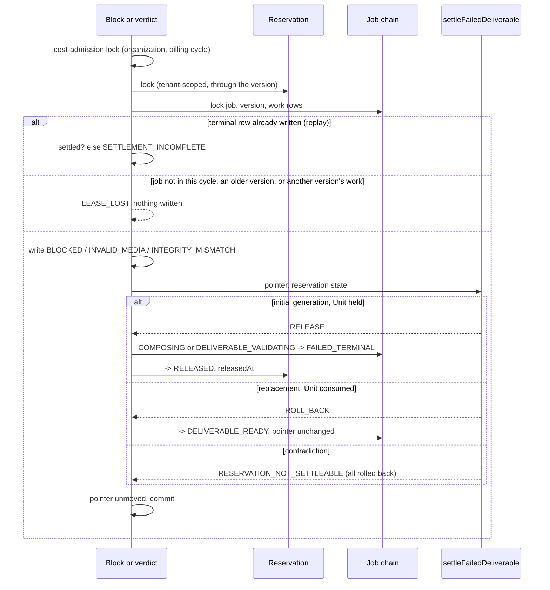
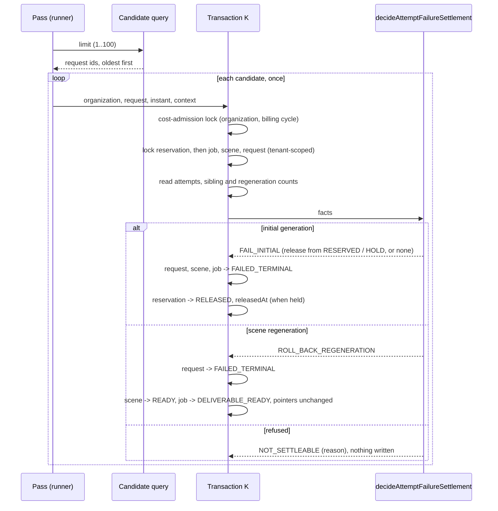

# Completion — starting a video, and previewing and downloading it

Branch: `claude/project-thread-az06z2`
ADRs: `docs/decisions/0082-a-failed-deliverable-settles-its-job.md` (GS-1),
`docs/decisions/0083-a-scene-whose-attempts-failed-settles-its-job.md` (GS-2a)
Gap analysis: `docs/generation-e2e-gap-analysis.md`
Plan: `/mnt/project-files/cto/generation-e2e-proposal.md`, approved by the
product owner on 2026-10-26, including the development-only pipeline command

The product owner approved connecting the built, dormant generation steps and
adding the screens, so that a person on a development machine can start a
video on the test provider and preview and download it, in about thirteen pull
requests (GS-1 to GS-13), each merged only with their yes. Each extends this
record. The plan is not a Roadmap phase, so it receives no `phase-N-complete`
tag.

## GS-1 — a failed deliverable settles its job

Base: `dbe8038` (PR #104 merge commit on `main`; post-merge CI run 666 green).
ADR: `docs/decisions/0082-a-failed-deliverable-settles-its-job.md`

**No migration**, although the plan expected one: every state and column the
settlement needs already exists.

Commits, oldest first:

| Commit | What it carries |
| --- | --- |
| `70a09ac` | the domain decision, the database settlement, both writers' wiring, the reserved edges, the tests, ADR-0082 and the documentation |
| `0316afa` | the review's answers: the claim's work row matched, the cost-admission lock first, the replacement's replay requiring its consumed Unit, the settlement defect's code reported, the guards rewritten onto the settlement, the ADR and TODO corrections |
| this commit | this record |

The exact head SHA is reported with the pull request.

### What GS-1 does

- **One decision for every failure class.** `settleFailedDeliverable` reads
  the job's deliverable pointer and its reservation's state: an initial
  generation whose Unit is `RESERVED` or `RECONCILIATION_HOLD` fails and
  releases it; a replacement whose earlier delivery is `CONSUMED` rolls back to
  `DELIVERABLE_READY`; anything else is refused with
  `RESERVATION_NOT_SETTLEABLE` and nothing is written.
- **In the commit that records the failure.** `blockComposition` and the
  three terminal verdicts call `settleDeliverableFailure` after writing their
  terminal row, so the failure and its settlement commit together or not at
  all. The release is stamped with the block's or the verdict's instant.
- **The cost-admission lock, then Reservation, then Job.** Both writers take
  the organization and billing-cycle lock every entitlement release takes,
  then lock the reservation, tenant-scoped through the version, then their
  chain.
- **Only the running cycle.** A block or verdict for a job that left the
  cycle's state, for a version that is not the job's newest, or (a block)
  with a claim whose work row is not the version's own, is `LEASE_LOST`.
- **A replay must find its settlement**, or throws `SETTLEMENT_INCOMPLETE`.
- **The generic API cannot end a Unit-holding job**: eight edges reserved.
- **Still dormant.** Nothing in production constructs either runner.

### Verification

Measured locally on `0316afa` (PostgreSQL 16 configured like CI; FFmpeg
6.1.1, the version CI's `media` job installs). This record's commit changes
only this file.

| Check | Result |
| --- | --- |
| `pnpm lint` / `pnpm typecheck` | clean |
| `pnpm test` | **5976 / 5976**, 215 files (5937 on `dbe8038`) |
| `pnpm test:db` | **1538 / 1538**, 58 files (1505 on `dbe8038`) |
| `pnpm test:media` | **169 / 169**, on `70a09ac`: no media code changed since |
| `pnpm build` | succeeded |
| `prisma migrate diff` (migrations against the schema) | no difference |

New and changed tests:

- `packages/domain/src/deliverable-settlement/settlement.test.ts` (new):
  both held reservations released and a consumed one rolled back; every
  other pointer and reservation pair refused with
  `RESERVATION_NOT_SETTLEABLE`, checked over the whole table; the replay
  check for each arm and each failed cycle, a replacement's only while its
  Unit is still `CONSUMED`; the defects' fixed messages.
- `packages/domain/src/deliverable-settlement/settlement-shape.test.ts` (new):
  the database settlement updates the job and the reservation once each and
  inserts or deletes nothing; it moves the reservation only to `RELEASED` with
  its instant, never consumes or writes the pointer, writes only the job state
  the domain chose, and takes the cost-admission lock before the reservation;
  neither writer releases or fails a job itself, and each settles in one
  place.
- `tests/integration/deliverable-failure-settlement.db.test.ts` (new): the
  replacement arm for a block and a verdict, each replayed; a replay after the
  job moved on to a later cycle; a reconciliation hold released by a block and
  by a verdict; every contradicting reservation writing nothing, the terminal
  row included; a replay whose settlement is missing refused; a cycle the job
  no longer runs, an older version, or a claim naming another version's work,
  lost; another tenant's claim lost; the eight reserved edges refused by the
  generic API; and the lock order: a writer holding the reservation and then
  needing the job makes both a block and a verdict wait, without a deadlock,
  and each waits for the cost-admission lock of its organization and cycle.
- `tests/integration/unit-entitlement-ledger.db.test.ts`: a deliverable that
  fails validation gives every frozen Unit back; the balance equals the
  balance before the reservation and no allocation moves.
- `tests/integration/deliverable-composition-execution.db.test.ts`,
  `deliverable-validation.db.test.ts`, `deliverable-plan.db.test.ts` and
  `deliverable-composition-execution-races.db.test.ts`: the five tests that
  pinned "a failure settles nothing" now pin the settlement: an initial job
  `FAILED_TERMINAL` with its reservation `RELEASED` at the failure's instant, a
  replacement `DELIVERABLE_READY` with its reservation untouched, and the
  settlement's job and reservation events.
- `packages/domain/src/orchestration/state-machines.test.ts`: the new
  `COMPOSING → DELIVERABLE_READY` edge.
- `packages/domain/src/deliverable-validation/dormancy.test.ts` and
  `deliverable-composition-execution/dormancy.test.ts`: the guards that said
  neither repository moves money now say what is true, that neither writes a
  Unit or a terminal job state itself and each reaches the settlement from its
  failure path alone; the settlement module and its lock reach nothing outside
  the database package, the domain and Prisma.
- `packages/domain/src/deliverable-validation/runner.test.ts`: the sweep
  reports a settlement defect's code.

The lock-order test was checked against the inverted order: with
`blockComposition` locking the job before the reservation, it fails with a
PostgreSQL deadlock.

### Mutation testing

Each mutant applied to the source, the relevant suites run, and the file
restored and checked by SHA-256; the repository's manifest was identical
before and after each pass.

**Round 1, on `70a09ac`: 44 mutants, 44 killed.** None survived, none broken.

| Mutant | Area | Change | Killed by |
| --- | --- | --- | --- |
| S01 | decide | a held Unit is not released | settlement, db-settle |
| S02 | decide | a reserved Unit is not released | settlement, db-compose |
| S03 | decide | an initial generation released whatever its Unit | settlement, db-settle |
| S04 | decide | a replacement rolled back whatever its Unit | settlement, db-settle |
| S05 | decide | a replacement releases instead | settlement, db-settle |
| S06 | replay | an initial settlement held without its release | settlement |
| S07 | replay | an initial settlement held without its job | settlement |
| S08 | replay | a later cycle not recognised | settlement, db-settle |
| S09 | replay | a replacement always held settled | settlement, db-settle |
| S10 | defect | a defect's message changed | settlement |
| M01 | state | the rollback edge missing from the state machine | state-machine |
| H01 | lock | the reservation read without its lock | db-settle |
| H02 | settle | the job not moved | db-compose, db-settle |
| H03 | settle | the Unit not released | db-compose, db-ledger |
| H04 | settle | no release instant | db-compose |
| H05 | settle | released only from RESERVED | db-settle |
| H06 | events | the job event types swapped | db-compose, db-settle |
| H07 | events | no reservation event | db-compose |
| H08 | events | no reason code | db-compose |
| H09 | replay | a missing settlement never refused | db-settle |
| H10 | settle | the reservation's state never read | db-compose |
| K01 | compose | a block settles nothing | db-compose |
| K02 | compose | the reservation locked after the chain | db-settle |
| K03 | compose | a block on an older version settles | db-settle |
| K04 | compose | a block on a job that left composing settles | db-settle |
| K05 | compose | a replayed block's settlement unchecked | db-settle |
| K06 | compose | the block's cycle named as validation | db-compose |
| K07 | compose | every version taken as the newest | db-settle |
| K08 | compose | the newest ordinal read as the lowest | db-settle |
| V01 | validate | a verdict settles nothing | db-validation |
| V02 | validate | the reservation locked after the chain | db-settle |
| V03 | validate | a verdict on a job that left validation settles | db-settle |
| V04 | validate | a verdict on an older version settles | db-settle |
| V05 | validate | a replayed verdict's settlement unchecked | db-settle |
| V06 | validate | the release stamped with the clock | db-validation |
| V07 | validate | every version taken as the newest | db-settle |
| E-RESERVED→CANCELLED | edges | the generic API takes RESERVED → CANCELLED | db-settle |
| E-RESERVED→FAILED_TERMINAL | edges | the generic API takes RESERVED → FAILED_TERMINAL | db-settle |
| E-GENERATING→FAILED_TERMINAL | edges | the generic API takes GENERATING → FAILED_TERMINAL | db-settle |
| E-SCENES_READY→FAILED_TERMINAL | edges | the generic API takes SCENES_READY → FAILED_TERMINAL | db-settle |
| E-COMPOSITION_PENDING→FAILED_TERMINAL | edges | the generic API takes COMPOSITION_PENDING → FAILED_TERMINAL | db-settle |
| E-COMPOSING→FAILED_TERMINAL | edges | the generic API takes COMPOSING → FAILED_TERMINAL | db-settle |
| E-DELIVERABLE_VALIDATING→FAILED_TERMINAL | edges | the generic API takes DELIVERABLE_VALIDATING → FAILED_TERMINAL | db-settle |
| E-COMPOSING→DELIVERABLE_READY | edges | the generic API takes COMPOSING → DELIVERABLE_READY | db-settle |

Suites: `settlement` = `settlement.test.ts`; `state-machine` =
`state-machines.test.ts`; `db-settle` = the new settlement database suite;
`db-compose` = the composition database suite; `db-validation` = the
validation database suite; `db-ledger` = the Unit entitlement ledger suite.
K02 is the inverted order the lock-order test was checked against by hand:
with it, a block deadlocks behind a writer holding the reservation.

**Round 2, on `0316afa`: the 44 again, with S08 and S09 re-anchored on the
replacement's new replay check, and eleven added for the review's answers: 55
mutants, 54 killed.** V08 survived: it added a bare reference
`void settleDeliverableFailure;` inside the verdict, which settles nothing and
is no second settlement, so the guard, which counts calls, rightly passes. It
was replaced by V09, a second settlement call from the `VALID` verdict, run on
its own afterwards and killed by the guards. None broken.

| Mutant | Area | Change | Killed by |
| --- | --- | --- | --- |
| S08 | replay | a later cycle not recognised | settlement, db-settle |
| S09 | replay | a replacement always held settled | settlement, db-settle |
| S11 | replay | a replacement held settled without its Unit | settlement |
| C01 | cost-lock | no cost-admission lock | db-settle, shape |
| C02 | cost-lock | the lock taken on another cycle | db-settle |
| C03 | cost-lock | the lock taken after the reservation | shape |
| G01 | guard | the settlement consumes instead | shape |
| G02 | guard | the settlement names its own job state | shape |
| G03 | guard | the settlement writes the pointer | shape |
| K09 | compose | a claim's work row not matched to its version | db-settle |
| K10 | guard | the block appends an event of its own | dormancy-compose |
| R01 | runner | a settlement defect's code dropped | runner |
| V08 | guard | a bare reference to the settlement in the verdict (no call) | **survived**, equivalent |
| V09 | guard | the VALID verdict settles too | dormancy-validation, shape |

New suites: `shape` = `settlement-shape.test.ts`; `runner` = the validation
`runner.test.ts`; `dormancy-compose` and `dormancy-validation` = the two
dormancy suites.

### Review

Codex is at its usage limit, so, as for DS-3 to DS-6b, an independent review
agent reviewed `70a09ac` against `dbe8038`, reading only git objects. It found
no way, with well-formed claims, to consume a Unit, release one twice, or
commit a terminal row without its settlement; it confirmed that a job holds one
reservation, so a replacement has nothing of its own to release, that no
transaction locks the job before the reservation, and that nothing in
production took any of the newly reserved edges. Verdict: nothing blocking;
five should-fix findings and five nits, answered in `0316afa`:

| Finding | Answer |
| --- | --- |
| `blockComposition` never matched the claim's work row to the version it locked: a claim pairing one version with another's work would block that other work unlocked and unsettled, and settle this job while its work still ran | Fixed: `LEASE_LOST` unless the locked work row is the claim's, as `finalizeComposition` asks (ADR-0082 Decision 4). Test: a block whose claim names another version's work writes nothing to either job. Mutant K09 |
| A settlement defect rolls the whole transaction back, so the work stays `RUNNING`, is re-offered after its lease and repeated, re-encoding each time; the validation sweep recorded its code as `null` | The defect stays a defect, as Transaction G's refusals of the same reservations are. ADR-0082 Decision 2 now says the work is re-offered and repeated, its cost (as ADR-0078's), and that nothing in production can produce such a reservation today. The validation sweep now reports the defect's code (mutant R01); TODO's operator-tooling and findability items name it. The generic reservation API's release is not reserved here: many suites use it, and its owners are later milestones' |
| Five guard tests (three in composition's dormancy suite, two in validation's) now passed vacuously and stated the opposite of the code | Rewritten as what is now true: each repository writes no Unit or terminal job state itself and reaches the settlement from its failure path alone. A new suite, `settlement-shape.test.ts`, holds the settlement module: one update each of the job and the reservation, the reservation only to `RELEASED` with its instant, never `CONSUMED` or the pointer, only the job state the domain chose, and the cost-admission lock before the reservation. Mutants G01 to G03, K10, V09 |
| The documented rule that every entitlement release takes the cost-admission lock before the reservation was skipped, and the ADR misattributed the order to Transaction H | Fixed: both writers take the organization and billing-cycle lock first, as Transaction H does (ADR-0082 Decision 3). Tests: a block and a verdict each wait for that lock. Mutants C01 to C03 |
| A failed replacement after a delivered scene regeneration keeps the new rendition and the counted right; if the block came from that rendition, every later revision fails the same way, while a regeneration that fails earlier spends no right | Recorded as an open decision gate in TODO, not decided here; ADR-0082's *Not decided here* and *Consequences* and the Roadmap now say "charging no Unit" and name the right |
| Nit: the ADR said the suite proves the inverted order deadlocks; the wait helper counted any waiting backend | The ADR now says that was checked by hand. The helper counts only a backend waiting on the reservation's lock statement, or on the advisory lock |
| Nit: `lockClaimChain` reads the work row and `highestOrdinal` from the pre-wait snapshot | Commented: safe because the work row's writes are compare-and-set and Transaction I, the only writer of versions, holds the reservation the block now takes first |
| Nit: a replacement's replay check never read its reservation | It now requires `CONSUMED`. Mutant S11 |
| Nit: "never consumes a Unit" only searched the JSON | Replaced by the whole table: three rows settle, every other pair is the defect |
| Nit: about 1,900 changed lines against the ~500-line policy | About 810 are production code with its comments (after these answers); the rest are tests and documentation. DS-6b's PR was a similar size. Splitting the decision from its wiring would leave a dormant module nothing calls in one PR |

### Required documentation

| Item | Where |
| --- | --- |
| Architecture diagram | `docs/architecture.md` status table: the composition-execution and validation rows |
| Entity-relationship diagram | `docs/er-diagram.md`, *GS-1*: not applicable, no entity, relationship or column changes |
| Critical sequence diagram | the diagram above; the decision is ADR-0082 Decision 2 |
| OpenAPI / API change summary | `docs/api-changes-gs-1.md`: no HTTP change; the domain decision, the writers' new behaviour, the reserved edges |
| Change log / release notes | the commit list above and the pull request description |
| Database migration notes | `docs/migration-notes.md`, *GS-1*: no migration, what rolling back means, and a query for terminal rows recorded before this build |
| Completion report | this file |

Also updated: `docs/Roadmap.md`, `docs/generation-e2e-gap-analysis.md` and
`docs/decisions/TODO.md` (the Phase 5B and 5C settlement items, the permanent
technical-failure item, the operator-tooling and findability items, and two new
open decision gates: whether operator recovery consumes a Unit, and whether a
failed replacement gives back the scene regeneration right that started it).

### Activation status

Nothing paid or scheduled is activated. Nothing in production constructs the
composition or validation runner: no worker, scheduler, credential,
environment variable or payment integration. Paid Provider Activation,
production Provider credentials, production paid AI calls, the production
scheduler and live Stripe charges remain BLOCKED.

### Known limitations

- **Provider-side failures** (a refusal, a failure, an unresolved submission)
  before composition still leave the job and its Unit where they are. GS-2
  settles them.
- **Transaction G's defects and a claim refused as `UNSUPPORTED_TARGET`**
  write no terminal row, so nothing settles them; they wait for an operator.
- **A failed replacement after a delivered scene regeneration** keeps the
  scene's new rendition and its counted regeneration right (ADR-0082, *Not
  decided here*; TODO).
- **A settlement defect is repeated, not parked.** Work whose reservation
  contradicts its job rolls back and is re-offered every lease period,
  repeating its encode or probe (ADR-0082 Decision 2). Nothing in production
  can produce such a reservation today; the operator tooling that finds and
  stops it is in TODO.
- **Terminal rows recorded before this build** are never settled late: a
  replay refuses them with `SETTLEMENT_INCOMPLETE`. Only development data can
  hold them; the migration notes give the query.
- **Whether a video delivered by operator recovery consumes a Unit** is not
  decided (TODO).

### Remaining work

Merged as PR #105 with the product owner's yes (`e446548`; post-merge CI run
670 green). GS-2 (provider-side failures settle the job) came next.

## GS-2a — a scene whose attempts ended without a video settles its job

Base: `e446548` (PR #105 merge commit on `main`; post-merge CI run 670 green).
ADR: `docs/decisions/0083-a-scene-whose-attempts-failed-settles-its-job.md`

GS-2 was split in two before implementation, to keep each pull request
reviewable: GS-2a settles the failed scene's job, GS-2b will end that job's
other scenes. **No migration.**

Commits, oldest first:

| Commit | What it carries |
| --- | --- |
| `2cd6cc1` | the domain decision, the runner, Transaction K, the reserved edges, the tests, ADR-0083 and the documentation |
| `98e9969` | the review's answers: the runner isolates a failing candidate, two race tests, the documents corrected |
| this commit | this record |

The exact head SHA is reported with the pull request.

### What GS-2a does

- **One decision whichever way the attempt ended.**
  `decideAttemptFailureSettlement` reads the request, every attempt's state,
  the scene, the job and the reservation. A request whose attempts all ended,
  the newest without a video, settles: an initial generation fails and its
  Unit is released from `RESERVED` or `RECONCILIATION_HOLD` (or is left alone
  when reconciliation already released it); a scene regeneration rolls back
  to the video the customer holds. Anything else is refused with a closed
  reason, and nothing is written.
- **A sweep over durable facts.** Transaction K is its own short
  transaction, offered requests by a bounded candidate query that mirrors
  every refusal, so a refused request is never offered again and cannot hold
  the head of a batch; a candidate whose settlement throws is reported and
  passed over. The three writers that end attempts are unchanged.
- **The cost-admission lock, then the reservation, then the chain**, as
  Transaction H; the attempts are read, not locked, because admission takes
  the request lock first.
- **The generic API cannot fail a generating request or scene.**
- **Still dormant.** Nothing in production constructs the runner or the
  repository.

### Verification

Measured locally on `98e9969` (PostgreSQL 16 configured like CI; FFmpeg
6.1.1, the version CI's `media` job installs). This record's commit changes
only this file.

| Check | Result |
| --- | --- |
| `pnpm lint` / `pnpm typecheck` | clean |
| `pnpm test` | **6053 / 6053**, 218 files (5976 on `e446548`) |
| `pnpm test:db` | **1586 / 1586**, 59 files (1538 on `e446548`) |
| `pnpm test:media` | **169 / 169**, 4 files: no media code changed |
| `pnpm build` | succeeded |
| `prisma migrate diff` (migrations against the schema) | no difference |

New and changed tests:

- `packages/domain/src/attempt-failure-settlement/settlement.test.ts` (new):
  every way an attempt can end without a video settles alike; a held,
  reserved and already released Unit for an initial generation, and a
  consumed one for a regeneration; every other request, attempt, scene, job
  and reservation shape refused with its closed reason; the batch bound; the
  defects' fixed messages.
- `packages/domain/src/attempt-failure-settlement/runner.test.ts` (new): each
  candidate settled once, with its own instant and correlation; refusals and
  releases counted honestly; the bound checked before the query; a settlement
  that throws reported `FAILED` with its defect code, or `null`, and the pass
  going on to the next candidate.
- `packages/domain/src/attempt-failure-settlement/dormancy.test.ts` (new):
  nothing in production constructs the runner or the repository, and neither
  reaches past the database, the domain and Prisma; the repository updates
  the request, scene, job and reservation only, inserts or deletes nothing,
  moves the reservation only to `RELEASED` with its instant, never consumes a
  Unit, writes a delivered pointer or touches an attempt, takes the
  cost-admission lock, then the reservation, then the chain, and decides in
  one place.
- `tests/integration/attempt-failure-settlement.db.test.ts` (new, 48 tests,
  on the fixture `tests/integration/attempt-failure-fixture.ts`): an initial
  generation settled after a refusal, a retryable or terminal provider
  failure and an exhausted reconciliation, its Unit released from `RESERVED`
  or `RECONCILIATION_HOLD` or left alone when reconciliation released it; a
  failed media recovery; a replay; a later scene of a failed job refused; a
  regeneration rolled back to the customer's video, and every contradicting
  shape refused, writing nothing; what is never offered; tenancy; discovery
  offering exactly what settles, oldest first and bounded; the dormant runner;
  the two reserved generic edges; and concurrency: two settlements of one
  request settle it once, two failed scenes of one job release its Unit once
  and fail it once, a writer holding the job is waited for and its commit
  decides, the cost-admission lock of the organization and cycle is waited
  for, and a writer holding the reservation and then needing the job is
  waited behind without a deadlock.

The lock-order test was checked against the inverted order by mutant R23
(round 2): with the job locked before the reservation, the reservation-first
writer and the settlement deadlock and the test fails.

### Mutation testing

Each mutant applied to the source, the relevant suites run, and the file
restored and checked by SHA-256; the repository's manifest was identical
before and after each pass.

**Round 1, on `2cd6cc1`: 72 mutants, 72 killed.** None survived, none broken.

| Mutant | Area | Change | Killed by |
| --- | --- | --- | --- |
| D01 | decide | a delivered request still settles | settlement |
| D02 | decide | the newest attempt need not have ended without a video | settlement, db |
| D03 | decide | an older attempt may still be open | settlement, db |
| D04 | decide | the job's state is not asked | settlement, db |
| D05 | decide | an initial scene need not be generating | settlement, db |
| D06 | decide | an initial scene may already name a rendition | settlement, db |
| D07 | decide | an initial job may already hold a video | settlement, db |
| D08 | decide | a Unit held for reconciliation is not released | settlement, db |
| D09 | decide | a job whose Unit reconciliation released is refused | settlement, db |
| D10 | decide | a released Unit is released again | settlement, db |
| D11 | decide | a held Unit's state not passed on | settlement, db |
| D12 | decide | a regeneration's scene need not be revising | settlement, db |
| D13 | decide | a regeneration's pointer need not name a delivered rendition | settlement, db |
| D14 | decide | a regeneration's job need not hold a video | settlement, db |
| D15 | decide | another scene may be not ready | settlement, db |
| D16 | decide | another regeneration may be open | settlement, db |
| D17 | decide | a regeneration's Unit need not be consumed | settlement, db |
| D18 | decide | a verified output counts as ended without one | settlement |
| D19 | bound | a batch of 101 accepted | settlement, runner, db |
| D20 | bound | a fraction accepted | settlement, runner, db |
| D21 | defect | a defect's message changed | settlement |
| U01 | runner | a candidate settled twice | runner |
| U02 | runner | every settlement stamped with one fixed instant | runner |
| U06 | runner | every settlement given one correlation | runner |
| U03 | runner | a refusal counted as settled | runner |
| U04 | runner | every settlement counted as a release | runner, db |
| U05 | runner | the bound not checked before the query | runner |
| R01 | lock | no cost-admission lock | db, dormancy |
| R02 | lock | the lock taken on another cycle | db |
| R03 | lock | the reservation read without its lock | db, dormancy |
| R04 | lock | the chain read without its lock | dormancy |
| R05 | tenancy | the chain found in any organization | db |
| R06 | settle | the request's failure instant not written | db, dormancy |
| R07 | settle | no release instant | db, dormancy |
| R08 | settle | the release stamped with the clock | db |
| R09 | settle | the Unit not released | db |
| R10 | settle | the Unit consumed instead | db, dormancy |
| R11 | settle | the initial scene not failed | db |
| R12 | settle | the initial job not failed | db |
| R13 | settle | the rolled-back job left generating scenes | db |
| R14 | settle | the rolled-back scene left revising | db |
| R15 | settle | the attempts read newest first | db |
| R16 | settle | a predecessor need not be delivered | db |
| R17 | settle | ready siblings counted as not ready | db |
| R18 | settle | open regenerations never counted | db |
| R19 | events | no reason code | db |
| R20 | events | no reservation event | db |
| R21 | events | the scene's failure named as a rollback | db |
| R22 | events | the caller's context dropped | db |
| Q01 | discovery | a job that left generating offered | db |
| Q02 | discovery | an older open attempt ignored | db |
| Q03 | discovery | the oldest attempt taken as the newest | db |
| Q04 | discovery | a verified output counts as ended without one | db |
| Q05 | discovery | an initial scene that is not generating offered | db |
| Q06 | discovery | an initial scene naming a rendition offered | db |
| Q07 | discovery | an initial job holding a video offered | db |
| Q08 | discovery | an initial job whose Unit reconciliation released not offered | db |
| Q09 | discovery | a consumed initial job offered | db |
| Q10 | discovery | a regeneration's scene need not be revising | db |
| Q11 | discovery | a regeneration's job need not hold a video | db |
| Q12 | discovery | a regeneration's Unit need not be consumed | db |
| Q13 | discovery | a predecessor need not be delivered | db |
| Q14 | discovery | a sibling not ready ignored | db |
| Q15 | discovery | another open regeneration ignored | db |
| Q16 | discovery | newest first | db |
| Q17 | discovery | the bound ignored | db |
| Q18 | discovery | the bound not validated | db |
| Q19 | discovery | the organization taken from the wrong row | db |
| E01 | edges | the generic API fails a generating request | db |
| E02 | edges | the generic API fails a generating scene | db |
| G01 | guard | the worker constructs the runner | dormancy |
| G02 | guard | the repository inserts a row | dormancy |

Suites: `settlement`, `runner` and `dormancy` = the three domain suites above;
`db` = the new settlement database suite.

**Round 2, on `98e9969`: the 72 again, with Q01 re-anchored on the query's new comment, and six
added for the review's answers: 78 mutants, 78 killed.** None survived, none
broken. R23 locks the job before the reservation: both lock-order tests fail,
the reservation-first one with PostgreSQL's `deadlock detected` (`40P01`).
R04, caught only by the dormancy guard in round 1, is now caught by the
job-first race test too.

| Mutant | Area | Change | Killed by |
| --- | --- | --- | --- |
| Q01 | discovery | a job that left generating offered | db |
| R04 | lock | the chain read without its lock | db, dormancy |
| U07 | runner | a throwing settlement stops the pass | runner |
| U08 | runner | a defect's code dropped | runner |
| U09 | runner | a failure not counted | runner |
| U10 | runner | a failure counted as settled | runner |
| U11 | runner | every error reported as a defect | runner |
| R23 | lock | the job locked before the reservation | db |

### Review

Codex is at its usage limit, so, as for DS-3 to GS-1, an independent review
agent reviewed `2cd6cc1` against `e446548`, reading only git objects. It found
no way to consume a Unit, release one twice, release a consumed one or deliver
past a settlement. It confirmed that the candidate query and the decision agree
on every predicate, so no request is starved or settled unoffered; that every
writer taking both the reservation and the job takes the reservation first, and
the writers taking the job first take neither the reservation nor the
cost-admission lock, so none can close a cycle with Transaction K; that no
attempt can appear while K holds the request; that K and Transaction H are
disjoint; and that tenancy is proved in every locking statement. Verdict:
nothing blocking; three should-fix findings, six nits and a list of test
gaps, answered in
`98e9969`:

| Finding | Answer |
| --- | --- |
| ADR-0083 named two writers that do not move the orchestration state: the execution preflight writes the legacy `state` column, and no generic attempt transition exists. Several documents said preflight failures and pre-submission cancellations settle. An orchestrated attempt that failed preflight would stay `QUEUED` and its Unit held | Corrected everywhere: three writers end an attempt without a video; `QUEUED → FAILED_*` and `QUEUED → CANCELLED_PRE_SUBMISSION` are edges no writer takes yet. ADR-0083 *Not decided here* names the preflight gap, and a new TODO item says the preflight must move the orchestration state before generation is activated |
| The ADR contradicted itself on a failed output copy | Corrected: a failed output copy does not end its attempt, which stays `OUTPUT_INGESTING` and resumes, so it settles nothing |
| One throwing settlement stopped the whole pass, and with the oldest candidate first it would recur at the head of every pass, stopping every later release | Fixed: the runner reports such a candidate `FAILED`, with its defect code or `null`, counts it, and goes on (ADR-0083 Decision 1). Test: a defect and an unexpected error each isolated, the next candidate still released. Mutants U07 to U11 |
| Nit: a comment said "Transactions H and J" | Now "H and K" |
| Nit: two comments said a retryable failure stays retryable | Both now say nothing retries one yet, so this settlement ends it (ADR-0083 Decision 2) |
| Nit: "the two take the same locks" was loose | ADR-0083 Decision 2 now says both take the cost-admission lock, the reservation and the chain, and H also locks the attempt, its validation and its work row |
| Nit: no test reaches the candidate query's `orchestrationState IS NULL` arm | It is unreachable: the all-or-none CHECK gives every attempt linked to a request a state. The query now says the arm is defensive; a mutant removing it would be equivalent |
| Nit: two side effects on a failed job's siblings | Named in ADR-0083 *Not decided here*: the gate's expected `RESERVATION_RELEASED` anomaly for a queued sibling, and a sibling's Transaction H work row answering `NOT_EXHAUSTED` on every pass. Both are GS-2b's |
| Test gap: two failed scenes of one job; a writer that takes the job first | Both added: one release and one job failure; a job-first writer waited for, its commit deciding. The remaining gaps (a real admission racing the settlement, races against H and against Transaction F, the gate refusing a sibling, a hold kept for an unknown sibling) are listed under *Known limitations* |
| Nit: about 830 production lines plus about 1,700 test lines against the ~500-line policy | About 865 are production code with its comments after these answers; the rest are tests (about 1,780) and documentation. GS-1 was a similar size. Splitting the decision from its transaction would leave a dormant module nothing calls in one PR |

### Required documentation

| Item | Where |
| --- | --- |
| Architecture diagram | `docs/architecture.md` status table: the attempt failure settlement row |
| Entity-relationship diagram | `docs/er-diagram.md`, *GS-2a*: not applicable, no entity, relationship or column changes |
| Critical sequence diagram | the diagram above; the decision is ADR-0083 Decisions 2 and 3 |
| OpenAPI / API change summary | `docs/api-changes-gs-2a.md`: no HTTP change; the domain decision, the runner, Transaction K, the reserved edges |
| Change log / release notes | the commit list above and the pull request description |
| Database migration notes | `docs/migration-notes.md`, *GS-2a*: no migration, and what rolling back means |
| Completion report | this file |

Also updated: `docs/Roadmap.md`, `docs/generation-e2e-gap-analysis.md` and
`docs/decisions/TODO.md` (the permanent technical-failure item, the recovery
budget item, the operator-tooling item, and two new items: bounding how long
an attempt may run, and moving the preflight's failures onto the orchestration
state).

### Activation status

Nothing paid or scheduled is activated. Nothing in production constructs the
attempt failure settlement runner or its repository: no worker, scheduler,
credential, environment variable or payment integration. Paid Provider
Activation, production Provider credentials, production paid AI calls, the
production scheduler and live Stripe charges remain BLOCKED.

### Known limitations

- **The failed job's other scenes** stay where they are: their requests stay
  `GENERATING`, a queued sibling is refused by the paid-submission gate as
  `RESERVATION_RELEASED` (read as an anomaly), and a sibling's Transaction H
  work row is offered again on every pass. GS-2b ends them.
- **An attempt that fails preflight** keeps its orchestration state `QUEUED`,
  so its request is never settled (TODO). Nothing in production runs the
  preflight against an orchestrated attempt yet.
- **An attempt that never ends**, left `PROCESSING` or `OUTPUT_INGESTING`, is
  never settled; how long one may run is not decided (TODO).
- **A retryable failure settles** until the internal service-recovery budget
  exists (ADR-0083 Decision 2).
- **Not tested here:** a real admission racing the settlement, races against
  Transaction H and Transaction F, the gate refusing a sibling once the Unit
  is released (the gate's own suite covers a released Unit), and a hold
  reconciliation keeps for an unknown sibling.
- **Whether a video delivered by operator recovery consumes a Unit** is still
  not decided (TODO).

### Remaining work

GS-2a waits for the product owner's yes before merge. GS-2b (ending the failed
job's other scenes and cancelling their queued attempts) comes next.
