# Completion — starting a video, and previewing and downloading it

Branch: `claude/project-thread-az06z2`
ADRs: `docs/decisions/0082-a-failed-deliverable-settles-its-job.md` (GS-1),
`docs/decisions/0083-a-scene-whose-attempts-failed-settles-its-job.md` (GS-2a),
`docs/decisions/0084-a-failed-jobs-other-scenes-close.md` (GS-2b),
`docs/decisions/0085-a-shared-folder-holds-development-objects.md` (GS-3),
`docs/decisions/0086-a-storyboard-is-saved-in-one-commit.md` (GS-4a),
`docs/decisions/0087-a-generation-starts-in-one-commit.md` (GS-4b),
`docs/decisions/0088-starting-a-video-the-start-service.md` (GS-4c),
`docs/decisions/0089-the-route-table-and-price-catalog-are-passed-in.md` (GS-5a-1),
`docs/decisions/0090-the-test-route-is-built-only-outside-production.md` (GS-5a-2),
`docs/decisions/0091-a-billing-cycles-revenue-is-read-from-its-period.md` (GS-5b),
`docs/decisions/0092-the-test-provider-makes-a-real-clip-from-the-photo.md` (GS-6),
`docs/decisions/0094-the-concurrent-job-limit-and-a-waiting-jobs-launch-plan.md` (GS-7a)
Gap analysis: `docs/generation-e2e-gap-analysis.md`
Plan: `/mnt/project-files/cto/generation-e2e-proposal.md`, approved by the
product owner on 2026-10-26, including the development-only pipeline command

The product owner approved connecting the built, dormant generation steps and
adding the screens, so that a person on a development machine can start a
video on the test provider and preview and download it, in about thirteen pull
requests (GS-1 to GS-13), each merged only with their yes. Each extends this
record. The plan is not a Roadmap phase, so it receives no `phase-N-complete`
tag.

## GS-1 — a failed deliverable settles its job

Base: `dbe8038` (PR #104 merge commit on `main`; post-merge CI run 666 green).
ADR: `docs/decisions/0082-a-failed-deliverable-settles-its-job.md`

**No migration**, although the plan expected one: every state and column the
settlement needs already exists.

Commits, oldest first:

| Commit | What it carries |
| --- | --- |
| `70a09ac` | the domain decision, the database settlement, both writers' wiring, the reserved edges, the tests, ADR-0082 and the documentation |
| `0316afa` | the review's answers: the claim's work row matched, the cost-admission lock first, the replacement's replay requiring its consumed Unit, the settlement defect's code reported, the guards rewritten onto the settlement, the ADR and TODO corrections |
| this commit | this record |

The exact head SHA is reported with the pull request.

### What GS-1 does

- **One decision for every failure class.** `settleFailedDeliverable` reads
  the job's deliverable pointer and its reservation's state: an initial
  generation whose Unit is `RESERVED` or `RECONCILIATION_HOLD` fails and
  releases it; a replacement whose earlier delivery is `CONSUMED` rolls back to
  `DELIVERABLE_READY`; anything else is refused with
  `RESERVATION_NOT_SETTLEABLE` and nothing is written.
- **In the commit that records the failure.** `blockComposition` and the
  three terminal verdicts call `settleDeliverableFailure` after writing their
  terminal row, so the failure and its settlement commit together or not at
  all. The release is stamped with the block's or the verdict's instant.
- **The cost-admission lock, then Reservation, then Job.** Both writers take
  the organization and billing-cycle lock every entitlement release takes,
  then lock the reservation, tenant-scoped through the version, then their
  chain.
- **Only the running cycle.** A block or verdict for a job that left the
  cycle's state, for a version that is not the job's newest, or (a block)
  with a claim whose work row is not the version's own, is `LEASE_LOST`.
- **A replay must find its settlement**, or throws `SETTLEMENT_INCOMPLETE`.
- **The generic API cannot end a Unit-holding job**: eight edges reserved.
- **Still dormant.** Nothing in production constructs either runner.

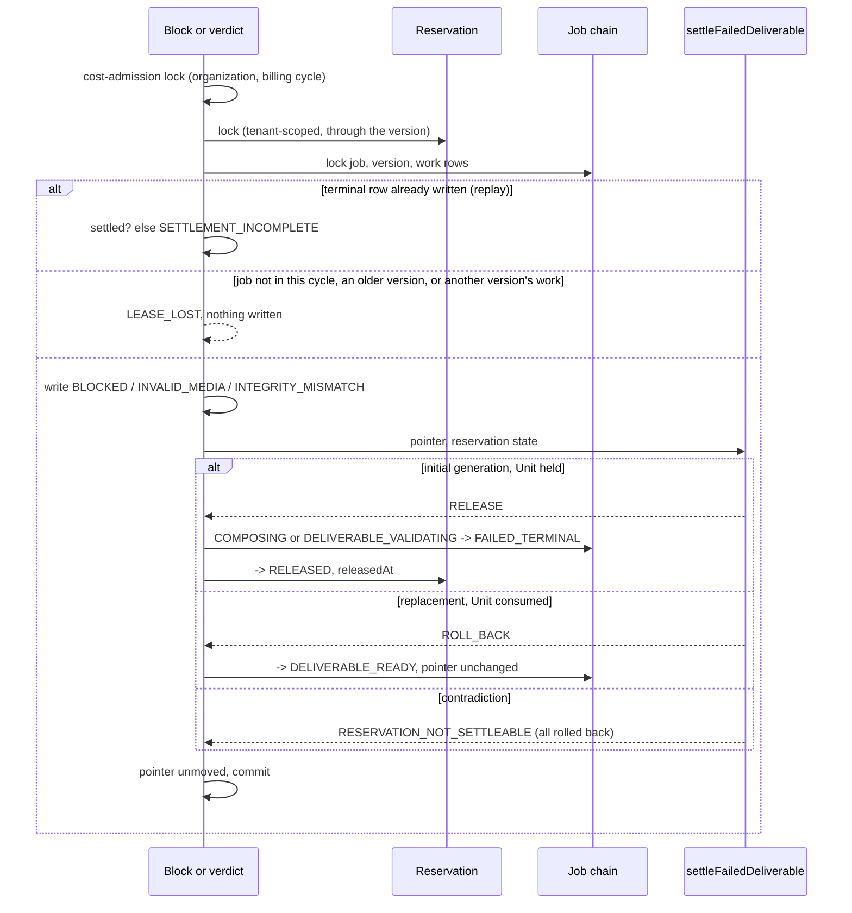

### Verification

Measured locally on `0316afa` (PostgreSQL 16 configured like CI; FFmpeg
6.1.1, the version CI's `media` job installs). This record's commit changes
only this file.

| Check | Result |
| --- | --- |
| `pnpm lint` / `pnpm typecheck` | clean |
| `pnpm test` | **5976 / 5976**, 215 files (5937 on `dbe8038`) |
| `pnpm test:db` | **1538 / 1538**, 58 files (1505 on `dbe8038`) |
| `pnpm test:media` | **169 / 169**, on `70a09ac`: no media code changed since |
| `pnpm build` | succeeded |
| `prisma migrate diff` (migrations against the schema) | no difference |

New and changed tests:

- `packages/domain/src/deliverable-settlement/settlement.test.ts` (new):
  both held reservations released and a consumed one rolled back; every
  other pointer and reservation pair refused with
  `RESERVATION_NOT_SETTLEABLE`, checked over the whole table; the replay
  check for each arm and each failed cycle, a replacement's only while its
  Unit is still `CONSUMED`; the defects' fixed messages.
- `packages/domain/src/deliverable-settlement/settlement-shape.test.ts` (new):
  the database settlement updates the job and the reservation once each and
  inserts or deletes nothing; it moves the reservation only to `RELEASED` with
  its instant, never consumes or writes the pointer, writes only the job state
  the domain chose, and takes the cost-admission lock before the reservation;
  neither writer releases or fails a job itself, and each settles in one
  place.
- `tests/integration/deliverable-failure-settlement.db.test.ts` (new): the
  replacement arm for a block and a verdict, each replayed; a replay after the
  job moved on to a later cycle; a reconciliation hold released by a block and
  by a verdict; every contradicting reservation writing nothing, the terminal
  row included; a replay whose settlement is missing refused; a cycle the job
  no longer runs, an older version, or a claim naming another version's work,
  lost; another tenant's claim lost; the eight reserved edges refused by the
  generic API; and the lock order: a writer holding the reservation and then
  needing the job makes both a block and a verdict wait, without a deadlock,
  and each waits for the cost-admission lock of its organization and cycle.
- `tests/integration/unit-entitlement-ledger.db.test.ts`: a deliverable that
  fails validation gives every frozen Unit back; the balance equals the
  balance before the reservation and no allocation moves.
- `tests/integration/deliverable-composition-execution.db.test.ts`,
  `deliverable-validation.db.test.ts`, `deliverable-plan.db.test.ts` and
  `deliverable-composition-execution-races.db.test.ts`: the five tests that
  pinned "a failure settles nothing" now pin the settlement: an initial job
  `FAILED_TERMINAL` with its reservation `RELEASED` at the failure's instant, a
  replacement `DELIVERABLE_READY` with its reservation untouched, and the
  settlement's job and reservation events.
- `packages/domain/src/orchestration/state-machines.test.ts`: the new
  `COMPOSING → DELIVERABLE_READY` edge.
- `packages/domain/src/deliverable-validation/dormancy.test.ts` and
  `deliverable-composition-execution/dormancy.test.ts`: the guards that said
  neither repository moves money now say what is true, that neither writes a
  Unit or a terminal job state itself and each reaches the settlement from its
  failure path alone; the settlement module and its lock reach nothing outside
  the database package, the domain and Prisma.
- `packages/domain/src/deliverable-validation/runner.test.ts`: the sweep
  reports a settlement defect's code.

The lock-order test was checked against the inverted order: with
`blockComposition` locking the job before the reservation, it fails with a
PostgreSQL deadlock.

### Mutation testing

Each mutant applied to the source, the relevant suites run, and the file
restored and checked by SHA-256; the repository's manifest was identical
before and after each pass.

**Round 1, on `70a09ac`: 44 mutants, 44 killed.** None survived, none broken.

| Mutant | Area | Change | Killed by |
| --- | --- | --- | --- |
| S01 | decide | a held Unit is not released | settlement, db-settle |
| S02 | decide | a reserved Unit is not released | settlement, db-compose |
| S03 | decide | an initial generation released whatever its Unit | settlement, db-settle |
| S04 | decide | a replacement rolled back whatever its Unit | settlement, db-settle |
| S05 | decide | a replacement releases instead | settlement, db-settle |
| S06 | replay | an initial settlement held without its release | settlement |
| S07 | replay | an initial settlement held without its job | settlement |
| S08 | replay | a later cycle not recognised | settlement, db-settle |
| S09 | replay | a replacement always held settled | settlement, db-settle |
| S10 | defect | a defect's message changed | settlement |
| M01 | state | the rollback edge missing from the state machine | state-machine |
| H01 | lock | the reservation read without its lock | db-settle |
| H02 | settle | the job not moved | db-compose, db-settle |
| H03 | settle | the Unit not released | db-compose, db-ledger |
| H04 | settle | no release instant | db-compose |
| H05 | settle | released only from RESERVED | db-settle |
| H06 | events | the job event types swapped | db-compose, db-settle |
| H07 | events | no reservation event | db-compose |
| H08 | events | no reason code | db-compose |
| H09 | replay | a missing settlement never refused | db-settle |
| H10 | settle | the reservation's state never read | db-compose |
| K01 | compose | a block settles nothing | db-compose |
| K02 | compose | the reservation locked after the chain | db-settle |
| K03 | compose | a block on an older version settles | db-settle |
| K04 | compose | a block on a job that left composing settles | db-settle |
| K05 | compose | a replayed block's settlement unchecked | db-settle |
| K06 | compose | the block's cycle named as validation | db-compose |
| K07 | compose | every version taken as the newest | db-settle |
| K08 | compose | the newest ordinal read as the lowest | db-settle |
| V01 | validate | a verdict settles nothing | db-validation |
| V02 | validate | the reservation locked after the chain | db-settle |
| V03 | validate | a verdict on a job that left validation settles | db-settle |
| V04 | validate | a verdict on an older version settles | db-settle |
| V05 | validate | a replayed verdict's settlement unchecked | db-settle |
| V06 | validate | the release stamped with the clock | db-validation |
| V07 | validate | every version taken as the newest | db-settle |
| E-RESERVED→CANCELLED | edges | the generic API takes RESERVED → CANCELLED | db-settle |
| E-RESERVED→FAILED_TERMINAL | edges | the generic API takes RESERVED → FAILED_TERMINAL | db-settle |
| E-GENERATING→FAILED_TERMINAL | edges | the generic API takes GENERATING → FAILED_TERMINAL | db-settle |
| E-SCENES_READY→FAILED_TERMINAL | edges | the generic API takes SCENES_READY → FAILED_TERMINAL | db-settle |
| E-COMPOSITION_PENDING→FAILED_TERMINAL | edges | the generic API takes COMPOSITION_PENDING → FAILED_TERMINAL | db-settle |
| E-COMPOSING→FAILED_TERMINAL | edges | the generic API takes COMPOSING → FAILED_TERMINAL | db-settle |
| E-DELIVERABLE_VALIDATING→FAILED_TERMINAL | edges | the generic API takes DELIVERABLE_VALIDATING → FAILED_TERMINAL | db-settle |
| E-COMPOSING→DELIVERABLE_READY | edges | the generic API takes COMPOSING → DELIVERABLE_READY | db-settle |

Suites: `settlement` = `settlement.test.ts`; `state-machine` =
`state-machines.test.ts`; `db-settle` = the new settlement database suite;
`db-compose` = the composition database suite; `db-validation` = the
validation database suite; `db-ledger` = the Unit entitlement ledger suite.
K02 is the inverted order the lock-order test was checked against by hand:
with it, a block deadlocks behind a writer holding the reservation.

**Round 2, on `0316afa`: the 44 again, with S08 and S09 re-anchored on the
replacement's new replay check, and eleven added for the review's answers: 55
mutants, 54 killed.** V08 survived: it added a bare reference
`void settleDeliverableFailure;` inside the verdict, which settles nothing and
is no second settlement, so the guard, which counts calls, rightly passes. It
was replaced by V09, a second settlement call from the `VALID` verdict, run on
its own afterwards and killed by the guards. None broken.

| Mutant | Area | Change | Killed by |
| --- | --- | --- | --- |
| S08 | replay | a later cycle not recognised | settlement, db-settle |
| S09 | replay | a replacement always held settled | settlement, db-settle |
| S11 | replay | a replacement held settled without its Unit | settlement |
| C01 | cost-lock | no cost-admission lock | db-settle, shape |
| C02 | cost-lock | the lock taken on another cycle | db-settle |
| C03 | cost-lock | the lock taken after the reservation | shape |
| G01 | guard | the settlement consumes instead | shape |
| G02 | guard | the settlement names its own job state | shape |
| G03 | guard | the settlement writes the pointer | shape |
| K09 | compose | a claim's work row not matched to its version | db-settle |
| K10 | guard | the block appends an event of its own | dormancy-compose |
| R01 | runner | a settlement defect's code dropped | runner |
| V08 | guard | a bare reference to the settlement in the verdict (no call) | **survived**, equivalent |
| V09 | guard | the VALID verdict settles too | dormancy-validation, shape |

New suites: `shape` = `settlement-shape.test.ts`; `runner` = the validation
`runner.test.ts`; `dormancy-compose` and `dormancy-validation` = the two
dormancy suites.

### Review

Codex is at its usage limit, so, as for DS-3 to DS-6b, an independent review
agent reviewed `70a09ac` against `dbe8038`, reading only git objects. It found
no way, with well-formed claims, to consume a Unit, release one twice, or
commit a terminal row without its settlement; it confirmed that a job holds one
reservation, so a replacement has nothing of its own to release, that no
transaction locks the job before the reservation, and that nothing in
production took any of the newly reserved edges. Verdict: nothing blocking;
five should-fix findings and five nits, answered in `0316afa`:

| Finding | Answer |
| --- | --- |
| `blockComposition` never matched the claim's work row to the version it locked: a claim pairing one version with another's work would block that other work unlocked and unsettled, and settle this job while its work still ran | Fixed: `LEASE_LOST` unless the locked work row is the claim's, as `finalizeComposition` asks (ADR-0082 Decision 4). Test: a block whose claim names another version's work writes nothing to either job. Mutant K09 |
| A settlement defect rolls the whole transaction back, so the work stays `RUNNING`, is re-offered after its lease and repeated, re-encoding each time; the validation sweep recorded its code as `null` | The defect stays a defect, as Transaction G's refusals of the same reservations are. ADR-0082 Decision 2 now says the work is re-offered and repeated, its cost (as ADR-0078's), and that nothing in production can produce such a reservation today. The validation sweep now reports the defect's code (mutant R01); TODO's operator-tooling and findability items name it. The generic reservation API's release is not reserved here: many suites use it, and its owners are later milestones' |
| Five guard tests (three in composition's dormancy suite, two in validation's) now passed vacuously and stated the opposite of the code | Rewritten as what is now true: each repository writes no Unit or terminal job state itself and reaches the settlement from its failure path alone. A new suite, `settlement-shape.test.ts`, holds the settlement module: one update each of the job and the reservation, the reservation only to `RELEASED` with its instant, never `CONSUMED` or the pointer, only the job state the domain chose, and the cost-admission lock before the reservation. Mutants G01 to G03, K10, V09 |
| The documented rule that every entitlement release takes the cost-admission lock before the reservation was skipped, and the ADR misattributed the order to Transaction H | Fixed: both writers take the organization and billing-cycle lock first, as Transaction H does (ADR-0082 Decision 3). Tests: a block and a verdict each wait for that lock. Mutants C01 to C03 |
| A failed replacement after a delivered scene regeneration keeps the new rendition and the counted right; if the block came from that rendition, every later revision fails the same way, while a regeneration that fails earlier spends no right | Recorded as an open decision gate in TODO, not decided here; ADR-0082's *Not decided here* and *Consequences* and the Roadmap now say "charging no Unit" and name the right |
| Nit: the ADR said the suite proves the inverted order deadlocks; the wait helper counted any waiting backend | The ADR now says that was checked by hand. The helper counts only a backend waiting on the reservation's lock statement, or on the advisory lock |
| Nit: `lockClaimChain` reads the work row and `highestOrdinal` from the pre-wait snapshot | Commented: safe because the work row's writes are compare-and-set and Transaction I, the only writer of versions, holds the reservation the block now takes first |
| Nit: a replacement's replay check never read its reservation | It now requires `CONSUMED`. Mutant S11 |
| Nit: "never consumes a Unit" only searched the JSON | Replaced by the whole table: three rows settle, every other pair is the defect |
| Nit: about 1,900 changed lines against the ~500-line policy | About 810 are production code with its comments (after these answers); the rest are tests and documentation. DS-6b's PR was a similar size. Splitting the decision from its wiring would leave a dormant module nothing calls in one PR |

### Required documentation

| Item | Where |
| --- | --- |
| Architecture diagram | `docs/architecture.md` status table: the composition-execution and validation rows |
| Entity-relationship diagram | `docs/er-diagram.md`, *GS-1*: not applicable, no entity, relationship or column changes |
| Critical sequence diagram | the diagram above; the decision is ADR-0082 Decision 2 |
| OpenAPI / API change summary | `docs/api-changes-gs-1.md`: no HTTP change; the domain decision, the writers' new behaviour, the reserved edges |
| Change log / release notes | the commit list above and the pull request description |
| Database migration notes | `docs/migration-notes.md`, *GS-1*: no migration, what rolling back means, and a query for terminal rows recorded before this build |
| Completion report | this file |

Also updated: `docs/Roadmap.md`, `docs/generation-e2e-gap-analysis.md` and
`docs/decisions/TODO.md` (the Phase 5B and 5C settlement items, the permanent
technical-failure item, the operator-tooling and findability items, and two new
open decision gates: whether operator recovery consumes a Unit, and whether a
failed replacement gives back the scene regeneration right that started it).

### Activation status

Nothing paid or scheduled is activated. Nothing in production constructs the
composition or validation runner: no worker, scheduler, credential,
environment variable or payment integration. Paid Provider Activation,
production Provider credentials, production paid AI calls, the production
scheduler and live Stripe charges remain BLOCKED.

### Known limitations

- **Provider-side failures** (a refusal, a failure, an unresolved submission)
  before composition still leave the job and its Unit where they are. GS-2
  settles them.
- **Transaction G's defects and a claim refused as `UNSUPPORTED_TARGET`**
  write no terminal row, so nothing settles them; they wait for an operator.
- **A failed replacement after a delivered scene regeneration** keeps the
  scene's new rendition and its counted regeneration right (ADR-0082, *Not
  decided here*; TODO).
- **A settlement defect is repeated, not parked.** Work whose reservation
  contradicts its job rolls back and is re-offered every lease period,
  repeating its encode or probe (ADR-0082 Decision 2). Nothing in production
  can produce such a reservation today; the operator tooling that finds and
  stops it is in TODO.
- **Terminal rows recorded before this build** are never settled late: a
  replay refuses them with `SETTLEMENT_INCOMPLETE`. Only development data can
  hold them; the migration notes give the query.
- **Whether a video delivered by operator recovery consumes a Unit** is not
  decided (TODO).

### Remaining work

Merged as PR #105 with the product owner's yes (`e446548`; post-merge CI run
670 green). GS-2 (provider-side failures settle the job) came next.

## GS-2a — a scene whose attempts ended without a video settles its job

Base: `e446548` (PR #105 merge commit on `main`; post-merge CI run 670 green).
ADR: `docs/decisions/0083-a-scene-whose-attempts-failed-settles-its-job.md`

GS-2 was split in two before implementation, to keep each pull request
reviewable: GS-2a settles the failed scene's job, GS-2b will end that job's
other scenes. **No migration.**

Commits, oldest first:

| Commit | What it carries |
| --- | --- |
| `2cd6cc1` | the domain decision, the runner, Transaction K, the reserved edges, the tests, ADR-0083 and the documentation |
| `98e9969` | the review's answers: the runner isolates a failing candidate, two race tests, the documents corrected |
| this commit | this record |

The exact head SHA is reported with the pull request.

### What GS-2a does

- **One decision whichever way the attempt ended.**
  `decideAttemptFailureSettlement` reads the request, every attempt's state,
  the scene, the job and the reservation. A request whose attempts all ended,
  the newest without a video, settles: an initial generation fails and its
  Unit is released from `RESERVED` or `RECONCILIATION_HOLD` (or is left alone
  when reconciliation already released it); a scene regeneration rolls back
  to the video the customer holds. Anything else is refused with a closed
  reason, and nothing is written.
- **A sweep over durable facts.** Transaction K is its own short
  transaction, offered requests by a bounded candidate query that mirrors
  every refusal, so a refused request is never offered again and cannot hold
  the head of a batch; a candidate whose settlement throws is reported and
  passed over. The three writers that end attempts are unchanged.
- **The cost-admission lock, then the reservation, then the chain**, as
  Transaction H; the attempts are read, not locked, because admission takes
  the request lock first.
- **The generic API cannot fail a generating request or scene.**
- **Still dormant.** Nothing in production constructs the runner or the
  repository.

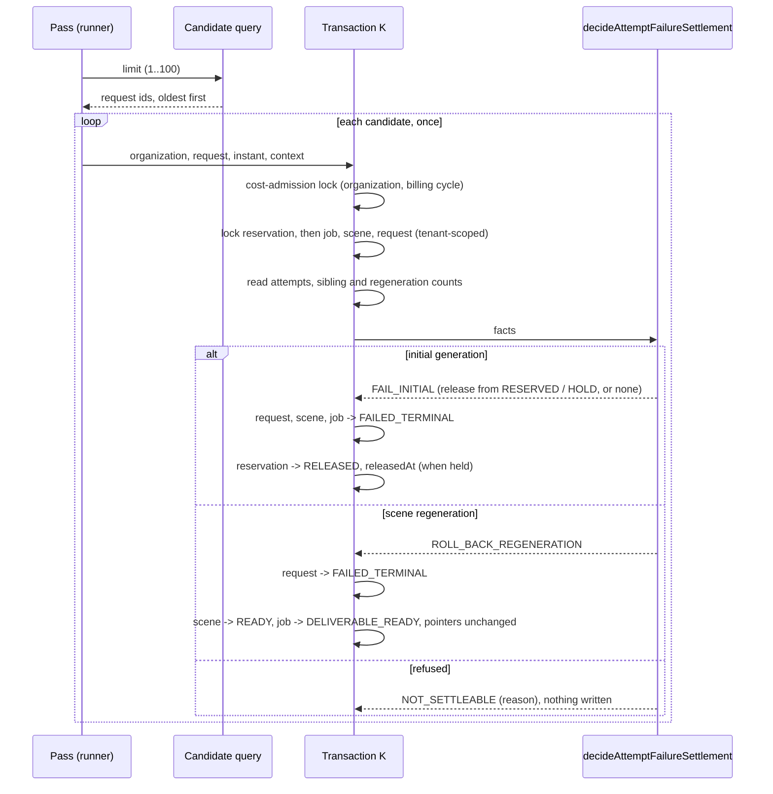

### Verification

Measured locally on `98e9969` (PostgreSQL 16 configured like CI; FFmpeg
6.1.1, the version CI's `media` job installs). This record's commit changes
only this file.

| Check | Result |
| --- | --- |
| `pnpm lint` / `pnpm typecheck` | clean |
| `pnpm test` | **6053 / 6053**, 218 files (5976 on `e446548`) |
| `pnpm test:db` | **1586 / 1586**, 59 files (1538 on `e446548`) |
| `pnpm test:media` | **169 / 169**, 4 files: no media code changed |
| `pnpm build` | succeeded |
| `prisma migrate diff` (migrations against the schema) | no difference |

New and changed tests:

- `packages/domain/src/attempt-failure-settlement/settlement.test.ts` (new):
  every way an attempt can end without a video settles alike; a held,
  reserved and already released Unit for an initial generation, and a
  consumed one for a regeneration; every other request, attempt, scene, job
  and reservation shape refused with its closed reason; the batch bound; the
  defects' fixed messages.
- `packages/domain/src/attempt-failure-settlement/runner.test.ts` (new): each
  candidate settled once, with its own instant and correlation; refusals and
  releases counted honestly; the bound checked before the query; a settlement
  that throws reported `FAILED` with its defect code, or `null`, and the pass
  going on to the next candidate.
- `packages/domain/src/attempt-failure-settlement/dormancy.test.ts` (new):
  nothing in production constructs the runner or the repository, and neither
  reaches past the database, the domain and Prisma; the repository updates
  the request, scene, job and reservation only, inserts or deletes nothing,
  moves the reservation only to `RELEASED` with its instant, never consumes a
  Unit, writes a delivered pointer or touches an attempt, takes the
  cost-admission lock, then the reservation, then the chain, and decides in
  one place.
- `tests/integration/attempt-failure-settlement.db.test.ts` (new, 48 tests,
  on the fixture `tests/integration/attempt-failure-fixture.ts`): an initial
  generation settled after a refusal, a retryable or terminal provider
  failure and an exhausted reconciliation, its Unit released from `RESERVED`
  or `RECONCILIATION_HOLD` or left alone when reconciliation released it; a
  failed media recovery; a replay; a later scene of a failed job refused; a
  regeneration rolled back to the customer's video, and every contradicting
  shape refused, writing nothing; what is never offered; tenancy; discovery
  offering exactly what settles, oldest first and bounded; the dormant runner;
  the two reserved generic edges; and concurrency: two settlements of one
  request settle it once, two failed scenes of one job release its Unit once
  and fail it once, a writer holding the job is waited for and its commit
  decides, the cost-admission lock of the organization and cycle is waited
  for, and a writer holding the reservation and then needing the job is
  waited behind without a deadlock.

The lock-order test was checked against the inverted order by mutant R23
(round 2): with the job locked before the reservation, the reservation-first
writer and the settlement deadlock and the test fails.

### Mutation testing

Each mutant applied to the source, the relevant suites run, and the file
restored and checked by SHA-256; the repository's manifest was identical
before and after each pass.

**Round 1, on `2cd6cc1`: 72 mutants, 72 killed.** None survived, none broken.

| Mutant | Area | Change | Killed by |
| --- | --- | --- | --- |
| D01 | decide | a delivered request still settles | settlement |
| D02 | decide | the newest attempt need not have ended without a video | settlement, db |
| D03 | decide | an older attempt may still be open | settlement, db |
| D04 | decide | the job's state is not asked | settlement, db |
| D05 | decide | an initial scene need not be generating | settlement, db |
| D06 | decide | an initial scene may already name a rendition | settlement, db |
| D07 | decide | an initial job may already hold a video | settlement, db |
| D08 | decide | a Unit held for reconciliation is not released | settlement, db |
| D09 | decide | a job whose Unit reconciliation released is refused | settlement, db |
| D10 | decide | a released Unit is released again | settlement, db |
| D11 | decide | a held Unit's state not passed on | settlement, db |
| D12 | decide | a regeneration's scene need not be revising | settlement, db |
| D13 | decide | a regeneration's pointer need not name a delivered rendition | settlement, db |
| D14 | decide | a regeneration's job need not hold a video | settlement, db |
| D15 | decide | another scene may be not ready | settlement, db |
| D16 | decide | another regeneration may be open | settlement, db |
| D17 | decide | a regeneration's Unit need not be consumed | settlement, db |
| D18 | decide | a verified output counts as ended without one | settlement |
| D19 | bound | a batch of 101 accepted | settlement, runner, db |
| D20 | bound | a fraction accepted | settlement, runner, db |
| D21 | defect | a defect's message changed | settlement |
| U01 | runner | a candidate settled twice | runner |
| U02 | runner | every settlement stamped with one fixed instant | runner |
| U06 | runner | every settlement given one correlation | runner |
| U03 | runner | a refusal counted as settled | runner |
| U04 | runner | every settlement counted as a release | runner, db |
| U05 | runner | the bound not checked before the query | runner |
| R01 | lock | no cost-admission lock | db, dormancy |
| R02 | lock | the lock taken on another cycle | db |
| R03 | lock | the reservation read without its lock | db, dormancy |
| R04 | lock | the chain read without its lock | dormancy |
| R05 | tenancy | the chain found in any organization | db |
| R06 | settle | the request's failure instant not written | db, dormancy |
| R07 | settle | no release instant | db, dormancy |
| R08 | settle | the release stamped with the clock | db |
| R09 | settle | the Unit not released | db |
| R10 | settle | the Unit consumed instead | db, dormancy |
| R11 | settle | the initial scene not failed | db |
| R12 | settle | the initial job not failed | db |
| R13 | settle | the rolled-back job left generating scenes | db |
| R14 | settle | the rolled-back scene left revising | db |
| R15 | settle | the attempts read newest first | db |
| R16 | settle | a predecessor need not be delivered | db |
| R17 | settle | ready siblings counted as not ready | db |
| R18 | settle | open regenerations never counted | db |
| R19 | events | no reason code | db |
| R20 | events | no reservation event | db |
| R21 | events | the scene's failure named as a rollback | db |
| R22 | events | the caller's context dropped | db |
| Q01 | discovery | a job that left generating offered | db |
| Q02 | discovery | an older open attempt ignored | db |
| Q03 | discovery | the oldest attempt taken as the newest | db |
| Q04 | discovery | a verified output counts as ended without one | db |
| Q05 | discovery | an initial scene that is not generating offered | db |
| Q06 | discovery | an initial scene naming a rendition offered | db |
| Q07 | discovery | an initial job holding a video offered | db |
| Q08 | discovery | an initial job whose Unit reconciliation released not offered | db |
| Q09 | discovery | a consumed initial job offered | db |
| Q10 | discovery | a regeneration's scene need not be revising | db |
| Q11 | discovery | a regeneration's job need not hold a video | db |
| Q12 | discovery | a regeneration's Unit need not be consumed | db |
| Q13 | discovery | a predecessor need not be delivered | db |
| Q14 | discovery | a sibling not ready ignored | db |
| Q15 | discovery | another open regeneration ignored | db |
| Q16 | discovery | newest first | db |
| Q17 | discovery | the bound ignored | db |
| Q18 | discovery | the bound not validated | db |
| Q19 | discovery | the organization taken from the wrong row | db |
| E01 | edges | the generic API fails a generating request | db |
| E02 | edges | the generic API fails a generating scene | db |
| G01 | guard | the worker constructs the runner | dormancy |
| G02 | guard | the repository inserts a row | dormancy |

Suites: `settlement`, `runner` and `dormancy` = the three domain suites above;
`db` = the new settlement database suite.

**Round 2, on `98e9969`: the 72 again, with Q01 re-anchored on the query's new comment, and six
added for the review's answers: 78 mutants, 78 killed.** None survived, none
broken. R23 locks the job before the reservation: both lock-order tests fail,
the reservation-first one with PostgreSQL's `deadlock detected` (`40P01`).
R04, caught only by the dormancy guard in round 1, is now caught by the
job-first race test too.

| Mutant | Area | Change | Killed by |
| --- | --- | --- | --- |
| Q01 | discovery | a job that left generating offered | db |
| R04 | lock | the chain read without its lock | db, dormancy |
| U07 | runner | a throwing settlement stops the pass | runner |
| U08 | runner | a defect's code dropped | runner |
| U09 | runner | a failure not counted | runner |
| U10 | runner | a failure counted as settled | runner |
| U11 | runner | every error reported as a defect | runner |
| R23 | lock | the job locked before the reservation | db |

### Review

Codex is at its usage limit, so, as for DS-3 to GS-1, an independent review
agent reviewed `2cd6cc1` against `e446548`, reading only git objects. It found
no way to consume a Unit, release one twice, release a consumed one or deliver
past a settlement. It confirmed that the candidate query and the decision agree
on every predicate, so no request is starved or settled unoffered; that every
writer taking both the reservation and the job takes the reservation first, and
the writers taking the job first take neither the reservation nor the
cost-admission lock, so none can close a cycle with Transaction K; that no
attempt can appear while K holds the request; that K and Transaction H are
disjoint; and that tenancy is proved in every locking statement. Verdict:
nothing blocking; three should-fix findings, six nits and a list of test
gaps, answered in
`98e9969`:

| Finding | Answer |
| --- | --- |
| ADR-0083 named two writers that do not move the orchestration state: the execution preflight writes the legacy `state` column, and no generic attempt transition exists. Several documents said preflight failures and pre-submission cancellations settle. An orchestrated attempt that failed preflight would stay `QUEUED` and its Unit held | Corrected everywhere: three writers end an attempt without a video; `QUEUED → FAILED_*` and `QUEUED → CANCELLED_PRE_SUBMISSION` are edges no writer takes yet. ADR-0083 *Not decided here* names the preflight gap, and a new TODO item says the preflight must move the orchestration state before generation is activated |
| The ADR contradicted itself on a failed output copy | Corrected: a failed output copy does not end its attempt, which stays `OUTPUT_INGESTING` and resumes, so it settles nothing |
| One throwing settlement stopped the whole pass, and with the oldest candidate first it would recur at the head of every pass, stopping every later release | Fixed: the runner reports such a candidate `FAILED`, with its defect code or `null`, counts it, and goes on (ADR-0083 Decision 1). Test: a defect and an unexpected error each isolated, the next candidate still released. Mutants U07 to U11 |
| Nit: a comment said "Transactions H and J" | Now "H and K" |
| Nit: two comments said a retryable failure stays retryable | Both now say nothing retries one yet, so this settlement ends it (ADR-0083 Decision 2) |
| Nit: "the two take the same locks" was loose | ADR-0083 Decision 2 now says both take the cost-admission lock, the reservation and the chain, and H also locks the attempt, its validation and its work row |
| Nit: no test reaches the candidate query's `orchestrationState IS NULL` arm | It is unreachable: the all-or-none CHECK gives every attempt linked to a request a state. The query now says the arm is defensive; a mutant removing it would be equivalent |
| Nit: two side effects on a failed job's siblings | Named in ADR-0083 *Not decided here*: the gate's expected `RESERVATION_RELEASED` anomaly for a queued sibling, and a sibling's Transaction H work row answering `NOT_EXHAUSTED` on every pass. Both are GS-2b's |
| Test gap: two failed scenes of one job; a writer that takes the job first | Both added: one release and one job failure; a job-first writer waited for, its commit deciding. The remaining gaps (a real admission racing the settlement, races against H and against Transaction F, the gate refusing a sibling, a hold kept for an unknown sibling) are listed under *Known limitations* |
| Nit: about 830 production lines plus about 1,700 test lines against the ~500-line policy | About 865 are production code with its comments after these answers; the rest are tests (about 1,780) and documentation. GS-1 was a similar size. Splitting the decision from its transaction would leave a dormant module nothing calls in one PR |

### Required documentation

| Item | Where |
| --- | --- |
| Architecture diagram | `docs/architecture.md` status table: the attempt failure settlement row |
| Entity-relationship diagram | `docs/er-diagram.md`, *GS-2a*: not applicable, no entity, relationship or column changes |
| Critical sequence diagram | the diagram above; the decision is ADR-0083 Decisions 2 and 3 |
| OpenAPI / API change summary | `docs/api-changes-gs-2a.md`: no HTTP change; the domain decision, the runner, Transaction K, the reserved edges |
| Change log / release notes | the commit list above and the pull request description |
| Database migration notes | `docs/migration-notes.md`, *GS-2a*: no migration, and what rolling back means |
| Completion report | this file |

Also updated: `docs/Roadmap.md`, `docs/generation-e2e-gap-analysis.md` and
`docs/decisions/TODO.md` (the permanent technical-failure item, the recovery
budget item, the operator-tooling item, and two new items: bounding how long
an attempt may run, and moving the preflight's failures onto the orchestration
state).

### Activation status

Nothing paid or scheduled is activated. Nothing in production constructs the
attempt failure settlement runner or its repository: no worker, scheduler,
credential, environment variable or payment integration. Paid Provider
Activation, production Provider credentials, production paid AI calls, the
production scheduler and live Stripe charges remain BLOCKED.

### Known limitations

- **The failed job's other scenes** stay where they are: their requests stay
  `GENERATING`, a queued sibling is refused by the paid-submission gate as
  `RESERVATION_RELEASED` (read as an anomaly), and a sibling's Transaction H
  work row is offered again on every pass. GS-2b ends them.
- **An attempt that fails preflight** keeps its orchestration state `QUEUED`,
  so its request is never settled (TODO). Nothing in production runs the
  preflight against an orchestrated attempt yet.
- **An attempt that never ends**, left `PROCESSING` or `OUTPUT_INGESTING`, is
  never settled; how long one may run is not decided (TODO).
- **A retryable failure settles** until the internal service-recovery budget
  exists (ADR-0083 Decision 2).
- **Not tested here:** a real admission racing the settlement, races against
  Transaction H and Transaction F, the gate refusing a sibling once the Unit
  is released (the gate's own suite covers a released Unit), and a hold
  reconciliation keeps for an unknown sibling.
- **Whether a video delivered by operator recovery consumes a Unit** is still
  not decided (TODO).

### Remaining work

GS-2a waits for the product owner's yes before merge. GS-2b (ending the failed
job's other scenes and cancelling their queued attempts) comes next.

## GS-2b — a failed job's other scenes close

Base: `ad535fd` (PR #106 merge commit on `main`; post-merge CI run 675 green).
ADR: `docs/decisions/0084-a-failed-jobs-other-scenes-close.md`

The second half of GS-2. **No migration.**

Commits, oldest first:

| Commit | What it carries |
| --- | --- |
| `50b643e` | the domain decision, the runner, Transaction L, the tests, ADR-0084 and the documentation |
| `3e5ae35` | the review's answers: an admitted request under a scene still `PENDING` closes, a scene with no request tested, the documents corrected on the job lock and the legacy column, three new TODO items |
| this commit | this record |

`50b643e`'s message says the job is neither written nor locked; it is locked,
for the lock order, and never written. `3e5ae35` corrects the documents.

The exact head SHA is reported with the pull request.

### What GS-2b does

- **One decision per open scene of a failed job.**
  `decideFailedJobSceneClosure` reads the job's and scene's states, the
  scene's pointer, its requests and every attempt's state. A scene that never
  started is cancelled with its pending request. A scene that started, or
  whose request was admitted, fails: each attempt still waiting to be sent is
  cancelled before submission, and its request fails (or is cancelled, if it
  was never admitted). A scene with an attempt the provider may hold is not
  closed yet; anything else is refused with a closed reason, and nothing is
  written.
- **A sweep over durable facts.** Transaction L is its own short transaction,
  offered scenes by a bounded candidate query that mirrors every refusal; a
  candidate whose closure throws is reported and passed over. Transactions H
  and K are unchanged.
- **The cost-admission lock, then job and scene, requests and attempts.** The
  job is locked for that order and never written; the reservation is read,
  unlocked, for the lock's key, and never written: the Unit was released when
  the job failed.
- **Still dormant.** Nothing in production constructs the runner or the
  repository.

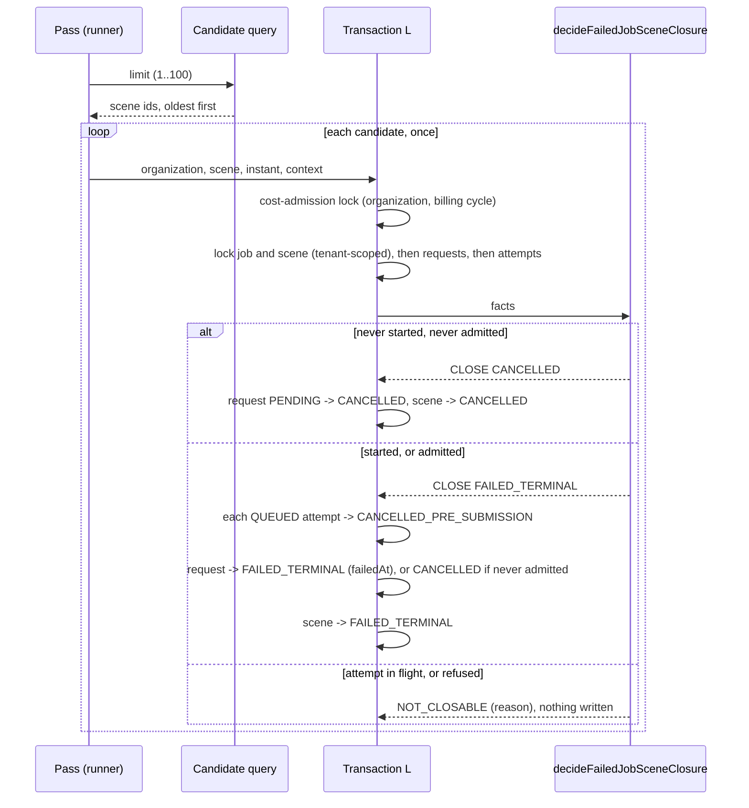

### Verification

Measured locally on `3e5ae35` (PostgreSQL 16 configured like CI; FFmpeg
6.1.1, the version CI's `media` job installs). This record's commit changes
only this file.

| Check | Result |
| --- | --- |
| `pnpm lint` / `pnpm typecheck` | clean |
| `pnpm test` | **6118 / 6118**, 221 files (6053 on `ad535fd`) |
| `pnpm test:db` | **1623 / 1623**, 60 files (1586 on `ad535fd`) |
| `pnpm test:media` | **169 / 169**, 4 files (on `50b643e`): no media code changed |
| `pnpm build` | succeeded |
| `prisma migrate diff` (migrations against the schema) | no difference |

New tests:

- `packages/domain/src/failed-job-scene-closure/closure.test.ts`: each
  closable shape and what it closes into, including an admitted request
  under a scene still `PENDING`; every in-flight attempt state waited for;
  every other job and scene state and every contradicting shape refused with
  its closed reason, in order; the whole table of scene, request and attempt
  states closing exactly eighteen shapes, each along a legal edge; the batch
  bound; the vocabulary and the defects' fixed messages.
- `packages/domain/src/failed-job-scene-closure/runner.test.ts`: each
  candidate closed once, with its own instant and correlation; closures,
  cancelled attempts and failures counted; the bound checked before the
  query; a closure that throws reported `FAILED` with its defect code, or
  `null`, and the pass going on.
- `packages/domain/src/failed-job-scene-closure/dormancy.test.ts`: nothing in
  production constructs the runner or the repository, and neither reaches
  past the database, the domain and Prisma; the repository updates attempts,
  requests and the scene only, inserts or deletes nothing, cancels only a
  `QUEUED` attempt, never writes the job, the reservation or a delivered
  pointer, takes the cost-admission lock, then job and scene, requests and
  attempts, and decides in one place.
- `tests/integration/failed-job-scene-closure.db.test.ts` (37 tests), each job
  failed through Transaction K first:
  - a scene that never started cancelled, the job and reservation unchanged;
  - a scene with no request closed alone, from `PENDING` and from
    `GENERATING`;
  - a started scene failed with its waiting attempt cancelled (its legacy
    column untouched), with its request never admitted, and with its attempt
    ended each way (refused, retryable, provider failure, exhausted,
    cancelled, verified);
  - an admitted request under a scene still `PENDING`, through the real
    admission primitive, failed with its scene;
  - only the waiting attempt cancelled behind an ended one; an attempt at the
    provider waited for, and the scene closed once it ends; no attempt
    admitted afterwards;
  - refused, not offered and nothing written: a ready scene, an already
    closed one, the job's own failed scene, a live and a cancelled job, and
    six contradicting shapes written by hand;
  - tenancy; discovery offering exactly what closes, oldest first and bounded;
    the dormant runner;
  - concurrency: two closures close once; the cost-admission lock waited for,
    its holder's commit deciding; a writer holding that lock and then needing
    the job waited behind without a deadlock; a job-first writer waited for.

### Mutation testing

Each mutant applied to the source, the relevant suites run, and the file
restored and checked by SHA-256; the repository's manifest was identical
before and after each pass.

**Round 1, on `50b643e`: 73 mutants, 71 killed, 2 survived, none broken.**

| Mutant | Area | Change | Killed by |
| --- | --- | --- | --- |
| C01 | decide | the job's state is not asked | closure, db |
| C02 | decide | a ready scene is open | closure, db |
| C03 | decide | a started scene is cancelled | closure, db |
| C04 | decide | a pointer naming a rendition ignored | closure, db |
| C05 | decide | a second request ignored | closure, db |
| C06 | decide | a regeneration request closes | closure, db |
| C07 | decide | a delivered request closes | closure, db |
| C08 | decide | a pending request with an attempt closes | closure, db |
| C09 | decide | a generating request under a scene that never started closes | closure, db |
| C10 | decide | a closed request closes again | closure, db |
| C11 | decide | an attempt with no state passes | closure |
| C12 | decide | an attempt in flight ignored | closure, db |
| C13 | decide | a waiting attempt not counted | closure, db |
| C14 | decide | a waiting attempt counted as in flight | closure, db |
| C15 | decide | a pending request fails instead of being cancelled | closure, db |
| C16 | decide | a scene with no request closes its absent request | closure |
| C17 | bound | a batch of 101 accepted | closure, runner, db |
| C18 | bound | a fraction accepted | closure, runner, db |
| C19 | vocabulary | a defect's message changed | closure |
| C20 | vocabulary | the scene cancellation event renamed | closure, db |
| C21 | vocabulary | the reason code renamed | closure, db |
| U01 | runner | a candidate closed twice | runner |
| U02 | runner | the bound not validated | runner |
| U03 | runner | one instant for every closure | runner |
| U04 | runner | one correlation for every closure | runner |
| U05 | runner | a throw stops the pass | runner |
| U06 | runner | any error reported as a defect | runner |
| U07 | runner | cancelled attempts not counted | runner, db |
| U08 | runner | failures not counted | runner |
| U09 | runner | refusals counted as closed | runner |
| R01 | locks | the cost-admission lock skipped | db, dormancy |
| R02 | locks | the organization's unreserved key for every job | db |
| R03 | locks | the job chain locked before the cost-admission lock | db, dormancy |
| R04 | locks | the job not locked | db, dormancy |
| R05 | locks | the requests not locked | dormancy |
| R06 | locks | the attempts not locked | dormancy |
| R07 | tenancy | the lock does not prove the organization | db |
| R08 | facts | the job's state not read | db |
| R09 | facts | the pointer not read | db |
| R10 | facts | the request's delivery not read | db |
| R11 | facts | the request's kind not read | db |
| R12 | writes | an ended attempt cancelled too | db |
| R13 | writes | a cancelled attempt's event dropped | db |
| R14 | writes | the attempt's version not bumped | db |
| R15 | writes | a started request cancelled instead of failed | db |
| R16 | writes | the closure instant not the failedAt | db |
| R17 | writes | the failed request's version not bumped | db |
| R18 | writes | the cancelled request's version not bumped | db |
| R19 | writes | the scene's version not bumped | db |
| R20 | writes | a pending request left open | db |
| R21 | events | the scene's event always a failure | db |
| R22 | events | the events lose the reason code | db |
| R23 | events | the events lose the caller's correlation | db |
| R24 | events | the request's failure recorded as a cancellation | db |
| Q01 | discovery | a live job's scenes offered | db |
| Q02 | discovery | a ready scene offered | **survived** |
| Q03 | discovery | a pointer ignored | db |
| Q04 | discovery | a second request ignored | **survived** |
| Q05 | discovery | a regeneration offered | db |
| Q06 | discovery | a delivered request offered | db |
| Q07 | discovery | a generating request under a scene that never started offered | db |
| Q08 | discovery | a closed request offered | db |
| Q09 | discovery | an attempt under a pending request ignored | db |
| Q10 | discovery | an attempt in flight ignored | db |
| Q11 | discovery | a waiting attempt counted as in flight | db |
| Q12 | discovery | an accepted attempt counted as not in flight | db |
| Q13 | discovery | newest first | db |
| Q14 | discovery | the bound ignored | db |
| Q15 | discovery | the bound not validated | db |
| Q16 | discovery | the organization taken from the wrong row | db |
| G01 | guard | the worker constructs the runner | dormancy |
| G02 | guard | the repository writes the reservation | dormancy |
| G03 | guard | the repository inserts a row | dormancy |

Suites: `closure`, `runner` and `dormancy` = the three domain suites above;
`db` = the new closure database suite.

The two survivors:

- **Q02** (a ready or closed scene offered) survived because every database
  test's scene had a request, whose own state already excluded it. A scene
  with no request is now tested, closing alone and never offered again.
- **Q04** (a second request ignored by the query) is equivalent: at most one
  initial request per scene (`scene_generation_requests_initial_key`), so a
  second request is a regeneration, which the query's kind condition already
  excludes. The count stays as the decision's explicit mirror.

**Round 2, on `3e5ae35`: 74 mutants, 73 killed, 1 survived (Q04, equivalent),
none broken.** C09, C10, Q07 and Q08 were re-anchored on the changed decision and query,
and R25 added; Q02 is now killed by the no-request test. The changed and new
ones:

| Mutant | Area | Change | Killed by |
| --- | --- | --- | --- |
| C09 | decide | an admitted request's scene still pending is cancelled | closure, db |
| C10 | decide | a closed request closes again | closure, db |
| Q02 | discovery | a ready scene offered | db |
| Q07 | discovery | a pending request not offered | db |
| Q08 | discovery | a closed request offered | db |
| R25 | writes | the scene closed from a state derived from the decision | db |

### Review

Codex is at its usage limit, so, as for DS-3 to GS-2a, an independent review
agent reviewed `50b643e` against `ad535fd`, reading only git objects. It
confirmed the candidate query mirrors every refusal, including the explicit
`IS NULL` arm that `NOT IN` would otherwise let through; that every writer
taking the cost-admission lock derives the same key from the job's one
reservation; that the writers locking the job without that lock (Transaction
F, media recovery, revision start) take job, scene, request and attempt in that
order and never wait for the lock afterwards, so none closes a cycle with
Transaction L; that every write checks its expected state under its lock; and
that every edge is legal and satisfies the database's checks. Verdict:
nothing blocking; three should-fix findings, four nits and a list of test
gaps, answered in `3e5ae35`:

| Finding | Answer |
| --- | --- |
| The job is locked, though the ADR, the API summary and the commit message said it is not | The documents now say it is locked for the lock order and never written. The commit message cannot change; this record names the error |
| A cancelled attempt's legacy `state` column stays `QUEUED`, so the legacy executor's discovery would still offer it, and the ADR said no closed row is offered by any discovery | Corrected rather than patched: no orchestration writer moves the legacy column, so every orchestrated attempt has this exposure, and writing it here alone would cover one writer of many. The ADR and migration notes now say so, and a new TODO item makes it GS-7's: before any executor runs orchestrated attempts, the legacy discovery must stop offering them. Nothing in production constructs that executor |
| An admitted request under a scene still `PENDING` was refused forever, since admission does not start the scene, leaving its queued attempt offered to the gate on every pass | Fixed: such a scene fails with its request, from `PENDING` (a legal edge), and the scene closes from the state read under its lock. The candidate query mirrors it. Tested through the real admission primitive. Transaction K's same assumption is a new TODO item for the start step (GS-4) |
| Nit: the repository header said the reservation is neither read nor locked | It is read once, unlocked, for the advisory key; the header says so |
| Nit: a generating request with no attempt closes but the ADR table omitted it | Added to the table: not a shape admission writes, and nothing of it is at the provider |
| Nit: two items left open were not in the TODO | Added: what closes a cancelled job's open scenes, and the legacy discovery (GS-7) |
| Nit: the ADR overstated who takes the advisory lock | It now also says the attempt rows are locked, so a writer that takes no advisory lock (the generic `recordSubmissionOutcome`) still cannot move one while L decides |
| Test gaps: the real gate in the advisory race, a concurrent admission, the legacy column, an admitted request under a pending scene, H's `OBSOLETE` answer | The last two added (the legacy column is pinned unchanged in the cancellation test). The rest are listed under *Known limitations* |

### Required documentation

| Item | Where |
| --- | --- |
| Architecture diagram | `docs/architecture.md` status table: the failed job scene closure row |
| Entity-relationship diagram | `docs/er-diagram.md`, *GS-2b*: not applicable, no entity, relationship or column changes |
| Critical sequence diagram | the diagram above; the decision is ADR-0084 Decision 2 |
| OpenAPI / API change summary | `docs/api-changes-gs-2b.md`: no HTTP change; the domain decision, the runner, Transaction L |
| Change log / release notes | the commit list above and the pull request description |
| Database migration notes | `docs/migration-notes.md`, *GS-2b*: no migration, and what rolling back means |
| Completion report | this file |

Also updated: `docs/Roadmap.md`, `docs/generation-e2e-gap-analysis.md`,
ADR-0083's *Not decided here* (a pointer to ADR-0084), and
`docs/decisions/TODO.md` (the permanent technical-failure item, and three new
items: the legacy discovery, starting each scene with its first admission, and
a cancelled job's open scenes).

### Activation status

Nothing paid or scheduled is activated. Nothing in production constructs the
closure's runner or its repository: no worker, scheduler, credential,
environment variable or payment integration. Paid Provider Activation,
production Provider credentials, production paid AI calls, the production
scheduler and live Stripe charges remain BLOCKED.

### Known limitations

- **An attempt that never ends** keeps its scene open (TODO).
- **A cancelled job's open scenes** are not closed; nothing cancels a job
  today (TODO).
- **The legacy column.** A cancelled attempt stays legacy `QUEUED`, as every
  orchestrated attempt does; GS-7 must stop the legacy discovery offering
  them (TODO).
- **Not tested here:** the real paid-submission gate racing the closure (the
  tests hold the advisory lock by its formula, written out, as GS-2a's do), a
  real admission racing it, and Transaction H's `OBSOLETE` answer for a closed
  sibling (H's own suite covers a request no longer generating).

### Remaining work

GS-2b waits for the product owner's yes before merge. GS-3 (shared folder
storage for development and CI, used by the web app and the worker) comes next.

## GS-3 — a shared folder holds development and CI objects

Base: `705332b` (PR #107 merge commit on `main`; post-merge CI run 678 green).
ADR: `docs/decisions/0085-a-shared-folder-holds-development-objects.md`

The first milestone of stage B, the engine. **No migration.**

Commits, oldest first:

| Commit | What it carries |
| --- | --- |
| `a0d441c` | the store and its two views, the shared signing helper, the setting, the web app's wiring, the tests |
| `56ae952` | the review's answers: streamed completion, proved absence, private folders, the refusals that named a path, the production guard; the new tests |
| `9556ca4` | an open error no supported platform raises dropped from the absence check |
| `5d17774` | ADR-0085 and the documentation |
| `9a72878` | media validation driven over the folder; ADR-0085 and the TODO name the empty folders a deleted key leaves; a TODO item for a timing-dependent lock test |
| this commit | this record |

The exact head SHA is reported with the pull request.

### What GS-3 does

- **One folder, two views.** `createSharedFolderStorage({ root, secret })`
  opens an absolute folder and hands out the domain's `ObjectStorage` port for
  the web app and the S3-shaped seam for the worker, over the same objects.
  Neither contract changes, so every caller runs over it unchanged.
- **Object storage's guarantees from the file system's atomic steps.** Every
  write is staged first; an unconditional write is renamed into place, and a
  first-wins write (a multipart completion, `putObjectIfAbsent`) is
  hard-linked, which the file system refuses when the key is taken. A losing
  completion gets S3's `412`.
- **Absence is proved.** A key reads as "nothing stored" only when no file is
  at it and the objects folder the store opened, and holds open, is still in
  place. Anything else at a key rejects.
- **Private, and silent about paths.** Only canonical keys; the folder and
  everything in it are this user's alone; no refusal names a key or a path.
- **The web app takes it when `SHARED_STORAGE_DIR` is set**, and otherwise
  keeps the in-memory store. The setting and the adapter are refused in
  production. Nothing in the worker opens the folder yet (GS-9).

```mermaid
sequenceDiagram
    participant W as Web app (ObjectStorage port)
    participant F as Shared folder
    participant K as Worker (S3-shaped seam)
    W->>F: putObject(photo key): stage, then rename onto the key
    K->>F: getObject(photo key): open, stream in 1 MiB chunks
    K->>F: createMultipartUpload, uploadPart (SHA-256 checked)
    K->>F: completeMultipartUpload(If-None-Match: *)
    alt key free
        F-->>K: linked into place (first wins)
    else key taken
        F-->>K: 412 PreconditionFailed; the sink reads the winner back
    end
    K->>F: putObjectIfAbsent(master or video): copy, chmod 0600, link
    F-->>K: CREATED or ALREADY_EXISTS
    W->>F: getObject(key): bytes, null only when proved absent
```

### Verification

Measured locally (PostgreSQL 16 configured like CI): lint, typecheck and the
unit suite on `9a72878`; the database suite and the build on `5d17774`, whose
code `9a72878` changes only by a unit test. This record's commit changes only
this file.

| Check | Result |
| --- | --- |
| `pnpm lint` / `pnpm typecheck` | clean |
| `pnpm test` | **6162 / 6162**, 223 files (6118 on `705332b`) |
| `pnpm test:db` | **1622 / 1623**, 60 files: one timing-dependent lock test failed, then passed three runs out of three (below) |
| `pnpm test:media` | not run: no media code changed |
| `pnpm build` | succeeded |
| `prisma migrate diff` (migrations against the schema) | not run: no schema or migration changed |

New and changed tests:

- `packages/storage/src/shared-folder-storage.test.ts` (41 tests), against
  real files in a fresh folder per test:
  - opening: refused in production by the given and by the process's
    `NODE_ENV`, creating nothing; a relative folder refused before anything
    is made; the three areas created; an unopenable folder refused with a
    code and no path; a link in place of a folder, and (as root) another
    user's folder, refused; every folder `0700` and every object `0600`,
    including a copy of a `0644` file;
  - the web app's view: store, read, check and delete; copies in and out; a
    second store on the same folder sees the objects and another folder does
    not; a folder of keys, and a key below an object, are not objects; a key
    the file system cannot name, and one that is not canonical, refused, with
    nothing written outside `objects/`; a device and a pipe at a key refused;
    a deleted or replaced objects folder refused rather than called absent;
    signing as every store signs, never for an internal key; no staged
    leftovers;
  - the worker's view: the seam's one absence; 2.5 MiB streamed in 1 MiB
    chunks; a cancelled body refused; another bucket, an owner check and a
    key that is not canonical refused; a multipart upload invisible until it
    completes, parts in order; a part replaced; a bad checksum or part number
    refused; every unprovable completion refused; first completion wins and
    the second gets a `412`, racing ones too; upload ids the folder issued,
    for their key only; `putObjectIfAbsent` first-wins, racing too; a file
    system failure named by its code only; no file left open after a read
    ends, is cancelled or fails, or a completion fails;
  - the worker's existing seams over the folder: the staging sink with one
    part and with three (first-wins read-back included), the composition
    source materializer and output publisher with the probe, media
    validation, and the Clean Master store; a photo the web app stored read
    by a second store;
  - a static test pinning what opens the folder in production code: the web
    app's wiring only.
- `packages/shared/src/env.test.ts`: `SHARED_STORAGE_DIR` absolute only, and
  never in production.
- `apps/web/src/lib/property.test.ts`: the folder when the setting is present,
  the in-memory store when it is not.
- `packages/domain/src/clean-master/clean-master-shape.test.ts`: the signer is
  called only by the signing helper, and the helper only by the two stores.

### Mutation testing

Each mutant applied to the source, the relevant suites run, and the file
restored and checked by SHA-256; the repository's manifest was identical
before and after the pass.

**On `9556ca4`: 63 mutants, 61 killed, 2 survived (both equivalent), none
broken.**

| Mutant | Area | Change | Killed by |
| --- | --- | --- | --- |
| S01 | open | the given `NODE_ENV` is not checked | store |
| S01b | open | the process's `NODE_ENV` is not checked | store |
| K01 | open | an opening failure leaves with its path | store |
| F01 | open | a link is adopted as a folder | store |
| F02 | open | another user's folder is adopted | store |
| F03 | open | an adopted folder stays open to others | store |
| F04 | write | a key's folders are made open to others | store |
| S02 | open | a relative folder is accepted | store |
| S03 | key | a key that is not canonical is a path | store |
| S04 | key | a NUL in a key reaches the file system | store |
| S05 | write | an unconditional write keeps the first object | store |
| S06 | write | a taken key fails instead of losing | store |
| S07 | write | a staged file is left behind | store |
| W02 | write | a stored object is open to others | store |
| S08 | write | first-wins overwrites | store |
| S09 | read | what is no object reads as absent | store |
| S09b | read | a folder of other keys is refused | store |
| S10 | read | every open failure is an absence | store |
| N01 | read | a pipe hangs the open | store |
| C01 | absent | absence is not proved | store |
| C02 | absent | the objects folder is not held open | store |
| C03 | absent | a check does not prove absence | store |
| C04 | absent | a check calls what is no object absent | store |
| C05 | absent | a check calls a folder an object | store |
| D01 | files | a cancelled body keeps its file open | store |
| D02 | files | a body read to its end keeps its file open | store |
| D03 | files | the web app's read keeps its file open | store |
| D04 | files | a folder or device opened by a read stays open | store |
| D05 | files | a failed completion keeps its staged file open | store |
| X01 | web | a check failure leaves with its path | store |
| S11 | read | a key below an object is not absent | store |
| S12 | read | the seam's absence carries a length | store |
| S13 | read | a body reads past its end | store |
| S14 | read | a read is not bounded | store |
| S15 | seam | another bucket is accepted | store |
| S16 | seam | an owner check is ignored | store |
| S17 | seam | a refusal's status is lost | store |
| S18 | seam | a file system error leaves with its path | store |
| S19 | upload | an upload id is a path | store |
| S20 | upload | an upload serves another key | store |
| S21 | upload | an upload records no key | store |
| S22 | part | a part's checksum is not checked | store |
| S23 | part | part number zero is accepted | store |
| S24 | part | a part number past S3's last is accepted | store |
| S25 | part | a fractional part number is accepted | store |
| S26 | complete | an unconditional completion is accepted | store |
| S27 | complete | an empty completion is accepted | store |
| S28 | complete | parts out of order are accepted | store |
| S29 | complete | a part's tag is not checked | store |
| S30 | complete | a part's checksum is not checked at completion | store |
| Q01 | complete | a short staged file is published | **survived** |
| Q02 | complete | a failing close is ignored | **survived** |
| S31 | complete | a losing completion is not a `412` | store |
| S32 | complete | a completed upload is left behind | store |
| S33 | abort | an abort removes nothing | store |
| P02 | write | a stored copy keeps its source's mode | store |
| S34 | web | a read failure leaves with its path | store |
| S35 | web | an upload URL is signed for download | store |
| E01 | env | a relative folder is accepted | env |
| E02 | env | the setting is accepted in production | env |
| P01 | wiring | the web app ignores the folder | wiring |
| G01 | signing | a URL expires before it is made | store |
| W01 | pin | the worker opens the folder unreviewed | store |

Suites: `store` = the shared-folder suite; `env` = the environment schema's;
`wiring` = the web app's property wiring; `signing` = the signer's (run for
G01, which it does not cover; the store suite does).

The two survivors are equivalent without a file system that fails on demand:
`FileHandle.writeFile` writes every byte or rejects, so the size check (Q01)
cannot see a short file, and a close does not fail on a local disk (Q02). Both
stay, because a full disk or a network mount is exactly where they would.

### Review

Codex is at its usage limit, so, as for DS-3 to GS-2b, an independent review
agent reviewed `a0d441c` against `705332b`, reading only git objects. It
confirmed that no key or upload id can name a path outside the folder, that
the sink's `412`, abort and read-back path works over the folder, and that an
unset setting leaves the web app exactly as before. Verdict: nothing blocking;
four should-fix findings, documentation the commit lacked, and nits, answered
in `56ae952`, `9556ca4`, `5d17774` and `9a72878`:

| Finding | Answer |
| --- | --- |
| A completion wrote each part with one unchecked `write` and closed quietly, so a full disk could publish a short object first-wins; it also held every part in memory | Fixed: one part in memory at a time, appended with `writeFile`, the staged size checked against the bytes appended, and a failing close fails the completion (Q01, Q02 above) |
| `getObject` answered "nothing stored" for a device, a pipe (whose open would hang) and a deleted objects folder | Fixed: only a folder of other keys is absent, anything else at a key is refused (`NOT_AN_OBJECT`), the open never waits on a pipe, and absence is proved against the objects folder the store holds open (`FOLDER_MISSING`). `exists` follows the same rules. The hold matters: without it, a replacement folder reused the deleted one's inode number on this machine's file system, and C02 shows the test catches it |
| An opening failure's message carried the folder's path, and the web app opens the folder inside a request | Fixed: `CONFIGURATION_ERROR` with the code only (K01) |
| Tests: the racing loser's `412`, the root after refused keys, the worker's other seams, a multipart sink, open files, refusals rather than absence | All added, and media validation too; an `EACCES` cannot be made as root, so the general refusal is shown with `ENAMETOOLONG` |
| No ADR-0085, and the setting undocumented | ADR-0085, `.env.example`, local setup and the rest in `5d17774` |
| Nit: cleanup after publishing could turn a success into a failure | Best effort now |
| Nit: links and a squatted folder | The root and its three folders are adopted only as real folders this user owns, and made `0700`; a link inside `objects/` can only be this user's (ADR-0085 Decision 3) |
| Nit: case-insensitive file systems | Recorded in ADR-0085: the application's keys are random identifiers and fixed names |
| Nit: the injectable `NODE_ENV` was an escape hatch | Either value saying production refuses (S01, S01b) |
| Nit: S3 differences (deleting a folder threw; a copy kept its source's mode; leftovers; a key naming a folder of keys) | Deleting a folder of keys does nothing; a copy is made `0600`; leftovers are a TODO item; no key the application builds names a folder of other keys |
| Nit: "a second process" was a second store in one process | Renamed |

### Required documentation

| Item | Where |
| --- | --- |
| Architecture diagram | `docs/architecture.md`: the storage node and the shared folder row |
| Entity-relationship diagram | `docs/er-diagram.md`, *GS-3*: not applicable, no entity, relationship or column changes |
| Critical sequence diagram | the diagram above; the decisions are ADR-0085 Decisions 2 to 4 |
| OpenAPI / API change summary | `docs/api-changes-gs-3.md`: no HTTP change; the setting, the store, the shared signing helper |
| Change log / release notes | the commit list above and the pull request description |
| Database migration notes | `docs/migration-notes.md`, *GS-3*: no migration, one optional setting refused in production, and what rolling back means |
| Completion report | this file |

Also updated: `docs/Roadmap.md`, `docs/generation-e2e-gap-analysis.md`,
`docs/local-setup.md`, `.env.example`, `.gitignore` (`.dev-storage/`), and
`docs/decisions/TODO.md` (the in-memory store's item, and two new items:
serving the customer's video, GS-12, and what a killed process leaves in the
folder).

### Activation status

Nothing paid or scheduled is activated. The folder is a development and CI
store, refused in production; the worker does not open it. No scheduler,
credential or payment integration. Paid Provider Activation, production
Provider credentials, production paid AI calls, the production scheduler and
live Stripe charges remain BLOCKED.

### Known limitations

- **Serving a video.** The download route reads a whole object into memory and
  has no content type for a deliverable's key (GS-12, TODO).
- **Leftovers.** An upload or staged file a killed process leaves stays in the
  folder, as do empty folders a deleted key leaves (TODO).
- **One machine, macOS or Linux,** one local file system with hard links.
- **A lock test that waits on a timer.** In the full database run,
  `submission-outcome.db.test.ts` "serializes against a Phase 2F-1 cost
  admission holding the same locks" failed once: it waits 100 ms for the
  gate's transaction to take its locks, and under load that was not enough.
  GS-3 touches no database code; the file passed three runs out of three
  afterwards. A test-only fix is a new TODO item.
- **Not tested here:** a failing disk (Q01, Q02 above), `EACCES` (the tests run
  as root), and two processes rather than two stores in one; the atomicity they
  would show is the kernel's rename and link, not the store's.

### Remaining work

GS-3 waits for the product owner's yes before merge. GS-4 (the start step: a
whole video's job, reservation, scenes and first attempts in one commit) comes
next.

## GS-4a — a storyboard is saved in one commit

Base: `b9513aa` (PR #108 merge commit on `main`; post-merge CI run 682 green).
ADR: `docs/decisions/0086-a-storyboard-is-saved-in-one-commit.md`

The first of GS-4's three pull requests (the gap analysis's *GS-4* section has
the split). **No migration, no route, no page.**

Commits, oldest first:

| Commit | What it carries |
| --- | --- |
| `ed751a1` | the one-commit save under the project row lock, the port and the service, the tests, ADR-0086 and the documentation |
| `38317ac` | the review's answers: a scene of another project refused, the project written first, lock-signalled tests released in `finally`, the documentation corrected |
| this commit | this record |

The exact head SHA is reported with the pull request.

### What GS-4a does

- **One composition, one commit.** `saveComposition` replaces the project's
  scenes and marks the project `STORYBOARD_READY` with the composition's
  fingerprint in one transaction, and returns both as that commit left them.
  `compose` makes this one call where it made two. A failure writes nothing:
  the previous composition stays whole.
- **The project row orders them.** The transaction's first statement locks the
  project row `FOR NO KEY UPDATE`, scoped to the organization. Two
  compositions of one project take turns, so neither fails on the position
  index, and a reader holding the row `FOR SHARE`, as the start step will,
  sees one composition whole. Rows that only reference the project, which
  check their foreign key `FOR KEY SHARE`, are not blocked.

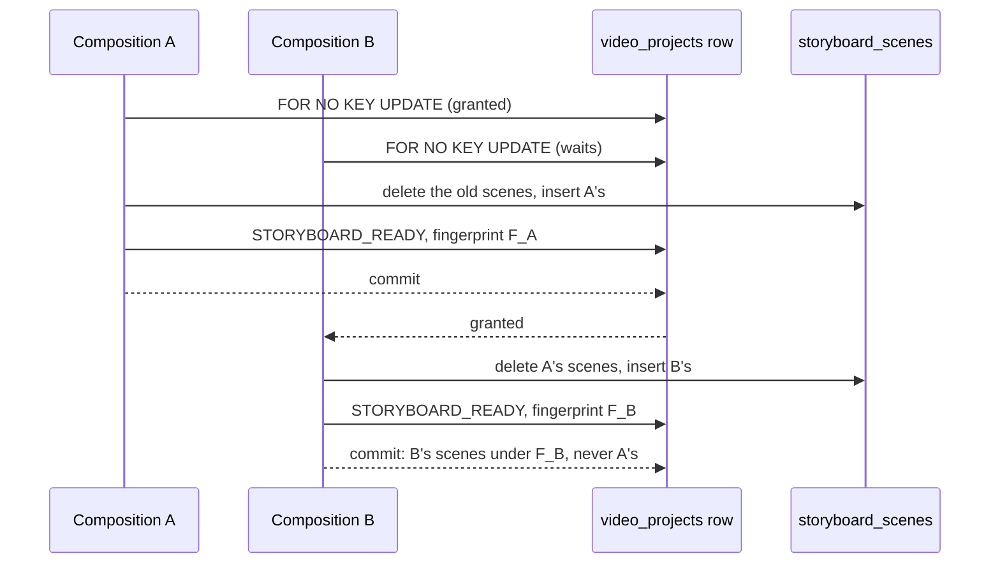

### Verification

Measured locally (PostgreSQL 16 configured like CI) on `38317ac`. This
record's commit changes only this file.

| Check | Result |
| --- | --- |
| `pnpm lint` / `pnpm typecheck` | clean |
| `pnpm test` | **6164 / 6164**, 223 files (6162 on `b9513aa`) |
| `pnpm test:db` | **1629 / 1629**, 60 files |
| `pnpm test:media` | not run: no media code changed |
| `pnpm build` | succeeded |
| `prisma migrate diff` (migrations against the schema) | not run: no schema or migration changed |

New and changed tests:

- `tests/integration/storyboard-repository.db.test.ts`, against PostgreSQL:
  - the save replaces the scenes wholesale, returns them in position order
    with the database's timestamps, and marks the project with the new
    fingerprint; another tenant's project is refused and its composition
    left as it was; a scene of another project is refused, writing nothing;
  - *one composition, one commit*: a save that fails leaves the previous
    scenes, status and fingerprint whole; a save waits for a composition
    already saving (holding the row and with its own scene at position 1)
    and then replaces it whole, the case that failed on the unique index
    before; two saves started together while a reader holds the row both
    succeed, one after the other, and the project ends with one composition's
    scenes under that composition's fingerprint; a save waits for a reader
    holding the row `FOR SHARE`, which meanwhile still reads the composition
    it locked; and a save finishes while a holder of `FOR KEY SHARE` is still
    open. Each holder signals once its lock is held, "blocked" is read from
    `pg_stat_activity`, and every holder is released in `finally`.
- `tests/integration/generation-persistence.db.test.ts`: an attempt still
  outlives recomposition, through `saveComposition`.
- `packages/domain/src/storyboard/storyboard-service.test.ts`: composition
  writes the project through `saveComposition` only, returns what it saved,
  and replaces an earlier composition's fingerprint with its own.
- The in-memory doubles in `storyboard-service.test.ts`,
  `content-reach.test.ts`, `tests/api/storyboard-routes.test.ts` and
  `tests/api/content-reach-routes.test.ts` implement the new method, refusing
  another tenant's project and setting `updatedAt`.

### Mutation testing

Each mutant applied to the source, the relevant suites run, and the file
restored and checked by SHA-256; the repository's manifest was identical
before and after each pass. The harness is outside the repository.

Two passes: the first on `ed751a1`, the second on the review's answers, which
moved the project's write ahead of the scenes and added the scene check.

| Id | Mutant | Result |
| --- | --- | --- |
| L01 | the project row is not locked by the first read | first pass: killed. Second pass: **equivalent**, since the project's `UPDATE` now comes first and takes the same lock before any scene is touched; the explicit lock keeps the tenant-scoped read and the lock one statement |
| L02 | `FOR UPDATE` instead of `FOR NO KEY UPDATE` | killed (the save cannot finish while a `FOR KEY SHARE` holder is open) |
| L03 | `FOR SHARE` instead | killed (two saves deadlock or collide) |
| T01 | the lock not scoped to the organization | killed |
| T02 | another tenant's project not refused | killed |
| O01 | a scene of another project accepted | killed (second pass; new test) |
| W01 | the old scenes kept | killed |
| W02 | the project not marked ready | killed |
| W03 | the fingerprint not written | killed |
| W04 | the project marked outside the transaction | killed |
| W05 | the returned scenes echoed from the input | survived the first pass; killed after the position-order and timestamp assertions were added |
| W06 | the project written after the scenes, as in the first commit | **equivalent**: a failure rolls either order back |
| S01 | compose saves the project's earlier fingerprint | survived the first pass; killed after the earlier-fingerprint test was added |
| S02 | compose returns the project as it read it | killed |
| S03 | compose also writes the project through `update` | killed |

Result: 15 mutants, 13 killed, 2 equivalent. One first-pass mutant was
dropped with the order it mutated: refusing another tenant only after the
scenes were written, equivalent because the refusal rolls the transaction
back.

### Review

Codex is at its usage limit, so, as for DS-3 to GS-3, an independent review
agent reviewed `ed751a1` against `b9513aa`, reading only git objects. It
confirmed the save is atomic and tenant-scoped, that `FOR NO KEY UPDATE` is the
right strength (the `UPDATE` changes no key column, so it takes that lock
anyway), that no other lock cycle exists in `packages/database/src`, and that
the race and the index collision ADR-0086 describes are real under READ
COMMITTED, so the new tests fail on the old code. Verdict: nothing blocking;
five should-fix findings and nits, answered in `38317ac`:

| Finding | Answer |
| --- | --- |
| The lock tests waited 100 ms for the holder to take its lock, so they could flake or pass vacuously (the `FOR KEY SHARE` one would have passed with `FOR UPDATE` too) | Fixed: the holder signals once its lock is held; "blocked" is read from `pg_stat_activity`; the `FOR KEY SHARE` test requires the save to finish while the holder is still open |
| A failing assertion left the holder open with the project locked | Fixed: every holder is released in `finally`, and its failure is delivered rather than left unhandled |
| ADR-0086 said a stale composition is never presented as current, but the compose response always says `fresh: true` | Reworded: later reads show it stale; the response does not re-check, nothing starts from it, and the start step derives freshness again |
| The gap analysis attributed "extra jobs wait with their Units reserved" to ADR-0052 Decision 7, and moved the first attempts to GS-7 without saying the plan allows it | The approved plan says both: its start step makes the job, the reservation and the scenes (Design 2), and extra jobs wait with their Units reserved, oldest first (Design 6). Cited; the base table's row corrected; and a new TODO item: a job that can never launch must still release its Unit (ADR-0052 Decision 19), decided in GS-7. Nothing launches a job or constructs the start step before then |
| The save did not check that each scene belongs to the locked project | Fixed: a scene naming another project is refused before anything is written, and the composite foreign keys tie it to that project's Property (new test) |
| Nit: the failing-save test would also have passed on the old code | The project is now written first, so the test proves its write rolls back with the scenes |
| Nit: job creation now waits for a composition | Said in ADR-0086 Decision 2 |
| Nit: "a failure anywhere writes nothing" was broader than true | Scoped to the save; the audit entry is written after the commit, as before |
| Nit: the lock wait counts against Prisma's 5-second limit | Recorded in ADR-0086, *Not decided here*; GS-4b settles the start step's bound |
| Nit: a misleading comment, a test double that ignored the organization, two that left `updatedAt`, future work written as present | Fixed |
| Nit: `projects.update` has no production caller left | Recorded in ADR-0086; it stays for settings editing |
| Nit: a future hard purge of photos could deadlock with a composition | Nothing hard-deletes a photo today (Property deletion is soft); left to the retention work in the TODO list |

### Required documentation

| Item | Where |
| --- | --- |
| Architecture diagram | `docs/architecture.md`: the storyboard module's row |
| Entity-relationship diagram | `docs/er-diagram.md`, *GS-4a*: not applicable, no entity, relationship or column changes |
| Critical sequence diagram | the diagram above; the decisions are ADR-0086 Decisions 1 and 2 |
| OpenAPI / API change summary | `docs/api-changes-gs-4a.md`: no HTTP change; the port method and its Prisma implementation |
| Change log / release notes | the commit list above and the pull request description |
| Database migration notes | `docs/migration-notes.md`, *GS-4a*: no migration, and what rolling back means |
| Completion report | this file |

Also updated: `docs/Roadmap.md`, `docs/generation-e2e-gap-analysis.md` (the
GS-4 gap analysis and its split, and two forward references corrected), and
`docs/decisions/TODO.md` (the first admissions move to GS-7's launch step).

### Activation status

Nothing paid or scheduled is activated. The change is to how an existing
screen's composition is saved. No scheduler, credential or payment
integration. Paid Provider Activation, production Provider credentials,
production paid AI calls, the production scheduler and live Stripe charges
remain BLOCKED.

### Known limitations

- **Analysis changes are not locked.** An approval or correction committed
  while a composition reads the inputs makes it stale at once, and it shows
  as stale (ADR-0086, *Not decided here*).
- **Project settings** are not part of the fingerprint; no route edits them
  yet (TODO).
- **Storyboards saved before this build** are not rewritten; one left
  inconsistent by the old race, if any exists, reads as before until composed
  again.

### Remaining work

GS-4a waits for the product owner's yes before merge. GS-4b (the start commit:
job, Unit reservation, scenes and first requests in one commit, with a start
key) and GS-4c (the start service) follow.

## GS-4b — a generation starts in one commit

Base: `b746e59` (PR #109 merge commit on `main`; post-merge CI run 685 green).
ADR: `docs/decisions/0087-a-generation-starts-in-one-commit.md`

The second of GS-4's three pull requests. **Migration 32; no route, no page.**
Nothing outside tests constructs the start commit until GS-4c's service and
GS-10's route.

Commits, oldest first:

| Commit | What it carries |
| --- | --- |
| `05889d2` | the start commit, the start key (migration 32), the domain types, Transaction B moved into a private helper, the tests, ADR-0087 and the documentation |
| `d720cb2` | the review's answers: Transaction B's two locks taken before the project row, the no-period refusal before the job, the start key and the audit entry's organization checked, deterministic same-key tests, the project-row lock inventory, the lock-order notes |
| `c9507ee` | a static assertion the second mutation pass found vacuous |
| this commit | this record |

The exact head SHA is reported with the pull request.

### What GS-4b does

- **One commit, or nothing.** `createGenerationStartRepository(prisma).start`
  checks that the project still holds the storyboard the service judged
  current, derives the quality from the project's resolution, creates the job
  and reserves its Units through Transaction B, copies the storyboard's scenes
  with their first requests, and records the audit entry. Every refusal writes
  nothing; the one found after the job is written, a short entitlement, rolls
  the job back with it.
- **A start key.** `generation_jobs."idempotencyKey"`, unique per project
  (migration 32), answers a replay with the job it started, before the
  storyboard is judged again. Two starts with one key take turns at their
  period's cost-admission lock; two in different periods are decided by the
  key's index.
- **The cost-admission lock stays outermost.** The start takes Transaction B's
  two locks as its first statements, then holds the project row `FOR SHARE` to
  the commit, so a composition cannot change the storyboard under it and no
  row lock is held while the cost-admission lock is acquired.
- **The job stays `RESERVED`.** No attempt is admitted; GS-7's launch step does
  that.

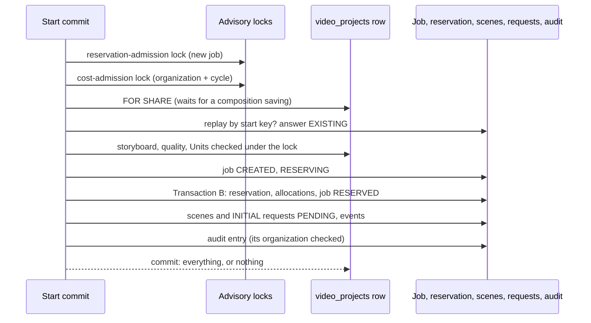

### Verification

Measured locally (PostgreSQL 16 configured like CI) on `c9507ee`. This
record's commit changes only this file.

| Check | Result |
| --- | --- |
| `pnpm lint` / `pnpm typecheck` | clean |
| `pnpm test` | **6178 / 6178**, 224 files (6164 on `b746e59`) |
| `pnpm test:db` | **1653 / 1653**, 61 files (1629 on `b746e59`), on `d720cb2`; `c9507ee` changes one unit test |
| `pnpm test:media` | not run: no media code changed |
| `pnpm build` | succeeded |
| `prisma migrate diff` (migrations against the schema) | no difference |

New and changed tests:

- `tests/integration/generation-start.db.test.ts` (new, 24 tests), against
  PostgreSQL, with its own two tenants and Standard periods:
  - a start writes the job (`RESERVED`, key, Units, snapshot), the reservation
    and its allocation, the scenes and first requests copied from the
    storyboard, every event under the organization, and one audit entry; a
    720p project starts at Normal; one key may start two projects;
  - a replay answers with the first job and writes nothing, even after
    recomposition; two same-key starts in one period both wait at the
    cost-admission lock and start one job; two in different periods are
    decided by the key's index while the first is held at its audit entry, and
    the second starts when the first's backend is cancelled; another
    organization's replay is answered `PROJECT_NOT_FOUND`;
  - each refusal writes nothing: another tenant's or a missing project; a
    changed fingerprint, scene order, scene count or status; an empty
    storyboard; a changed quality; a storyboard over 90 seconds; an unknown
    disclosure mode; no period; the plan's one HQ Unit spent; a failing audit
    builder; an audit entry naming another organization; a key of 0 or 201
    characters, or none (and 200 starts);
  - a start waits for the cost-admission lock holding no row, while a
    composition saves, then refuses the storyboard it changed; it waits for a
    composition already saving and then refuses or starts on what it left; it
    does not wait for another reader of the project; a 90-scene storyboard
    starts within the default limit (composition and start together about
    0.7 s locally). Each wait is read from `pg_stat_activity`, and every
    holder is released in `finally`.
- `packages/domain/src/orchestration/start.test.ts` (new, 13 tests): the
  quality mapping; migration 32's exact SQL; the start's lock and statement
  order; refusals returned before the job and thrown after it; the key and
  mode refused before the transaction; the audit entry's organization checked
  before it is written; no attempt admitted; nothing constructs the
  repository; and an inventory of every lock and write on a project row in the
  database package, with composition and job creation taking no advisory lock.
- `tests/database-public-surface.test.ts`: the start repository is exported;
  `reserveJobWithin` is not, and only its module names it.
- `durable-shape.test.ts` and `mode-shape.test.ts` follow Transaction B into
  `reserveJobWithin` and the start's job write; eighteen migration-count pins
  move from 32 to 33, and four dormancy pins name migration 32 as the newest.

### Mutation testing

Each mutant applied to the source, the start's database and static suites run
(the ledger suite for the `reserve()` mutant), and the file restored and
checked by SHA-256; the repository's manifest was identical before and after
each pass. The harness is outside the repository.

| Id | Mutant | Result |
| --- | --- | --- |
| L01 | the project row not locked | killed |
| L02 | the project locked `FOR UPDATE` | first pass: killed by the static test only; a test that a start does not wait for another reader was added, which kills it |
| T01 | the project lock not scoped to the organization | killed |
| R01 / R02 | no replay read; any job of the project taken as the replay | killed |
| S01–S05 | fingerprint, status, scene order, scene count, empty storyboard not checked | killed |
| Q01 / Q02 | the confirmed quality not checked; 720p mapped to HQ | killed |
| U01 / U02 | the duration from the first scene only; an over-long storyboard not refused | killed |
| J01–J04 | no key on the job; no move to `RESERVING`; the wrong job version; the wall clock for `startedAt` | killed |
| B01 | no period: the refusal returned after the job is written | first pass: killed. Second pass: killed by the static test only, since the start now refuses a missing period before the job, so Transaction B cannot meet one |
| B02 | short Units: the refusal returned after the job is written | killed |
| C01–C04 | a scene not copied; its prompt not copied; its events mislabelled; no first request | killed |
| A01 / A02 | no audit entry; an entry naming another organization written | killed (A02 second pass) |
| V01 / V02 | the key's check removed; a 200-character key refused | killed (second pass) |
| O01 | the cost-admission lock not taken before the project row | killed (second pass) |
| O02 | the no-period refusal removed, leaving it to Transaction B | second pass: survived, because the static order assertion passed on a missing line; fixed in `c9507ee`, then killed. Behaviourally the same except when a period is opened mid-start |
| O03 | the reservation-admission lock not taken first | killed by the static test only: the lock is uncontended for a new job |
| K01 | a key conflict not recognised | killed |
| D01 | an unknown disclosure mode reaching the transaction | killed |
| X01 | `reserve()` running Transaction B outside a transaction | killed by the ledger suite |

Result: first pass on `05889d2`, 28 mutants, 28 killed. Second pass on
`d720cb2`, 34 mutants, 33 killed and one survivor, killed after `c9507ee`.

### Review

Codex is at its usage limit, so, as for DS-3 to GS-4a, an independent review
agent reviewed `05889d2` against `b746e59`, reading only git objects. It
confirmed Transaction B is unchanged for `reserve()`, that the start is atomic
and every refusal writes nothing, that Prisma 5.22 reports the key's index by
field names, that tenant isolation holds through the replay and the conflict
re-read, and that no lock cycle exists today. Verdict: nothing blocking. Its
findings, answered in `d720cb2`:

| Finding | Answer |
| --- | --- |
| The start held the project row and then took the cost-admission lock, contradicting the documented rule that it is the outermost lock; a later author following that rule could add a deadlock | Fixed by obeying the rule: the start takes the reservation-admission and cost-admission locks first, and refuses a start no period covers before the job, so Transaction B never takes a cost-admission lock under the project row. The lock module's and the authorization repository's notes name the start, and a static inventory lists every lock and write on a project row |
| The same-key test could pass without reaching the key's index | Rewritten: same-period starts are both seen waiting at the cost-admission lock; a cross-period pair is held at the first's audit entry so the second is seen waiting on the index, both when the first commits and when its backend is cancelled |
| A missing key would match any job of the project | Refused before the transaction: a string of 1 to 200 characters, as the column's check |
| The audit entry's organization was not enforced | An entry naming another organization rolls the start back |
| The cross-tenant replay test did not prove the first start happened | Asserted |
| ADR wording: a write to project rows left out, the job row's place in the lock order, "bounds its callers" | Corrected |
| The project-scoped key departs from `docs/DataModel.md` | Kept, as ADR-0087 Decision 2 explains; the PR names it for the product owner |
| A long storyboard against the 5-second limit | Measured locally (a 90-scene storyboard, now a test); the production timing is a TODO before activation |
| Nits: a redundant index, two stale comments, `Promise` missing from the API summary, the timing of a differing replay, scene and request events' organization untested | Comments, summary and test fixed; the differing replay is described in ADR-0087; the redundant `videoProjectId` index is left, since dropping it is a schema change of its own |

### Required documentation

| Item | Where |
| --- | --- |
| Architecture diagram | `docs/architecture.md`: the start commit's row |
| Entity-relationship diagram | `docs/er-diagram.md`, *GS-4b*: the start key |
| Critical sequence diagram | the diagram above; the decisions are ADR-0087 Decisions 1 to 3 |
| OpenAPI / API change summary | `docs/api-changes-gs-4b.md`: no HTTP change; the port, its outcomes, the Prisma repository |
| Change log / release notes | the commit list above and the pull request description |
| Database migration notes | `docs/migration-notes.md`, *GS-4b*: migration 32, and how to roll it back |
| Completion report | this file |

Also updated: `docs/Roadmap.md`, `docs/generation-e2e-gap-analysis.md`,
`docs/DataModel.md` (the key's scope), and `docs/decisions/TODO.md` (measure
the start on the production database before activation).

### Activation status

Nothing paid or scheduled is activated, and nothing a customer can reach
changes: the start commit is constructed by tests only. No scheduler,
credential or payment integration. Paid Provider Activation, production
Provider credentials, production paid AI calls, the production scheduler and
live Stripe charges remain BLOCKED.

### Known limitations

- **Nothing launches a started job** until GS-7, and a job that could never
  launch must still release its Units (TODO).
- **The start's time on the production database** is not measured (TODO).
- **Analysis changes are not locked**, as ADR-0086 recorded.

### Remaining work

GS-4b waits for the product owner's yes before merge. GS-4c (the start
service: permissions, reach, the start key, freshness, quality, Mode A and the
Unit period) follows.

## GS-4c — the start service

Base: `e7a04b5` (PR #111 merge commit on `main`; post-merge CI run 691 green).
ADR: `docs/decisions/0088-starting-a-video-the-start-service.md`

The last of GS-4's three pull requests. **No migration; no route, no page.**
Nothing outside tests constructs the service until GS-10's route.

Commits, oldest first:

| Commit | What it carries |
| --- | --- |
| `3446ce8` | `GenerationStartService`, the replay read `findStarted`, the deleted-Property outcome, the tests, ADR-0088 and the documentation |
| `884a835` | the review's answers: the commit re-checks the Property under its lock, the replay read's ids checked, the one-permission and stub-argument tests, the service against the real commit, the audit wording corrected |
| this commit | this record |

The exact head SHA is reported with the pull request.

### What GS-4c does

- **Who may start.** `video.generate` and `unit.consume` together, before
  anything is read; a project out of the member's reach, or under a deleted
  Property, is answered as not found.
- **A replay first.** The start key's job is read, scoped to the organization,
  before the storyboard is judged, so a retry finds its job after the customer
  recomposed.
- **What the customer confirmed.** The storyboard must be composed and current,
  and be the scenes the start screen showed, in order; the quality the
  project's resolution gives must be the one shown, and one a verified route
  serves (Normal today, so a 1080p project is answered not offered); every
  scene must have a compiled prompt and an approved camera motion; the length
  must be one the product sells.
- **The Unit period, then the commit.** The period containing the server
  clock's instant is opened if nothing has opened it, then the start commit
  (ADR-0087) receives a record with new ids, that instant, Mode A, the member's
  transition context and the `generation.started` audit entry. Its outcomes
  are mapped to the ones the start screen will show.
- **The commit re-checks the Property.** Its project read joins the Property
  and holds both rows `FOR SHARE`, so a deletion saving at the same moment is
  waited for and then refused (`PROPERTY_DELETED`).

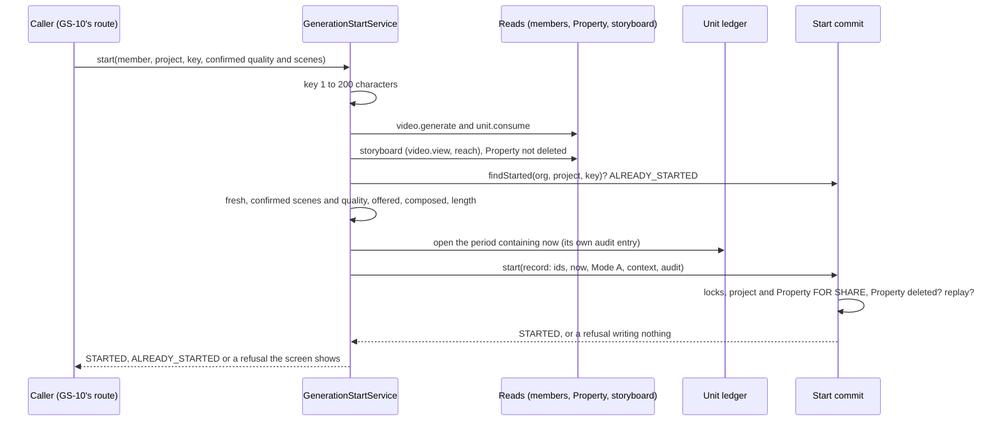

### Verification

Measured locally (PostgreSQL 16 configured like CI) on `884a835`. This
record's commit changes only this file.

| Check | Result |
| --- | --- |
| `pnpm lint` / `pnpm typecheck` | clean |
| `pnpm test` | **6207 / 6207**, 225 files |
| `pnpm test:db` | **1660 / 1660**, 62 files |
| `pnpm test:media` | not run: no media code changed |
| `pnpm build` | succeeded |
| `prisma migrate diff` | not run: no schema or migration changed |

New and changed tests:

- `packages/domain/src/orchestration/start-service.test.ts` (new, 28 tests),
  with a real organization and its six roles, real grants, the in-memory Unit
  ledger and a recording start repository: a start's record (ids, the server
  clock, Mode A, the context, the scenes in order) and its audit entry; HQ
  where offered; ninety seconds; a 200-character key; who may start, including
  a member holding only one of the two permissions; reach, a deleted Property
  (even to a replay) and an archived one; each refusal, with no period opened
  and the commit not reached; the period open when the commit runs; each
  commit outcome's mapping; and nothing outside tests constructing it.
- `tests/integration/generation-start-service.db.test.ts` (new, 4 tests): the
  service against the real commit: a start reserving from the period it
  opened; a replay writing nothing more; short Units with the real eligible
  count; and a commit refusal that leaves the period and its own audit entry
  and nothing else.
- `tests/integration/generation-start.db.test.ts` (3 more, 27): the replay
  read's scoping and its refusals; a deleted Property refused, a replay
  included; and a start that waits for a deletion saving, then refuses.
- `packages/domain/src/orchestration/start.test.ts`: the key checked before
  the replay read, the Property joined and locked, and its refusal before the
  replay read.

### Mutation testing

The same harness as GS-4b: each mutant applied, the suites run, the file
restored and checked by SHA-256, and the repository's manifest identical before
and after each pass.

The service's mutants ran against `start-service.test.ts`; the commit's
against both start database suites, and separately against the static suite
(`start.test.ts`) to see which it alone catches.

| Id | Mutant | Result |
| --- | --- | --- |
| K01–K03 | an empty key accepted; a 200-character key refused; a 201-character key accepted | killed |
| P01 / P02 | `unit.consume` not required; `video.generate` not required | first pass: survived; the one-permission test was added, which kills both |
| H01–H03 | a deleted Property starts; reach not checked; an archived Property refused instead | killed |
| R01 / R02 | the replay not answered; the replay read with another key | killed |
| F01 | a project with scenes but no fingerprint accepted | first pass: survived; a test of exactly that was added, which kills it |
| F02 / F03 | an empty or stale storyboard accepted | killed |
| C01–C03 | the confirmed scenes' count, order or ids not compared | killed |
| Q01–Q03 | the confirmed quality not compared; the offer not checked; today's offer offering HQ | killed |
| S01 / S02 | a scene with no prompt, or an unapproved camera motion, accepted | killed |
| L01 / L02 | the length not checked; the length from the longest scene | killed |
| N01–N04 | no subscription or one not started not `NO_PLAN`; a period conflict started around; the wall clock | killed |
| D01 | the requester taken from the project's creator | first pass: survived, since the fixture's creator was the member starting; the fixture's project is now created by another member, which kills it |
| D02–D05 | the request id's prefix; actor type `SYSTEM`; the context without the actor; the event type | killed |
| A01–A03 | the audit entry on the project; without the scene count; without the block | killed |
| A04 | the audit entry's organization taken from the project row | survived: **equivalent**, since the storyboard read returns only a project of the organization asked for |
| O01–O07 | each commit outcome mapped wrongly (the length, the eligible count, the replay, a missing project, the no-period defect, the allocations, a deleted Property) | killed (O07 second pass) |
| X01 | the period opened before the storyboard is judged | killed |
| DB01–DB06 | the replay read not scoped to the organization, the key or the project; no key check on it or on the commit; the conflict re-read not a replay | killed |
| DB07 / DB08 | the commit's deleted-Property refusal removed; moved after the replay read | killed by the database suites (and the static suite) |
| DB09 | only the project row locked, not its Property | killed by the database suites (and the static suite) |
| DB10 / DB11 | the replay read accepting an empty or a missing id | killed by the database suites |
| DB12 | an archived Property refused instead of a deleted one | killed |

Result: first pass on `3446ce8`, 49 mutants, 44 killed and five survivors.
Second pass on `884a835`: the service's 44 mutants, 43 killed and A04
equivalent; the commit's 12, all killed by the database suites.

### Review

Codex is at its usage limit, so an independent review agent reviewed `3446ce8`
against `e7a04b5`, reading only git objects. It confirmed that the checks run
in ADR-0088's order and every refusal before the period step only reads; that
no refusal can leave a Unit reserved; that the replay read is scoped to the
organization; that a project out of reach and a deleted Property's project are
answered alike; that the service and the commit cannot disagree in a way that
charges the customer; and that the audit entry is an explicit allowlist.
Verdict: correct and tenant-safe, nothing blocking; fix the audit-entry
wording and close three test gaps before merge, and fix or document the
deleted-Property race. Its four should-fix findings and three nits, answered
in `884a835`:

| Finding | Answer |
| --- | --- |
| The documents said a refusal writes no audit entry, but opening the period writes `entitlement.period_opened` | Corrected in ADR-0088, the service's comments, the API summary and the Roadmap: a refusal writes no job, reservation or `generation.started` entry, and one after the period step leaves the period and its own entry. A database test proves it |
| No test caught dropping `unit.consume` | A member holding only one of the two permissions is refused (this also kills two mutants that survived the first pass) |
| The storyboard stub ignored its arguments, and the service never met the real commit and ledger | The stub records its arguments and the tests assert them; a database suite runs the service against the real commit: a start, a replay, short Units, and a commit refusal |
| A deletion could save between the service's Property read and the commit | Fixed in the commit: it joins the Property and holds both rows `FOR SHARE`, and answers `PROPERTY_DELETED` before the replay read. No cycle: nothing that writes a Property takes the project row or the start's advisory locks. Database tests prove a deleted Property refused and a deletion in flight waited for, then refused |
| Nit: the replay read did not check its organization and project ids | A missing or empty one is refused before anything is read |
| Nit: ADR-0088 claimed the tests prove each refusal "in its order", and the period was checked only after the call | Reworded to what the tests prove; the period is now checked open at the moment the commit runs |
| Nit: a comment naming the constructor would fail the dormancy test | Comments are stripped before the search |

The choice to answer a deleted Property's project as not found, rather than
let it start, is ADR-0088's; the pull request asks the product owner to
confirm it.

### Required documentation

| Item | Where |
| --- | --- |
| Architecture diagram | `docs/architecture.md`: the start service's row |
| Entity-relationship diagram | Not applicable: no schema change |
| Critical sequence diagram | the diagram above; the decisions are ADR-0088 Decisions 1 to 4 |
| OpenAPI / API change summary | `docs/api-changes-gs-4c.md`: no HTTP change; the service, its outcomes and errors, `findStarted`, `PROPERTY_DELETED` |
| Change log / release notes | the commit list above and the pull request description |
| Database migration notes | `docs/migration-notes.md`, *GS-4c*: no migration; the Property row the start now holds |
| Completion report | this file |

Also updated: `docs/Roadmap.md`, `docs/generation-e2e-gap-analysis.md` and
`docs/decisions/TODO.md` (the deleted-Property item).

### Activation status

Nothing paid or scheduled is activated, and nothing a customer can reach
changes: the service and the start commit are constructed by tests only. No
scheduler, credential or payment integration. Paid Provider Activation,
production Provider credentials, production paid AI calls, the production
scheduler and live Stripe charges remain BLOCKED.

### Known limitations

- **HQ cannot start** while no verified route serves it; how the test route
  offers HQ outside production is GS-5's.
- **Nothing launches a started job** until GS-7, and a job that could never
  launch must still release its Units (TODO).
- **A deleted Property's project** is refused only by the start; reading,
  composing and single-scene admission are unchanged (TODO).
- **A refusal after the period step leaves the period**, with its own audit
  entry, as any later Unit action would have written it.

### Remaining work

GS-4c waits for the product owner's yes before merge. GS-5 (the test
provider's route, price and catalog entry outside production, and the billing
cycle's revenue for the paid-call gate) follows.

## GS-5a-1 — the route table and price catalog are passed in

Base: `90f0be6` (PR #112 merge commit on `main`; post-merge CI run 696 green).
ADR: `docs/decisions/0089-the-route-table-and-price-catalog-are-passed-in.md`

The first of GS-5's three pull requests. **No migration; no route, no page.**
Production passes nothing new and behaves exactly as before; nothing outside
tests builds another policy or catalog until GS-5a-2.

Commits, oldest first:

| Commit | What it carries |
| --- | --- |
| `a4e9ad7` | the route policy, the start's quality offer for a policy, the extended price catalog, the repository's catalog option, the tests, ADR-0089 and the documentation, and the product owner's revenue decision recorded |
| `9a44693` | the test that a cycle's siblings are verified against the catalog given |
| `9419390` | the review's answers: `defineRoutePolicy`, the offer requiring a route, the sibling's cost asserted, the documents corrected |
| this commit | this record |

The exact head SHA is reported with the pull request.

### What GS-5a-1 does

- **A route policy.** `RoutePolicy` is a route table and the qualities it
  serves, under one version. `PRODUCTION_ROUTE_POLICY` is the existing table,
  frozen. `authorizeRoute` and the paid-submission gate authorize against the
  policy given, and production's when none is, so forgetting to pass one
  refuses the route rather than authorizing it. A policy outside production is
  built by `defineRoutePolicy`, which refuses production's version, a quality
  listed with no route, a route whose quality is not listed and a repeated
  quality, and returns a frozen copy.
- **The record names its table.** The authorization record's
  `routingPolicyVersion` is the version of the policy the route was authorized
  against, carried out of the gate in its audit block.
- **The start's offer follows a policy.** `routeQualityOffer(policy)` offers a
  quality the policy lists and has a route for, the gate's first two checks;
  production's is Normal only, as before.
- **The price catalog is passed in.** The paid-submission repository verifies
  the candidate's snapshot and every cost-bearing sibling's against the catalog
  it is given, production's when none is. `extendProviderPricingCatalog(added)`
  builds a new catalog with production's contracts and the added ones, and
  refuses a duplicate identity; production's is never changed.
- **The revenue question is closed.** The product owner chose on 2026-10-27
  that a cycle's revenue is the plan's monthly price plus the period's Unit
  purchases, tax-exclusive (`docs/decisions/TODO.md`, decision gates closed).
  GS-5b builds it.

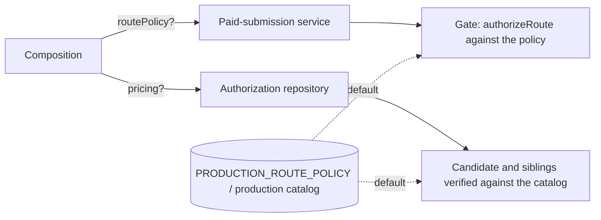

### Verification

Measured locally (PostgreSQL 16 configured like CI) on `9419390`. This
record's commit changes only this file.

| Check | Result |
| --- | --- |
| `pnpm lint` / `pnpm typecheck` | clean |
| `pnpm test` | 225 files, 6,223 tests passed |
| `pnpm test:db` | 62 files, 1,662 tests passed on `a4e9ad7`; the one suite changed since, `paid-submission-authorization.db.test.ts`, 67 passed on `9419390` |
| `pnpm test:media` | not run: no media code changed |
| `pnpm build` | succeeded |
| `prisma migrate diff` | not run: no schema or migration changed |

New and changed tests:

- `packages/domain/src/authorization/routing.test.ts`: production's policy is
  the existing constants and frozen; a route is authorized against the policy
  given; a quality is served only when listed and routed; `defineRoutePolicy`
  copies and freezes, and refuses each malformed policy.
- `packages/domain/src/authorization/gate.test.ts`: the gate against a policy it
  is given (permitted and recorded with that policy's version, HQ served, the
  default refusing the provider, the policy as the whole table), and the audit
  carrying production's version by default.
- `packages/domain/src/authorization/paid-submission-service.test.ts`: the
  service passing its policy to the gate and recording its version; an empty
  policy refusing without arming.
- `packages/domain/src/pricing/provider-pricing.test.ts`: an extended catalog
  finds the added and production's contracts, leaves production's unchanged,
  and refuses a duplicate.
- `packages/domain/src/orchestration/start-service.test.ts`: the offer for a
  policy, and no offer for a quality listed with no route.
- `tests/integration/paid-submission-authorization.db.test.ts` (3 more): an
  attempt priced on a contract production's catalog lacks is refused by
  default and authorized with the extended catalog, and a sibling priced on it
  is verified against the catalog given and counted as the next attempt's
  in-flight cost.

### Mutation testing

The same harness as GS-4c: each mutant applied, the suites run, the file
restored and checked by SHA-256, and the repository's manifest identical before
and after each pass.

The domain mutants ran against the authorization, pricing and start-service
suites; the repository's against the paid-submission database suite.

| Id | Mutant | Result |
| --- | --- | --- |
| R1 / R2 | `authorizeRoute` ignoring the policy's qualities; its routes | killed |
| R3 / R4 | production's policy not frozen; serving HQ | killed |
| G1 / G2 | the gate ignoring the policy; the audit naming another version | killed |
| S1 / S2 | the service not passing its policy; the record naming production's version | killed |
| Q1 | the start's offer ignoring the policy | killed |
| P1–P4 | the extended catalog dropping production's contracts, accepting a duplicate, not frozen; the duplicate check removed | killed |
| D1 / D2 | the repository ignoring the catalog given; the contract lookup ignoring it | killed |
| D3 | the siblings verified against production's catalog | killed, by the sibling test added in `9a44693` |
| D4 / D5 | the candidate's contract looked up, or its snapshot verified, in production's catalog | killed |
| V1 / V2 | `defineRoutePolicy` accepting an empty version; production's | killed |
| V3–V5 | accepting a repeated quality, a quality with no route, a route whose quality is not listed | killed |
| V6 | returning the input frozen rather than a copy | killed |
| V7 / V8 | `servesQualityTier` ignoring the routes; the listed qualities | killed |
| V9 | the start's offer reading only the listed qualities, as before the review | killed |
| D6 | an in-flight sibling's cost not counted | killed |

Result: first pass on `9a44693`, 18 mutants, all killed. Second pass on
`9419390`, for the review's answers: 10 mutants and D3 again, all killed.

### Review

Codex is at its usage limit, so an independent review agent reviewed
`9a44693` against `90f0be6`, reading only git objects. It confirmed that
production's policy reuses the same frozen tables, so the default is
identical and the record's version unchanged; that every default falls back to
production's and refuses anything else; that the candidate and every sibling
are verified against the same catalog; that nothing passed in can change
production's tables; and that the sibling test catches the regression it
targets. Verdict: nothing blocking. Its two should-fix findings and four nits,
answered in `9419390`:

| Finding | Answer |
| --- | --- |
| A policy is not checked: one listing HQ with no HQ route makes the start offer HQ and reserve Units the gate then refuses; one reusing production's version would make the record name the wrong table; the start's offer and the gate's policy are passed separately | `defineRoutePolicy` refuses both, and the offer requires a route for the quality. ADR-0089 records that a composition must build the offer and the policy from one policy, that GS-5a-2's factory hands out both, and that a job started on a mismatched pair holds its Units until the GS-7 release work |
| The revenue decision's TODO entry: no unbuilt-work item, "built by GS-5b" reads as done, and the sub-rules should be checked against the card | The reader is listed as unbuilt work and the entry says "to be built". The card's own words were tax-exclusive, seats and storage not counted, and Enterprise paused until its contracted price is recorded; that a cancelled purchase counts nothing is ADR-0070's (a cancelled purchase is withdrawn and not invoiced), and the entry says so |
| Nit: an added contract can re-price a production route under a new pricing version, which the media recovery planner would refuse as ambiguous | Recorded in ADR-0089 *Not decided here*; the test route's contract names its own provider |
| Nit: the extended catalog freezes the caller's added contracts in place | A comment says so, and why: the caller cannot change a price the catalog holds |
| Nit: the Roadmap and architecture said every dependency defaults to production's, but the start's offer has no default | Corrected |
| Nit: the sibling test relied on the fixture putting both chains in one cycle | It now also asserts the sibling's cost as the second attempt's in-flight cost |

### Required documentation

| Item | Where |
| --- | --- |
| Architecture diagram | `docs/architecture.md`: the route policy and catalog row |
| Entity-relationship diagram | Not applicable: no schema change |
| Critical sequence diagram | the diagram above; the decisions are ADR-0089 Decisions 1 to 5 |
| OpenAPI / API change summary | `docs/api-changes-gs-5a-1.md`: no HTTP change; the new and changed exports |
| Change log / release notes | the commit list above and the pull request description |
| Database migration notes | `docs/migration-notes.md`, *GS-5a-1*: no migration |
| Completion report | this file |

Also updated: `docs/Roadmap.md`, `docs/generation-e2e-gap-analysis.md` (the GS-5
gap table and split) and `docs/decisions/TODO.md` (the revenue decision and
the reader as unbuilt work).

### Activation status

Nothing paid or scheduled is activated, and nothing a customer can reach
changes: production passes no policy or catalog of its own and the defaults
are production's tables. No scheduler, credential or payment integration. Paid
Provider Activation, production Provider credentials, production paid AI
calls, the production scheduler and live Stripe charges remain BLOCKED.

### Known limitations

- **No test route exists yet**: nothing builds a policy or catalog other than
  production's until GS-5a-2's factory, which refuses production.
- **Revenue is still unknown** to the guard, which therefore still pauses
  every paid submission, until GS-5b's reader.

### Remaining work

GS-5a-1 waits for the product owner's yes before merge. GS-5a-2 (the test
route's catalog entry, routes, price and FX rate, built only outside
production) and GS-5b (the revenue reader) follow.

## GS-5a-2 — the test route is built only outside production

Base: `18080af` (PR #113 merge commit on `main`; post-merge CI run 702 green).
ADR: `docs/decisions/0090-the-test-route-is-built-only-outside-production.md`

The second of GS-5's three pull requests. **No migration; no route, no page.**
Production's route policy, model catalog and price catalog are unchanged, and
nothing outside tests builds the test route until GS-9.

Commits, oldest first:

| Commit | What it carries |
| --- | --- |
| `feed81d` | the test route's factory, its tests, ADR-0090 and the documentation |
| `046bc21` | the review's answers: each part of the kit frozen, the builders watched, the comments and the rate's record corrected, two tests widened |
| this commit | this record |

The exact head SHA is reported with the pull request.

### What GS-5a-2 does

- **One factory.** `createFakeRouteKit(env)` in `@app/video-providers` hands
  out the test provider's model catalog, a route policy, the start's quality
  offer built from the same policy, a price catalog and an exchange rate, the
  kit and each part frozen.
- **Refused in production.** It throws `CONFIGURATION_ERROR` when the given or
  the process's `NODE_ENV` is `production`, or `VIDEO_PROVIDER` is not `fake`,
  with no override.
- **Two routes.** Normal at 720p and HQ at 1080p, each recorded as generated
  at its own size, image-to-video with no audio, under the version
  `dev-test-route.1`. The policy holds no production route, so it can never
  authorize a paid provider's.
- **Its own catalog entry**, the default and only entry, selectable, 5 to 15
  seconds like production's default model. The fake provider makes no clip
  yet; GS-6 must make each at the route's size (`docs/decisions/TODO.md`).
- **A nominal price and a named rate.** One cent a second per size, added to a
  copy of production's catalog, and ¥150 per dollar under an id and source
  that name it as a development rate. The fake provider is never paid.
- **Nobody builds it yet.** A test lists every file outside tests that names
  the factory or the two builders it uses, which have no production check of
  their own.

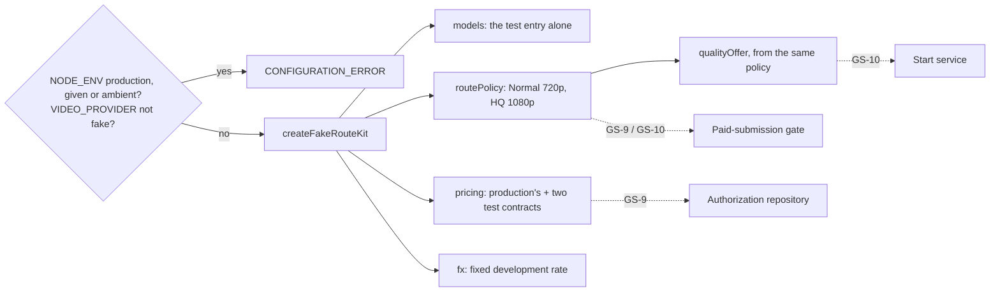

### Verification

Measured locally (PostgreSQL 16 configured like CI).

| Check | Result |
| --- | --- |
| `pnpm lint` / `pnpm typecheck` | clean on `046bc21` |
| `pnpm test` | 226 files, 6,242 tests passed on `046bc21` |
| `pnpm test:db` | 62 files, 1,666 tests passed on `feed81d`; the one suite changed since, `paid-submission-authorization.db.test.ts`, 71 passed on `046bc21` |
| `pnpm test:media` | not run: no media code changed |
| `pnpm build` | succeeded on `046bc21` |
| `prisma migrate diff` | not run: no schema or migration changed |

New and changed tests:

- `packages/video-providers/src/fake/route-kit.test.ts` (new, 16): refused
  for a given and an ambient production and for another provider; the
  catalog; the policy serving each quality at its size only, and no production
  route; both prices beside production's; the rate usable; a snapshot for
  every length; production's tables unchanged; the kit and each part frozen;
  who names the factory and the two builders.
- `tests/routing-catalog-parity.test.ts` (3 more): each route goes to a
  selectable entry at the size the entry generates, is priced for exactly the
  entry's lengths, and the entry's lengths are production's default model's.
- `tests/integration/paid-submission-authorization.db.test.ts` (4 more): an HQ
  attempt on the test route is authorized with the kit and recorded under its
  version; a Normal one on a 720p project too; production's catalog refuses
  one, and production's policy refuses HQ for its quality and Normal for its
  provider, leaving the attempt queued.

### Mutation testing

The same harness as GS-5a-1: each mutant applied, the suites run (the kit's
unit tests and the parity test), the file restored and checked by SHA-256, and
the repository's manifest identical before and after the pass. Run on
`046bc21`.

| Id | Mutant | Result |
| --- | --- | --- |
| K1 / K2 / K3 | a given production, an ambient production, another provider accepted | killed |
| K4 / K5 / K6 | HQ routed at 720p; a route serving both sizes; another generation mode | killed |
| K7 | the start's offer built apart from the policy (Normal only) | killed |
| K8 / K9 / K10 | one price missing; billed for other lengths; under another version | killed |
| K11 / K12 / K13 | the entry, the kit, the rate not frozen | killed |
| K14 | the rate unusable | killed |
| K15 / K19 / K20 | the catalog finding any key; listing nothing; the entry not selectable | killed |
| K16 / K21 | 1080p generated at 720p; claimed as upscaled | killed |
| K17 / K18 | the entry's lengths changed; its provider changed | killed |
| K22 / K26 | a production file naming the factory; naming `defineRoutePolicy` | killed |
| K23 / K24 / K25 | the catalog, the offer, the price catalog not frozen | killed |
| K27 | a file outside `src`, a URL earlier on its line, naming `extendProviderPricingCatalog` | killed |

Result: 27 mutants, all killed (K7's anchor was corrected for the review's
change and run again).

### Review

Codex is at its usage limit, so an independent review agent reviewed
`feed81d` against `18080af`, reading only git objects. It confirmed that
nothing in the kit can change production's tables; that the refusal checks
both the given and the ambient `NODE_ENV` and the provider, with no override;
that an attempt admitted from the kit's catalog passes admission's pricing
binding, the gate's route check and execution preflight for both qualities,
with exactly one current contract per route; that the fixture resets the
project's resolution before every test; and that the documents add no
business rule. Verdict: nothing blocking. Its four should-fix findings and
four nits, answered in `046bc21`:

| Finding | Answer |
| --- | --- |
| ADR-0090 and the migration notes said the paid-submission repository records the rate, in `fx_snapshots` | Corrected: attempt admission records it (`bindFxSnapshot`) in `fx_rate_snapshots`; the repository loads and validates it |
| The kit's comments said the fake provider makes clips at each size, which it does not yet | Reworded; making the clips at the route's sizes is recorded for GS-6 in `docs/decisions/TODO.md` and ADR-0090 Decision 4 |
| The kit was frozen one level deep | The catalog, the offer and the price catalog are each frozen, and the test checks all three |
| The caller test watched only the factory, while `defineRoutePolicy` and `extendProviderPricingCatalog` have no production check | The test lists their callers too, their definitions and the kit only, over every app and package (not only `src`), `infra` and `prisma` |
| Nit: the error type differs from the storage guards; an unset `NODE_ENV` reads as development | Kept: `CONFIGURATION_ERROR` is what this package's provider factory throws, and the provider package does not depend on storage. The unset `NODE_ENV` is the storage guards' same assumption; ADR-0090 Decision 2 says a production deployment must set it |
| Nit: a stale comment called a non-production policy production's plus the test route | Corrected: the test route's alone |
| Nit: "no production route" checked only the first; the database test refused by policy at HQ only | Every production route and target is checked; a Normal attempt is refused by production's policy for its provider |
| Nit: the scan missed files outside `src`, and a URL in a string hid the rest of its line | Both fixed, and K27 proves the second |

### Required documentation

| Item | Where |
| --- | --- |
| Architecture diagram | `docs/architecture.md`: the test route kit row |
| Entity-relationship diagram | Not applicable: no schema change |
| Critical sequence diagram | the diagram above; the decisions are ADR-0090 Decisions 1 to 6 |
| OpenAPI / API change summary | `docs/api-changes-gs-5a-2.md`: no HTTP change; the new exports |
| Change log / release notes | the commit list above and the pull request description |
| Database migration notes | `docs/migration-notes.md`, *GS-5a-2*: no migration |
| Completion report | this file |

Also updated: `docs/Roadmap.md`, `docs/generation-e2e-gap-analysis.md` (the
GS-5 split) and `docs/decisions/TODO.md` (the clips GS-6 must make).

### Activation status

Nothing paid or scheduled is activated, and nothing a customer can reach
changes: the factory refuses production and nothing outside tests calls it.
No scheduler, credential or payment integration. Paid Provider Activation,
production Provider credentials, production paid AI calls, the production
scheduler and live Stripe charges remain BLOCKED.

### Known limitations

- **Revenue is still unknown** to the guard, which therefore still pauses
  every paid submission, the test route's included, until GS-5b's reader.
- **The fake provider makes no clip** at the sizes its entry records (GS-6).
- **Nothing builds the kit** until the pipeline command (GS-9) and the start
  route (GS-10).

### Remaining work

GS-5a-2 waits for the product owner's yes before merge. GS-5b (the billing
cycle's revenue reader) follows.

## GS-5b — a billing cycle's revenue is read from its period

Base: `e34cf3f` (PR #114 merge commit on `main`; post-merge CI run 705 green).
ADR: `docs/decisions/0091-a-billing-cycles-revenue-is-read-from-its-period.md`

The last of GS-5's three pull requests. **No migration; no route, no page.**
Nothing outside tests constructs the paid-submission service until GS-9.

Commits, oldest first:

| Commit | What it carries |
| --- | --- |
| `113db41` | the rule, the database reader, their tests, ADR-0091 and the documentation |
| `67ff0ee` | the review's answers: the revenue read on the gate's own transaction through its session, the read's order pinned, comments and documents corrected |
| this commit | this record |

The exact head SHA is reported with the pull request.

### What GS-5b does

- **The rule, as decided.** `billingCycleRevenueYen` in `@app/domain`: the
  monthly price of the plan the period was opened on plus every uncancelled
  Unit purchase approved on it, tax-exclusive, as the product owner decided
  on 2026-10-27. Seats and storage blocks are not counted while they are not
  recorded. Enterprise, and a plan the catalog does not hold, are unknown; a
  total past a safe integer throws.
- **The facts are the cycle's period.** The cycle key comes from the job's
  reservation; the organization's period for that key holds the plan it was
  opened on, and each purchase names its period. No subscription row,
  invoice or current plan is read.
- **One statement, on the gate's transaction.** The gate asks its session
  for the revenue after loading its facts and before arming, so only while
  the cycle's cost-admission lock is held, which a purchase's block grant and
  a cancellation also take. The database's session runs
  `readBillingCycleRevenueWithin` on the gate's own transaction: one
  tenant-scoped statement over the period, its purchases and their
  cancellations, and never a second connection.
- **A fixed figure only where asked.** The paid-submission repository's
  `revenue` option replaces the read: a fixed figure in tests that steer the
  guard, the unavailable reader where the gate must fail closed. The gate's
  dependencies no longer carry a revenue reader.
- **Nobody builds it in production yet.**

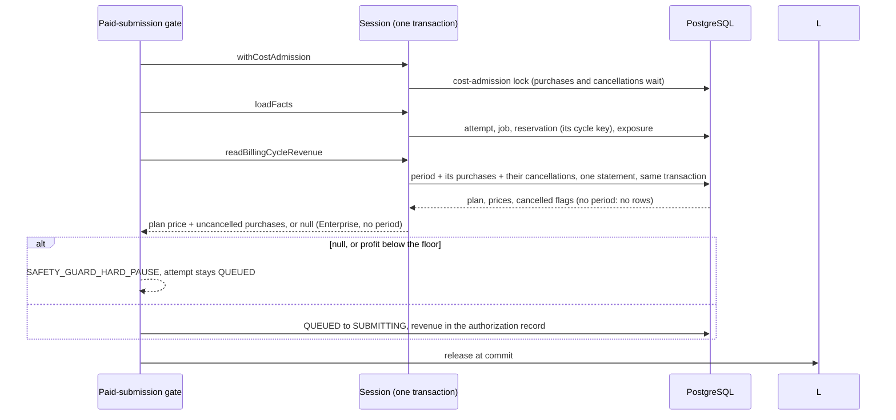

### Verification

Measured locally (PostgreSQL 16 configured like CI), on `67ff0ee`; the same
checks passed on `113db41` (6,249 unit tests, 1,675 database tests).

| Check | Result |
| --- | --- |
| `pnpm lint` / `pnpm typecheck` | clean |
| `pnpm test` | 227 files, 6,251 tests passed |
| `pnpm test:db` | 63 files, 1,675 tests passed |
| `pnpm test:media` | not run: no media code changed |
| `pnpm build` | succeeded |
| `prisma migrate diff` | not run: no schema or migration changed |

New and changed tests:

- `packages/domain/src/authorization/revenue.test.ts` (new, 7): each plan's
  price; purchases added; a cancelled one counted as nothing; Enterprise
  unknown with or without purchases; a plan the catalog lacks unknown; a
  total past a safe integer refused; the unavailable reader unknown.
- `packages/domain/src/authorization/paid-submission-service.test.ts` (2
  more): the revenue is read on the session after the facts and before
  arming, inside the lock; and not read for an attempt with no cycle.
- `tests/integration/billing-cycle-revenue-reader.db.test.ts` (new, 6, its
  own two organizations): the plan price with no purchase; purchases of both
  qualities added and a cancelled one left out, per period; a period whose
  only purchase was cancelled; Enterprise unknown with or without purchases;
  a cycle with no period unknown; another organization's period with the same
  key never read.
- `tests/integration/paid-submission-authorization.db.test.ts` (2 more): with
  the database's reader, the fixture's Enterprise cycle hard-pauses for
  unknown revenue and leaves the attempt queued; a Standard cycle with one
  purchase authorizes and records ¥49,800 + ¥19,900 under its cycle key, on
  a client with one connection, which only a read on the gate's own
  transaction can pass.

### Mutation testing

The same harness as GS-5a-1: each mutant applied, the suites run, the file
restored and checked by SHA-256, and the repository's manifest identical
before and after the pass. The rule's and the service's mutants ran against
the authorization unit tests; the reader's and the repository's against both
database suites above. Run on `113db41` (R1 to D9) and again on the review's
changes, with the reader's mutants re-anchored and S1 to S4 added.

| Id | Mutant | Result |
| --- | --- | --- |
| R1 | Enterprise priced at its list price | killed |
| R2 / R8 | a cancelled purchase counted; subtracted | killed |
| R3 | purchases ignored | killed |
| R4 | an unknown plan read as zero | killed |
| R5 | the plan price taken tax-inclusive | killed |
| R6 | no safe-integer check | killed |
| R7 | the catalog given ignored | killed |
| D1 / D2 | any organization's period; any cycle's | killed |
| D3 | the organization's purchases on any period | killed |
| D4 / D5 | cancellations ignored; any cancellation cancelling every purchase | killed |
| D6 / D9 | Standard read as Premium; Enterprise as Standard | killed |
| D7 | no period read as zero | killed |
| D8 | the period's purchases dropped | killed |
| S1 | the revenue read for an attempt with no cycle | killed |
| S2 | the repository's given revenue ignored | killed |
| S3 | the period never read | killed |
| S4 | the period read on another pooled connection | killed |

Result: all killed, 17 of 17 in the first pass and 21 of 21 in the second.

### Review

Codex is at its usage limit, so an independent review agent reviewed
`113db41` against `e34cf3f`, reading only git objects. It confirmed that the
rule matches the decision, including Enterprise before the catalog and the
overflow check; that the statement finds at most one period (unique on
organization and key), that a purchase has at most one cancellation (its
primary key), and that every join is tenant-scoped with the price read as a
number; that the read happens inside the cost-admission lock, which a
purchase's grant and a cancellation also take, so the snapshot claim holds;
that an allocated reservation's cycle key is its period's by foreign key; and
that the tests' windows and cleanup collide with no other suite. Verdict:
nothing blocking. Its two should-fix findings and five nits, answered in
`67ff0ee`:

| Finding | Answer |
| --- | --- |
| The read used a second pooled connection while the gate's transaction held one: as many concurrent authorizations as the pool has connections would all stall until the transaction timeout | Fixed: the gate reads revenue from its session, and the database's session reads the period on the gate's own transaction (`readBillingCycleRevenueWithin`). The gate's dependencies lose the reader; the repository's `revenue` option takes a fixed figure for tests or the unavailable reader. A database test authorizes on a one-connection client, and S4 proves it |
| No test pinned the read inside the lock | A domain test records lock, facts, revenue, arm and unlock in that order, and another that no read happens for an attempt with no cycle (S1) |
| Nit: two test comments still said no revenue layer exists | Reworded: a fixed figure, so the test controls the guard |
| Nit: "seats and storage are not counted" dropped the decision's "while they are not recorded" | Restored in the rule's comment, ADR-0091 and this record |
| Nit: the API summary gave `null` only for no period | Enterprise added |
| Nit: ADR-0091's consequences named the test route, which the new gate test does not use | Reworded: reading the cycle's period, in a test |
| Nit: a legacy reservation has no foreign key tying its key to a period | ADR-0091 Decision 2 says the lookup then finds that key's period or none, and none fails closed |

### Required documentation

| Item | Where |
| --- | --- |
| Architecture diagram | `docs/architecture.md`: the billing-cycle revenue row |
| Entity-relationship diagram | Not applicable: no schema change |
| Critical sequence diagram | the diagram above; the decisions are ADR-0091 Decisions 1 to 5 |
| OpenAPI / API change summary | `docs/api-changes-gs-5b.md`: no HTTP change; the new exports |
| Change log / release notes | the commit list above and the pull request description |
| Database migration notes | `docs/migration-notes.md`, *GS-5b*: no migration |
| Completion report | this file |

Also updated: `docs/Roadmap.md`, `docs/generation-e2e-gap-analysis.md` and
`docs/decisions/TODO.md` (the reader done; a new open gate on recording an
Enterprise contracted price and versioning plan prices).

### Activation status

Nothing paid or scheduled is activated, and nothing a customer can reach
changes: nothing outside tests constructs the paid-submission service. No
scheduler, credential or payment integration. Paid Provider Activation,
production Provider credentials, production paid AI calls, the production
scheduler and live Stripe charges remain BLOCKED.

### Known limitations

- **Enterprise revenue is unknown**, so an Enterprise cycle's paid submission
  still pauses; the development organizations GS-9 uses need a Standard or
  Premium period. Where a contracted price is recorded is an open gate in
  `docs/decisions/TODO.md`.
- **Plan prices are not versioned**: a catalog price change would change an
  open period's revenue (ADR-0091 Decision 4).

### Remaining work

GS-5b waits for the product owner's yes before merge. GS-6 (the test
provider's status and real clip bytes at the route's sizes) follows.

## GS-6 — the test provider makes a real clip from the photo

Base: `22f7099` (PR #115 merge commit on `main`; post-merge CI run 708 green).
ADR: `docs/decisions/0092-the-test-provider-makes-a-real-clip-from-the-photo.md`

**No migration; no route, no page.** Nothing outside tests builds the studio
or the clip maker until the pipeline command (GS-9).

Commits, oldest first:

| Commit | What it carries |
| --- | --- |
| `fc2c470` | the studio, the FFmpeg clip maker, the fake provider's studio option, their tests, the media suite, ADR-0092 and the documentation |
| `cba54d3` | the review's and the first mutation pass's answers, and FFmpeg given the photo decoded by sharp; the 2026-10-28 billing decisions taken out of this pull request |
| `d5869f2` | the second mutation pass's answers: one branch fewer at the link, the byte source held to its declared size by two more tests |
| `7a35bc1` | this record |
| `31b4b83` | a test fixture's type, which CI's typecheck caught on `7a35bc1` |
| this commit | this record's verification restated |

The exact head SHA is reported with the pull request.

### What GS-6 does

- **A studio behind the fake provider.** `createFakeClipStudio` in
  `@app/video-providers`, refused in production (given or ambient
  `NODE_ENV`) and unless `VIDEO_PROVIDER=fake`. `make` reads the scene's
  photo through its signed URL, as a provider does, and makes and keeps the
  clip; `statusSource` answers `SUCCEEDED` with a locator for a kept clip;
  `byteSource` streams it to the transfer core.
- **Made before acceptance.** With a studio, `FakeVideoProvider` accepts a
  request only once its clip is made, and refuses one it could not make
  (`FAKE_CLIP_NOT_MADE`, not retryable), so an accepted request always has
  its clip and a refusal is settled by GS-2 (ADR-0083).
- **The request's frame and length.** The native size of the request's
  aspect ratio from the composition profile's raster table (720p at 16:9 is
  1280×720, 1080p at 9:16 is 1080×1920), the size the test route's catalog
  entry records, and the requested whole seconds at 30 frames a second.
- **What it shows.** The whole photo, never cropped, zooming in by 8 % and
  drifting from left to right; H.264, `yuv420p`, no audio, no metadata. The
  FFmpeg clip maker in `@app/storage` decodes the photo with sharp into a PNG
  and runs FFmpeg on it through the no-shell process runner, bounded.
- **Kept by a name no request controls, handed over by a locator that names
  nothing.** A clip's file is the SHA-256 of its prediction id, linked into
  place from a private work folder. A locator's value is random; the studio
  remembers which clip each locator it issued stands for, and its byte source
  opens only those, never more or fewer bytes than it declared.

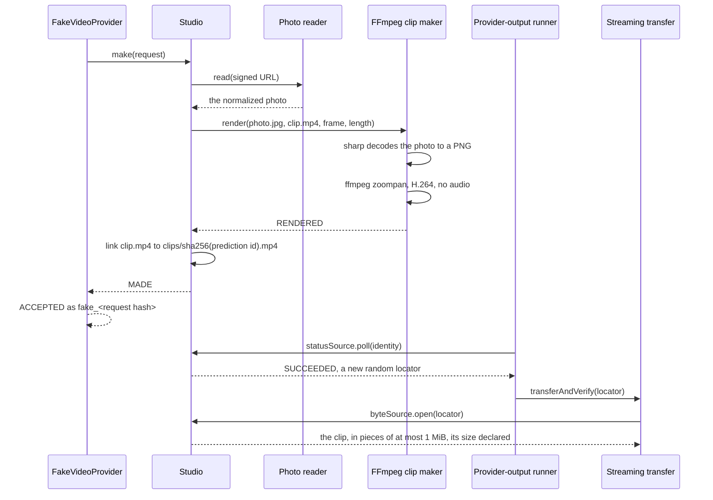

### Verification

Measured locally (PostgreSQL 16 configured like CI, FFmpeg 6.1.1 as CI
installs it), on `d5869f2` and, for lint, typecheck and the fake provider's
tests, again on `31b4b83`; the database suite ran on `cba54d3` (the commits
after it change only the studio, its unit tests and this record, which no
database test reaches). The unit suite also passed on `fc2c470` (6,307 tests) and
`cba54d3` (6,321).

| Check | Result |
| --- | --- |
| `pnpm lint` / `pnpm typecheck` | clean on `31b4b83`. On `7a35bc1` CI's typecheck failed on a test fixture in `clip-studio.test.ts` (a `NODE_ENV` widened to `string`), added in `cba54d3`: the local runs' exit status had not been read. Reproduced locally, fixed, and both checks rerun with their exit status checked |
| `pnpm test` | 229 files, 6,322 tests passed |
| `pnpm test:db` | 63 files, 1,675 tests passed |
| `pnpm test:media` (`tests/media/fake-clip.media.test.ts`) | 3 tests passed |
| `pnpm build` | succeeded |
| `prisma migrate diff` | not run: no schema or migration changed |

New and changed tests:

- `packages/storage/src/fake-clip-renderer.test.ts` (new, 25): the argument
  vector pinned; odd, oversized, fractional and empty sides and lengths
  refused; the photo decoded to a PNG beside the clip and FFmpeg run on it
  once, bounded; a photo that cannot be decoded is not made and runs nothing;
  a frame it does not make refused before anything is decoded; each runner
  outcome other than a clean exit not made; the timeout's bounds; production
  refused, given or ambient.
- `packages/video-providers/src/fake/clip-studio.test.ts` (new, 45): building
  refused in production, for any other provider and for a folder that is not
  absolute or cannot be opened; making at each raster, once, with the photo
  written for the renderer alone; two makes at once both made with one clip
  kept; a kept file that is not a clip, and a folder that cannot keep one;
  each request it does not make, and each renderer that fails, throws, writes
  nothing, writes an empty clip or fails after writing, keeping nothing; the
  observation accepted by the domain parser; a new locator at each answer,
  naming no file; foreign providers, models and predictions answered with
  nothing; streaming in pieces of at most 1 MiB; a locator it did not issue,
  a clip gone or emptied, a clip that ends before its declared size (only the
  bytes it has handed over), one that grew (no more than declared) and a read
  that fails; each file let go of once.
- `packages/video-providers/src/fake/route-kit.test.ts` (1 more): who builds
  the studio and the clip maker.
- `packages/storage/src/managed-output/dormancy.test.ts` (changed): the
  studio's byte source authorized by name beside fal's.
- `tests/media/fake-clip.media.test.ts` (new, 3, real FFmpeg): a 5-second
  720p clip with 150 frames, no audio, the whole photo in its first frame and
  the zoom and pan in its last, read from single pixels; a photo that cannot
  be read not made; a photo stored as an upload stores it, through the signed
  URL, the provider, the status source, the byte source, the streaming
  transfer and the media validator, to a valid 1080×1920 five-second video.

### Mutation testing

The same harness as GS-5b, against the clip maker's and the studio's unit
suites. The first pass ran on `fc2c470`; the second on `cba54d3`, with the
first pass's survivors answered and the new code's mutants added.

| Id | Mutant | Result |
| --- | --- | --- |
| R01 to R03 | a side of 0, past 1920, or odd allowed | killed |
| R04 | a fractional side allowed past the integer check | equivalent: the even-side check refuses every fraction |
| R05 to R07 | a fractional length, no length, or 61 seconds allowed | killed |
| R08 | the zoom and pan reaching their end one frame late | killed |
| R09 / R10 | the photo cropped to fill; the padding not centred | killed |
| R11 / R12 | no pan; no zoom | killed |
| R13 / R14 / R15 | audio, metadata, or an unbounded frame count kept | killed |
| R16 | FFmpeg left to guess the input's format | killed |
| R17 / R18 | production refused only when given, or only when ambient | killed |
| R19 to R21 | the timeout's bounds, and a fractional timeout (pass 1 survivor, a test added) | killed |
| R22 / R23 | a failed exit, or a missing program, reported as made | killed |
| R24 / R25 | the program path ignored; the quality changed | killed |
| R26 to R29 | the photo not decoded; a decode failure ignored; the PNG outside the work folder; FFmpeg given the JPEG | killed |
| S01 / S02 | production refused only when given, or only when ambient | killed |
| S03 | only one other provider refused (pass 1 survivor, cases added) | killed |
| S04 | a relative folder allowed | killed |
| S05 | the folder's real path not resolved | equivalent: a symlinked folder is resolved once at construction, which no test can tell from resolving it at each use |
| S06 to S11 | another model made; the length's bounds; an unknown raster made at 720p; the sides swapped | killed |
| S12 | an empty photo rendered | killed |
| S13 / S14 | a renderer that wrote an empty clip, or wrote one and failed, counted as made (pass 1 survivors, renderers added) | killed |
| S15 / S38 | the second of two makes refused; an existing entry trusted unchecked (pass 1 survivor, the race test added; S38 added) | killed |
| S16 | a link failure other than an existing clip ignored | pass 2 survivor: the branch could not change the answer, so it was removed in `d5869f2` |
| S17 / S18 / S19 | the work folder kept; a kept clip made again; a throw escaping `make` | killed |
| S20 | the photo written readable by others (pass 1 survivor, its mode recorded) | killed |
| S21 / S23 | a foreign provider, or a foreign model, answered | killed (pass 1's S23, the prediction-id prefix check, survived as redundant with the kept-clip check and was removed in `cba54d3`) |
| S24 / S25 / S26 | a missing clip answered; a locator not remembered; a locator naming the file | killed |
| S27 | locators shared between studios | killed |
| S28 | an empty clip opened (pass 1 survivor, a test added) | killed |
| S29 / S30 | larger pieces; a clip that ends early accepted | killed |
| S31 / S41 | the whole read buffer handed over; reads not bounded by what remains (pass 2 survivors, tests added in `d5869f2`) | killed |
| S32 | a failed read thrown unbranded (pass 1 survivor, a test added) | killed |
| S33 | no size declared | killed |
| S34 / S35 | a stream's file closed twice; a refused file left open (pass 1 survivors, each file's closes counted) | killed |
| S36 / S37 | the prediction id as the file name; a missing clip throwing at open | killed |
| S39 / S40 | reading past the declared size; never reaching it | killed |
| P01 to P05 | the studio ignored or not kept; the refusal's code or retryability changed; the prediction id's prefix | killed |

Result: 53 of 67 killed in the first pass on `fc2c470`; 69 of 74 in the
second on `cba54d3`; the third, on `d5869f2`, killed all 4 of the second
pass's answered survivors (S15, S31, S38, S41 re-anchored). Two survivors
remain, both equivalent (R04, S05).

### Review

Codex is at its usage limit, so an independent review agent reviewed
`fc2c470` against `22f7099`, reading only git objects. It confirmed that the
observation has exactly the keys the domain parser accepts and keeps the
locator object the WeakMap is keyed by; that the stream passes the runner's
inspection and every refusal closes its file; that a prediction id reaches no
path; that both constructors refuse production and nothing outside tests
builds them; and it worked the media suite's pixel checks by hand. Verdict:
nothing blocking. Its five should-fix findings and its nits, answered in
`cba54d3`:

| Finding | Answer |
| --- | --- |
| The locator's raw value named the clip's file, which the comment and ADR said it did not | Fixed: the value is random, new at each answer; a test proves two answers differ and a locator naming the file opens nothing |
| No test checked the observation against the domain parser | Added: the status source's answer is parsed by `parseProviderPollObservation` |
| The race between two makes of one request was untested | Added: two makes held at once both say made and keep one clip, with no work folder left |
| A clip lost after acceptance leaves its attempt `PROCESSING` | Kept as it is, and said in ADR-0092 Decision 6: the studio cannot tell a deleted folder from a status source built over another folder, and `FAILED` would end accepted attempts on a configuration mistake. Ending an attempt that never finishes is the existing open item *Bound how long an attempt may run before it is treated as failed* (`docs/decisions/TODO.md`), which applies to a real provider that stops answering too; the folder must not be deleted while attempts are in flight |
| The two billing decisions of 2026-10-28 were mixed into this pull request, with ADR-0053 Decision 3B left contradicting one and two readings recorded as decided | Taken out of this pull request. They come in their own documentation pull request after this one merges, with an ADR amending ADR-0053 Decision 3B, and the readings nobody decided (whether the old plan's unused days are credited, whether the Enterprise amount is entered tax-exclusive) as open gates |
| Nit: `route-kit.ts` still said the fake makes no clip | Corrected |
| Nit: the byte source did not hold the stream to its declared size | Fixed: it reads exactly that many bytes, and a clip that ends early is the retryable interruption |
| Nit: a crash leaves `work-` folders behind | ADR-0092 *Not decided here*: the same deletion as the clips clears them |
| Nit: a status source and a byte source from two studios never transfer | ADR-0092 Decision 7: one studio serves both, and GS-9 builds one |
| Nit: on `EEXIST` the existing entry was trusted unchecked | Fixed: it counts as made only if it is a clip, and a test proves an empty one is not |
| Nit: the media suite's photo was FFmpeg's JPEG, not the image pipeline's | Fixed, and it found a real failure: FFmpeg 6.1 refused the pipeline's mozjpeg JPEG of the flat test photo (and of a white wall with one dark square). The clip maker now decodes the photo with sharp and gives FFmpeg a PNG; the media suite stores its photo through `SharpImageProcessor`, as an upload does |
| Nit: the first frame's checks would accept a starting zoom near 1.07 | The checks now sit 10 pixels either side of both edges of the unzoomed photo |
| Nit: the dormancy test called the test provider's byte source a production one; the 60-second limit is written in both packages | The test's name corrected. The limit stays in both: `@app/video-providers` does not depend on `@app/storage`, and the studio's comment names the renderer's |

### Required documentation

| Item | Where |
| --- | --- |
| Architecture diagram | `docs/architecture.md`: the test provider studio row |
| Entity-relationship diagram | Not applicable: no schema change |
| Critical sequence diagram | the diagram above; the decisions are ADR-0092 Decisions 1 to 7 |
| OpenAPI / API change summary | `docs/api-changes-gs-6.md`: no HTTP change; the new exports |
| Change log / release notes | the commit list above and the pull request description |
| Database migration notes | `docs/migration-notes.md`, *GS-6*: no migration |
| Completion report | this file |

Also updated: `docs/Roadmap.md`, `docs/generation-e2e-gap-analysis.md` and
`docs/decisions/TODO.md` (the GS-6 item done).

### Activation status

Nothing paid or scheduled is activated, and nothing a customer can reach
changes: nothing outside tests builds the studio or the clip maker, and both
refuse production. No scheduler, credential or payment integration. Paid
Provider Activation, production Provider credentials, production paid AI
calls, the production scheduler and live Stripe charges remain BLOCKED.

### Known limitations

- **A clip deleted after acceptance leaves its attempt `PROCESSING`** until
  an attempt's running time is bounded (ADR-0092 Decision 6).
- **Clips and interrupted work folders stay** until a person deletes the
  studio's folder.
- **The fake never fails after accepting**; the end-to-end failure test
  (GS-13) uses the configured refusal.

### Remaining work

GS-6 waits for the product owner's yes before merge. Then the documentation
pull request for the 2026-10-28 billing decisions, and GS-7 (sending work to
the provider and recording the answer, with the concurrent-job limit).

*Since: GS-6 merged as PR #116 and the billing decisions as PR #117 (ADR-0093,
documentation only); GS-7 is split in four, below.*

## GS-7a — the concurrent-job limit and a waiting job's launch plan

Base: `94ac595` (PR #117 merge commit on `main`, a documentation pull request; GS-6's
merge `9830804` had post-merge CI run 715 green).
ADR: `docs/decisions/0094-the-concurrent-job-limit-and-a-waiting-jobs-launch-plan.md`

The first of GS-7's four pull requests (ADR-0094's table). **No migration; no
route, no page.** Nothing outside tests builds the planner until the launch
commit (GS-7b) and the pipeline command (GS-9).

Commits, oldest first:

| Commit | What it carries |
| --- | --- |
| `29a0327` | the limit on each plan, the states that hold a place, the launch planner, the shared lookup of a route's contracts in force, their tests, ADR-0094 and the documentation |
| `bd06933` | the first mutation pass's answers: the route's own resolution filter removed as redundant with the gate's check, and a test of a route's modes |
| `f058c80` | the review's answers: every scene's settings checked, routes of a mode admission does not price skipped, no tie-break between two routes, the compiled prompt carried with each rendered one, the rate copied, the plan tested against what consumes it and against the real tables, and two undecided rules recorded |
| this commit | this record |

The exact head SHA is reported with the pull request.

### What GS-7a does

- **The limit is a plan fact.** `CustomerPlan.concurrentJobs`: Standard 1,
  Premium 3, Enterprise 5 (ADR-0052 Decision 7).
- **Which jobs hold a place.** `JOB_STATES_HOLDING_A_PLACE`: a job holds one
  from launch until it is delivered or fails, composition and the final check
  included; `RESERVED` is the one state a job waits in.
  `decideJobLaunchCapacity` answers `PLACE_FREE` or `AT_LIMIT`, and throws on a
  limit below one or a count that is not a whole number. Whether a regeneration
  counts is not decided; counting `REVISING` is provisional.
- **One route for the whole job.** `JobLaunchPlanner.plan` takes the one route
  that the route policy sells for the job's quality and resolution, of the one
  generation and audio mode admission prices, whose model the catalog holds as
  selectable under the same provider and model id and reaches the resolution
  from the route's own native tier, that accepts every scene's settings by
  admission's own check (`assertSettingsSupported`), and that the
  paid-submission gate's own route check authorizes. Two plan nothing
  (`AMBIGUOUS_ROUTE`).
- **A prompt and a price per scene.** Each scene's frozen compiled prompt is
  rendered once and carried with the rendered one; each scene is priced for its
  own length at one instant, against the one verified contract in force, at a
  copy of the rate the FX source gives last.
- **A fixed code for every reason it plans nothing**, carrying no prompt, no
  provider text and no identifier.
- **One lookup of a route's contracts in force.**
  `currentlyEligibleContractsForRoute` moves from the media-recovery planner
  into the pricing domain; both planners call it.

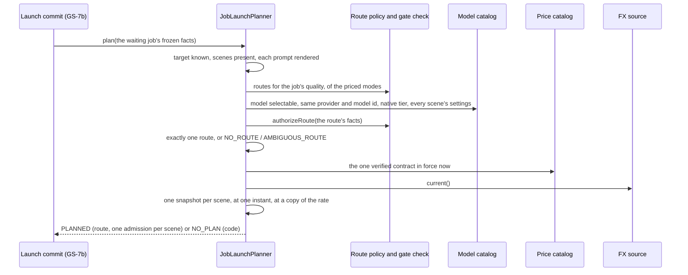

### Verification

Measured locally (PostgreSQL 16 configured like CI). The checks ran on the
commits before they were carried onto `94ac595` (`acd24c7`, `8daaabd` and
`a2c7b4d`, on `9830804`); `94ac595` adds only PR #117's three documents, so
the code each check ran on is the code here.

| Check | Result |
| --- | --- |
| `pnpm lint` / `pnpm typecheck` | clean on `f058c80`'s code, each exit status read |
| `pnpm test` | 233 files, 6,384 tests passed (6,371 on `29a0327`'s code, 6,374 on `bd06933`'s) |
| `pnpm test:db` | 63 files, 1,675 tests passed on `bd06933`'s code; `f058c80` changes only the planner, its tests and documents, which no database test reaches |
| `pnpm test:media` | not run: no media code changed |
| `pnpm build` | succeeded |
| `prisma migrate diff` | not run: no schema or migration changed |

New and changed tests:

- `packages/domain/src/job-launch/limit.test.ts` (new, 18): every job state
  classified exactly once, so a new state must be placed before it is counted;
  the capacity table at and below each plan's limit; a limit below one, a
  negative count and fractions refused as defects.
- `packages/domain/src/job-launch/planner.test.ts` (new, 33): a job planned
  whole, with each scene's own prompt, compiled prompt and price at one
  instant; an HQ job at its own tier and buffer; the delivery plan recorded as
  the catalog states it; the plan frozen and the source's rate left alone; the
  job's own facts checked before any catalog; every route condition, including
  each scene's length, the native tier, the aspect ratio and camera motion, the
  priced modes, the gate's own refusal of a second route for one model, and two
  qualifying routes planning nothing whichever model is the default; one
  verified price in force, de-duplicated, and a length it cannot bill; the rate
  read last and only once there is a price; and each admission accepted by
  admission's pricing binding, the gate's re-derivation of the stored snapshot
  and the gate's route check.
- `packages/domain/src/job-launch/dormancy.test.ts` (new, 4): nothing in
  production constructs the planner; its imports stay inside the domain's
  catalogs, renderer and pricing; it reaches no provider, HTTP client, storage,
  database or timer; the contract lookup is defined once and called by exactly
  the two planners.
- `packages/video-providers/src/launch-plan.test.ts` (new, 4): with
  production's tables a Normal job plans H3 Max, and an HQ job plans nothing;
  with the test route's kit each quality plans its one route.
- `packages/domain/src/pricing/customer-pricing.test.ts` (3 more): the three
  plans' limits.

### Mutation testing

The same harness as GS-6, against the job-launch, pricing and media-recovery
unit suites, and after the review's answers the new table test too.

| Id | Mutant | Result |
| --- | --- | --- |
| L01 to L04 | `REVISING` or `COMPOSING` holding no place; `RESERVED` holding one; another waiting state | killed |
| L05 to L09 | one over the limit; a limit of 0, a count of -1, a fractional limit or count allowed | killed |
| L10 | the states' list not frozen | killed |
| C01 to C03 | each plan's limit changed | killed |
| E01 to E07 | the shared lookup not matching provider, model key, generation mode, native tier or audio mode; eligibility ignored; duplicates not merged | killed |
| P01 to P04 | an unknown resolution, no scenes, or a missing prompt not refused first; a render failure thrown | killed |
| P05 / P06 / P30 | the catalog default's tie-break changed | killed in pass 1; the tie-break was removed after review (Decision 3), so they are gone |
| P07 / P08 / P14 | no contract, two contracts, or a length that cannot be billed accepted | killed |
| P09 / P10 | an FX failure thrown; an invalid rate accepted | killed |
| P11 to P13 | an HQ job at the Normal buffer; every scene at the first's length; another instant | killed |
| P15 / P16 | every scene sent the first prompt; the wrong request id | killed |
| P17 to P19 | the plan not frozen; the normalization or meets-target fact assumed | killed |
| P20 | the quality filter removed | killed |
| P21 | the route's own resolution filter removed | survived a trial run: the gate's route check makes the same refusal, so the filter was removed in `bd06933` |
| P22 | an unverified model allowed | equivalent: an unverified entry's type forbids a model id (`providerModelId?: never`), so the next check skips it |
| P23 / P24 | a provider or model id mismatch allowed | killed |
| P25 / P26 | the length check removed; one scene's length enough | killed in pass 1; the check is now part of the settings check (F03, F11) |
| P27 / P28 / P29 | an unsupported target thrown; a native tier mismatch allowed; the gate's check ignored | killed |
| P31 / P32 | priced at 720p always; priced by model id | killed |
| P33 / P34 / P35 | a different rate recorded; a snapshot without the rate; the clock shifted | killed |
| P36 / P37 | the price looked up at an assumed generation or audio mode | pass 1 survivors, killed by a test in `bd06933`; after review only the priced modes qualify (F01, F02), so both are equivalent |
| F01 / F02 | a route of another generation or audio mode taken | killed |
| F03 / F04 / F11 | settings not checked; a refused setting accepted; one scene's settings enough | killed |
| F05 / F06 / F07 / F12 | the aspect ratio, camera motion, native tier or negative prompt assumed | killed |
| F08 | of two routes, the first taken | killed |
| F09 | the source's rate frozen | killed |
| F10 | every scene carrying the first scene's compiled prompt | killed |

Result: 53 of 56 killed in the first pass on `29a0327`'s code (P21 was tried
before it and its filter removed); the second, on `bd06933`'s, killed both of
its answered survivors (P36, P37); the third, on `f058c80`'s, killed all 12
new mutants (F01 to F12) and 48 of the first pass's 51 re-anchored. Three
survivors remain, all equivalent (P22, P36, P37).

### Review

Codex is at its usage limit, so an independent review agent reviewed
the first commit as `acd24c7` against `9830804` (the same change, before it was
carried onto PR #117's merge), reading only git objects. It confirmed that the
plan agrees with the gate (the route facts, the contract by the route's own
dimensions, the risk profile and length, and an FX snapshot always named), that
policy order plays no part, that the lookup's move changes no behaviour, that
the limit's classification matches the state machine, and that no line exceeds
120 columns, no `any` is used and nothing is logged. Verdict: nothing blocking.
Its four should-fix findings and its nits, answered in `f058c80`:

| Finding | Answer |
| --- | --- |
| The route check was narrower than admission's settings check: a catalog entry whose capability lacks the native tier it reaches the target from, or a job's aspect ratio or a scene's camera motion the model does not honour, would be planned and then refused by the preflight, or sent with nothing refusing it | Fixed: every scene is checked by `assertSettingsSupported` (length, native tier, aspect ratio, camera motion); the facts now carry the job's aspect ratio and each scene's camera motion, as admission binds them; tests for each |
| A route of another generation or audio mode would be planned and then refused at admission (`PRICING_BINDING_INVALID`) | Fixed: only routes of `AUTHORIZED_GENERATION_MODE` and `AUTHORIZED_AUDIO_MODE` qualify; a test proves a route of either other mode is skipped even with a price for it |
| No test connected the plan to what consumes it, nor ran the planner against the real tables | Added: each admission is fed to admission's pricing binding, the gate's re-derivation of the stored snapshot and the gate's route check, for Normal, HQ and a downscaling route; and the planner runs against production's tables and the test route's kit |
| ADR-0094 settled whether a regeneration counts against the limit, which nobody decided | Recorded as open in `docs/decisions/TODO.md`, and the counting of `REVISING` marked provisional in the ADR and the code |
| Nit: the catalog's default as the tie-break between two routes is a preference nobody decided | Removed: two qualifying routes plan nothing, and which to prefer is recorded as open. With production's tables only Normal at 1080p is ambiguous, a pairing the start never makes |
| Nit: freezing the plan froze the FX source's own object | Fixed: the plan holds a copy |
| Nit: admission stores the rendered prompt without comparing it with the compiled one | The plan now carries each scene's compiled prompt, for the launch commit (GS-7b) to compare with the scene it locks |
| Nit: a failed job frees its place while attempts may still be at the provider | Said in Decision 2 and in `limit.ts` |
| Nit: the legacy executor's discovery fix was not on ADR-0094's GS-7c row | Added |
| Nit: a GS-7b choice was worded as decided inside *Not decided here*; Decision 1 read as implemented | Reworded |
| Nit: `JobLaunchFacts.generationJobId` was never read | Removed |
| Nit: test fixtures cast past the model entry's type | Kept: they build entries the type forbids on purpose, to prove the planner refuses them |

### Required documentation

| Item | Where |
| --- | --- |
| Architecture diagram | `docs/architecture.md`: the concurrent-job limit and launch planner row |
| Entity-relationship diagram | Not applicable: no schema change |
| Critical sequence diagram | the diagram above; the decisions are ADR-0094 Decisions 1 to 6 |
| OpenAPI / API change summary | `docs/api-changes-gs-7a.md`: no HTTP change; the new exports |
| Change log / release notes | the commit list above and the pull request description |
| Database migration notes | `docs/migration-notes.md`, *GS-7a*: no migration |
| Completion report | this file |

Also updated: `docs/Roadmap.md`, `docs/generation-e2e-gap-analysis.md` and
`docs/decisions/TODO.md` (the plan-definitions note, the GS-7 items planned
for GS-7b to GS-7d, and two new open decisions: whether a regeneration counts
against the limit, and which route a job takes when several could serve it).

### Activation status

Nothing paid or scheduled is activated, and nothing a customer can reach
changes: nothing outside tests constructs the planner, and it reaches no
provider, storage or database. No scheduler, credential or payment
integration. Paid Provider Activation, production Provider credentials,
production paid AI calls, the production scheduler and live Stripe charges
remain BLOCKED.

### Known limitations

- **Nothing launches a job yet.** A started job stays `RESERVED` until the
  launch commit (GS-7b).
- **Two open decisions** bound what the planner and the limit do: a
  regeneration is counted provisionally, and two qualifying routes plan
  nothing.
- **A job that can never be planned keeps its Units** until GS-7d decides
  which codes release them.

### Remaining work

GS-7a waits for the product owner's yes before merge. Then GS-7b, the launch
commit.

## GS-7b — the launch commit

Base: `c932aa1` (PR #118 merge commit on `main`; post-merge CI run 725 green).
ADR: `docs/decisions/0095-launching-a-waiting-job-under-the-organizations-limit.md`

The second of GS-7's four pull requests (ADR-0094's table). **No migration; no
route, no page.** Nothing outside tests builds the runner or the launch
repository until the pipeline command (GS-9), and the attempts it admits are
not sent until GS-7c.

Commits, oldest first:

| Commit | What it carries |
| --- | --- |
| `60698a5` | the launch decision, the runner, the launch commit and its lock, their tests, ADR-0095 and the documentation |
| `7cdf28d` | the review's answers: a plan's rendered prompt checked against the renderer's answer for the compiled one, a test of the candidate window, and the documents on what holds back a queue, on revision start and on a concurrent exchange-rate snapshot |
| this commit | this record |

The exact head SHA is reported with the pull request.

### What GS-7b does

- **One launch decision per organization.** The commit takes the
  organization's launch lock first, so counting the jobs holding a place,
  choosing the oldest waiting job and starting it are one decision.
- **The current subscription's limit.** Read inside the commit, so an upgrade
  raises it for the next launch; no subscription launches nothing.
- **Oldest first, past a deleted Property's job.** Any other job is refused
  (`NOT_NEXT`); a deleted Property's job is never launched and holds no other
  job back.
- **Found as planned.** The project and Property (`FOR SHARE`), the
  reservation (`FOR SHARE`), the job, scenes and requests (`FOR UPDATE`) are
  locked in that order and judged by `decideJobLaunch`: still waiting, its
  Property standing, of the start's shape, and every fact the plan was made
  from unchanged. A refusal writes nothing.
- **One commit.** The job and every scene move to `GENERATING`, and each
  scene's first attempt is admitted through attempt admission with the plan's
  route, rendered prompt and price, which starts its request. Any refused
  admission rolls back the whole job.
- **The same video twice waits.** The active-request index's refusal is the
  launch's `SAME_REQUEST_RUNNING`, and the job waits for the first.
- **A dormant runner.** `JobLaunchRunner.runOnce(limit)` offers each
  organization one launch per pass, plans it and commits it, and reports each
  candidate's outcome, keeping only a defect's code.

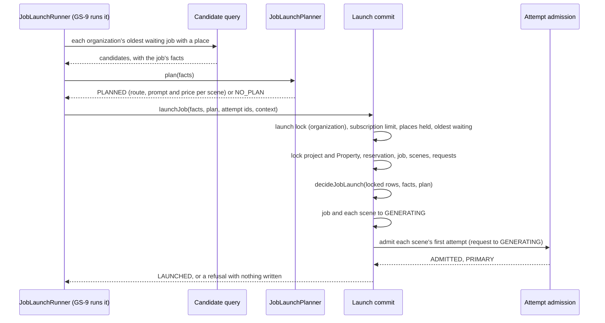

### Verification

Measured locally (PostgreSQL 16 configured like CI). CI run 726 passed on
`60698a5`.

| Check | Result |
| --- | --- |
| `pnpm lint` / `pnpm typecheck` | clean on `7cdf28d`'s code, each exit status read |
| `pnpm test` | 235 files, 6,428 tests passed on `7cdf28d`'s code (the same count on `60698a5`'s) |
| `pnpm test:db` | 64 files, 1,700 tests passed on `7cdf28d`'s code (1,696 before the launch suite's last four tests) |
| `pnpm test:media` | not run: no media code changed |
| `pnpm build` | succeeded on `60698a5`'s code; `7cdf28d` changes one domain function, typechecked |
| `prisma migrate diff` | not run: no schema or migration changed |

New and changed tests:

- `packages/domain/src/job-launch/launch.test.ts` (new, 33): a waiting
  job as the start wrote it launches; any other job state is `NOT_WAITING`,
  answered before the Property or the shape; a deleted Property's job is
  refused whatever else holds; each shape conflict (the reservation released,
  on hold or missing, no scene, a scene started, no request or two, a first
  request of another kind, started or attempted); each fact the plan was made
  from changed, scene order included; a plan for other facts a defect before
  any row is judged, a rendered prompt the renderer does not make of the
  compiled one included; the batch bound; the defects' fixed messages.
- `packages/domain/src/job-launch/runner.test.ts` (new, 7): the
  commit handed the facts, the plan, fresh ids and its own correlation; one
  launch per organization per pass; the limit refused before anything is read;
  a job with no plan or not of the start's shape left uncommitted; each
  refusal passed through; a throw that candidate's `FAILED`, with only a
  defect's code.
- `tests/integration/job-launch.db.test.ts` (new, 25): a full launch (the
  states and versions, the reservation untouched, the attempts' route,
  rendered prompt and price, the snapshots, the events), accepted as priced by
  the provider boundary; nothing left to launch; the Standard and Premium
  limits, oldest first, a place freed, an upgrade raising the limit, one
  organization's running job leaving another's place free, no subscription;
  the same video twice; `NOT_NEXT`; the candidate window by oldest job, up to
  the pass's limit; a deleted Property's job
  passed over and never launched, and a deletion in flight waited for; facts
  changed, a scene moved, the Units released, a request already attempted, a
  second request (whose facts are never read); another tenant's job; an admission refused rolling back the
  whole job; ids for another plan; two launches at once; the launch lock
  waited for.
- `packages/domain/src/job-launch/dormancy.test.ts` (3 more, 7): the runner
  and the repository constructed nowhere in production; the runner and the
  decision open no transaction and schedule nothing; the commit creates
  attempts only through admission and writes no reservation, takes no
  cost-admission lock; and its locks in the declared order, the launch lock
  first.
- `tests/database-public-surface.test.ts` (1 more): the locked transition and
  the launch lock unpublished, and the locked transition's callers bounded;
  the launch commit added to admission's callers.

### Mutation testing

The same harness as GS-7a: the job-launch unit suite for the domain, and the
launch commit's database suite for the repository.

| Id | Mutant | Result |
| --- | --- | --- |
| D01 to D03 | the job state or the Property not checked; the Property answered before the job state | killed |
| D04 / D05 | the reservation not checked; one on hold accepted | killed |
| D06 to D11 | no scene, a started scene, two requests, a regeneration request, a started request or an attempted one accepted | killed |
| D12 to D20 | the quality, resolution, aspect ratio, scene count, a scene's id, first request, length, camera motion or compiled prompt not compared | killed |
| D21, D23 to D25 | the plan not checked against the facts, or its scene ids, requests or compiled prompts not | killed |
| D22 | the plan's scene count not checked | survived pass 1 (a plan dropping its first scene failed on ids); killed by a plan of only the first scene and one with an extra scene |
| D26 to D28 | the batch bound one over, zero or a fraction accepted | killed |
| D29 | changed facts reported as a shape conflict | killed |
| D30 / D31 | the rendered prompt not checked; a compiled prompt the renderer refuses matching anything | killed, after the review's answer added the check (D31 by a test added for it) |
| N01, N02, N04 to N09 | an organization offered twice; null facts mislabelled; snapshot ids drawn from attempt ids; a thrown message kept; failures or launches not counted; one correlation for all; the limit not validated | killed |
| N03 | the planner's code replaced | invalid in pass 1 (replaced by the code the test uses); killed with another code |
| R01 / R02 | the launch lock not taken; no subscription answered as at the limit | killed |
| R03 / R05 | every job counted as holding a place; the limit not enforced | killed |
| R04 | every organization's jobs counted | survived pass 1; killed by a test that one organization's running job leaves another's place free |
| R06 to R08 | the commit's oldest-first choice ignoring a deleted Property, not enforced, or newest first | killed |
| R09 to R13 | the project read across tenants; the project and Property not locked; the Property's status, the reservation's state or the attempts ignored | killed |
| R14 to R16 | the job or a scene not moved; the job's event without the launch type and reason | killed |
| R17 | a non-`PRIMARY` admission accepted | equivalent: every request is locked with no attempt, so admission can only derive `PRIMARY`; kept as a defect check |
| R18 to R20 | an admission refusal ignored; attempt ids not matched to the plan; the duplicate request thrown | killed |
| R21 | any `requestHash` conflict taken for the active-request index | equivalent: no other unique index on attempts includes `requestHash` |
| R22 to R25, R27, R31 | candidates including a deleted Property's job, one at the limit, the newest first, a limit one higher, every job counted, running jobs offered | killed |
| R26 | facts read for a scene with two requests | survived pass 1 (the commit refused it the same way); killed by asserting the candidate's facts are `null` |
| R28 | candidates counting every organization's jobs | survived pass 1; killed by the same test as R04 |
| R29 / R30 | Standard read as Premium; scenes locked in reverse order | killed |
| S01 to S04 | the reservation, job, scenes or requests not locked | killed by the lock-order test |
| S05 | the locked transition published | killed by the public-surface test |

Result: the domain's 38 mutants, 36 killed in the first pass and the other 2
after a test case and a corrected mutant; the repository's 31, 26 killed in the
first pass against the database suite and 3 more after two tests; 5 lock and
surface mutants against the static tests, all killed; and the review answer's
2, killed. 76 in all: 74 killed, 2 equivalent (R17, R21).

### Review

Codex is at its usage limit, so an independent review agent reviewed
`60698a5` against `c932aa1`, reading only git objects. It checked the lock
order against Transactions F, G, H, I, K and L, media recovery, composition,
the paid-submission gate, reconciliation, the start, storyboard saving and
Property deletion and found no cycle; found the limit correct under concurrent
launches (the count is a fresh statement after the lock is granted); found a
stale attempt count after a request-lock wait caught twice, by the request's
re-read state and by admission's own re-read; and confirmed that refusals only
read, the reservation is never written, tenant scope is proved before any
unscoped read, the candidate query mirrors the commit, nothing in production
builds the runner or the repository, and no line of code exceeds 120 columns.
Verdict: nothing blocking. Its findings, answered in `7cdf28d`:

| Finding | Answer |
| --- | --- |
| Should-fix: a waiting job that can never launch holds back its organization's later jobs, and once a pass's window (at most 100 organizations, oldest first) fills with such organizations, no other organization is offered a launch | Recorded in ADR-0095 Decisions 3 and 7 and *Not decided here*, and in the GS-7d item of `docs/decisions/TODO.md` as requirements on GS-7d (remove such a job from the head) and GS-9 (refused jobs must not use up the window). Nothing runs the launch before both; a test now pins the window's order |
| Should-fix: revision start never checks the limit, so it can exceed it by any number, not by one during a launch | Reworded in ADR-0095 and `docs/decisions/TODO.md` |
| Nit: the refusal table read as unconditional, though the limit and the order are answered first | ADR-0095 Decision 4 now says the table follows Decisions 2 and 3, and that another organization's job id is answered only from the caller's own rows |
| Nit: the rendered prompt was never checked against the compiled one, and nothing later renders it again | Fixed: `assertPlanForFacts` compares each rendered prompt with the renderer's answer for its compiled prompt, and a prompt the renderer refuses matches nothing; tests and mutants D30, D31 |
| Nit: two launches of different organizations binding the same new exchange-rate snapshot fail the second | Recorded in ADR-0095 Decision 7: it rolls back, is `FAILED` with no code, and the next pass launches it |
| Nit: no test of a Property deletion waiting for a launch, of a reservation release waiting on the launch's share lock, or of the candidate window; the concurrent-launch test proves the over-limit interleaving only with the lock-wait test | The window test is added. The two waits are the database's own `FOR SHARE` semantics, which the lock-order test pins in the code; the opposite direction of each is tested. Recorded here that the over-limit interleaving rests on the lock-wait test and the two-runner test together |

### Required documentation

| Item | Where |
| --- | --- |
| Architecture diagram | `docs/architecture.md`: the launch commit row |
| Entity-relationship diagram | Not applicable: no schema change |
| Critical sequence diagram | the diagram above; the lock order is ADR-0095 Decision 4 |
| OpenAPI / API change summary | `docs/api-changes-gs-7b.md`: no HTTP change; the new exports |
| Change log / release notes | the commit list above and the pull request description |
| Database migration notes | `docs/migration-notes.md`, *GS-7b*: no migration |
| Completion report | this file |

Also updated: `docs/Roadmap.md`, `docs/generation-e2e-gap-analysis.md` and
`docs/decisions/TODO.md` (*Start each scene in the commit that admits its
first attempt* done; the deleted Property's waiting job noted under GS-7d's
item; revision start and the launch lock noted under the regeneration item;
two new items: whether a duplicate job blocks its organization's queue, and
reserving the launch's generic edges).

### Activation status

Nothing paid or scheduled is activated, and nothing a customer can reach
changes: nothing outside tests constructs the runner or the launch
repository, and the attempts they admit wait `QUEUED`, sent by nothing until
GS-7c. No scheduler, credential or payment integration. Paid Provider
Activation, production Provider credentials, production paid AI calls, the
production scheduler and live Stripe charges remain BLOCKED.

### Known limitations

- **Admitted attempts are not sent.** They wait `QUEUED` for GS-7c.
- **A job that can never launch keeps its Units**, a deleted Property's job
  included, until GS-7d.
- **A waiting job that cannot launch holds back its organization's queue**: a
  duplicate until the first one's attempts end (ADR-0095 Decision 6), any
  other until GS-7d releases it. Enough such organizations fill a pass's
  candidate window (Decision 7). Both are open in `docs/decisions/TODO.md`.
- **Revision start never checks the limit**, so a revision started at the
  limit holds a place beyond it; nothing runs revision start today.

### Remaining work

GS-7b waits for the product owner's yes before merge. Then GS-7c, sending an
admitted attempt through the paid-submission gate.

## GS-7c-1 — the boundary an orchestrated attempt crosses

Base: `a8fa555` (PR #119 merge commit on `main`; post-merge CI run 729 green).
ADR: `docs/decisions/0096-the-gate-moves-only-the-source-it-locked-and-audits-the-paid-call.md`

The first of GS-7c's two pull requests (GS-7 is now five: 7a, 7b, 7c-1, 7c-2,
7d). **No migration; no route, no page.** Nothing outside tests constructs the
paid-submission gate or the legacy executor, and nothing sends an attempt
until GS-7c-2.

Commits, oldest first:

| Commit | What it carries |
| --- | --- |
| `e3b26a3` | the legacy executor kept to legacy rows, the gate's source lock and audit entry, their tests, ADR-0096 and the documentation |
| `2f84ceb` | the review's answers: the gate also refuses a deleted Property, the lock-order notes, a static guard on the attempt repository's own arm, the audit action in the generation vocabulary, and the tests and documents the review asked for |
| this commit | this record, and a test of the Property's tenant predicate that mutation testing asked for |

The exact head SHA is reported with the pull request.

### What GS-7c-1 does

- **The legacy executor is legacy-only.** Its discovery, its claim (before
  the asset lock, after it, and at its compare-and-swap) and its park act
  only on a `QUEUED` row with no orchestration state. An orchestrated
  attempt, which reads `QUEUED` in the legacy column for life, is never
  offered, claimed, waited on or parked.
- **The gate moves only the source it locked.** After its pure rules permit
  the move, the gate locks the attempt's photo (`FOR NO KEY UPDATE`) and its
  project's Property (`FOR SHARE`) in the caller's organization, and answers
  `SOURCE_INVALID` unless the Property stands and the photo is still the
  source preparation signed, judged by preparation's own classifier.
- **The paid call is audited in the move's commit.** The move to
  `SUBMITTING` writes `generation.submission_started` with internal ids only;
  a failed insert rolls the move back, and no refusal or lost move writes one.
- **Only the gate moves an attempt to `SUBMITTING` in production**, proved
  by a static test over every production source.

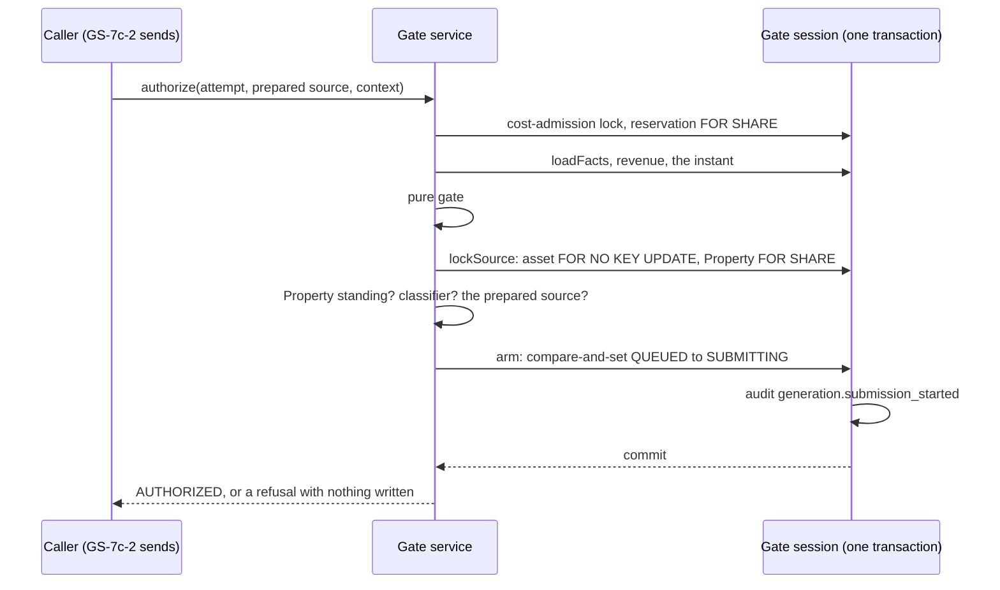

### Verification

Measured locally (PostgreSQL 16 configured like CI). CI runs 40674009392 and
40674099402 passed on `e3b26a3`, and 40677098895 and 40677105535 on `2f84ceb`.

| Check | Result |
| --- | --- |
| `pnpm lint` / `pnpm typecheck` | clean on `2f84ceb`'s code, each exit status read |
| `pnpm test` | 236 files, 6,443 tests passed on `2f84ceb`'s code (235 files, 6,438 on `e3b26a3`'s) |
| `pnpm test:db` | 65 files, 1,719 tests passed on `2f84ceb`'s code (1,713 on `e3b26a3`'s before its last two tests); this commit's one more test passes with the gate suite's other 86 |
| `pnpm test:media` | not run locally: no media code changed; CI's media job passed on both heads |
| `pnpm build` | not run locally; CI's verify job builds, and passed on both heads |
| `prisma migrate diff` | not run: no schema or migration changed; CI's database job checks it |

New and changed tests:

- `tests/integration/legacy-executor-orchestrated.db.test.ts` (new, 6):
  discovery passes over an orchestrated attempt that is the oldest row and
  offers the legacy row behind it; the claim and the park refuse one and write
  nothing; the claim does not wait on its asset; a row made orchestrated
  underneath the claim, after its asset wait or at its compare-and-swap, is
  not moved.
- `tests/integration/paid-submission-authorization.db.test.ts` (14 new, in
  *the source and the paid call's audit*): the audit entry written in the
  move's commit, none on a refusal, a lost compare-and-set or a failed insert
  (which moves nothing); a photo whose deletion was asked for, whose bytes
  changed, or of another organization; a Property deleted while its photo
  still reads usable; a photo deletion and a Property deletion in flight each
  waited for, then refused; the photo held against a deletion until the
  commit; the lock modes, by `NOWAIT` (a foreign key's share lock on the
  photo and a reader's on the Property free, a writer's on either not);
  another organization's attempt, or another organization's Property behind
  the project, finding no source. Every existing call
  passes the prepared source.
- `packages/domain/src/authorization/paid-submission-service.test.ts` (12
  new): the source locked after the gate permits and before the move, and not
  for a refusal; each refusal reason, a deleted Property first; the audit
  entry's fields, actor and request kind.
- `packages/domain/src/authorization/submission-boundary.test.ts` (new, 2):
  no production caller of the attempt repository's own arm, and the
  within-transaction arm called only by the gate's session and that method.
- `tests/integration/orchestration-fixture.ts`: the prepared source, and the
  fixture's photo and Property restored on every seed.

### Mutation testing

The same harness as GS-7b: each mutant applied alone, the named suite run, the
file restored and its digest checked.

| Id | Mutant | Result |
| --- | --- | --- |
| U01 to U04 | no asset accepted; the classifier's refusal, a changed source or the refusal itself ignored | killed |
| U05 | the source locked before the facts and the gate's refusals | killed |
| U06 | the refusal's reason replaced | killed |
| U07 to U12, U14 | the audit entry's action, resource, actor, snapshot, correlation, resource type or organization wrong | killed |
| U13 | the audit entry's request kind fixed | survived pass 1; killed by a regeneration's entry |
| D01 | discovery offering orchestrated attempts | killed |
| D02 to D06 | the claim's first check, its re-read, its compare-and-swap, the park's, or the shared predicate on the legacy column only | killed |
| D07 / D08 | the asset's or the attempt's tenant predicate dropped from the source lock | D07 killed; D08, mis-anchored in pass 1, survived its re-run (the gate's facts already prove the attempt's tenant), killed by the session asked as the wrong organization |
| D09 / D10 | the source not locked, or locked `FOR KEY SHARE` | killed |
| D11 / D12 | the audit entry not written; written for a lost move | D11 killed; D12 survived pass 1, killed by a lost compare-and-set |
| D13 | the source lock finding nothing | killed |
| P01 / P09 | a deleted Property not refused; refused after the classifier | killed |
| P02 | the Property's tenant predicate dropped | survived pass 1; killed by a project pointed at another organization's Property |
| P03 to P05 | the Property not locked, locked `FOR KEY SHARE`, or its status ignored | killed |
| P06 | the asset locked `FOR UPDATE` | killed by the `NOWAIT` test |
| P08 | a failed audit insert swallowed | killed |
| S01 / S02 | a production caller of the repository's own arm, or of the within-transaction form | killed by the static test |

Result: 27 mutants against `e3b26a3`, 24 killed in the first pass and the
other 3 (one mis-anchored and re-run) after three tests; 12 against `2f84ceb`,
11 killed in the first pass and the last after one test. D09 and D10 ran
against both, so 39 runs of 37 mutants, every one killed.

### Review

Codex is at its usage limit, so an independent review agent reviewed
`e3b26a3` against `a8fa555`, reading only git objects. It walked every
transaction that writes or locks a photo (the asset writes and deletion
requests, Property removal, the analysis review, the legacy claim, storyboard
and analysis inserts) and every one that takes the cost-admission lock or a
reservation (F, H, K, L, settlement, release, reconciliation, media recovery,
the launch commit, Unit purchase) and found no cycle; confirmed a deletion
committed before, during and after the gate behaves as the ADR says, that
refusals write nothing, that the audit entry is written only on a committed
move with internal ids only, that both tenant predicates hold, and that the
held-Unit gap is recorded. Verdict: nothing blocking. Its findings, answered
in `2f84ceb`:

| Finding | Answer |
| --- | --- |
| Should-fix: the gate never checks the attempt's Property, while a Property deletion asks for its photos' deletion one statement each after it, so a photo can read usable under a deleted Property, for good if the deletion stops part way | Fixed: `lockSource` holds the project's Property `FOR SHARE` in the same statement and the gate answers `SOURCE_INVALID` `PROPERTY_DELETED` before judging the photo, as the start and the launch refuse it; tests for a deleted Property and one being deleted; ADR-0096 Decision 2 |
| Should-fix: the attempt repository's own `armProviderBoundary` still moves an attempt to `SUBMITTING` with no lock, source check or audit entry | Ten integration suites build fixtures with it, so it stays; a static test now allows no production caller of it, and no caller of the within-transaction form but the gate's session and that method. ADR-0096 Decision 3 says so |
| Should-fix: the lock-order notes in `cost-admission-lock.ts` and the gate's repository did not name the new edge, which a park copying the legacy claim's order would deadlock against | All three notes now name the asset and Property under the cost-admission lock and the rule that nothing locks either and then waits for that lock; ADR-0096 states the rule and that GS-7c-2's park takes the lock first |
| Nit: a TODO still said `failQueuedPreflight` records orchestrated refusals; the audit vocabulary still said one action; a changed photo was called refused for good; the residual deletion race was not stated | All fixed: the TODO notes the park now writes nothing for one; `generation.submission_started` joins `GenerationAuditAction`; a changed but usable photo is prepared again; a deletion asked for after the gate's commit does not stop the send, as ADR-0030 accepted |
| Nit: the discovery test passed with the filter removed; two lock tests proved blocking by elapsed time; no test of a failed audit insert, of the lock modes, or of a MIME mismatch | All added or changed: the orchestrated attempt is the oldest row; the waits are read from `pg_stat_activity`; the failed insert, the lock modes by `NOWAIT`, and a PNG refused as the wrong format |

### Required documentation

| Item | Where |
| --- | --- |
| Architecture diagram | `docs/architecture.md`: the paid-submission gate row |
| Entity-relationship diagram | Not applicable: no schema change |
| Critical sequence diagram | the diagram above; the lock order is ADR-0096 Decision 2 |
| OpenAPI / API change summary | `docs/api-changes-gs-7c-1.md`: no HTTP change; the changed exports |
| Change log / release notes | the commit list above and the pull request description |
| Database migration notes | `docs/migration-notes.md`, *GS-7c-1*: no migration |
| Completion report | this file |

Also updated: `docs/Roadmap.md`, `docs/generation-e2e-gap-analysis.md` (GS-7c
split in two) and `docs/decisions/TODO.md` (*Stop the legacy executor's
discovery from offering orchestrated attempts* done; progress noted on
auditing the paid call, the Phase 4C-3 sequence, failing closed on a missing
source and the preflight's failures; one new item: ending an attempt the gate
will never authorize, for GS-7d).

### Activation status

Nothing paid or scheduled is activated, and nothing a customer can reach
changes: nothing outside tests constructs the gate or the legacy executor,
and nothing sends an attempt. No scheduler, credential or payment
integration. Paid Provider Activation, production Provider credentials,
production paid AI calls, the production scheduler and live Stripe charges
remain BLOCKED.

### Known limitations

- **Nothing sends an attempt yet.** GS-7c-2 prepares, gates and sends one.
- **An attempt the gate refuses for good keeps its Unit**: a deleted
  Property, a photo deleted or unrecoverable, or a price no contract will
  cover again leaves it `QUEUED` until GS-7d decides what ends it.
- **A deletion asked for after the gate's commit does not stop the send**,
  the race ADR-0030 accepted for the legacy claim.
- **The attempt repository's own arm remains** for test fixtures; only a
  static test keeps production from calling it.

### Remaining work

GS-7c-1 waits for the product owner's yes before merge. Then GS-7c-2, sending
an admitted attempt through the gate and recording the answer.

## GS-7c-2a — finding an attempt to send, and ending one refused for good

Base: `ccbfdc6` (PR #120 merge commit on `main`; post-merge CI run 736 green).
ADR: `docs/decisions/0097-finding-an-attempt-to-send-and-ending-one-whose-preparation-is-refused.md`

The first of GS-7c-2's two pull requests (GS-7 is now six: 7a, 7b, 7c-1,
7c-2a, 7c-2b, 7d). **No migration; no route, no page.** Nothing outside tests
constructs the attempt submission repository, and nothing sends an attempt
until GS-7c-2b.

Commits, oldest first:

| Commit | What it carries |
| --- | --- |
| `be9a609` | discovery, the ending of a refused preparation, their tests, ADR-0097 and the documentation |
| `c7015be` | a test that the ending rolls back when its event cannot be written |
| `15c8399` | the review's answers: the lock-order wording, two risks named in ADR-0097 and the TODO, the TODO notes qualified, and three tests sharpened or added |
| this commit | this record |

The exact head SHA is reported with the pull request.

### What GS-7c-2a does

- **Discovery offers what the sender could send.** Orchestrated attempts
  `QUEUED` before submission, under a `GENERATING` request and job and a
  Property not deleted, oldest first with `id` breaking ties, bounded 1 to
  100 (refused, not clamped), each with its project's organization, read
  without locks.
- **A refusal for good ends the attempt.** A `TERMINAL` preparation refusal,
  by the canonical disposition, ends the attempt `QUEUED →
  CANCELLED_PRE_SUBMISSION` with the reason as its code and an
  `attempt.preparation_refused` event, in one commit behind the
  cost-admission lock. Transaction K then fails the request, scene and job
  and releases the Unit; Transaction L cancels the other scenes' attempts.
- **A refusal that may pass leaves it waiting.** A `RETRYABLE` reason is
  refused by the ending as a caller's defect, and the attempt stays `QUEUED`.
- **Exactly one of the gate and the ending moves an attempt.** Both require it
  `QUEUED`; another organization's attempt, one already ended or armed, or one
  whose certainty moved answers `NOT_QUEUED` and writes nothing.

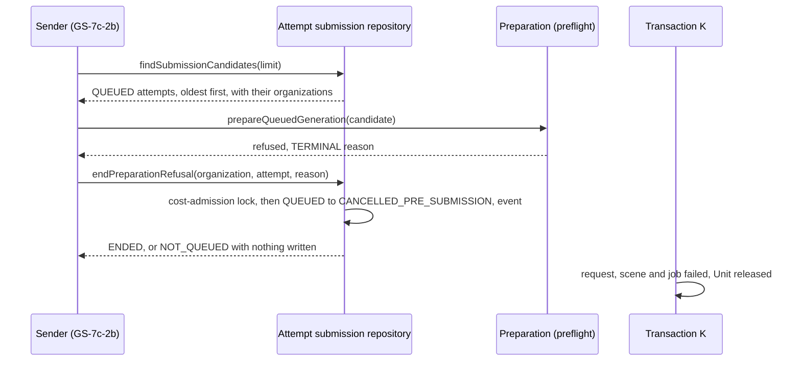

### Verification

Measured locally (PostgreSQL 16 configured like CI). CI run 738 passed on
`c7015be`.

| Check | Result |
| --- | --- |
| `pnpm lint` / `pnpm typecheck` | clean on `15c8399`'s code, each exit status read |
| `pnpm test` | 238 files, 6,462 tests passed on `15c8399`'s code (6,477 on `be9a609`'s, before one table test replaced seventeen) |
| `pnpm test:db` | 66 files, 1,737 tests passed on `c7015be`'s code; `15c8399` adds one test, and the suite's 18 pass |
| `pnpm test:media` | not run locally: no media code changed; CI's media job passed on `c7015be` |
| `pnpm build` | not run locally; CI's verify job builds, and passed on `c7015be` |
| `prisma migrate diff` | not run: no schema or migration changed; CI's database job checks it |

New tests:

- `tests/integration/attempt-submission.db.test.ts` (new, 18), on jobs started
  by the real start commit and launched by the real launch: discovery's order
  across organizations and ties, its organizations, a candidate preparation
  accepts with nothing written, the bound; passing over an armed attempt, a
  certainty that moved, a request no longer generating and a deleted
  Property; the ending's row and event and nothing else moved; a photo
  withdrawn, refused by preparation before anything is signed, ended, and the
  Unit released by K and the sibling cancelled by L; a retryable reason
  refused; a rollback when the event cannot be written; another organization,
  a replay, an armed attempt and a moved certainty answering `NOT_QUEUED`;
  the wait for the cost-admission lock of the organization and cycle; no
  other organization's reservation read for the lock key; an arm in flight
  that takes no cost lock waited for on the row, then nothing ended.
- `packages/domain/src/attempt-submission/preparation-refusal.test.ts` (new):
  the reasons that stay written out, every other one ending; the move legal
  and read by K as ended without a video; the bound.
- `packages/domain/src/attempt-submission/dormancy.test.ts` (new): no
  production caller; no provider, network, storage or timer; one write, after
  the cost-admission lock, and no row lock.

### Mutation testing

The same harness as GS-7c-1: each mutant applied alone, the named suite run,
the file restored and its digest checked.

| Id | Mutant | Result |
| --- | --- | --- |
| R01 to R05 | a discovery filter dropped: orchestration state, certainty, request state, job state, Property | killed |
| R06 to R10 | newest first, ties reversed, the bound off by one, the bound not validated, the wrong organization | killed |
| R11 | a retryable reason not refused | killed |
| R12 / R13 | no cost-admission lock; the wrong key | killed |
| R14 | the cycle read before the lock not tenant-scoped | survived pass 1; killed by a call as another organization that must not wait on its own lock for the other's cycle |
| R15 to R17 | the compare-and-set's organization, `QUEUED` or certainty predicate dropped | killed |
| R18 to R20 | the version not bumped, the code not written, the message not cleared | killed |
| R21 to R23, R27, R28, M07 | the event's type, reason code, from-state, aggregate or caller context wrong; the event type constant changed | killed |
| R24 / R25 | the outcome's version wrong; `NOT_QUEUED` thrown | killed |
| R26 | the ending outside a transaction | killed by the rollback test |
| M01 to M06 | the disposition inverted, every refusal ending, the bound's edges, non-integers accepted, the bound changed | killed |
| S01 to S03 | a production caller, a row lock, storage reachable | killed by the static test |

Result: 38 mutants against `c7015be`, 37 killed in the first pass and the
last after one test. M01, M02, R12, R13, R14 and R16 were run again against
`15c8399`'s tests, which changed the tests that kill them: all killed.

### Review

Codex is at its usage limit, so an independent review agent reviewed
`be9a609` against `ccbfdc6`, reading only git objects. It confirmed the
tenant scoping of both statements, that the lock key is the gate's own query
with the same fallback, that the ending and an arm cannot both move an
attempt, that the schema's checks accept the write and no trigger or
allowlist refuses the event, that K settles the new ending and releases the
Unit and L closes the request beside it, that regeneration attempts are not
excluded, and that every writer taking the cost-admission lock takes it
before any row lock, so it found no cycle. Verdict: nothing blocking. Its
findings, answered in `15c8399`:

| Finding | Answer |
| --- | --- |
| Should-fix: discovery is one window over every organization, oldest first; attempts left `QUEUED` by a retryable refusal or a gate refusal that writes nothing (a hard pause, an ineligible price) are offered on every pass, and once a window's worth are oldest no other organization's attempt is found | Not built here, since how a pass moves past them is the sender's and the pipeline pass's design (GS-7c-2b, GS-9), as the launch's same problem is (ADR-0095 Decision 7). ADR-0097 *Not decided here* names it, and a new TODO item requires it before activation |
| Should-fix: `PROVIDER_IDENTITY_MISMATCH` and `MODEL_DELIVERY_PLAN_CHANGED` are `TERMINAL` but come from the deployment's catalog, so a misconfigured or older worker would end customers' attempts across organizations | Named in ADR-0097 Decision 2 as a refusal the deployment causes; a new TODO item asks whether it should end an attempt, before activation. The canonical table is unchanged |
| Nit: "every writer of an attempt's orchestration state takes this lock first" is not true (K and H write no attempt; the repository's own arm and admission take none) | Reworded in the repository and the ADR: the transactions that take it take it before any row lock; a writer that takes none is kept apart by the compare-and-set |
| Nit: "the predicate the gate's arm competes on" is not literal | Reworded: both require the attempt `QUEUED` |
| Nit: TODO notes described the ending as running, though only tests call it | Qualified: built in GS-7c-2a, called by the sender from GS-7c-2b |
| Nit: the arm-in-flight test uses an arm that takes no cost lock | Kept and renamed: it proves the compare-and-set holds without that lock; the cost-lock test proves the gate and the ending serialize on it |
| Nit: the lock-wait helper accepted any waiting backend | It now matches the ending's own statement |
| Nit: the per-reason table test repeated the implementation | Replaced by the reasons that stay, written out |
| Nit: the null-certainty branch cannot match an orchestrated row | Kept, as the gate's reading of null; commented |

### Required documentation

| Item | Where |
| --- | --- |
| Architecture diagram | `docs/architecture.md`: the attempt submission row |
| Entity-relationship diagram | Not applicable: no schema change |
| Critical sequence diagram | the diagram above; the lock order is ADR-0097 Decision 3 |
| OpenAPI / API change summary | `docs/api-changes-gs-7c-2a.md`: no HTTP change; the new exports |
| Change log / release notes | the commit list above and the pull request description |
| Database migration notes | `docs/migration-notes.md`, *GS-7c-2a*: no migration |
| Completion report | this file |

Also updated: `docs/Roadmap.md`, `docs/generation-e2e-gap-analysis.md` (GS-7c-2
split in two) and `docs/decisions/TODO.md` (*Move the execution preflight's
failures onto the orchestration state* built; progress noted on the Phase
4C-3 sequence, the preflight-failure audit, failing closed on a missing
source, bounding how long an attempt may run, and ending an attempt the gate
will never authorize; three new items: a photo changed while its URL is
signed, keeping the submission window moving, and a refusal the deployment
causes).

### Activation status

Nothing paid or scheduled is activated, and nothing a customer can reach
changes: nothing outside tests constructs the repository, and nothing sends
an attempt. No scheduler, credential or payment integration. Paid Provider
Activation, production Provider credentials, production paid AI calls, the
production scheduler and live Stripe charges remain BLOCKED.

### Known limitations

- **Nothing sends an attempt yet.** GS-7c-2b prepares, checks the URL's
  freshness, gates and sends one.
- **A retryable refusal holds the Unit** for as long as it recurs; how long an
  attempt may wait is not decided.
- **Attempts that cannot be sent could fill discovery's window** once a pass
  runs; GS-7c-2b and GS-9 must move past them.
- **A deleted Property's attempt is passed over and keeps its Unit** until
  GS-7d.
- **A refusal the deployment's catalog causes ends the attempt**, by the
  canonical table, until that is decided.

### Remaining work

GS-7c-2a waits for the product owner's yes before merge. Then GS-7c-2b,
sending a prepared attempt through the gate and recording the answer.

## GS-7c-2b — sending an attempt once, and recording the answer

Base: `c18d3f8` (PR #121 merge commit on `main`; post-merge CI run 741 green).
ADR: `docs/decisions/0098-sending-an-attempt-once-and-recording-the-answer.md`

The second of GS-7c-2's two pull requests. **No migration; no route, no
page.** Nothing outside tests constructs the runner, the attempt submission
repository or the sender adapter, so nothing sends an attempt until the
pipeline command (GS-9), with the test provider only.

Commits, oldest first:

| Commit | What it carries |
| --- | --- |
| `d52a6db` | the runner, the sender port and its adapter, discovery's cursor, their tests, ADR-0098 and the documentation |
| `2391f96` | the review's answers: the record tried again while it throws or loses a race, and a pass stopped by an answer it could not record; the static test, the cursor's validation and a retryable refusal tightened; ADR-0098 and the TODO corrected |
| `53f2005` | a test that the record's last try decides what is reported |
| this commit | this record |

The exact head SHA is reported with the pull request.

### What GS-7c-2b does

- **One runner, in a fixed order.** `AttemptSubmissionRunner.runOnce` takes
  each attempt discovery offers through preparation (a refusal for good ends
  it, ADR-0097), a check that this sender reaches its provider and that the
  signed URL has 300 seconds left, the paid-submission gate, one send and the
  submission outcome's record. Each attempt gets one transition context.
- **Armed means sent once.** After `AUTHORIZED` the sender is called once. A
  sender that throws, or answers with anything that is not a well-formed
  observation, is recorded `SUBMISSION_UNKNOWN`. The record is tried up to
  three times while it throws or loses a race; an answer still not recorded
  is lost, the attempt is left `SUBMITTING` for the stale submission recovery,
  and the pass sends nothing more. Nothing sends an attempt again.
- **Nothing is sent that cannot be used.** Another provider's attempt is passed
  over before it is signed; a URL with too little time left is not sent and
  nothing is written; once an attempt of a job ends in the pass, by
  preparation or by the provider's definitive refusal, the job's other
  attempts are not sent in it.
- **The window moves.** Discovery reads after a `{ createdAt, id }` cursor in
  its own order, and each pass returns `next`, or `null` at the end.
- **The adapter.** `createPreparedGenerationSender` builds the provider's
  request from the prepared generation alone and maps the answer into the
  outcome's closed vocabulary. It is the only production caller of a
  provider's create POST.

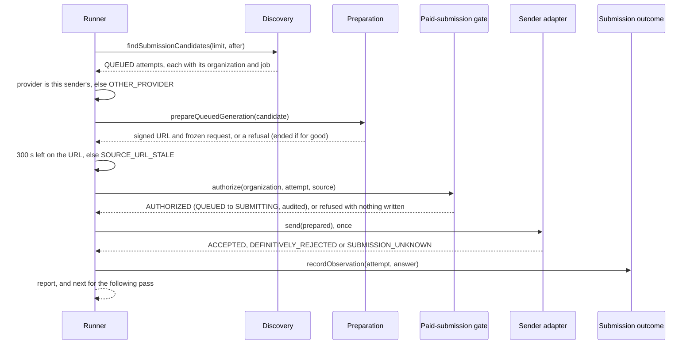

### Verification

Measured locally (PostgreSQL 16 configured like CI).

| Check | Result |
| --- | --- |
| `pnpm lint` / `pnpm typecheck` | clean on `53f2005`'s code, each exit status read |
| `pnpm test` | 240 files, 6,511 tests passed on `53f2005`'s code (6,500 on `d52a6db`'s) |
| `pnpm test:db` | 66 files, 1,746 tests passed on `53f2005`'s code (and on `d52a6db`'s) |
| `pnpm test:media` | not run locally: no media code changed; CI's media job runs it |
| `pnpm build` | not run locally; CI's verify job builds |
| `prisma migrate diff` | not run: no schema or migration changed; CI's database job checks it |

New tests:

- `packages/domain/src/attempt-submission/runner.test.ts` (new, 26): the order
  and one context per attempt; the gate's warning carried; an answer lost to a
  throw, a blank acceptance or an unknown kind recorded unknown; the record
  tried again while it throws or loses a race, and a pass stopped by an answer
  no try records or the outcome refuses; the gate's refusals and reasons; another provider; the URL's
  boundary and the margin below the URL's life; an ending, a move and a
  retryable refusal; a definitive refusal, retryable or not, stopping the
  job's other attempts; a
  gate, a photo read or an ending that throws counted as failed; the cursor
  and `next`, and validation before any read.
- `packages/video-providers/src/prepared-generation-sender.test.ts` (new, 14):
  the request field by field; the answer's mapping and its only code; one
  call; another provider's attempt never sent; a throw let through; the test
  provider's acceptance.
- `tests/integration/attempt-submission.db.test.ts` (8 new, 26 in all), on jobs
  started and launched by the real commits, through the real gate and outcome
  service over the test provider: four attempts sent with their audit entries
  and events in order; a withdrawn photo ended, its job's other attempts not
  sent, K and L settling; a gate refusal writing nothing; a provider's refusal;
  an unknown answer holding the reservation so the sibling is refused; two
  concurrent passes sending each attempt once; a window moving past attempts
  left waiting; discovery naming each job and reading after the cursor.
- `packages/domain/src/attempt-submission/dormancy.test.ts` (rewritten, 9): no
  production construction of the runner, repository or adapter; the module's
  imports; the gate and outcome taken as types; no network, storage or timer;
  one send, one authorize and one record, in order; one production caller of
  a provider's create POST.
- `packages/domain/src/attempt-submission/preparation-refusal.test.ts` (6 new):
  the cursor passed through, and refused when it is not one.

### Mutation testing

The same harness as GS-7c-2a: each mutant applied alone, the named suite run,
the file restored and its digest checked, and the working tree's manifest
compared before and after.

| Id | Mutant | Result |
| --- | --- | --- |
| R01 / R02 | the provider check removed or inverted | killed |
| R03 to R05 | the URL's boundary moved, removed, or the margin set to the URL's whole life | killed |
| R06 / R07 | a send without `AUTHORIZED`; the gate's reason dropped | killed |
| R08 to R10 | a malformed answer passed through; a sender's throw not recorded; a record's throw escaping | killed |
| R11 | the gate's warning inverted | killed |
| R12 to R14 | an ended or definitively refused job's attempts still sent; the job check removed | killed |
| R15 to R17 | a retryable refusal ended; a move reported as an ending; any error read as a refusal | killed |
| R18 to R22 | `next` on a partial window or from the first candidate; the cursor not passed; the cursor or the bound not validated | killed |
| R23 to R26 | a count dropped; one throw stopping the pass | killed |
| R27 to R30 | the record under another context; the gate given another source; the wrong attempt reported; the ending given another reason | killed |
| C01 / C02 | a cursor with an invalid date or a blank id accepted | killed |
| S01 to S12 | the adapter's model id, native resolution, URL or request hash wrong; a timeout not named, every error named one, retryable forced, an unknown answer losing its code; the provider check removed, the provider's name fixed, the prediction id wrong, `LOCAL_CONFIGURATION` dropped | killed |
| D01 to D06 | discovery's cursor: an instant or id compared inclusively, the tie arm dropped, the cursor ignored or not validated, the wrong job named | killed |
| F01 to F03, F10 | the record not tried again, not after a lost race, not after a throw; one try too many | killed |
| F04 to F09 | a replay stopping the pass; a refused answer not stopping it; no stop; `next` ignoring the stop; the stop not applied; `stopped` not reported | killed |
| F11 | the cursor's type not checked | killed |
| F12 | a throw on the last try keeping an earlier try's result | survived pass 1; killed by a record that loses races and then throws |

Result: 50 mutants against `d52a6db`, all killed in the first pass: 44 by the
unit suites (`packages/domain/src/attempt-submission` and the adapter's), 6 by
`tests/integration/attempt-submission.db.test.ts`. The review's answers added
12 against `2391f96`: 11 killed in the first pass, and F12 after one test in
`53f2005`; F01 to F03, F10 and F12 were run again against it, all killed.

### Review

Codex is at its usage limit, so an independent review agent reviewed
`d52a6db` against `c18d3f8`, reading only git objects. It confirmed that the
gate is asked once and the sender called once per attempt, and only after
`AUTHORIZED`; that nothing after the arm can throw; that concurrent passes are
kept apart by the gate's compare-and-set under the cost-admission lock; the
tenant scoping of discovery, preparation and the gate, which locks the source
preparation signed; that the cursor's predicate matches discovery's order
exactly, ties included, on a millisecond column; that the freshness check
compares milliseconds and fails closed; that only a prediction id and the
closed codes cross from the provider; and that nothing in production
constructs the runner, the repository or the adapter. Verdict: nothing
blocking. Its findings, answered in `2391f96` and `53f2005`:

| Finding | Answer |
| --- | --- |
| Should-fix: a record that throws or loses a race loses the provider's answer (an acceptance's prediction id among it), and the pass goes on sending, so a systemic record fault would pay for a whole window and record none of it | Fixed: the record is tried up to three times while it throws or answers `LOST_CONCURRENCY` (an identical answer on file replays); an answer still not recorded, or one the outcome refuses, stops the pass (`PASS_STOPPED`, `stopped`), and `next` starts after that attempt. ADR-0098 Decision 2 says the answer is then lost |
| Should-fix: "until a pass sends and ends nothing" would stop GS-9 at a full window of waiting attempts, the starvation Decision 6 fixes | Fixed in ADR-0098 and the TODO: a whole cycle, from the oldest until a pass returns `next: null`, with nothing sent or ended; and at once on a pass that stopped |
| Nit: only a non-retryable provider refusal was tested ending the job for the pass; Decision 5's wording when the answer was not recorded | A retryable refusal tested too; Decision 5 now says the outcome writes `FAILED_RETRYABLE` or `FAILED_TERMINAL` and K settles both; an unrecorded answer now stops the pass |
| Nit: the static test's `.send(` count would not see a second `this.#send(` | It counts `this.#send(`, `this.#record(` and `.recordObservation(` too |
| Nit: Decision 4 said an armed unsent attempt "can only be recorded as unknown"; the order listed preparation before the provider check; a DB test's title said "unreadable" for a timeout | Reworded: it is left `SUBMITTING` for the recovery; the provider check listed first; the title says timed out |
| Nit: `SOURCE_URL_STALE` and `OTHER_PROVIDER` also wait and hold a Unit | Added to ADR-0098 *Not decided here* and the TODO item on how long an attempt may hold a Unit |
| Nit: the runner does not check that the gate's answer names the same attempt | Not built: the gate is called with the attempt and answers for it; a check after the arm could only leave an armed attempt unsent |
| Nit: the cursor's validation threw a `TypeError` for `undefined` from a caller the types do not reach | Fixed: anything not an object is `VALIDATION_FAILED`, tested |
| Nit: an attempt committed after a pass read past its `createdAt` waits until the cursor comes round | Named in ADR-0098 Decision 6: it waits, it is not lost |

### Required documentation

| Item | Where |
| --- | --- |
| Architecture diagram | `docs/architecture.md`: the attempt sender row |
| Entity-relationship diagram | Not applicable: no schema change |
| Critical sequence diagram | the diagram above; the order is ADR-0098 Decision 1 |
| OpenAPI / API change summary | `docs/api-changes-gs-7c-2b.md`: no HTTP change; the new and changed exports |
| Change log / release notes | the commit list above and the pull request description |
| Database migration notes | `docs/migration-notes.md`, *GS-7c-2b*: no migration |
| Completion report | this file |

Also updated: `docs/Roadmap.md`, `docs/generation-e2e-gap-analysis.md` and
`docs/decisions/TODO.md` (progress noted on the Phase 4C-3 sequence, the
signed URL's provisional life, failing closed on a missing source, bounding
how long an attempt may run, keeping the submission window moving, and a
refusal the deployment causes).

### Activation status

Nothing paid or scheduled is activated, and nothing a customer can reach
changes: nothing outside tests constructs the runner, the repository or the
sender adapter, and the only provider any test sends to is the test provider.
No scheduler, credential or payment integration. Paid Provider Activation,
production Provider credentials, production paid AI calls, the production
scheduler and live Stripe charges remain BLOCKED.

### Known limitations

- **Nothing runs a pass yet.** The pipeline command (GS-9) will, with the
  test provider only; it must carry `next` and stop on a pass that sends and
  ends nothing.
- **An attempt the gate refuses for good waits** and keeps its Unit until
  GS-7d.
- **A retryable refusal holds the Unit** for as long as it recurs.
- **The URL's 300-second margin is provisional**, with its 600-second life,
  until measured against a real submission.
- **A refusal the deployment's catalog causes still ends the attempt**, by the
  canonical table, until that is decided.

### Remaining work

GS-7c-2b waits for the product owner's yes before merge. Then GS-7d: a job
that can never launch, and an attempt the gate refuses for good, released
with their Units.

## GS-7d-1 — ending a waiting job that can never launch

Base: `81ed350` (PR #122 merge commit on `main`; post-merge CI run 745 green).
ADR: `docs/decisions/0099-ending-a-waiting-job-that-can-never-launch.md`

The first of GS-7d's two pull requests (`/mnt/project-files/cto/gs-7d-proposal.md`).
**No migration; no route, no page.** Nothing outside tests constructs the
ending repository or the launch runner, so nothing ends a job until the
pipeline command (GS-9), with the test provider only.

On 2026-10-29 the product owner decided, on the decision card asking whether
a deleted Property's unfinished videos end at once and return their Units,
"すぐ戻す": they do, without waiting for the 30-day trash period.

Commits, oldest first:

| Commit | What it carries |
| --- | --- |
| `933b7bd` | the decision, the ending repository, the runner's two steps, their tests, ADR-0099 and the documentation |
| `b11c90e` | the review's answers: the requests locked `FOR UPDATE` and their attempts counted after that lock; three DB tests; ADR-0099, the Roadmap and the TODO corrected |
| this commit | this record |

The exact head SHA is reported with the pull request.

### What GS-7d-1 does

- **A waiting job ends only for its own rows.** Its Property deleted, a fact
  frozen at the start that the planner refuses before any catalog (an unknown
  resolution, no scenes, a scene with no prompt or one that does not render),
  or rows not as the start wrote them (`SHAPE_CONFLICT`). A job refused for a
  route, a price or a rate keeps waiting with its Units held.
- **Decided from the rows it locked.** `decideUnlaunchableJobEnding` keeps a
  job that is not `RESERVED`, one whose hold is not `RESERVED`, and one any of
  whose requests has an attempt, before it looks for a cause. The planner's
  frozen-fact step and the launch's shape check are each one function the
  ending shares, so the two cannot disagree.
- **One commit behind the cost-admission lock.** The job moves `RESERVED →
  FAILED_TERMINAL` (`job.ended_unlaunchable`) and its reservation `RESERVED →
  RELEASED` (`reservation.released`), both events carrying the cause; the
  balance returns the Units because it counts allocations by their
  reservation's state. Transaction L then cancels the scenes.
- **The launch runner ends them.** It first ends up to `limit` waiting jobs of
  deleted Properties, found by a query that mirrors every refusal of the
  ending, then launches as before, handing the ending any candidate whose
  facts are not of the start's shape, that the planner refused for a frozen
  fact, or that the commit refused as `PROPERTY_DELETED` or `SHAPE_CONFLICT`.

```mermaid
sequenceDiagram
    participant W as Launch runner
    participant E as Ending repository
    participant DB as PostgreSQL
    participant L as Transaction L
    W->>E: findPropertyDeletedWaitingJobs(limit)
    E-->>W: waiting jobs of deleted Properties, oldest first
    W->>E: endUnlaunchableJob(organization, job, endedAt, context)
    E->>DB: cost-admission lock, then reservation FOR UPDATE, Property FOR SHARE
    E->>DB: job FOR UPDATE, scenes FOR SHARE, requests FOR UPDATE, then their attempts counted
    E->>E: decideUnlaunchableJobEnding(locked rows)
    E->>DB: job RESERVED to FAILED_TERMINAL, reservation RESERVED to RELEASED, two events
    E-->>W: ENDED with its cause, or NOT_ENDED with the refusal
    W->>W: then each organization's launch candidate; one that can never launch is ended
    L->>DB: later, the failed job's PENDING scenes and requests CANCELLED
```

### Verification

Measured locally (PostgreSQL 16 configured like CI).

| Check | Result |
| --- | --- |
| `pnpm lint` / `pnpm typecheck` | clean on `b11c90e`'s code, each exit status read |
| `pnpm test` | 241 files, 6,549 tests passed on `b11c90e`'s code |
| `pnpm test:db` | 66 files, 1,759 tests passed on `b11c90e`'s code (1,756 on `933b7bd`'s) |
| `pnpm test:media` | not run locally: no media code changed; CI's media job runs it |
| `pnpm build` | not run locally; CI's verify job builds |
| `prisma migrate diff` | not run: no schema or migration changed; CI's database job checks it |

New tests:

- `packages/domain/src/job-launch/ending.test.ts` (new, 23): the
  decision's causes and their order; a job not waiting, a hold not `RESERVED`
  and an admitted attempt kept before any cause; the frozen-fact codes, and no
  configuration code among them.
- `packages/domain/src/job-launch/runner.test.ts` (20 in all): configuration refusals left
  waiting; a deleted Property's waiting jobs ended first at the clock's
  instant, each with the runner's correlation; a frozen fact, facts not of the
  start's shape and the commit's `PROPERTY_DELETED` or `SHAPE_CONFLICT` ended;
  the ending's refusal reported; an ending that throws counted as failed and
  the pass going on.
- `tests/integration/job-launch.db.test.ts` (13 new, 38 in all): the full release with
  the balance restored, the events and L cancelling the scenes; a null and an
  unrenderable prompt ended and the next job launched; a rate left waiting;
  nothing written for a launchable, another tenant's or a launched job; a hold
  not `RESERVED`, an admitted attempt and a job no longer waiting neither
  offered nor ended; oldest first and the limit; a deletion saving and the
  cost-admission lock waited for; an attempt admitted while the ending waited
  for a request's lock counted; a launch and an ending of the same job at
  once.
- `packages/domain/src/job-launch/dormancy.test.ts` (2 new, 9 in all): the ending's lock
  order, its attempt count after the requests' lock, and its writes; nothing
  in production constructs it.

### Mutation testing

The same harness as GS-7c-2b: each mutant applied alone, the named suite run,
the file restored and its digest checked, and the working tree's manifest
compared before and after.

| Id | Mutant | Result |
| --- | --- | --- |
| E01 to E04 | the job's state, its hold or the attempts not checked; an attempt counted from the second | killed |
| E05 to E08 | a deleted Property, a frozen fact or the shape not ended; a launchable job ended | killed |
| E09 to E12 | the order: the hold before the job's state, the Property before the attempts, the shape before a frozen fact, the Property after one | killed |
| L01 to L07 | the shape check: no scenes accepted, a second request, the request's kind, state or attempts, the scene's state, a missing request | killed |
| P01 to P05 | the frozen-fact codes: one dropped, a configuration code added; an unknown resolution or no scenes passed; a missing prompt named unrenderable | killed |
| N01 to N12 | the runner: the deleted phase skipped or unbounded; null facts, frozen codes or the commit's refusals not ended; every refusal ended; the clock or the context ignored; an ending not counted or its throw escaping; one launch per organization dropped | killed |
| S01 to S04 | the reservation, job, scenes or requests not locked (static) | killed |
| B01 to B03, B06 to B13 | the cost-admission lock missing or on the wrong key; the Property not locked or read across tenants; the reservation not released, its instant, the reason code, an event type or event dropped; a launchable job written; the job not failed | killed |
| Q01 to Q06 | the deleted-Property query: not deleted, any hold, any attempts, newest first, the limit ignored or not validated | killed |
| Q07 | the query offering any job state | survived pass 1; killed by a job no longer waiting (`b11c90e`) |
| F01 to F04 | the fix: attempts not counted; requests only shared; attempts counted before the requests' lock; Q07 again | killed |

Result: 58 mutants against `933b7bd`: 40 by the unit suites
(`packages/domain/src/job-launch`), all killed; 18 by
`tests/integration/job-launch.db.test.ts`, 17 killed in the first pass and Q07
after one test. The review's answers added 4 against `b11c90e`'s code, F04 being Q07
again: F02 by the unit suites, F01, F03 and F04 by the DB suite, all killed.
The new DB test of an attempt admitted while the ending waits fails on
`933b7bd`'s code (the job is ended) and passes on `b11c90e`'s.

### Review

Codex is at its usage limit, so an independent review agent reviewed
`933b7bd` against `81ed350`, reading only git objects. It confirmed the tenant
scoping of every query, the compare-and-set writes and an exactly-once
release, events matching every other release, the decision's order, the
deleted-Property query mirroring each refusal, configuration refusals never
ended, the lock order against the launch, the start, the gate, L, the failure
settlements and a deletion, and that nothing in production constructs the
repository or the runner. Verdict: nothing blocking. Its findings, answered
in `b11c90e`:

| Finding | Answer |
| --- | --- |
| Should-fix: the attempt count was a subquery of the requests' locking statement, which reads the statement's snapshot even for a row it waited for, so an attempt admitted while the ending waited would count as none and the Unit would be released; and `FOR SHARE` does not stop a new attempt's insert | Fixed: the requests are locked `FOR UPDATE`, which a new attempt's foreign-key check waits for, and their attempts are counted in a statement of their own after that lock. A DB test holds a request and admits an attempt under it while the ending waits: the old code ended the job, the new one keeps it (`ATTEMPT_ADMITTED`). ADR-0099 Decision 3 says why |
| Should-fix: `SCENE_PROMPT_UNRENDERABLE` follows from editing the prompt's fixed rules, a change of ours | Kept as a frozen fact: ADR-0020 already makes such a change a re-admission event, failed closed, and the ending returns the Units. Named in ADR-0099 Decision 1 and *Not decided here*, and a TODO item on releasing such a change only when no job waits |
| Should-fix: a frozen-fact or shape job is found only as a launch candidate, so not while its organization is at its limit or has no subscription; two claims overstated the fix | Narrowed in ADR-0099 Context and Decision 5, the Roadmap and the TODO: such a job is ended once its organization has a place to offer it |
| Should-fix: no live test of an ending racing a launch | A DB test runs a launch and an ending of the same job at once, for a job only the ending writes and one only the launch writes; each answers and the job goes one way. The serialization rests on the job's row lock, which both take before writing |
| Nit: the job's compare-and-set missing raises the locked transition's internal error, not `ENDING_LOST_UNDER_LOCK` | ADR-0099 Decision 3 now says so |
| Nit: "every such job in the same pass" ignores the limit | Decision 5 says up to `limit` a pass |
| Nit: the reservation guard after the decision is unreachable | Kept: it narrows the type, and fails closed if the decision ever changes |
| Nit: the ADR said `checkFrozenFacts` is exported | Decision 1 and Consequences say it is inside the module; `FrozenFactsCode` is the export |
| Beyond the PR: a waiting job whose hold is not `RESERVED` or that has an attempt is neither launched nor ended | Named in ADR-0099 *Not decided here* and the TODO |

### Required documentation

| Item | Where |
| --- | --- |
| Architecture diagram | `docs/architecture.md`: the ending row |
| Entity-relationship diagram | Not applicable: no schema change |
| Critical sequence diagram | the diagram above; the lock order is ADR-0099 Decision 3 |
| OpenAPI / API change summary | `docs/api-changes-gs-7d-1.md`: no HTTP change; the new and changed exports |
| Change log / release notes | the commit list above and the pull request description |
| Database migration notes | `docs/migration-notes.md`, *GS-7d-1*: no migration |
| Completion report | this file |

Also updated: `docs/Roadmap.md`, `docs/generation-e2e-gap-analysis.md` and
`docs/decisions/TODO.md` (progress on releasing a started job that can never
launch, the deleted Property's trash lifecycle and the preflight audit item;
new items on bounding a configuration refusal's hold and on releasing a change
to the prompt's fixed rules).

### Activation status

Nothing paid or scheduled is activated, and nothing a customer can reach
changes: nothing outside tests constructs the ending repository or the launch
runner. No scheduler, credential or payment integration. Paid Provider
Activation, production Provider credentials, production paid AI calls, the
production scheduler and live Stripe charges remain BLOCKED.

### Known limitations

- **Nothing runs a pass yet.** The pipeline command (GS-9) will, with the test
  provider only.
- **A job refused for configuration waits** with its Units held, and holds
  back its organization's queue, until that is decided.
- **A frozen-fact or shape job is ended only when offered**, which needs its
  organization to have a place and a subscription.
- **A change to the prompt's fixed rules ends every waiting job**, Units
  returned, until how such a change is released is decided.
- **An ended job is not shown to the customer** until the progress page
  (GS-10, GS-11).

### Remaining work

GS-7d-1 waits for the product owner's yes before merge. Then GS-7d-2: a
generating job's attempt that can never be sent, its Property deleted or its
photo gone, ended before submission so the attempt failure settlement releases
its Unit.

## GS-7d-2 — ending a generating job's attempt whose Property was deleted

Base: `8e267b2` (PR #123 merge commit on `main`).
ADR: `docs/decisions/0100-ending-a-generating-attempt-whose-property-was-deleted.md`

The second of GS-7d's two pull requests (`/mnt/project-files/cto/gs-7d-proposal.md`).
**No migration; no route, no page.** Nothing outside tests constructs the
attempt submission repository or the sender, so nothing ends an attempt until
the pipeline command (GS-9), with the test provider only.

The product owner's decision of 2026-10-29 ("すぐ戻す") covers a deleted
Property's generating videos as well as its waiting ones: they end at once and
their Units are released, without waiting for the 30-day trash period. This
pull request ends a generating video while one of its attempts still waits
before submission; one whose attempts are all at the provider, or one being
assembled, is a follow-up (GS-7d-3).

Commits, oldest first:

| Commit | What it carries |
| --- | --- |
| `7c0e6ba` | the ending, its query, the sender's two hand-offs, their tests, ADR-0100 and the documentation |
| `030a397` | the review's answers: ADR-0100 narrowed to an attempt still waiting, a rename's lost update and the in-flight case recorded, a comment, the lock's header, two tests |
| this commit | this record |

The exact head SHA is reported with the pull request.

### What GS-7d-2 does

- **The attempt ends before submission.** A `QUEUED` attempt, before
  submission, whose Property is deleted moves `QUEUED →
  CANCELLED_PRE_SUBMISSION` with `PROPERTY_DELETED` as its code and an
  `attempt.ended_property_deleted` event, as a refused preparation's attempt
  ends (ADR-0097). Transaction K then fails the job and releases its Unit (a
  scene regeneration rolls back to the video already delivered), and
  Transaction L closes the job's other scenes.
- **One commit behind the cost-admission lock.** The gate's key first, then
  the attempt's Property `FOR SHARE`, tenant-scoped through its project, found
  `DELETED`, then the attempt's compare-and-set and its event. The
  compare-and-set is now one function the two endings share. A standing
  Property (`PROPERTY_NOT_DELETED`), an attempt no longer queued, another
  tenant's or none (`NOT_QUEUED`) write nothing.
- **Found one per job.** `findPropertyDeletedAttempts` offers the oldest
  queued attempt of each generating job of a deleted Property, oldest first,
  up to the pass's limit; ending one fails the job, so a job with many scenes
  does not fill a pass.
- **The sender ends them.** First, before its window; then, when the gate
  refuses an attempt as `SOURCE_INVALID` with `PROPERTY_DELETED` (a deletion
  saved since discovery), at once. Either marks the job as ending for the
  rest of the pass. An attempt whose photo is gone was already ended by
  preparation (GS-7c-2a).

```mermaid
sequenceDiagram
    participant W as Sender
    participant R as Attempt submission repository
    participant DB as PostgreSQL
    participant K as Transaction K
    participant L as Transaction L
    W->>R: findPropertyDeletedAttempts(limit)
    R-->>W: one queued attempt of each generating job of a deleted Property
    W->>R: endPropertyDeletedAttempt(organization, attempt, context)
    R->>DB: cost-admission lock, then the Property FOR SHARE, found DELETED
    R->>DB: attempt QUEUED to CANCELLED_PRE_SUBMISSION, PROPERTY_DELETED, and its event
    R-->>W: ENDED, NOT_QUEUED or PROPERTY_NOT_DELETED
    W->>W: then the window; a gate refusal for a deletion since discovery is ended the same way
    K->>DB: later, the request's attempts all ended: the job fails, its Unit released
    L->>DB: later, the failed job's other scenes closed, their queued attempts cancelled
```

### Verification

Measured locally (PostgreSQL 16 configured like CI).

| Check | Result |
| --- | --- |
| `pnpm lint` / `pnpm typecheck` | clean on `030a397`, each exit status read |
| `pnpm test` | 6,558 tests in 241 files passed, exit 0 |
| `pnpm test:db` | 1,767 tests in 66 files passed, exit 0 |
| `pnpm test:media` | not run locally: no media code changed; CI's media job runs it |
| `pnpm build` | not run locally; CI's verify job builds |
| `prisma migrate diff` | not run: no schema or migration changed; CI's database job checks it |

New tests:

- `packages/domain/src/attempt-submission/runner.test.ts` (8 new): a deleted
  Property's attempts ended first, each under its own correlation, before the
  window, bounded by the pass's limit, and their jobs sent nothing more; an
  ending that found the attempt moved or its Property standing reported and
  its job sent; an ending that throws counted as failed; a read of them that
  throws rejecting the pass before its window; a gate refusal for a
  deleted Property ended under the gate's correlation; the ending's two
  refusals there; any other source refusal left.
- `packages/domain/src/attempt-submission/dormancy.test.ts` (1 new, 2
  changed): one write between the two endings, the Property the only row
  locked and only `FOR SHARE`, the cost-admission lock before it and the
  compare-and-set after, the code and event the repository's own.
- `tests/integration/attempt-submission.db.test.ts` (8 new, one of them
  extended after review): one attempt of
  each generating job of a deleted Property, oldest first, bounded and
  validated; an armed attempt, one no longer before the boundary, a request
  or a job not generating passed over; the full write, its event and nothing
  else; a standing Property, another tenant (before and after the ending), a
  replay, an unknown and an armed attempt writing nothing; the cost-admission lock waited for; a deletion
  saving waited for and then seen; the sender ending one, sending the other
  organization's, and K and L freeing the Unit and closing the job; a
  deletion saved after discovery ended at the gate's refusal, nothing sent.

### Mutation testing

The same harness as GS-7d-1: each mutant applied alone, the named suite run,
the file restored and its digest checked, and the working tree's manifest
compared before and after.

| Id | Mutant | Result |
| --- | --- | --- |
| N01 to N07 | the runner: the deleted step skipped or unbounded; its throw escaping; its job not marked; an ending not counted; the window read first; one correlation for every ending | killed |
| G01 to G03 | the gate's deleted Property not ended; every source refusal ended; a new correlation for it | killed |
| M01 to M03 | the ending's answers mapped wrong: `ENDED`, `NOT_QUEUED`, `PROPERTY_NOT_DELETED` | killed |
| S01 to S03 | the Property not locked, locked `FOR UPDATE`, or locked before the cost-admission lock (static) | killed |
| Q01 to Q10 | the query: any Property, every attempt of a job, a job's newest, newest first, the limit ignored or not validated, any attempt state, certainty, request or job state | killed (10/10) |
| B01 to B08 | the ending: no cost-admission lock; the Property not locked or read across tenants; a standing Property ended; the wrong code or event; an unknown attempt named standing; a lost compare-and-set reported ended | killed (8/8) |
| H01 to H05 | the shared write and the preparation ending: no lock; not tenant-scoped; the code or the event type ignored; the event not written | killed (5/5) |
| C01 | the event type constant reused | killed |
| N08 | after review: a read of deleted Properties' attempts that throws swallowed, the window still sent | killed |

Result: **41 of 41 killed**: 16 in the unit suites and 24 in
`tests/integration/attempt-submission.db.test.ts` on `7c0e6ba`, and N08 on
`030a397`, killed by the test the review asked for. The tree's manifest
matched before and after every run.

### Review

An independent review, by a subagent reading the git objects only (Codex was
at its usage limit), found nothing blocking. All of it is answered in
`030a397`:

- **Should fix: the scope was overstated.** The documentation said a deleted
  Property's generating videos end; only one whose attempt still waits before
  submission does. ADR-0100 and the TODO's trash item are narrowed, and the
  rest, a job whose attempts are all at the provider or one being assembled,
  which still delivers and consumes its Unit, is a new TODO item and a
  follow-up, GS-7d-3.
- **"Nothing restores a Property" was not true.** A rename that read the
  Property before its deletion writes the whole row back, `ACTIVE` included.
  ADR-0100 now says so; the ending then reads the Property standing and leaves
  the attempt, which the gate refuses for its photo once the deletion's photo
  requests save. The rename is a separate bug in Property editing, recorded in
  TODO.md for the product owner, not fixed here.
- **A read of deleted Properties' attempts that throws** rejects the pass
  before its window, as a window read that throws does; now in ADR-0100
  Decision 4 and tested (N08).
- **The runner's comment on `PROPERTY_NOT_DELETED`** said only the gate's path
  reaches it; it now names both, and that the first step's may be reported
  again from the window.
- **The cost-admission lock's header** listed two lockers of a Property; it
  now lists the ending of ADR-0099 and this one too.
- **Another organization naming a deleted Property's queued attempt** is now
  tested to answer `NOT_QUEUED` and write nothing.

Not added: a race test between the gate and this ending. The ending waits for
the cost-admission lock under the attempt's organization and cycle, the key
the gate takes, which the lock-wait test shows; and both require the attempt
`QUEUED`, which the armed-attempt test shows.

### Required documentation

| Item | Where |
| --- | --- |
| Architecture diagram | `docs/architecture.md`: the ending's row |
| Entity-relationship diagram | Not applicable: no schema change |
| Critical sequence diagram | the diagram above; the lock order is ADR-0100 Decision 2 |
| OpenAPI / API change summary | `docs/api-changes-gs-7d-2.md`: no HTTP change; the new and changed exports |
| Change log / release notes | the commit list above and the pull request description |
| Database migration notes | `docs/migration-notes.md`, *GS-7d-2*: no migration |
| Completion report | this file |

Also updated: `docs/Roadmap.md`, `docs/generation-e2e-gap-analysis.md` and
`docs/decisions/TODO.md` (progress on ending an attempt the gate will never
authorize, failing closed on a missing source, the preflight audit item and
the trash lifecycle).

### Activation status

Nothing paid or scheduled is activated, and nothing a customer can reach
changes: nothing outside tests constructs the repository or the sender. No
scheduler, credential or payment integration. Paid Provider Activation,
production Provider credentials, production paid AI calls, the production
scheduler and live Stripe charges remain BLOCKED.

### Known limitations

- **Nothing runs a pass yet.** The pipeline command (GS-9) will, with the test
  provider only, and must run K and L after the sender for the Unit to come
  back.
- **The gate's other refusals for good still write nothing**: a price no
  contract will cover again, or an attempt not in a shape to cross the
  boundary. Such an attempt holds its Unit (TODO).
- **An attempt refused for configuration waits** (no route, the Safety
  Guard's pause, no revenue figure), its Unit held, until how long it may is
  decided.
- **A deleted Property's video with no attempt left waiting still delivers**:
  every attempt at the provider, or the job being assembled. Its Unit is
  consumed until GS-7d-3.
- **A rename can undo a Property's deletion** (Property editing's own bug,
  TODO.md): the ending then leaves the attempt to the gate and preparation.
- **An attempt of the same job already at the provider still runs there**
  when the job fails; its cost is VTaVision's (ADR-0083 Decision 1).
- **An ended video is not shown to the customer** until the progress page
  (GS-10, GS-11).

### Remaining work

GS-7d-2 waits for the product owner's yes before merge. Then GS-7d-3, a
deleted Property's video already at the provider or being assembled, to be
proposed; GS-8, the Transaction I driver; and GS-9, the pipeline command.

## GS-7d-3a — ending a deleted Property's launched job before its video is assembled

Base: `9c8a8b8` (PR #125 merge commit on `main`).
ADR: `docs/decisions/0102-ending-a-deleted-propertys-launched-job-before-assembly.md`

The first of GS-7d-3's two pull requests (`/mnt/project-files/cto/gs-7d-3-proposal.md`,
approved by the product owner on 2026-10-29 08:14Z). **No migration; no route,
no page.** Nothing outside tests constructs the ending's repository or the
launch runner, so nothing ends a job until the pipeline command (GS-9), with the
test provider only.

The product owner decided on 2026-10-29 ("すぐ戻す") that a deleted Property's
unfinished videos end at once and their Units are released. GS-7d-1 ends a
waiting one and GS-7d-2 a generating one's attempt still waiting to be sent.
A launched job with no attempt left waiting was still assembled and delivered,
its Unit consumed. This pull request ends one not yet being assembled:
`GENERATING`, `SCENES_READY` or `COMPOSITION_PENDING`. One being assembled or
checked is GS-7d-3b's.

Commits, oldest first:

| Commit | What it carries |
| --- | --- |
| `37d2a7f` | the ending, its finder, the runner's step, their tests, ADR-0102 and the documentation |
| `afad90c` | the review's answers: ADR-0102's reconciliation hold and unknown outcome, the Property's own organization, Decision 4's notes, the TODO's progress notes, three tests added and three extended |
| this commit | this record |

The exact head SHA is reported with the pull request.

### What GS-7d-3a does

- **The job fails and its Unit comes back, in one commit.** A launched job not
  yet being assembled, with no delivered video, a `RESERVED` hold and a
  deleted Property, moves to `FAILED_TERMINAL` with a
  `job.ended_property_deleted` event, and its reservation `RESERVED →
  RELEASED` with `releasedAt` set to the ending's time and a
  `reservation.released` event, both with `PROPERTY_DELETED` as their code.
- **Behind the cost-admission lock.** The lock for the job's frozen cycle
  first, then the reservation `FOR UPDATE`, the Property `FOR SHARE` and the
  job `FOR UPDATE`, each tenant-scoped through the project. The decision
  (`decideLaunchedJobEnding`) reads only those locked rows: a job in any other
  state, a regeneration holding a delivered video, a hold not `RESERVED`
  (reconciliation, consumed, released) and a standing Property write nothing.
- **The scenes are left to Transaction L**, as after Transaction K: an attempt
  still waiting is cancelled and its scene fails; an attempt at the provider
  finishes there and is never delivered, its cost VTaVision's.
- **The launch runner ends them before it launches.** Between the waiting
  jobs' endings (GS-7d-1) and the launches, up to the pass's limit, oldest
  first. The place an ended job held is taken by its organization's next
  waiting job in the same pass.

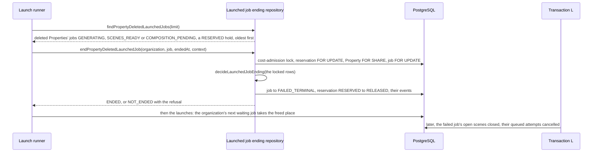

### Verification

Measured locally (PostgreSQL 16 configured like CI).

| Check | Result |
| --- | --- |
| `pnpm lint` / `pnpm typecheck` | clean on `afad90c`, each exit status read |
| `pnpm test` | 6,592 tests in 242 files passed, exit 0 |
| `pnpm test:db` | 1,793 tests in 67 files passed, exit 0 |
| `pnpm test:media` | not run locally: no media code changed; CI's media job runs it |
| `pnpm build` | not run locally; CI's verify job builds |
| `prisma migrate diff` | not run: no schema or migration changed; CI's database job checks it |

New tests:

- `packages/domain/src/job-launch/launched-ending.test.ts` (21): each of the
  three states ended from itself; the list frozen; every other state, and no
  job, kept whatever else is true of it (extended after review); a delivered
  video read before the hold; every hold but `RESERVED`, and none, kept; a
  standing Property kept, and read last.
- `packages/domain/src/job-launch/runner.test.ts` (4 new; every expected call
  list changed): the launched jobs ended after the waiting ones and before the
  launches, each under its own correlation and time, and counted; a refusal
  reported; an ending that throws counted as failed and the pass going on; a
  read of them that throws rejecting the pass before any launch, the waiting
  job's ending already made (extended after review).
- `packages/domain/src/job-launch/dormancy.test.ts` (2 new, 3 changed): the
  repository not constructed outside tests; the lock order, the cost-admission
  lock first with one read before it; one `UPDATE`, the locked transition from
  the decided state, and no scene, request or attempt, audit, insert, delete
  or launch lock.
- `tests/integration/job-launch.db.test.ts` (16 new, 3 of them after review): a
  generating job ended, its Unit back and its version bumped, the next job
  launched in the same pass, the events, and L closing its scenes; `SCENES_READY` and `COMPOSITION_PENDING` ended;
  `COMPOSING`, `DELIVERABLE_VALIDATING` and `FAILED_TERMINAL` kept; a waiting
  job left to GS-7d-1; a delivered video and a reconciliation hold kept; a
  standing Property and another tenant writing nothing; oldest first, bounded
  and validated; a deletion saving waited for; the cost-admission lock waited
  for with no row locked; a writer holding the job waited for and the state it
  left read. After review: a `COMPOSITION_PENDING` job's planned video no
  longer offered to or claimable by the composition claim (J1) once ended; a
  Property of another organization read as standing; and another tenant's id
  waiting on none of the job's rows nor on its cycle's lock.

### Mutation testing

The same harness as GS-7d-2: each mutant applied alone, the named suite run,
the file restored and its digest checked, and the working tree's manifest
compared before and after.

| Id | Mutant | Result |
| --- | --- | --- |
| D01 to D11 | the decision: each of its four checks dropped; the Property read before the hold, or the hold before the delivered video; `COMPOSITION_PENDING` left out or `COMPOSING` added; always from `GENERATING`; the event type of the waiting job's ending; the list not frozen | 10 killed; D10 survived the unit suites and is C01 below |
| R01 to R08 | the runner: the step skipped, unbounded, or after the launches; another job's ending; the outcome under the wrong ids; the clock not read; an ending's throw escaping the pass; a read that throws swallowed | killed |
| S01 to S07 | the reservation, the Property or the job not locked; the Property locked `FOR UPDATE`, or before the reservation; a scene written; a read before the cost-admission lock (static) | killed |
| Q01 to Q07 | the finder: any job state, a job holding a delivered video, any hold, any Property, newest first, the limit ignored or not validated | killed |
| B01 to B20 | the ending: no cost-admission lock, or the wrong cycle's; the reservation, the Property or the job read across tenants; the Property or the job not locked; the release not a compare-and-set; its time not the ending's; the version not bumped; the wrong event type or reason code; the job moved or recorded from `GENERATING` always; either event not written; the delivered video, the Property or the hold not read; a lost release reported ended | 15 killed on the first run; B03, B04 and B10 killed after review; B08 and B20 equivalent |
| C01 | the event type constant reused (D10), on the DB suite | killed |
| D12, R09 | after review: the delivered video read before the job's state; the launched jobs read before the waiting ones end | killed |
| K01, P01, P02 | after review: the cycle read across tenants; the ending, then the finder, not reading the Property's own organization | killed |

Result: **56 of 58 killed, and 2 equivalent.** The first run, on `37d2a7f`,
killed 25 of 26 in `packages/domain/src/job-launch` and 22 of 27 in
`tests/integration/job-launch.db.test.ts`. The second, on `afad90c` with
the tests the review asked for, killed all 9 it ran: the three DB survivors
(B03 and B04 with the Property's own organization added, B10), D10 again as
C01 on the DB suite, and five new ones. B08 and B20 are equivalent: the
reservation is locked `FOR UPDATE` and read `RESERVED` in the same
transaction, so the release's compare-and-set always matches its one row and
the check of that count cannot fire. The tree's manifest matched before and
after every run.

### Review

An independent review, by a subagent reading the git objects only (Codex was
at its usage limit), found nothing blocking: no lock cycle with any writer of
a launched job, no double release, no later consumption of a released Unit,
the finder mirroring the decision, and nothing outside tests running it. All
of it is answered in `afad90c`:

- **Should fix: a released reconciliation hold was said to be left to
  publication.** Reconciliation releases only on a terminal rejection or
  exhaustion, and Transaction K then fails the job, accepting a released hold.
  ADR-0102 and TODO.md now say so; the hold is kept because it is
  reconciliation's to move.
- **Should fix: the Unit is released while a submission's outcome may be
  unknown.** Now stated in Decision 3: a later unknown outcome leaves a
  released hold alone, and whatever the provider did is VTaVision's cost.
- **Should fix: the race claims were tested against stand-ins.** Added: a
  `COMPOSITION_PENDING` job's planned video, run through the real composition
  discovery and claim; another tenant's id taking none of the job's locks; the
  reservation's version; and every other state kept whatever else is true.
  These kill the review's three surviving mutants. Not added: a race with K,
  the gate or ADR-0100's ending, each ordered with this by the cost-admission
  lock under the same key, which the lock-wait test shows; nor with F or I,
  ordered by the job's and the reservation's row locks, which the static lock
  order and the writer test show.
- **Minor: the Property is now read by its own organization too**, as ADR-0100
  reads it, in the ending and the finder (P01, P02).
- **Minor: a read of launched jobs that throws** keeps the waiting jobs'
  endings, each its own commit; Decision 4 says so and the runner test shows
  it.
- **Minor: the two endings report alike.** Their events tell them apart;
  Decision 4 says so. The report's only reader will be the pipeline command
  (GS-9).
- **Question: a place freed while an attempt is at the provider.** A place
  counts a customer's videos at once, not provider work, as after K; the
  attempt's cost stays in the gate's exposure, which counts attempts by their
  own state. Decision 4 says so.
- **Question: no audit entry for the release.** As for ADR-0099, K and L; the
  existing TODO item on audit entries for such releases now names this
  ending.

### Required documentation

| Item | Where |
| --- | --- |
| Architecture diagram | `docs/architecture.md`: the ending's row |
| Entity-relationship diagram | Not applicable: no schema change |
| Critical sequence diagram | the diagram above; the lock order is ADR-0102 Decision 2 |
| OpenAPI / API change summary | `docs/api-changes-gs-7d-3a.md`: no HTTP change; the new and changed exports |
| Change log / release notes | the commit list above and the pull request description |
| Database migration notes | `docs/migration-notes.md`, *GS-7d-3a*: no migration |
| Completion report | this file |

Also updated: `docs/Roadmap.md`, `docs/generation-e2e-gap-analysis.md` and
`docs/decisions/TODO.md` (progress on ending a deleted Property's video already
at the provider or being assembled, and the trash lifecycle).

### Activation status

Nothing paid or scheduled is activated, and nothing a customer can reach
changes: nothing outside tests constructs the repository or the runner. No
scheduler, credential or payment integration. Paid Provider Activation,
production Provider credentials, production paid AI calls, the production
scheduler and live Stripe charges remain BLOCKED.

### Known limitations

- **Nothing runs a pass yet.** The pipeline command (GS-9) will, with the test
  provider only, and must run Transaction L after the runner for the scenes to
  close.
- **A deleted Property's video being assembled or checked still delivers**
  (`COMPOSING`, `DELIVERABLE_VALIDATING`), its Unit consumed, until GS-7d-3b.
- **A job whose hold is on reconciliation is kept**: once restored to
  `RESERVED` the next pass ends it; if released, it is GS-7d-3b's to stop at
  publication.
- **An attempt already at the provider still runs there** when the job fails;
  its cost is VTaVision's (ADR-0083 Decision 1), and its copied output stays in
  internal storage until the 30-day trash lifecycle (TODO).
- **A regeneration of a deleted Property's delivered video** holds no Unit and
  is not ended; whether it may run belongs to the open item on video projects
  created before their Property's deletion.
- **An ended video is not shown to the customer** until the progress page
  (GS-10, GS-11).

### Remaining work

GS-7d-3a waits for the product owner's yes before merge. Then GS-7d-3b,
Transaction G refusing to publish a deleted Property's initial video, failing
the job and releasing its Unit; GS-8, the Transaction I driver; and GS-9, the
pipeline command.

## GS-7d-3b — Transaction G refusing a deleted Property's first video

Base: `5d5bbdb` (PR #126 merge commit on `main`).
ADR: `docs/decisions/0103-transaction-g-refuses-a-deleted-propertys-first-video.md`

The second of GS-7d-3's two pull requests (`/mnt/project-files/cto/gs-7d-3-proposal.md`,
approved by the product owner on 2026-10-29 08:14Z). **No migration; no route,
no page.** Nothing outside tests constructs the validation repository or its
runner, so nothing is refused until the pipeline command (GS-9), with the test
provider only.

The product owner decided on 2026-10-29 ("すぐ戻す") that a deleted Property's
unfinished videos end at once and their Units are released. GS-7d-1, GS-7d-2 and
GS-7d-3a end such a video while it waits, while it is generated and while it
waits to be assembled. One being assembled or checked (`COMPOSING`,
`DELIVERABLE_VALIDATING`) was still published and its Unit consumed, and so was
one whose deletion was saved just after an ending read its Property. This pull
request makes Transaction G, the only place a Unit is consumed, refuse it.

Commits, oldest first:

| Commit | What it carries |
| --- | --- |
| `4c1aadc` | the refusal, the settlement's cause, their tests, ADR-0103 and the documentation |
| `c2a775d` | the review's answers: the event type and the reason code every ending shares, ADR-0103's wording on the Property's lock, the funding check and the Property's writers, and three tests added or extended |
| this commit | this record |

The exact head SHA is reported with the pull request.

### What GS-7d-3b does

- **A deleted Property's first video is never published.** For the job's first
  video, once its hold is shown `RESERVED` or `RECONCILIATION_HOLD`, G reads the
  Property. Deleted, the job moves `DELIVERABLE_VALIDATING → FAILED_TERMINAL`
  with a `job.ended_property_deleted` event, its reservation to `RELEASED` with
  `releasedAt` set to the publication's instant and a `reservation.released`
  event, both with `PROPERTY_DELETED` as their code, in one commit, and G
  answers `PROPERTY_DELETED`. The version stays validated and unpublished; its
  `VALID` verdict is kept.
- **Judged after every other refusal.** A replay of a publication that happened
  is `ALREADY_PUBLISHED`; a target that is not the job's next is
  `NOT_PUBLISHABLE`; a defect is raised as before, a hold that cannot be spent
  included. None of them ends the job. The frozen funding is not checked:
  nothing is spent.
- **A replacement is published whatever its Property**: its Unit was spent by
  the video the customer holds.
- **The same settlement as a video with no usable output.**
  `settleDeliverableFailure` (ADR-0082) gains a `cause`, `NO_USABLE_VIDEO` by
  default, which names the events and nothing else, so a deleted Property
  cannot bill differently from a blocked composition or a terminal verdict
  (ADR-0052 Decision 19). `deliverableSettlementRecord(kind, cause)` names them.
- **The cost-admission lock first.** G now takes the lock for the
  reservation's frozen cycle before the reservation `FOR UPDATE`, then the
  Property `FOR SHARE`, then the job and version `FOR UPDATE`, each read
  tenant-scoped through the job's project, and the Property by its own
  organization too.
- **The validation runner reports `PROPERTY_DELETED` unchanged** and counts it
  as claimed work.

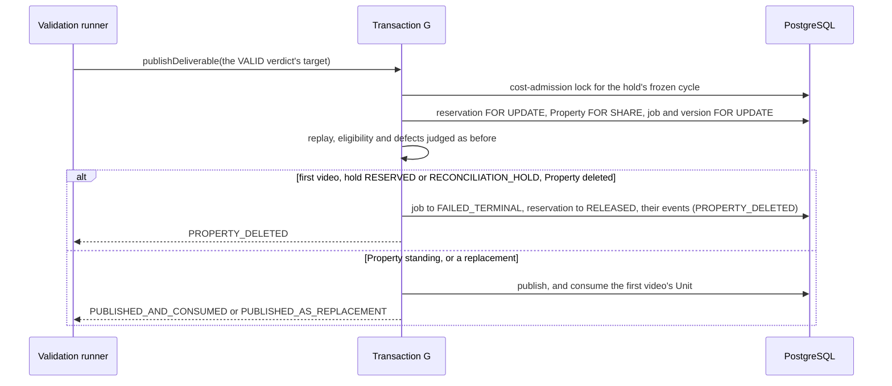

### Verification

Measured locally (PostgreSQL 16 configured like CI).

| Check | Result |
| --- | --- |
| `pnpm lint` / `pnpm typecheck` | clean on `c2a775d`, each exit status read |
| `pnpm test` | 6,599 tests in 242 files passed, exit 0 |
| `pnpm test:db` | 1,806 tests in 68 files passed on the first commit's code, exit 0; the six tests added after it pass with their two files (53 tests, exit 0) |
| `pnpm test:media` | not run locally: no media code changed; CI's media job runs it |
| `pnpm build` | not run locally; CI's verify job builds |
| `prisma migrate diff` | not run: no schema or migration changed; CI's database job checks it |

New tests:

- `tests/integration/deliverable-publication-deleted-property.db.test.ts`
  (17): the job failed and its Unit released in one commit, its version
  bumped, `releasedAt` the publication's instant, two events with the
  `PROPERTY_DELETED` code and the caller's actor and correlation, and nothing
  published; a replay answered
  `NOT_PUBLISHABLE` and the version no longer offered or claimable; a hold on
  reconciliation released; a replacement published; a publication that already
  happened replayed `ALREADY_PUBLISHED`; a stale target and a foreign job id
  ending nothing; a Property of another organization read as not the job's;
  another tenant's id waiting on no lock of the job's, its Property's or its
  cycle's, including through a Property now in the caller's organization; a
  Property held `FOR SHARE` by another transaction not stopping it; a hold
  already released, or none at all under the `unreserved` key, raising its
  defect whatever the Property; a deletion saving
  waited for, then the video refused; the Property held until commit, so a
  deletion waits for the published video; the Property taken after the
  reservation and before the job; the cost-admission lock waited for with no
  row locked; and the validation runner reporting `PROPERTY_DELETED` end to end.
- `tests/integration/unit-entitlement-ledger.db.test.ts` (2 new): every frozen
  Unit, Base and add-on block, given back when the Property was deleted, the
  frozen allocations kept; a hold whose frozen funding no longer covers it
  released, not refused, once its Property was deleted, its recorded Base Unit
  given back.
- `packages/domain/src/deliverable-settlement/settlement.test.ts` (4 new): the
  events and reason code for each settlement kind and cause.
- `packages/domain/src/deliverable-settlement/settlement-shape.test.ts` (2 new,
  1 changed): the events named through the domain's record by their cause; G's
  lock order, the cost-admission lock before the reservation and the Property
  `FOR SHARE` before the job; the settlement counted per file.
- `packages/domain/src/deliverable-validation/runner.test.ts` (1 new, 1
  changed): `PROPERTY_DELETED` passed through and counted as claimed work, the
  pass going on.
- `packages/domain/src/deliverable-validation/dormancy.test.ts` (1 changed):
  the settlement called from the terminal verdict and from G's refusal only,
  with the `PROPERTY_DELETED` cause, and the repository still not constructed
  outside tests.

### Mutation testing

The same harness as GS-7d-2: each mutant applied alone, the named suite run,
the file restored and its digest checked, and the working tree's manifest
compared before and after.

| Id | Mutant | Result |
| --- | --- | --- |
| R01, R02 | the refusal never taken, or taken for every first video | killed |
| R03 | a Property not read counted as deleted | killed |
| R04, R05 | the Property read across organizations, by its own organization or through the project | killed |
| R06, R07 | the Property read without a lock, or locked `FOR UPDATE` | killed |
| R08 | the Property locked after the job | killed |
| R09 to R12 | no cost-admission lock; always the `unreserved` key; the cycle read across tenants; the lock taken after the reservation | killed |
| R16 to R18 | the refusal judged for every publication before the hold, before eligibility, or after the frozen funding | killed |
| S01 to S03 | the settlement's reason code or event fixed whatever the cause; `PROPERTY_DELETED` the default cause | killed |
| D01 to D04 | the record's event types swapped; the rollback event for a release; one reason code; the reason codes swapped | killed |
| U01 | the refusal counted by the runner as unclaimed work | killed |
| K01, C01 | after review: another key for a job with no hold; a correlation not the caller's | killed |

Result: **25 of 25 killed.** The first run, on the first commit's code,
killed all 23: the 18 database mutants on
`tests/integration/deliverable-publication-deleted-property.db.test.ts`,
`deliverable-failure-settlement.db.test.ts`,
`deliverable-publication-gate.db.test.ts` and
`unit-entitlement-ledger.db.test.ts`, the 5 unit mutants on
`packages/domain/src/deliverable-settlement` and
`packages/domain/src/deliverable-validation`. R05 needed a Property moved to
the caller's organization, R07 a Property held `FOR SHARE`, R16 a hold already
released and R18 frozen funding no longer intact: those tests were written
before the run. The second, on `c2a775d`, killed the 2 the review's tests
were written for, on the deleted-Property suite. Not run: the pointer check after the release
removed, equivalent under the job lock (the pointer cannot move). The tree's
manifest matched before and after every run.

### Review

An independent review, by a subagent reading the git objects only (Codex was
at its usage limit), found nothing blocking: the refusal judged after every
other refusal, no double release and no consumption after a release, the
cost-admission key the one every release takes for the same hold, no lock
cycle with any writer of these rows, every read tenant-scoped, and the writes
those of the failure settlement. All of it is answered in `c2a775d`:

- **Should fix: ADR-0099's ending does not record
  `job.ended_property_deleted`.** It records `job.ended_unlaunchable`. What
  every deleted Property's ending shares is the reason code
  `PROPERTY_DELETED`; the domain's record, its test, ADR-0103 and the migration
  notes now say so.
- **Should fix: claims no test proved.** Added: both events carry the caller's
  actor and correlation (C01); a first video with no hold raises its defect,
  having waited for the `unreserved` key (K01); a released hold whose funding
  no longer covers it gives its recorded Base Unit back. Not added: G run
  concurrently with a terminal verdict, a composition block or a launch
  commit, each ordered with G by the cost-admission lock or by row locks
  taken in the declared order, which the lock-wait, lock-order and writer
  tests show; nor a failure halfway through the settlement, whose writes are
  one transaction and whose own tests show its defect raised before any write.
- **Question: a Property outside the job's organization is read as standing.**
  Kept, and recorded under "Considered and not done": no code writes such a
  row, G publishes only to the job's own organization, and a defect would
  leave the Unit held with no video, which ADR-0052 Decision 19 forbids.
- **Minor: the frozen funding is not checked on the refusal.** Kept, as the
  composition block and the terminal verdicts never check it: the check guards
  what a consumption spends. Decision 1 no longer says every defect is raised,
  and says so.
- **Minor: ADR wording.** Decision 1 says the Property is locked before the job
  and judged after the hold; Decision 3 lists the Property's assignment and the
  release of a member's or group's Properties among its writers, neither
  holding a job, a reservation or the cost-admission lock.
- **Minor: only the job's event says why the version never published.** As
  Decision 2 records; the version stays validated, its verdict `VALID`.

### Required documentation

| Item | Where |
| --- | --- |
| Architecture diagram | `docs/architecture.md`: the validation row |
| Entity-relationship diagram | Not applicable: no schema change |
| Critical sequence diagram | the diagram above; the lock order is ADR-0103 Decision 3 |
| OpenAPI / API change summary | `docs/api-changes-gs-7d-3b.md`: no HTTP change; the new and changed exports |
| Change log / release notes | the commit list above and the pull request description |
| Database migration notes | `docs/migration-notes.md`, *GS-7d-3b*: no migration |
| Completion report | this file |

Also updated: `docs/Roadmap.md`, `docs/generation-e2e-gap-analysis.md` and
`docs/decisions/TODO.md` (ending a deleted Property's video already at the
provider or being assembled, done; the trash lifecycle).

### Activation status

Nothing paid or scheduled is activated, and nothing a customer can reach
changes: nothing outside tests constructs the validation repository or its
runner. No scheduler, credential or payment integration. Paid Provider
Activation, production Provider credentials, production paid AI calls, the
production scheduler and live Stripe charges remain BLOCKED.

### Known limitations

- **Nothing runs it yet.** The pipeline command (GS-9) will, with the test
  provider only.
- **A deleted Property's video being assembled or checked is still composed
  and checked**: G is where it ends, and the Unit comes back when the check
  finishes. That compute is VTaVision's.
- **A refused video's composed outputs stay in managed storage** (the
  deliverable key no route signs yet, the Clean Master in the internal
  namespace) until the 30-day trash lifecycle (TODO).
- **A regeneration of a deleted Property's delivered video is still
  published**; whether it may run belongs to the open item on video projects
  created before their Property's deletion.
- **No audit entry for the release**, as for the other endings; the existing
  TODO item on such entries covers it.
- **A refused video is not shown to the customer** until the progress page
  (GS-10, GS-11).

### Remaining work

GS-7d-3b waits for the product owner's yes before merge. It completes GS-7d:
once the pipeline runs, every unfinished first video of a deleted Property ends
and returns its Unit. Then GS-8, the Transaction I driver, and GS-9, the pipeline command.

## GS-8 — planning a video's composition once its scenes are ready

Base: `d298251` (PR #127 merge commit on `main`).
ADR: `docs/decisions/0104-planning-a-videos-composition-once-its-scenes-are-ready.md`

A milestone of the approved plan (`/mnt/project-files/cto/generation-e2e-proposal.md`,
row GS-8). **No migration; no route, no page.** Nothing outside tests
constructs the runner, so nothing is planned until the pipeline command (GS-9),
with the test provider only.

Transaction F moves a job to `SCENES_READY` when its last scene is delivered.
Transaction I would plan its composition and move it to `COMPOSITION_PENDING`,
where the composition claim (J1) takes it, but nothing found such a job or
called Transaction I, so a job stopped at `SCENES_READY`.

Commits, oldest first:

| Commit | What it carries |
| --- | --- |
| `f224002` | the candidate query, the runner, their tests, ADR-0104 and the documentation |
| `24e8536` | the review's answers: the latest-attempt test, the guards scoped to everything but discovery, the defect's place in the batch documented, the repository's lock-order comments, four tests added or extended |
| this commit | this record |

The exact head SHA is reported with the pull request.

### What GS-8 does

- **The candidate query.** `findCompositionPlanCandidates({ limit })` on the
  plan repository: one read with no lock and no transaction, identifiers only,
  oldest first by the job's creation and then its id, the organization taken
  from the job's project. It offers a `SCENES_READY` job whose hold describes a
  first video (no current deliverable, `RESERVED`) or a recomposition (a current
  deliverable, `CONSUMED`), with at least one scene and every scene `READY`,
  its delivered pointer naming a `DELIVERED` request whose latest attempt is
  `OUTPUT_VERIFIED` with a `VALID` verdict. That mirrors every refusal of
  Transaction I, so a job it would refuse never holds the head of the batch.
- **A defect is offered.** A verdict bound to other bytes than its attempt's
  receipt is reported on every pass as that job's failure with its code, and
  keeps its place in the batch until someone repairs it (ADR-0104 Decision 1).
- **The runner.** `CompositionPlanRunner.runOnce(limit)` asks once, then calls
  Transaction I once per job with a fresh version id and its own context. A job
  listed twice is planned once; an admission that throws is that job's `FAILED`
  outcome, with its defect code or none, and the pass goes on; a query that
  throws rejects the pass. The report counts the plans and the failures.
- **Transaction I is unchanged.**

```mermaid
sequenceDiagram
    participant R as Composition plan runner
    participant Q as Candidate query
    participant I as Transaction I
    participant DB as PostgreSQL
    R->>Q: findCompositionPlanCandidates(limit)
    Q->>DB: SCENES_READY jobs it would plan, oldest first (no lock)
    Q-->>R: organization and job ids
    loop each job, once
        R->>I: admitCompositionPlan(org, job, fresh version id, context)
        I->>DB: reservation, job and scene chain FOR UPDATE; version, inputs, job COMPOSITION_PENDING
        I-->>R: PLANNED, ALREADY_PLANNED, NOT_ELIGIBLE, NOT_FOUND, or it throws (FAILED)
    end
```

### Verification

Measured locally (PostgreSQL 16 configured like CI).

| Check | Result |
| --- | --- |
| `pnpm lint` / `pnpm typecheck` | clean on `f224002` and on `24e8536`, each exit status read |
| `pnpm test` | 6,605 tests in 243 files passed on `f224002`'s code, exit 0; the module's 55 pass on `24e8536`, exit 0 |
| `pnpm test:db` | 1,837 tests in 69 files passed on `f224002`'s code, exit 0; the discovery suite's 29 pass on `24e8536`, exit 0 |
| `pnpm test:media` | not run locally: no media code changed; CI's media job runs it |
| `pnpm build` | not run locally; CI's verify job builds |
| `prisma migrate diff` | not run: no schema or migration changed; CI's database job checks it |

New tests:

- `tests/integration/composition-plan-discovery.db.test.ts` (29): both cycles
  offered oldest first by creation then id, up to the limit, each with its
  organization; an unusable limit refused by the query itself; a scene judged
  by its latest attempt, a recovery that passed after a first attempt that
  failed offered and planned; a receipt defect offered and reported by the
  runner with its code, nothing written; for each of 24 refusals (four job
  states, seven hold shapes and no hold, no scene, a scene not `READY`, no
  pointer, a request not `DELIVERED`, no attempt, an attempt not verified, a
  newer attempt with no verdict, four verdicts that are not `VALID`, no
  verdict) the job passed over for a younger one and Transaction I refusing it,
  a job marked planned with no plan behind it by its defect; and the runner
  planning two jobs of two organizations once each, with its version ids and
  correlations, then finding nothing and writing nothing.
- `packages/domain/src/deliverable-composition/runner.test.ts` (5): each job
  offered once with its own version id and correlation, outcomes passed
  through and counted; an empty pass; the bound checked before discovery; a
  throw isolated, a defect's code kept and nothing else; a discovery failure
  rejecting the pass.
- `packages/domain/src/deliverable-composition/dormancy.test.ts` (changed):
  nothing in production calls the repository but the runner, or constructs the
  runner, `apps/ops` included; discovery one plain read with no lock and no
  write; the reservation-state, pointer and `CONSUMED` guards applied to
  everything but discovery, and discovery's own reads pinned.
- `tests/integration/deliverable-composition-fixture.ts` gains a `tag` option,
  so a test chooses how its rows' ids sort.

### Mutation testing

The same harness as GS-7d-3b: each mutant applied alone, the named suite run,
the file restored and its digest checked, and the working tree's manifest
compared before and after.

| Id | Mutant | Result |
| --- | --- | --- |
| D01 | no job-state condition | killed |
| D02 to D07 | either cycle's pointer or hold not required, or loosened; both cycles required at once | killed |
| D08 to D14 | no scene required; another job's scene counted; scene, request, attempt or verdict not checked; a missing verdict passing | killed |
| D15, D22 | the oldest attempt, or any attempt, instead of the latest | killed |
| D16 to D19 | ordered by id only, without the id tie-break, newest first; one row past the limit | killed |
| D20, D21 | the query not checking its limit; the wrong organization returned | killed |
| U01 to U09 | no dedupe; one version id or correlation for all; replays counted as plans; failures not counted or listed; the defect code dropped; the bound not checked; a throw stopping the pass | killed |
| U10 to U12 | 100, 0 or a fraction misjudged by the bound | killed |
| K01 to K03 | outside discovery: an unlocked reservation-state read; a pointer write naming `IS NULL`; a `CONSUMED` write | killed |

Result: **37 of 37 killed.** The first run, on `f224002`, killed 21 database
mutants on the discovery suite and 12 unit mutants on the module's tests. The
second, on `24e8536`, killed the 4 written for the review: D22 on the
discovery suite, K01 to K03 on the static tests. D17 is killed because the heap
returns the tied pair in insertion order, which the test makes the reverse of
id order. Not run: the reservation join made outer, and the request's state
or the attempt's compared with `<>`: each is equivalent, since a job with no
hold fails both cycle shapes and a missing request or attempt leaves no
verdict. The tree's manifest matched before and after every run.

### Review

An independent review, by a subagent reading the git objects only (Codex was
at its usage limit), found nothing blocking: the query mirrors Transaction I
exactly but for the receipt defect it leaves out on purpose, the schema allows
one reservation per job, one verdict per attempt and one attempt per ordinal,
the organization returned is the one Transaction I accepts, and the runner is
correct. All of it is answered in `24e8536`:

- **Should fix: the latest-attempt filter was not tested.** Removing it passed
  every test. Added: a scene whose first attempt failed its check and whose
  recovery passed is offered and planned (D22).
- **Should fix: a defect holds the head of the batch on every pass.** Kept, and
  stated in ADR-0104 Decision 1, the Roadmap and the port: such a job, or any
  whose admission keeps throwing, keeps its place and is reported each time;
  with `limit` of them a pass plans no newer job. Hiding the defect would leave
  the job stopped with nothing saying why.
- **Should fix: the static guards were weaker than stated.** The
  reservation-state check now covers the whole file but discovery; the
  pointer allowlist applies outside discovery, and discovery may name the
  pointer on its two cycle lines only; `'CONSUMED'` appears nowhere but once in
  discovery's read (K01 to K03).
- **Should fix: stale comments.** The repository's header now gives the lock
  order the transaction takes, the reservation first, and the pointer read's
  comment says discovery reads the reservation's state unlocked as a hint.
- **Minor: two events ordered across jobs by a sequence both have as 1.** Each
  job's events are now read on their own.
- **Minor: tests not covering a `RUNNING` or `INTEGRITY_MISMATCH` verdict, a
  recomposition with its hold released, or a second organization end to end.**
  Added.
- **Question: should the runner refuse more than `limit` candidates?** No: the
  query is bounded by the same validated limit, as in every other sweep.
- **Question: a `FAILED` outcome with no code carries no diagnosis.** Kept, as
  in every other sweep: an error's text can carry SQL or provider detail, and
  the report is not the place for it. The pipeline command (GS-9) decides what
  it logs.
- **Minor: table rows over 120 columns** in `docs/api-changes-gs-8.md` and
  `docs/architecture.md`, as in the earlier summaries; prose and code lines fit.

### Required documentation

| Item | Where |
| --- | --- |
| Architecture diagram | `docs/architecture.md`: the composition plan row |
| Entity-relationship diagram | Not applicable: no schema change |
| Critical sequence diagram | the diagram above |
| OpenAPI / API change summary | `docs/api-changes-gs-8.md`: no HTTP change; the new and changed exports |
| Change log / release notes | the commit list above and the pull request description |
| Database migration notes | `docs/migration-notes.md`, *GS-8*: no migration |
| Completion report | this file |

Also updated: `docs/Roadmap.md` and `docs/generation-e2e-gap-analysis.md`.
`docs/decisions/TODO.md` is unchanged: nothing is left open by this change
that the plan does not already carry (GS-9, GS-11).

### Activation status

Nothing paid or scheduled is activated, and nothing a customer can reach
changes: nothing outside tests constructs the runner. No scheduler, credential
or payment integration. Paid Provider Activation, production Provider
credentials, production paid AI calls, the production scheduler and live
Stripe charges remain BLOCKED.

### Known limitations

- **Nothing runs it yet.** The pipeline command (GS-9) will, with the test
  provider only.
- **A job whose admission keeps throwing keeps its place** at the head of the
  batch and is reported on every pass (ADR-0104 Decision 1).
- **A deleted Property's job is planned like any other** if the pass reaches it
  first; ADR-0102's ending and ADR-0103's refusal end it and return its Unit,
  and the version written for it is never published.
- **A video waiting for composition is not shown to the customer** until the
  progress page (GS-11).

### Remaining work

GS-8 waits for the product owner's yes before merge. Then GS-9, the pipeline
command that runs every step on the test provider, and the screens (GS-10 to
GS-12).

## GS-9a — the launch window moves

Base: `2fc1380` (PR #128 merge commit on `main`).
ADR: `docs/decisions/0105-the-launch-window-moves.md`

The first milestone of row GS-9 of the approved plan
(`/mnt/project-files/cto/generation-e2e-proposal.md`: the pipeline command).
**No migration; no route, no page.** Nothing outside tests constructs the
launch runner or its repository.

The launch offers each organization its oldest waiting job, oldest first, up
to the pass's limit. A job refused for a route, a price or a rate keeps
waiting at its organization's head (ADR-0099 Decision 1), so a window of such
organizations was read again on every pass, and no other organization's job
was ever offered (ADR-0095 Decision 7).

GS-9 is split into four milestones, recorded in
`docs/generation-e2e-gap-analysis.md`: this one; the development assembly
(GS-9b); the command (GS-9c); and its end-to-end test (GS-9d).

Commits, oldest first:

| Commit | What it carries |
| --- | --- |
| `526404e` | the cursor, `next`, the UTC comparison, their tests, ADR-0105 and the documentation |
| this commit | the review's answers and this record |

The exact head SHA is reported with the pull request.

### What GS-9a does

- **The query reads after a cursor.** `findJobLaunchCandidates({ limit,
  after })` takes `after`, a `{ createdAt, generationJobId }` cursor in its own
  order, or `null` for the oldest. The cursor is applied after each
  organization's oldest waiting job is chosen, so it moves over organizations.
  Each candidate carries its job's `createdAt`.
- **The instant is compared in UTC.** A `Date` parameter reaches PostgreSQL as
  `timestamptz` and the column holds UTC with no zone; the query turns the
  parameter to UTC, so a session in another time zone does not move the
  window's start. Found while testing: in a session set to `Asia/Tokyo` the
  window started nine hours off.
- **The runner returns `next`.** `runOnce(limit, after = null)` passes the
  cursor to its launches and returns the last candidate read when the window
  was full, or `null` when it reached the end. The endings of deleted
  Properties' jobs still read from the oldest.
- **Both check the cursor.** `validateJobLaunchCursor` refuses anything but
  `null` or a `Date` with a finite time and a non-empty string id, before any
  read.

```mermaid
sequenceDiagram
    participant C as Caller (GS-9c)
    participant R as Launch runner
    participant Q as Candidate query
    participant DB as PostgreSQL
    C->>R: runOnce(limit, null)
    R->>Q: findJobLaunchCandidates(limit, after: null)
    Q->>DB: each organization's oldest waiting job, oldest first
    Q-->>R: up to limit candidates, each with createdAt
    R-->>C: report, next = last candidate (window full)
    C->>R: runOnce(limit, next)
    R->>Q: findJobLaunchCandidates(limit, after: next)
    Q->>DB: the same, after (createdAt, id) in UTC
    Q-->>R: fewer than limit
    R-->>C: report, next = null (from the oldest again)
```

### Verification

Measured locally (PostgreSQL 16 configured like CI).

| Check | Result |
| --- | --- |
| `pnpm lint` / `pnpm typecheck` | clean on `526404e`'s code, each exit status read |
| `pnpm test` | 6,609 tests in 243 files passed, exit 0, before the two cursor tests of `launch.test.ts` were added; that file's 35 pass after, exit 0 |
| `pnpm test:db` | 1,846 tests in 69 files passed on `526404e`'s code, exit 0; the launch suite's 60 pass on this commit, exit 0 |
| the window's DB tests in other session time zones | pass with `TimeZone` set to `Asia/Tokyo`, `America/Los_Angeles` and `UTC`; without the cast, the three that compare an instant fail in `Asia/Tokyo` |
| `pnpm test:media` | not run locally: no media code changed; CI's media job runs it |
| `pnpm build` | not run locally; CI's verify job builds |
| `prisma migrate diff` | not run: no schema or migration changed; CI's database job checks it |

New tests:

- `tests/integration/job-launch.db.test.ts` (6 new, 3 changed): a cycle in
  which an organization whose oldest job waits for a rate is passed over for
  the next window's organization, then the window comes back to it from the
  oldest, its Units still held; the window starting after the cursor, not at
  it, to the millisecond and between two jobs; the same in a session set to
  `Asia/Tokyo`, on its own connection; an organization's later job not offered
  once the window has passed its oldest; a tie in creation broken by id; a
  cursor that names no instant or no job refused by the query. The candidate
  shape and the empty report now carry `createdAt` and `next`.
- `packages/domain/src/job-launch/runner.test.ts` (4 new, 5 changed): the
  cursor passed to the launches only, `next` null short of full; the last
  candidate read returned when full, whatever its launch answered; a window
  full by what was read, not what was offered; a bad cursor refused before any
  read.
- `packages/domain/src/job-launch/launch.test.ts` (2 new): the cursor's
  validation, accepted and refused.

### Mutation testing

The same harness as GS-8: each mutant applied alone, the named suite run, the
file restored and its digest checked, and the working tree's manifest
compared before and after. 21 of 21 killed.

| Id | Mutant | Result |
| --- | --- | --- |
| D01 | the query not checking its cursor | killed |
| D02 | the cursor ignored | killed |
| D03, D07 | the window starting at the cursor, or reading before it | killed |
| D04 | the instant compared in the session's time zone | killed (by the `Asia/Tokyo` test alone) |
| D05 | no tie-break by id | killed |
| D06 | a candidate's `createdAt` not its job's | killed |
| D08 | the cursor applied inside each organization's choice of its oldest job, so a later job is offered | killed (added after the review) |
| U01, U02 | the runner not checking the cursor, or not passing it | killed |
| U03, U07 | `next` when the window is not full; never full | killed |
| U04 to U06 | `next` the first candidate, without its instant, or naming the organization | killed |
| U08 to U13 | each clause of the cursor's validation removed or loosened | killed |

### Review

An independent review, by a subagent reading the git objects only (Codex was
at its usage limit), found nothing blocking: the cursor sits after each
organization's choice and before the order and the limit, the row comparison
matches the order, the UTC cast gives back the stored value to the
millisecond, `next` is right, and the validator matches the submission
window's. Answered in this commit:

- **Should fix: the TODO's list of raw SQL that depends on the session's time
  zone was incomplete.** It now lists reconciliation's two comparisons, the
  failed-job scene closure's and both job endings' writes, and the 20 raw
  `CURRENT_TIMESTAMP` writes, and says that a cast covers parameters only,
  while setting the session to UTC covers all of them.
- **Should fix: "neither are its later jobs" was not tested.** Added: an
  organization's later job is not offered once the window has passed its
  oldest (D08).
- **Minor: `next`'s comment said "offered".** It says "read", as the code, the
  ADR and the tests do.
- **Minor: Decision 3 cited ADR-0098 Decision 6 for the stopping rule**, which
  is in ADR-0098's *Not decided here*. It now cites both, and states the rule
  as a constraint the command must respect, the command deciding the rest.
- **Minor: an ending that keeps throwing keeps its place** at the head of its
  own query, as before this change. ADR-0105 Decision 2 now says so: it holds
  newer deleted Properties' jobs back, not the launch window.
- **Minor: `startJob`'s parameter shadowed the new `minute()` helper.**
  Renamed, and the helper reused.
- **Minor: a `Date` outside PostgreSQL's range passes the validator** and
  fails in the database instead. Kept: the submission window's validator does
  the same, and only a caller's own code makes such a cursor.
- **Question: does a cycle of failures alone count as quiet?** Left to the
  command (GS-9c), and recorded in ADR-0105's *Not decided here*: a failure
  that would pass on a retry is then retried only when the command next runs.
- **Question: can a cycle starve under load?** Yes, as ADR-0098 accepts for
  attempts: if every window fills with organizations newly able to launch,
  one the window has passed waits until it comes round. ADR-0105 Decision 3
  now says so.

### Required documentation

| Item | Where |
| --- | --- |
| Architecture diagram | `docs/architecture.md`: the job launch row |
| Entity-relationship diagram | Not applicable: no schema change |
| Critical sequence diagram | the diagram above |
| OpenAPI / API change summary | `docs/api-changes-gs-9a.md`: no HTTP change; the new and changed exports |
| Change log / release notes | the commit list above and the pull request description |
| Database migration notes | `docs/migration-notes.md`, *GS-9a*: no migration |
| Completion report | this file |

Also updated: `docs/Roadmap.md`, `docs/generation-e2e-gap-analysis.md` (the
GS-9 survey and split) and `docs/decisions/TODO.md`: the launch window's means
built and the command still to carry it, and a new item on raw SQL `Date`
parameters in other repositories, which are right only in a UTC session.

### Activation status

Nothing paid or scheduled is activated, and nothing a customer can reach
changes: nothing outside tests constructs the runner. No scheduler, credential
or payment integration. Paid Provider Activation, production Provider
credentials, production paid AI calls, the production scheduler and live
Stripe charges remain BLOCKED.

### Known limitations

- **Nothing carries the cursor yet.** The pipeline command (GS-9c) will, and
  must run a whole cycle before it judges the launches settled (ADR-0105
  Decision 3).
- **A job refused for configuration still holds its own organization's queue
  and its Units.** How long it may is still open (`docs/decisions/TODO.md`).
- **Other raw SQL `Date` parameters** compare and write in the session's time
  zone; every environment runs in UTC today (`docs/decisions/TODO.md`).

### Remaining work

GS-9a waits for the product owner's yes before merge. Then GS-9b, GS-9c and
GS-9d, and the screens (GS-10 to GS-12).


## GS-9b-1 — the development pipeline's assembly

Base: `2285690` (PR #129 merge commit on `main`).
ADR: `docs/decisions/0106-the-development-pipelines-assembly.md`

The second milestone of row GS-9 of the approved plan
(`/mnt/project-files/cto/generation-e2e-proposal.md`: the pipeline command,
run only when a person or a test starts it, only with the test provider, never
in production). **No migration; no route, no page, no environment variable.**
Nothing calls the assembly until the command (GS-9c).

GS-9b is split in two: this milestone builds the steps from a waiting job to
each clip copied into the shared folder, with Transactions K and L and the
maintenance at the provider boundary; GS-9b-2 builds the rest.

Commits, oldest first:

| Commit | What it carries |
| --- | --- |
| `65c3f0e` | the assembly, the photo reader, their tests, the database suite, the static tests' admissions, ADR-0106 and the documentation |
| this commit | a check that K and L run on the system clock (from mutation testing), the review's answers and this record |

The exact head SHA is reported with the pull request.

### What GS-9b-1 does

- **One assembly, in the worker.** `assembleDevelopmentPipeline(env,
  { providerFolder }, { prisma, renderer? })` builds the launch, the
  submission, the provider output, the maintenance at the provider boundary
  and K and L, and returns them. It runs none. Nothing in the worker's
  start-up, the web app or the operator commands reaches it.
- **Refused before anything is opened**: in production (given or ambient
  `NODE_ENV`), unless `VIDEO_PROVIDER=fake`, without `SHARED_STORAGE_DIR`, or
  with a relative test provider folder.
- **The shared folder, signed under an address that cannot resolve.** Photo
  URLs are signed under `https://development.invalid/api/storage`, which
  preparation accepts and nobody can fetch.
- **The test provider reads a photo as the download route serves it**: under
  the base's download path, with an unexpired download token signed with the
  shared folder's secret, for a key that may be signed.
- **One studio** serves the test provider, its status source and its byte
  source. The launch prices against the test route's fixed rate; the gate
  reads the billing cycle's own revenue.
- **Development reconciliation values**: a one-hour window, presumed lost
  after 15 minutes at the boundary. Production's are still an activation
  decision.

```mermaid
sequenceDiagram
    participant C as Command (GS-9c)
    participant A as Assembly
    participant L as Launch
    participant S as Submission
    participant P as Test provider (studio)
    participant O as Provider output
    participant F as Shared folder
    C->>A: assembleDevelopmentPipeline(env, folder, prisma)
    A-->>C: the steps (none run)
    C->>L: a pass
    L-->>C: the job launched, its attempts admitted
    C->>S: a pass
    S->>F: sign each scene's photo under development.invalid
    S->>P: send (no network)
    P->>F: read the photo through its token
    P-->>S: accepted once the clip is made
    C->>O: a batch
    O->>P: status, then the clip's bytes
    O->>F: copy and verify the clip
```

### Verification

Measured locally (PostgreSQL 16 configured like CI).

| Check | Result |
| --- | --- |
| `pnpm lint` / `pnpm typecheck` | clean on this commit, each exit status read |
| `pnpm test` | 6,626 tests in 246 files passed on this commit, exit 0 |
| `pnpm test:db` | 1,849 tests in 70 files passed on `65c3f0e` with the clock check, exit 0; the pipeline suite's 2 pass on this commit, exit 0 |
| `pnpm test:media` | not run locally: no media code changed; CI's media job runs it |
| `pnpm build` | not run locally; CI's verify job builds |
| `prisma migrate diff` | not run: no schema or migration changed; CI's database job checks it |

New tests:

- `tests/integration/development-pipeline.db.test.ts` (2): a job started by
  the real start commit is launched, both scenes' photos are read by the test
  provider through the URLs preparation signed and sent, and each clip is
  copied into the shared folder and verified, with nothing left for the
  maintenance; and when the test provider cannot make a clip, the first scene
  is refused, the second is not sent, K releases the Unit and L cancels the
  second attempt, both on the system clock.
- `apps/worker/src/development-pipeline/assembly.test.ts` (9): each refusal,
  before any folder exists; every step built; the base; the development
  policy; the contexts.
- `apps/worker/src/development-pipeline/photo-reader.test.ts` (4): the photo
  read; nothing for a missing key, another secret's token, an upload token
  under the download path, an expired token, another origin, scheme or path,
  no token, or no URL.
- `apps/worker/src/development-pipeline/dormancy.test.ts` (2): the folder holds
  two files that run no step, start nothing, reach no network or real
  provider, and that nothing else names.

### Mutation testing

The same harness as GS-9a. 45 of 45 killed, one of them after a check was
added.

| Id | Mutant | Result |
| --- | --- | --- |
| A01 to A05 | each refusal removed or loosened | killed |
| A06, A07, A23 | the default relative base; the reader under another base; the reader seeing no photo | killed |
| A08 | the given clip maker ignored | killed |
| A09, A10 | no rate; the gate on production's prices | killed |
| A11, A12 | the copy staged into another bucket; a 4-byte limit | killed |
| A13 to A15, A22 | the context's label, correlation, actor or user changed | killed |
| A16 | the stale threshold equal to the window | killed |
| A17 | one id for every attempt | killed |
| A18 to A20 | the status source, the byte source or the studio not the provider's | killed |
| A21 | K settling at the epoch | survived, then killed by the added check of the release instant |
| A24 | L closing at the epoch | killed by the same check |
| P01 to P07 | the reader's base, origin, purpose, token, verdict, parse and path checks | killed |
| S01 to S10 | a timer, a step run, a batch run, K's commit called, an `S3Client`, an ffprobe, a fetch, a second rate source, a key no token names, the folder reached from start-up | killed by the static tests |
| R01 to R04 | upload tokens read; a second or a different rate line; an HTTP module | killed (added after the review) |

### Review

An independent review, by a subagent reading the git objects only (Codex was
at its usage limit), found nothing blocking: the wiring matches the database
suites' for each runner, the refusals come before anything is opened, nothing
reaches a network or a paid provider, the photo reader reads no key a token
does not name, and every static admission names the assembly by path and
keeps the calls banned. Answered in this commit:

- **Should fix: the upload token was refused by its path, not its purpose.**
  The test now puts it under the download path (R01).
- **Should fix: the rate's admission was wider than the ADR said.** The test
  now admits the one exact line, once (R02, R03), and the ADR quotes it.
- **Should fix: "fetches nothing" was enforced by `fetch(` alone.** The folder's
  test also bans the HTTP and socket modules, HTTP clients, the AWS SDK, an
  `S3Client`, the AI providers, the WaveSpeed and fal adapters and the provider
  factory (R04).
- **Should fix: architecture rows still said nothing builds the planner, the
  gate, the sender, the endings, K and L** until GS-9. Each now names the
  assembly, and the new row's refusal list is complete.
- **Minor: the Mermaid node was over 120 columns.** Shortened.
- **Minor: "a token the pipeline signed" overclaimed.** The reader takes any
  download token signed with the shared secret, the web app's included, and
  the web app's route would serve a pipeline token; the reader, the ADR and
  the API summary now say so. Nothing stores the URL.
- **Minor: the DS-4 test's title named one route.** It names the reader too.
- **Minor: the database suite checked outcomes by kind.** It now checks each
  outcome whole and the second test's launch; the maintenance check stays a
  smoke check, its stale and exhaustion paths being the reconciliation
  suite's.
- **Minor: a run across a month's end could start the job outside the seeded
  period.** The job starts at the instant the period was chosen from.
- **Minor: the exported types were not listed.** The ADR and the API summary
  list them.
- **Question: should the output pass and the maintenance read only the test
  provider's attempts?** A development database holds no other provider's,
  since nothing can send one while paid activation is blocked; if one did, the
  studio refuses to answer for it and nothing is written, and the maintenance
  would apply the development values. Recorded in ADR-0106's *Not decided
  here* for the command (GS-9c).

### Required documentation

| Item | Where |
| --- | --- |
| Architecture diagram | `docs/architecture.md`: the worker node and the development pipeline row, and the rows of the steps it builds |
| Entity-relationship diagram | Not applicable: no schema change |
| Critical sequence diagram | the diagram above |
| OpenAPI / API change summary | `docs/api-changes-gs-9b-1.md`: no HTTP change; the worker's new module |
| Change log / release notes | the commit list above and the pull request description |
| Database migration notes | `docs/migration-notes.md`, *GS-9b-1*: no migration |
| Completion report | this file |

Also updated: `docs/Roadmap.md` and `docs/generation-e2e-gap-analysis.md` (the
9b split). `docs/decisions/TODO.md` is unchanged: production's reconciliation
values are already recorded as open.

### Activation status

Nothing paid or scheduled is activated, and nothing a customer can reach
changes: nothing calls the assembly, and it is refused in production. No
scheduler, credential or payment integration. Paid Provider Activation,
production Provider credentials, production paid AI calls, the production
scheduler and live Stripe charges remain BLOCKED.

### Known limitations

- **Nothing runs the steps yet.** The command (GS-9c) will.
- **The steps after the copy are not built** (GS-9b-2).
- **The development reconciliation values are not production's**, which are
  still open (`docs/decisions/TODO.md`).

### Remaining work

GS-9b-1 waits for the product owner's yes before merge. Then GS-9b-2, GS-9c
and GS-9d, and the screens (GS-10 to GS-12).
