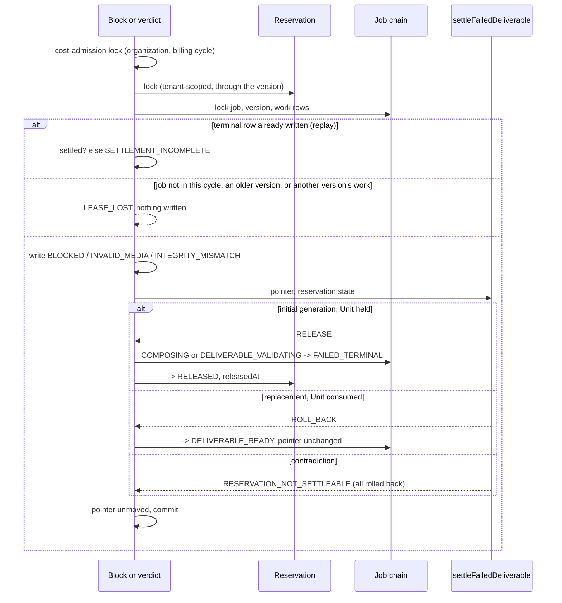
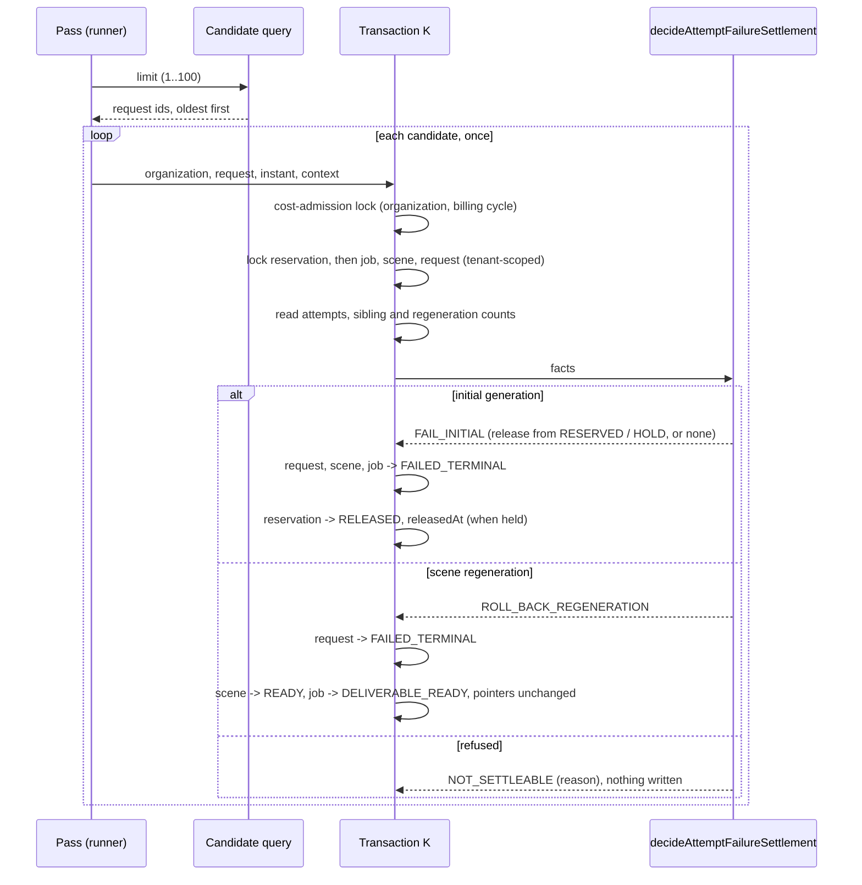
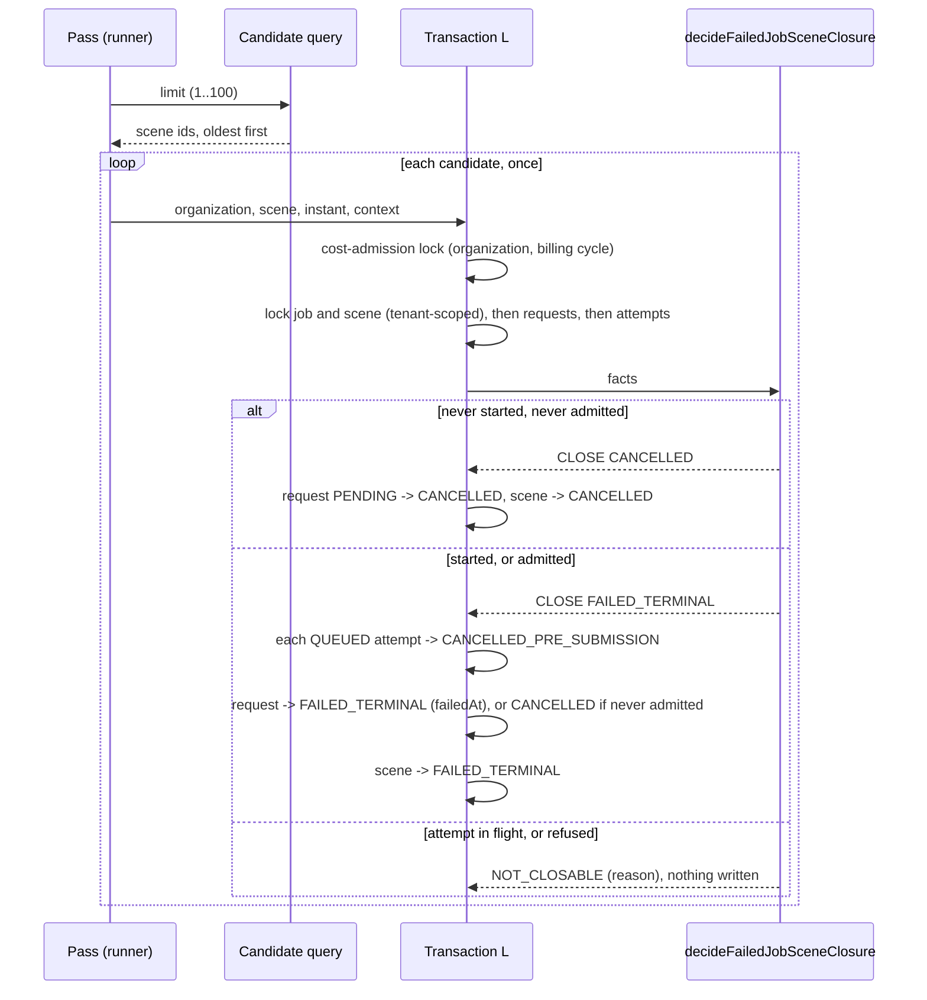

# Completion — starting a video, and previewing and downloading it

Branch: `claude/project-thread-az06z2`
ADRs: `docs/decisions/0082-a-failed-deliverable-settles-its-job.md` (GS-1),
`docs/decisions/0083-a-scene-whose-attempts-failed-settles-its-job.md` (GS-2a),
`docs/decisions/0084-a-failed-jobs-other-scenes-close.md` (GS-2b),
`docs/decisions/0085-a-shared-folder-holds-development-objects.md` (GS-3),
`docs/decisions/0086-a-storyboard-is-saved-in-one-commit.md` (GS-4a)
Gap analysis: `docs/generation-e2e-gap-analysis.md`
Plan: `/mnt/project-files/cto/generation-e2e-proposal.md`, approved by the
product owner on 2026-10-26, including the development-only pipeline command

The product owner approved connecting the built, dormant generation steps and
adding the screens, so that a person on a development machine can start a
video on the test provider and preview and download it, in about thirteen pull
requests (GS-1 to GS-13), each merged only with their yes. Each extends this
record. The plan is not a Roadmap phase, so it receives no `phase-N-complete`
tag.

## GS-1 — a failed deliverable settles its job

Base: `dbe8038` (PR #104 merge commit on `main`; post-merge CI run 666 green).
ADR: `docs/decisions/0082-a-failed-deliverable-settles-its-job.md`

**No migration**, although the plan expected one: every state and column the
settlement needs already exists.

Commits, oldest first:

| Commit | What it carries |
| --- | --- |
| `70a09ac` | the domain decision, the database settlement, both writers' wiring, the reserved edges, the tests, ADR-0082 and the documentation |
| `0316afa` | the review's answers: the claim's work row matched, the cost-admission lock first, the replacement's replay requiring its consumed Unit, the settlement defect's code reported, the guards rewritten onto the settlement, the ADR and TODO corrections |
| this commit | this record |

The exact head SHA is reported with the pull request.

### What GS-1 does

- **One decision for every failure class.** `settleFailedDeliverable` reads
  the job's deliverable pointer and its reservation's state: an initial
  generation whose Unit is `RESERVED` or `RECONCILIATION_HOLD` fails and
  releases it; a replacement whose earlier delivery is `CONSUMED` rolls back to
  `DELIVERABLE_READY`; anything else is refused with
  `RESERVATION_NOT_SETTLEABLE` and nothing is written.
- **In the commit that records the failure.** `blockComposition` and the
  three terminal verdicts call `settleDeliverableFailure` after writing their
  terminal row, so the failure and its settlement commit together or not at
  all. The release is stamped with the block's or the verdict's instant.
- **The cost-admission lock, then Reservation, then Job.** Both writers take
  the organization and billing-cycle lock every entitlement release takes,
  then lock the reservation, tenant-scoped through the version, then their
  chain.
- **Only the running cycle.** A block or verdict for a job that left the
  cycle's state, for a version that is not the job's newest, or (a block)
  with a claim whose work row is not the version's own, is `LEASE_LOST`.
- **A replay must find its settlement**, or throws `SETTLEMENT_INCOMPLETE`.
- **The generic API cannot end a Unit-holding job**: eight edges reserved.
- **Still dormant.** Nothing in production constructs either runner.



### Verification

Measured locally on `0316afa` (PostgreSQL 16 configured like CI; FFmpeg
6.1.1, the version CI's `media` job installs). This record's commit changes
only this file.

| Check | Result |
| --- | --- |
| `pnpm lint` / `pnpm typecheck` | clean |
| `pnpm test` | **5976 / 5976**, 215 files (5937 on `dbe8038`) |
| `pnpm test:db` | **1538 / 1538**, 58 files (1505 on `dbe8038`) |
| `pnpm test:media` | **169 / 169**, on `70a09ac`: no media code changed since |
| `pnpm build` | succeeded |
| `prisma migrate diff` (migrations against the schema) | no difference |

New and changed tests:

- `packages/domain/src/deliverable-settlement/settlement.test.ts` (new):
  both held reservations released and a consumed one rolled back; every
  other pointer and reservation pair refused with
  `RESERVATION_NOT_SETTLEABLE`, checked over the whole table; the replay
  check for each arm and each failed cycle, a replacement's only while its
  Unit is still `CONSUMED`; the defects' fixed messages.
- `packages/domain/src/deliverable-settlement/settlement-shape.test.ts` (new):
  the database settlement updates the job and the reservation once each and
  inserts or deletes nothing; it moves the reservation only to `RELEASED` with
  its instant, never consumes or writes the pointer, writes only the job state
  the domain chose, and takes the cost-admission lock before the reservation;
  neither writer releases or fails a job itself, and each settles in one
  place.
- `tests/integration/deliverable-failure-settlement.db.test.ts` (new): the
  replacement arm for a block and a verdict, each replayed; a replay after the
  job moved on to a later cycle; a reconciliation hold released by a block and
  by a verdict; every contradicting reservation writing nothing, the terminal
  row included; a replay whose settlement is missing refused; a cycle the job
  no longer runs, an older version, or a claim naming another version's work,
  lost; another tenant's claim lost; the eight reserved edges refused by the
  generic API; and the lock order: a writer holding the reservation and then
  needing the job makes both a block and a verdict wait, without a deadlock,
  and each waits for the cost-admission lock of its organization and cycle.
- `tests/integration/unit-entitlement-ledger.db.test.ts`: a deliverable that
  fails validation gives every frozen Unit back; the balance equals the
  balance before the reservation and no allocation moves.
- `tests/integration/deliverable-composition-execution.db.test.ts`,
  `deliverable-validation.db.test.ts`, `deliverable-plan.db.test.ts` and
  `deliverable-composition-execution-races.db.test.ts`: the five tests that
  pinned "a failure settles nothing" now pin the settlement: an initial job
  `FAILED_TERMINAL` with its reservation `RELEASED` at the failure's instant, a
  replacement `DELIVERABLE_READY` with its reservation untouched, and the
  settlement's job and reservation events.
- `packages/domain/src/orchestration/state-machines.test.ts`: the new
  `COMPOSING → DELIVERABLE_READY` edge.
- `packages/domain/src/deliverable-validation/dormancy.test.ts` and
  `deliverable-composition-execution/dormancy.test.ts`: the guards that said
  neither repository moves money now say what is true, that neither writes a
  Unit or a terminal job state itself and each reaches the settlement from its
  failure path alone; the settlement module and its lock reach nothing outside
  the database package, the domain and Prisma.
- `packages/domain/src/deliverable-validation/runner.test.ts`: the sweep
  reports a settlement defect's code.

The lock-order test was checked against the inverted order: with
`blockComposition` locking the job before the reservation, it fails with a
PostgreSQL deadlock.

### Mutation testing

Each mutant applied to the source, the relevant suites run, and the file
restored and checked by SHA-256; the repository's manifest was identical
before and after each pass.

**Round 1, on `70a09ac`: 44 mutants, 44 killed.** None survived, none broken.

| Mutant | Area | Change | Killed by |
| --- | --- | --- | --- |
| S01 | decide | a held Unit is not released | settlement, db-settle |
| S02 | decide | a reserved Unit is not released | settlement, db-compose |
| S03 | decide | an initial generation released whatever its Unit | settlement, db-settle |
| S04 | decide | a replacement rolled back whatever its Unit | settlement, db-settle |
| S05 | decide | a replacement releases instead | settlement, db-settle |
| S06 | replay | an initial settlement held without its release | settlement |
| S07 | replay | an initial settlement held without its job | settlement |
| S08 | replay | a later cycle not recognised | settlement, db-settle |
| S09 | replay | a replacement always held settled | settlement, db-settle |
| S10 | defect | a defect's message changed | settlement |
| M01 | state | the rollback edge missing from the state machine | state-machine |
| H01 | lock | the reservation read without its lock | db-settle |
| H02 | settle | the job not moved | db-compose, db-settle |
| H03 | settle | the Unit not released | db-compose, db-ledger |
| H04 | settle | no release instant | db-compose |
| H05 | settle | released only from RESERVED | db-settle |
| H06 | events | the job event types swapped | db-compose, db-settle |
| H07 | events | no reservation event | db-compose |
| H08 | events | no reason code | db-compose |
| H09 | replay | a missing settlement never refused | db-settle |
| H10 | settle | the reservation's state never read | db-compose |
| K01 | compose | a block settles nothing | db-compose |
| K02 | compose | the reservation locked after the chain | db-settle |
| K03 | compose | a block on an older version settles | db-settle |
| K04 | compose | a block on a job that left composing settles | db-settle |
| K05 | compose | a replayed block's settlement unchecked | db-settle |
| K06 | compose | the block's cycle named as validation | db-compose |
| K07 | compose | every version taken as the newest | db-settle |
| K08 | compose | the newest ordinal read as the lowest | db-settle |
| V01 | validate | a verdict settles nothing | db-validation |
| V02 | validate | the reservation locked after the chain | db-settle |
| V03 | validate | a verdict on a job that left validation settles | db-settle |
| V04 | validate | a verdict on an older version settles | db-settle |
| V05 | validate | a replayed verdict's settlement unchecked | db-settle |
| V06 | validate | the release stamped with the clock | db-validation |
| V07 | validate | every version taken as the newest | db-settle |
| E-RESERVED→CANCELLED | edges | the generic API takes RESERVED → CANCELLED | db-settle |
| E-RESERVED→FAILED_TERMINAL | edges | the generic API takes RESERVED → FAILED_TERMINAL | db-settle |
| E-GENERATING→FAILED_TERMINAL | edges | the generic API takes GENERATING → FAILED_TERMINAL | db-settle |
| E-SCENES_READY→FAILED_TERMINAL | edges | the generic API takes SCENES_READY → FAILED_TERMINAL | db-settle |
| E-COMPOSITION_PENDING→FAILED_TERMINAL | edges | the generic API takes COMPOSITION_PENDING → FAILED_TERMINAL | db-settle |
| E-COMPOSING→FAILED_TERMINAL | edges | the generic API takes COMPOSING → FAILED_TERMINAL | db-settle |
| E-DELIVERABLE_VALIDATING→FAILED_TERMINAL | edges | the generic API takes DELIVERABLE_VALIDATING → FAILED_TERMINAL | db-settle |
| E-COMPOSING→DELIVERABLE_READY | edges | the generic API takes COMPOSING → DELIVERABLE_READY | db-settle |

Suites: `settlement` = `settlement.test.ts`; `state-machine` =
`state-machines.test.ts`; `db-settle` = the new settlement database suite;
`db-compose` = the composition database suite; `db-validation` = the
validation database suite; `db-ledger` = the Unit entitlement ledger suite.
K02 is the inverted order the lock-order test was checked against by hand:
with it, a block deadlocks behind a writer holding the reservation.

**Round 2, on `0316afa`: the 44 again, with S08 and S09 re-anchored on the
replacement's new replay check, and eleven added for the review's answers: 55
mutants, 54 killed.** V08 survived: it added a bare reference
`void settleDeliverableFailure;` inside the verdict, which settles nothing and
is no second settlement, so the guard, which counts calls, rightly passes. It
was replaced by V09, a second settlement call from the `VALID` verdict, run on
its own afterwards and killed by the guards. None broken.

| Mutant | Area | Change | Killed by |
| --- | --- | --- | --- |
| S08 | replay | a later cycle not recognised | settlement, db-settle |
| S09 | replay | a replacement always held settled | settlement, db-settle |
| S11 | replay | a replacement held settled without its Unit | settlement |
| C01 | cost-lock | no cost-admission lock | db-settle, shape |
| C02 | cost-lock | the lock taken on another cycle | db-settle |
| C03 | cost-lock | the lock taken after the reservation | shape |
| G01 | guard | the settlement consumes instead | shape |
| G02 | guard | the settlement names its own job state | shape |
| G03 | guard | the settlement writes the pointer | shape |
| K09 | compose | a claim's work row not matched to its version | db-settle |
| K10 | guard | the block appends an event of its own | dormancy-compose |
| R01 | runner | a settlement defect's code dropped | runner |
| V08 | guard | a bare reference to the settlement in the verdict (no call) | **survived**, equivalent |
| V09 | guard | the VALID verdict settles too | dormancy-validation, shape |

New suites: `shape` = `settlement-shape.test.ts`; `runner` = the validation
`runner.test.ts`; `dormancy-compose` and `dormancy-validation` = the two
dormancy suites.

### Review

Codex is at its usage limit, so, as for DS-3 to DS-6b, an independent review
agent reviewed `70a09ac` against `dbe8038`, reading only git objects. It found
no way, with well-formed claims, to consume a Unit, release one twice, or
commit a terminal row without its settlement; it confirmed that a job holds one
reservation, so a replacement has nothing of its own to release, that no
transaction locks the job before the reservation, and that nothing in
production took any of the newly reserved edges. Verdict: nothing blocking;
five should-fix findings and five nits, answered in `0316afa`:

| Finding | Answer |
| --- | --- |
| `blockComposition` never matched the claim's work row to the version it locked: a claim pairing one version with another's work would block that other work unlocked and unsettled, and settle this job while its work still ran | Fixed: `LEASE_LOST` unless the locked work row is the claim's, as `finalizeComposition` asks (ADR-0082 Decision 4). Test: a block whose claim names another version's work writes nothing to either job. Mutant K09 |
| A settlement defect rolls the whole transaction back, so the work stays `RUNNING`, is re-offered after its lease and repeated, re-encoding each time; the validation sweep recorded its code as `null` | The defect stays a defect, as Transaction G's refusals of the same reservations are. ADR-0082 Decision 2 now says the work is re-offered and repeated, its cost (as ADR-0078's), and that nothing in production can produce such a reservation today. The validation sweep now reports the defect's code (mutant R01); TODO's operator-tooling and findability items name it. The generic reservation API's release is not reserved here: many suites use it, and its owners are later milestones' |
| Five guard tests (three in composition's dormancy suite, two in validation's) now passed vacuously and stated the opposite of the code | Rewritten as what is now true: each repository writes no Unit or terminal job state itself and reaches the settlement from its failure path alone. A new suite, `settlement-shape.test.ts`, holds the settlement module: one update each of the job and the reservation, the reservation only to `RELEASED` with its instant, never `CONSUMED` or the pointer, only the job state the domain chose, and the cost-admission lock before the reservation. Mutants G01 to G03, K10, V09 |
| The documented rule that every entitlement release takes the cost-admission lock before the reservation was skipped, and the ADR misattributed the order to Transaction H | Fixed: both writers take the organization and billing-cycle lock first, as Transaction H does (ADR-0082 Decision 3). Tests: a block and a verdict each wait for that lock. Mutants C01 to C03 |
| A failed replacement after a delivered scene regeneration keeps the new rendition and the counted right; if the block came from that rendition, every later revision fails the same way, while a regeneration that fails earlier spends no right | Recorded as an open decision gate in TODO, not decided here; ADR-0082's *Not decided here* and *Consequences* and the Roadmap now say "charging no Unit" and name the right |
| Nit: the ADR said the suite proves the inverted order deadlocks; the wait helper counted any waiting backend | The ADR now says that was checked by hand. The helper counts only a backend waiting on the reservation's lock statement, or on the advisory lock |
| Nit: `lockClaimChain` reads the work row and `highestOrdinal` from the pre-wait snapshot | Commented: safe because the work row's writes are compare-and-set and Transaction I, the only writer of versions, holds the reservation the block now takes first |
| Nit: a replacement's replay check never read its reservation | It now requires `CONSUMED`. Mutant S11 |
| Nit: "never consumes a Unit" only searched the JSON | Replaced by the whole table: three rows settle, every other pair is the defect |
| Nit: about 1,900 changed lines against the ~500-line policy | About 810 are production code with its comments (after these answers); the rest are tests and documentation. DS-6b's PR was a similar size. Splitting the decision from its wiring would leave a dormant module nothing calls in one PR |

### Required documentation

| Item | Where |
| --- | --- |
| Architecture diagram | `docs/architecture.md` status table: the composition-execution and validation rows |
| Entity-relationship diagram | `docs/er-diagram.md`, *GS-1*: not applicable, no entity, relationship or column changes |
| Critical sequence diagram | the diagram above; the decision is ADR-0082 Decision 2 |
| OpenAPI / API change summary | `docs/api-changes-gs-1.md`: no HTTP change; the domain decision, the writers' new behaviour, the reserved edges |
| Change log / release notes | the commit list above and the pull request description |
| Database migration notes | `docs/migration-notes.md`, *GS-1*: no migration, what rolling back means, and a query for terminal rows recorded before this build |
| Completion report | this file |

Also updated: `docs/Roadmap.md`, `docs/generation-e2e-gap-analysis.md` and
`docs/decisions/TODO.md` (the Phase 5B and 5C settlement items, the permanent
technical-failure item, the operator-tooling and findability items, and two new
open decision gates: whether operator recovery consumes a Unit, and whether a
failed replacement gives back the scene regeneration right that started it).

### Activation status

Nothing paid or scheduled is activated. Nothing in production constructs the
composition or validation runner: no worker, scheduler, credential,
environment variable or payment integration. Paid Provider Activation,
production Provider credentials, production paid AI calls, the production
scheduler and live Stripe charges remain BLOCKED.

### Known limitations

- **Provider-side failures** (a refusal, a failure, an unresolved submission)
  before composition still leave the job and its Unit where they are. GS-2
  settles them.
- **Transaction G's defects and a claim refused as `UNSUPPORTED_TARGET`**
  write no terminal row, so nothing settles them; they wait for an operator.
- **A failed replacement after a delivered scene regeneration** keeps the
  scene's new rendition and its counted regeneration right (ADR-0082, *Not
  decided here*; TODO).
- **A settlement defect is repeated, not parked.** Work whose reservation
  contradicts its job rolls back and is re-offered every lease period,
  repeating its encode or probe (ADR-0082 Decision 2). Nothing in production
  can produce such a reservation today; the operator tooling that finds and
  stops it is in TODO.
- **Terminal rows recorded before this build** are never settled late: a
  replay refuses them with `SETTLEMENT_INCOMPLETE`. Only development data can
  hold them; the migration notes give the query.
- **Whether a video delivered by operator recovery consumes a Unit** is not
  decided (TODO).

### Remaining work

Merged as PR #105 with the product owner's yes (`e446548`; post-merge CI run
670 green). GS-2 (provider-side failures settle the job) came next.

## GS-2a — a scene whose attempts ended without a video settles its job

Base: `e446548` (PR #105 merge commit on `main`; post-merge CI run 670 green).
ADR: `docs/decisions/0083-a-scene-whose-attempts-failed-settles-its-job.md`

GS-2 was split in two before implementation, to keep each pull request
reviewable: GS-2a settles the failed scene's job, GS-2b will end that job's
other scenes. **No migration.**

Commits, oldest first:

| Commit | What it carries |
| --- | --- |
| `2cd6cc1` | the domain decision, the runner, Transaction K, the reserved edges, the tests, ADR-0083 and the documentation |
| `98e9969` | the review's answers: the runner isolates a failing candidate, two race tests, the documents corrected |
| this commit | this record |

The exact head SHA is reported with the pull request.

### What GS-2a does

- **One decision whichever way the attempt ended.**
  `decideAttemptFailureSettlement` reads the request, every attempt's state,
  the scene, the job and the reservation. A request whose attempts all ended,
  the newest without a video, settles: an initial generation fails and its
  Unit is released from `RESERVED` or `RECONCILIATION_HOLD` (or is left alone
  when reconciliation already released it); a scene regeneration rolls back
  to the video the customer holds. Anything else is refused with a closed
  reason, and nothing is written.
- **A sweep over durable facts.** Transaction K is its own short
  transaction, offered requests by a bounded candidate query that mirrors
  every refusal, so a refused request is never offered again and cannot hold
  the head of a batch; a candidate whose settlement throws is reported and
  passed over. The three writers that end attempts are unchanged.
- **The cost-admission lock, then the reservation, then the chain**, as
  Transaction H; the attempts are read, not locked, because admission takes
  the request lock first.
- **The generic API cannot fail a generating request or scene.**
- **Still dormant.** Nothing in production constructs the runner or the
  repository.



### Verification

Measured locally on `98e9969` (PostgreSQL 16 configured like CI; FFmpeg
6.1.1, the version CI's `media` job installs). This record's commit changes
only this file.

| Check | Result |
| --- | --- |
| `pnpm lint` / `pnpm typecheck` | clean |
| `pnpm test` | **6053 / 6053**, 218 files (5976 on `e446548`) |
| `pnpm test:db` | **1586 / 1586**, 59 files (1538 on `e446548`) |
| `pnpm test:media` | **169 / 169**, 4 files: no media code changed |
| `pnpm build` | succeeded |
| `prisma migrate diff` (migrations against the schema) | no difference |

New and changed tests:

- `packages/domain/src/attempt-failure-settlement/settlement.test.ts` (new):
  every way an attempt can end without a video settles alike; a held,
  reserved and already released Unit for an initial generation, and a
  consumed one for a regeneration; every other request, attempt, scene, job
  and reservation shape refused with its closed reason; the batch bound; the
  defects' fixed messages.
- `packages/domain/src/attempt-failure-settlement/runner.test.ts` (new): each
  candidate settled once, with its own instant and correlation; refusals and
  releases counted honestly; the bound checked before the query; a settlement
  that throws reported `FAILED` with its defect code, or `null`, and the pass
  going on to the next candidate.
- `packages/domain/src/attempt-failure-settlement/dormancy.test.ts` (new):
  nothing in production constructs the runner or the repository, and neither
  reaches past the database, the domain and Prisma; the repository updates
  the request, scene, job and reservation only, inserts or deletes nothing,
  moves the reservation only to `RELEASED` with its instant, never consumes a
  Unit, writes a delivered pointer or touches an attempt, takes the
  cost-admission lock, then the reservation, then the chain, and decides in
  one place.
- `tests/integration/attempt-failure-settlement.db.test.ts` (new, 48 tests,
  on the fixture `tests/integration/attempt-failure-fixture.ts`): an initial
  generation settled after a refusal, a retryable or terminal provider
  failure and an exhausted reconciliation, its Unit released from `RESERVED`
  or `RECONCILIATION_HOLD` or left alone when reconciliation released it; a
  failed media recovery; a replay; a later scene of a failed job refused; a
  regeneration rolled back to the customer's video, and every contradicting
  shape refused, writing nothing; what is never offered; tenancy; discovery
  offering exactly what settles, oldest first and bounded; the dormant runner;
  the two reserved generic edges; and concurrency: two settlements of one
  request settle it once, two failed scenes of one job release its Unit once
  and fail it once, a writer holding the job is waited for and its commit
  decides, the cost-admission lock of the organization and cycle is waited
  for, and a writer holding the reservation and then needing the job is
  waited behind without a deadlock.

The lock-order test was checked against the inverted order by mutant R23
(round 2): with the job locked before the reservation, the reservation-first
writer and the settlement deadlock and the test fails.

### Mutation testing

Each mutant applied to the source, the relevant suites run, and the file
restored and checked by SHA-256; the repository's manifest was identical
before and after each pass.

**Round 1, on `2cd6cc1`: 72 mutants, 72 killed.** None survived, none broken.

| Mutant | Area | Change | Killed by |
| --- | --- | --- | --- |
| D01 | decide | a delivered request still settles | settlement |
| D02 | decide | the newest attempt need not have ended without a video | settlement, db |
| D03 | decide | an older attempt may still be open | settlement, db |
| D04 | decide | the job's state is not asked | settlement, db |
| D05 | decide | an initial scene need not be generating | settlement, db |
| D06 | decide | an initial scene may already name a rendition | settlement, db |
| D07 | decide | an initial job may already hold a video | settlement, db |
| D08 | decide | a Unit held for reconciliation is not released | settlement, db |
| D09 | decide | a job whose Unit reconciliation released is refused | settlement, db |
| D10 | decide | a released Unit is released again | settlement, db |
| D11 | decide | a held Unit's state not passed on | settlement, db |
| D12 | decide | a regeneration's scene need not be revising | settlement, db |
| D13 | decide | a regeneration's pointer need not name a delivered rendition | settlement, db |
| D14 | decide | a regeneration's job need not hold a video | settlement, db |
| D15 | decide | another scene may be not ready | settlement, db |
| D16 | decide | another regeneration may be open | settlement, db |
| D17 | decide | a regeneration's Unit need not be consumed | settlement, db |
| D18 | decide | a verified output counts as ended without one | settlement |
| D19 | bound | a batch of 101 accepted | settlement, runner, db |
| D20 | bound | a fraction accepted | settlement, runner, db |
| D21 | defect | a defect's message changed | settlement |
| U01 | runner | a candidate settled twice | runner |
| U02 | runner | every settlement stamped with one fixed instant | runner |
| U06 | runner | every settlement given one correlation | runner |
| U03 | runner | a refusal counted as settled | runner |
| U04 | runner | every settlement counted as a release | runner, db |
| U05 | runner | the bound not checked before the query | runner |
| R01 | lock | no cost-admission lock | db, dormancy |
| R02 | lock | the lock taken on another cycle | db |
| R03 | lock | the reservation read without its lock | db, dormancy |
| R04 | lock | the chain read without its lock | dormancy |
| R05 | tenancy | the chain found in any organization | db |
| R06 | settle | the request's failure instant not written | db, dormancy |
| R07 | settle | no release instant | db, dormancy |
| R08 | settle | the release stamped with the clock | db |
| R09 | settle | the Unit not released | db |
| R10 | settle | the Unit consumed instead | db, dormancy |
| R11 | settle | the initial scene not failed | db |
| R12 | settle | the initial job not failed | db |
| R13 | settle | the rolled-back job left generating scenes | db |
| R14 | settle | the rolled-back scene left revising | db |
| R15 | settle | the attempts read newest first | db |
| R16 | settle | a predecessor need not be delivered | db |
| R17 | settle | ready siblings counted as not ready | db |
| R18 | settle | open regenerations never counted | db |
| R19 | events | no reason code | db |
| R20 | events | no reservation event | db |
| R21 | events | the scene's failure named as a rollback | db |
| R22 | events | the caller's context dropped | db |
| Q01 | discovery | a job that left generating offered | db |
| Q02 | discovery | an older open attempt ignored | db |
| Q03 | discovery | the oldest attempt taken as the newest | db |
| Q04 | discovery | a verified output counts as ended without one | db |
| Q05 | discovery | an initial scene that is not generating offered | db |
| Q06 | discovery | an initial scene naming a rendition offered | db |
| Q07 | discovery | an initial job holding a video offered | db |
| Q08 | discovery | an initial job whose Unit reconciliation released not offered | db |
| Q09 | discovery | a consumed initial job offered | db |
| Q10 | discovery | a regeneration's scene need not be revising | db |
| Q11 | discovery | a regeneration's job need not hold a video | db |
| Q12 | discovery | a regeneration's Unit need not be consumed | db |
| Q13 | discovery | a predecessor need not be delivered | db |
| Q14 | discovery | a sibling not ready ignored | db |
| Q15 | discovery | another open regeneration ignored | db |
| Q16 | discovery | newest first | db |
| Q17 | discovery | the bound ignored | db |
| Q18 | discovery | the bound not validated | db |
| Q19 | discovery | the organization taken from the wrong row | db |
| E01 | edges | the generic API fails a generating request | db |
| E02 | edges | the generic API fails a generating scene | db |
| G01 | guard | the worker constructs the runner | dormancy |
| G02 | guard | the repository inserts a row | dormancy |

Suites: `settlement`, `runner` and `dormancy` = the three domain suites above;
`db` = the new settlement database suite.

**Round 2, on `98e9969`: the 72 again, with Q01 re-anchored on the query's new comment, and six
added for the review's answers: 78 mutants, 78 killed.** None survived, none
broken. R23 locks the job before the reservation: both lock-order tests fail,
the reservation-first one with PostgreSQL's `deadlock detected` (`40P01`).
R04, caught only by the dormancy guard in round 1, is now caught by the
job-first race test too.

| Mutant | Area | Change | Killed by |
| --- | --- | --- | --- |
| Q01 | discovery | a job that left generating offered | db |
| R04 | lock | the chain read without its lock | db, dormancy |
| U07 | runner | a throwing settlement stops the pass | runner |
| U08 | runner | a defect's code dropped | runner |
| U09 | runner | a failure not counted | runner |
| U10 | runner | a failure counted as settled | runner |
| U11 | runner | every error reported as a defect | runner |
| R23 | lock | the job locked before the reservation | db |

### Review

Codex is at its usage limit, so, as for DS-3 to GS-1, an independent review
agent reviewed `2cd6cc1` against `e446548`, reading only git objects. It found
no way to consume a Unit, release one twice, release a consumed one or deliver
past a settlement. It confirmed that the candidate query and the decision agree
on every predicate, so no request is starved or settled unoffered; that every
writer taking both the reservation and the job takes the reservation first, and
the writers taking the job first take neither the reservation nor the
cost-admission lock, so none can close a cycle with Transaction K; that no
attempt can appear while K holds the request; that K and Transaction H are
disjoint; and that tenancy is proved in every locking statement. Verdict:
nothing blocking; three should-fix findings, six nits and a list of test
gaps, answered in
`98e9969`:

| Finding | Answer |
| --- | --- |
| ADR-0083 named two writers that do not move the orchestration state: the execution preflight writes the legacy `state` column, and no generic attempt transition exists. Several documents said preflight failures and pre-submission cancellations settle. An orchestrated attempt that failed preflight would stay `QUEUED` and its Unit held | Corrected everywhere: three writers end an attempt without a video; `QUEUED → FAILED_*` and `QUEUED → CANCELLED_PRE_SUBMISSION` are edges no writer takes yet. ADR-0083 *Not decided here* names the preflight gap, and a new TODO item says the preflight must move the orchestration state before generation is activated |
| The ADR contradicted itself on a failed output copy | Corrected: a failed output copy does not end its attempt, which stays `OUTPUT_INGESTING` and resumes, so it settles nothing |
| One throwing settlement stopped the whole pass, and with the oldest candidate first it would recur at the head of every pass, stopping every later release | Fixed: the runner reports such a candidate `FAILED`, with its defect code or `null`, counts it, and goes on (ADR-0083 Decision 1). Test: a defect and an unexpected error each isolated, the next candidate still released. Mutants U07 to U11 |
| Nit: a comment said "Transactions H and J" | Now "H and K" |
| Nit: two comments said a retryable failure stays retryable | Both now say nothing retries one yet, so this settlement ends it (ADR-0083 Decision 2) |
| Nit: "the two take the same locks" was loose | ADR-0083 Decision 2 now says both take the cost-admission lock, the reservation and the chain, and H also locks the attempt, its validation and its work row |
| Nit: no test reaches the candidate query's `orchestrationState IS NULL` arm | It is unreachable: the all-or-none CHECK gives every attempt linked to a request a state. The query now says the arm is defensive; a mutant removing it would be equivalent |
| Nit: two side effects on a failed job's siblings | Named in ADR-0083 *Not decided here*: the gate's expected `RESERVATION_RELEASED` anomaly for a queued sibling, and a sibling's Transaction H work row answering `NOT_EXHAUSTED` on every pass. Both are GS-2b's |
| Test gap: two failed scenes of one job; a writer that takes the job first | Both added: one release and one job failure; a job-first writer waited for, its commit deciding. The remaining gaps (a real admission racing the settlement, races against H and against Transaction F, the gate refusing a sibling, a hold kept for an unknown sibling) are listed under *Known limitations* |
| Nit: about 830 production lines plus about 1,700 test lines against the ~500-line policy | About 865 are production code with its comments after these answers; the rest are tests (about 1,780) and documentation. GS-1 was a similar size. Splitting the decision from its transaction would leave a dormant module nothing calls in one PR |

### Required documentation

| Item | Where |
| --- | --- |
| Architecture diagram | `docs/architecture.md` status table: the attempt failure settlement row |
| Entity-relationship diagram | `docs/er-diagram.md`, *GS-2a*: not applicable, no entity, relationship or column changes |
| Critical sequence diagram | the diagram above; the decision is ADR-0083 Decisions 2 and 3 |
| OpenAPI / API change summary | `docs/api-changes-gs-2a.md`: no HTTP change; the domain decision, the runner, Transaction K, the reserved edges |
| Change log / release notes | the commit list above and the pull request description |
| Database migration notes | `docs/migration-notes.md`, *GS-2a*: no migration, and what rolling back means |
| Completion report | this file |

Also updated: `docs/Roadmap.md`, `docs/generation-e2e-gap-analysis.md` and
`docs/decisions/TODO.md` (the permanent technical-failure item, the recovery
budget item, the operator-tooling item, and two new items: bounding how long
an attempt may run, and moving the preflight's failures onto the orchestration
state).

### Activation status

Nothing paid or scheduled is activated. Nothing in production constructs the
attempt failure settlement runner or its repository: no worker, scheduler,
credential, environment variable or payment integration. Paid Provider
Activation, production Provider credentials, production paid AI calls, the
production scheduler and live Stripe charges remain BLOCKED.

### Known limitations

- **The failed job's other scenes** stay where they are: their requests stay
  `GENERATING`, a queued sibling is refused by the paid-submission gate as
  `RESERVATION_RELEASED` (read as an anomaly), and a sibling's Transaction H
  work row is offered again on every pass. GS-2b ends them.
- **An attempt that fails preflight** keeps its orchestration state `QUEUED`,
  so its request is never settled (TODO). Nothing in production runs the
  preflight against an orchestrated attempt yet.
- **An attempt that never ends**, left `PROCESSING` or `OUTPUT_INGESTING`, is
  never settled; how long one may run is not decided (TODO).
- **A retryable failure settles** until the internal service-recovery budget
  exists (ADR-0083 Decision 2).
- **Not tested here:** a real admission racing the settlement, races against
  Transaction H and Transaction F, the gate refusing a sibling once the Unit
  is released (the gate's own suite covers a released Unit), and a hold
  reconciliation keeps for an unknown sibling.
- **Whether a video delivered by operator recovery consumes a Unit** is still
  not decided (TODO).

### Remaining work

GS-2a waits for the product owner's yes before merge. GS-2b (ending the failed
job's other scenes and cancelling their queued attempts) comes next.

## GS-2b — a failed job's other scenes close

Base: `ad535fd` (PR #106 merge commit on `main`; post-merge CI run 675 green).
ADR: `docs/decisions/0084-a-failed-jobs-other-scenes-close.md`

The second half of GS-2. **No migration.**

Commits, oldest first:

| Commit | What it carries |
| --- | --- |
| `50b643e` | the domain decision, the runner, Transaction L, the tests, ADR-0084 and the documentation |
| `3e5ae35` | the review's answers: an admitted request under a scene still `PENDING` closes, a scene with no request tested, the documents corrected on the job lock and the legacy column, three new TODO items |
| this commit | this record |

`50b643e`'s message says the job is neither written nor locked; it is locked,
for the lock order, and never written. `3e5ae35` corrects the documents.

The exact head SHA is reported with the pull request.

### What GS-2b does

- **One decision per open scene of a failed job.**
  `decideFailedJobSceneClosure` reads the job's and scene's states, the
  scene's pointer, its requests and every attempt's state. A scene that never
  started is cancelled with its pending request. A scene that started, or
  whose request was admitted, fails: each attempt still waiting to be sent is
  cancelled before submission, and its request fails (or is cancelled, if it
  was never admitted). A scene with an attempt the provider may hold is not
  closed yet; anything else is refused with a closed reason, and nothing is
  written.
- **A sweep over durable facts.** Transaction L is its own short transaction,
  offered scenes by a bounded candidate query that mirrors every refusal; a
  candidate whose closure throws is reported and passed over. Transactions H
  and K are unchanged.
- **The cost-admission lock, then job and scene, requests and attempts.** The
  job is locked for that order and never written; the reservation is read,
  unlocked, for the lock's key, and never written: the Unit was released when
  the job failed.
- **Still dormant.** Nothing in production constructs the runner or the
  repository.



### Verification

Measured locally on `3e5ae35` (PostgreSQL 16 configured like CI; FFmpeg
6.1.1, the version CI's `media` job installs). This record's commit changes
only this file.

| Check | Result |
| --- | --- |
| `pnpm lint` / `pnpm typecheck` | clean |
| `pnpm test` | **6118 / 6118**, 221 files (6053 on `ad535fd`) |
| `pnpm test:db` | **1623 / 1623**, 60 files (1586 on `ad535fd`) |
| `pnpm test:media` | **169 / 169**, 4 files (on `50b643e`): no media code changed |
| `pnpm build` | succeeded |
| `prisma migrate diff` (migrations against the schema) | no difference |

New tests:

- `packages/domain/src/failed-job-scene-closure/closure.test.ts`: each
  closable shape and what it closes into, including an admitted request
  under a scene still `PENDING`; every in-flight attempt state waited for;
  every other job and scene state and every contradicting shape refused with
  its closed reason, in order; the whole table of scene, request and attempt
  states closing exactly eighteen shapes, each along a legal edge; the batch
  bound; the vocabulary and the defects' fixed messages.
- `packages/domain/src/failed-job-scene-closure/runner.test.ts`: each
  candidate closed once, with its own instant and correlation; closures,
  cancelled attempts and failures counted; the bound checked before the
  query; a closure that throws reported `FAILED` with its defect code, or
  `null`, and the pass going on.
- `packages/domain/src/failed-job-scene-closure/dormancy.test.ts`: nothing in
  production constructs the runner or the repository, and neither reaches
  past the database, the domain and Prisma; the repository updates attempts,
  requests and the scene only, inserts or deletes nothing, cancels only a
  `QUEUED` attempt, never writes the job, the reservation or a delivered
  pointer, takes the cost-admission lock, then job and scene, requests and
  attempts, and decides in one place.
- `tests/integration/failed-job-scene-closure.db.test.ts` (37 tests), each job
  failed through Transaction K first:
  - a scene that never started cancelled, the job and reservation unchanged;
  - a scene with no request closed alone, from `PENDING` and from
    `GENERATING`;
  - a started scene failed with its waiting attempt cancelled (its legacy
    column untouched), with its request never admitted, and with its attempt
    ended each way (refused, retryable, provider failure, exhausted,
    cancelled, verified);
  - an admitted request under a scene still `PENDING`, through the real
    admission primitive, failed with its scene;
  - only the waiting attempt cancelled behind an ended one; an attempt at the
    provider waited for, and the scene closed once it ends; no attempt
    admitted afterwards;
  - refused, not offered and nothing written: a ready scene, an already
    closed one, the job's own failed scene, a live and a cancelled job, and
    six contradicting shapes written by hand;
  - tenancy; discovery offering exactly what closes, oldest first and bounded;
    the dormant runner;
  - concurrency: two closures close once; the cost-admission lock waited for,
    its holder's commit deciding; a writer holding that lock and then needing
    the job waited behind without a deadlock; a job-first writer waited for.

### Mutation testing

Each mutant applied to the source, the relevant suites run, and the file
restored and checked by SHA-256; the repository's manifest was identical
before and after each pass.

**Round 1, on `50b643e`: 73 mutants, 71 killed, 2 survived, none broken.**

| Mutant | Area | Change | Killed by |
| --- | --- | --- | --- |
| C01 | decide | the job's state is not asked | closure, db |
| C02 | decide | a ready scene is open | closure, db |
| C03 | decide | a started scene is cancelled | closure, db |
| C04 | decide | a pointer naming a rendition ignored | closure, db |
| C05 | decide | a second request ignored | closure, db |
| C06 | decide | a regeneration request closes | closure, db |
| C07 | decide | a delivered request closes | closure, db |
| C08 | decide | a pending request with an attempt closes | closure, db |
| C09 | decide | a generating request under a scene that never started closes | closure, db |
| C10 | decide | a closed request closes again | closure, db |
| C11 | decide | an attempt with no state passes | closure |
| C12 | decide | an attempt in flight ignored | closure, db |
| C13 | decide | a waiting attempt not counted | closure, db |
| C14 | decide | a waiting attempt counted as in flight | closure, db |
| C15 | decide | a pending request fails instead of being cancelled | closure, db |
| C16 | decide | a scene with no request closes its absent request | closure |
| C17 | bound | a batch of 101 accepted | closure, runner, db |
| C18 | bound | a fraction accepted | closure, runner, db |
| C19 | vocabulary | a defect's message changed | closure |
| C20 | vocabulary | the scene cancellation event renamed | closure, db |
| C21 | vocabulary | the reason code renamed | closure, db |
| U01 | runner | a candidate closed twice | runner |
| U02 | runner | the bound not validated | runner |
| U03 | runner | one instant for every closure | runner |
| U04 | runner | one correlation for every closure | runner |
| U05 | runner | a throw stops the pass | runner |
| U06 | runner | any error reported as a defect | runner |
| U07 | runner | cancelled attempts not counted | runner, db |
| U08 | runner | failures not counted | runner |
| U09 | runner | refusals counted as closed | runner |
| R01 | locks | the cost-admission lock skipped | db, dormancy |
| R02 | locks | the organization's unreserved key for every job | db |
| R03 | locks | the job chain locked before the cost-admission lock | db, dormancy |
| R04 | locks | the job not locked | db, dormancy |
| R05 | locks | the requests not locked | dormancy |
| R06 | locks | the attempts not locked | dormancy |
| R07 | tenancy | the lock does not prove the organization | db |
| R08 | facts | the job's state not read | db |
| R09 | facts | the pointer not read | db |
| R10 | facts | the request's delivery not read | db |
| R11 | facts | the request's kind not read | db |
| R12 | writes | an ended attempt cancelled too | db |
| R13 | writes | a cancelled attempt's event dropped | db |
| R14 | writes | the attempt's version not bumped | db |
| R15 | writes | a started request cancelled instead of failed | db |
| R16 | writes | the closure instant not the failedAt | db |
| R17 | writes | the failed request's version not bumped | db |
| R18 | writes | the cancelled request's version not bumped | db |
| R19 | writes | the scene's version not bumped | db |
| R20 | writes | a pending request left open | db |
| R21 | events | the scene's event always a failure | db |
| R22 | events | the events lose the reason code | db |
| R23 | events | the events lose the caller's correlation | db |
| R24 | events | the request's failure recorded as a cancellation | db |
| Q01 | discovery | a live job's scenes offered | db |
| Q02 | discovery | a ready scene offered | **survived** |
| Q03 | discovery | a pointer ignored | db |
| Q04 | discovery | a second request ignored | **survived** |
| Q05 | discovery | a regeneration offered | db |
| Q06 | discovery | a delivered request offered | db |
| Q07 | discovery | a generating request under a scene that never started offered | db |
| Q08 | discovery | a closed request offered | db |
| Q09 | discovery | an attempt under a pending request ignored | db |
| Q10 | discovery | an attempt in flight ignored | db |
| Q11 | discovery | a waiting attempt counted as in flight | db |
| Q12 | discovery | an accepted attempt counted as not in flight | db |
| Q13 | discovery | newest first | db |
| Q14 | discovery | the bound ignored | db |
| Q15 | discovery | the bound not validated | db |
| Q16 | discovery | the organization taken from the wrong row | db |
| G01 | guard | the worker constructs the runner | dormancy |
| G02 | guard | the repository writes the reservation | dormancy |
| G03 | guard | the repository inserts a row | dormancy |

Suites: `closure`, `runner` and `dormancy` = the three domain suites above;
`db` = the new closure database suite.

The two survivors:

- **Q02** (a ready or closed scene offered) survived because every database
  test's scene had a request, whose own state already excluded it. A scene
  with no request is now tested, closing alone and never offered again.
- **Q04** (a second request ignored by the query) is equivalent: at most one
  initial request per scene (`scene_generation_requests_initial_key`), so a
  second request is a regeneration, which the query's kind condition already
  excludes. The count stays as the decision's explicit mirror.

**Round 2, on `3e5ae35`: 74 mutants, 73 killed, 1 survived (Q04, equivalent),
none broken.** C09, C10, Q07 and Q08 were re-anchored on the changed decision and query,
and R25 added; Q02 is now killed by the no-request test. The changed and new
ones:

| Mutant | Area | Change | Killed by |
| --- | --- | --- | --- |
| C09 | decide | an admitted request's scene still pending is cancelled | closure, db |
| C10 | decide | a closed request closes again | closure, db |
| Q02 | discovery | a ready scene offered | db |
| Q07 | discovery | a pending request not offered | db |
| Q08 | discovery | a closed request offered | db |
| R25 | writes | the scene closed from a state derived from the decision | db |

### Review

Codex is at its usage limit, so, as for DS-3 to GS-2a, an independent review
agent reviewed `50b643e` against `ad535fd`, reading only git objects. It
confirmed the candidate query mirrors every refusal, including the explicit
`IS NULL` arm that `NOT IN` would otherwise let through; that every writer
taking the cost-admission lock derives the same key from the job's one
reservation; that the writers locking the job without that lock (Transaction
F, media recovery, revision start) take job, scene, request and attempt in that
order and never wait for the lock afterwards, so none closes a cycle with
Transaction L; that every write checks its expected state under its lock; and
that every edge is legal and satisfies the database's checks. Verdict:
nothing blocking; three should-fix findings, four nits and a list of test
gaps, answered in `3e5ae35`:

| Finding | Answer |
| --- | --- |
| The job is locked, though the ADR, the API summary and the commit message said it is not | The documents now say it is locked for the lock order and never written. The commit message cannot change; this record names the error |
| A cancelled attempt's legacy `state` column stays `QUEUED`, so the legacy executor's discovery would still offer it, and the ADR said no closed row is offered by any discovery | Corrected rather than patched: no orchestration writer moves the legacy column, so every orchestrated attempt has this exposure, and writing it here alone would cover one writer of many. The ADR and migration notes now say so, and a new TODO item makes it GS-7's: before any executor runs orchestrated attempts, the legacy discovery must stop offering them. Nothing in production constructs that executor |
| An admitted request under a scene still `PENDING` was refused forever, since admission does not start the scene, leaving its queued attempt offered to the gate on every pass | Fixed: such a scene fails with its request, from `PENDING` (a legal edge), and the scene closes from the state read under its lock. The candidate query mirrors it. Tested through the real admission primitive. Transaction K's same assumption is a new TODO item for the start step (GS-4) |
| Nit: the repository header said the reservation is neither read nor locked | It is read once, unlocked, for the advisory key; the header says so |
| Nit: a generating request with no attempt closes but the ADR table omitted it | Added to the table: not a shape admission writes, and nothing of it is at the provider |
| Nit: two items left open were not in the TODO | Added: what closes a cancelled job's open scenes, and the legacy discovery (GS-7) |
| Nit: the ADR overstated who takes the advisory lock | It now also says the attempt rows are locked, so a writer that takes no advisory lock (the generic `recordSubmissionOutcome`) still cannot move one while L decides |
| Test gaps: the real gate in the advisory race, a concurrent admission, the legacy column, an admitted request under a pending scene, H's `OBSOLETE` answer | The last two added (the legacy column is pinned unchanged in the cancellation test). The rest are listed under *Known limitations* |

### Required documentation

| Item | Where |
| --- | --- |
| Architecture diagram | `docs/architecture.md` status table: the failed job scene closure row |
| Entity-relationship diagram | `docs/er-diagram.md`, *GS-2b*: not applicable, no entity, relationship or column changes |
| Critical sequence diagram | the diagram above; the decision is ADR-0084 Decision 2 |
| OpenAPI / API change summary | `docs/api-changes-gs-2b.md`: no HTTP change; the domain decision, the runner, Transaction L |
| Change log / release notes | the commit list above and the pull request description |
| Database migration notes | `docs/migration-notes.md`, *GS-2b*: no migration, and what rolling back means |
| Completion report | this file |

Also updated: `docs/Roadmap.md`, `docs/generation-e2e-gap-analysis.md`,
ADR-0083's *Not decided here* (a pointer to ADR-0084), and
`docs/decisions/TODO.md` (the permanent technical-failure item, and three new
items: the legacy discovery, starting each scene with its first admission, and
a cancelled job's open scenes).

### Activation status

Nothing paid or scheduled is activated. Nothing in production constructs the
closure's runner or its repository: no worker, scheduler, credential,
environment variable or payment integration. Paid Provider Activation,
production Provider credentials, production paid AI calls, the production
scheduler and live Stripe charges remain BLOCKED.

### Known limitations

- **An attempt that never ends** keeps its scene open (TODO).
- **A cancelled job's open scenes** are not closed; nothing cancels a job
  today (TODO).
- **The legacy column.** A cancelled attempt stays legacy `QUEUED`, as every
  orchestrated attempt does; GS-7 must stop the legacy discovery offering
  them (TODO).
- **Not tested here:** the real paid-submission gate racing the closure (the
  tests hold the advisory lock by its formula, written out, as GS-2a's do), a
  real admission racing it, and Transaction H's `OBSOLETE` answer for a closed
  sibling (H's own suite covers a request no longer generating).

### Remaining work

GS-2b waits for the product owner's yes before merge. GS-3 (shared folder
storage for development and CI, used by the web app and the worker) comes next.

## GS-3 — a shared folder holds development and CI objects

Base: `705332b` (PR #107 merge commit on `main`; post-merge CI run 678 green).
ADR: `docs/decisions/0085-a-shared-folder-holds-development-objects.md`

The first milestone of stage B, the engine. **No migration.**

Commits, oldest first:

| Commit | What it carries |
| --- | --- |
| `a0d441c` | the store and its two views, the shared signing helper, the setting, the web app's wiring, the tests |
| `56ae952` | the review's answers: streamed completion, proved absence, private folders, the refusals that named a path, the production guard; the new tests |
| `9556ca4` | an open error no supported platform raises dropped from the absence check |
| `5d17774` | ADR-0085 and the documentation |
| `9a72878` | media validation driven over the folder; ADR-0085 and the TODO name the empty folders a deleted key leaves; a TODO item for a timing-dependent lock test |
| this commit | this record |

The exact head SHA is reported with the pull request.

### What GS-3 does

- **One folder, two views.** `createSharedFolderStorage({ root, secret })`
  opens an absolute folder and hands out the domain's `ObjectStorage` port for
  the web app and the S3-shaped seam for the worker, over the same objects.
  Neither contract changes, so every caller runs over it unchanged.
- **Object storage's guarantees from the file system's atomic steps.** Every
  write is staged first; an unconditional write is renamed into place, and a
  first-wins write (a multipart completion, `putObjectIfAbsent`) is
  hard-linked, which the file system refuses when the key is taken. A losing
  completion gets S3's `412`.
- **Absence is proved.** A key reads as "nothing stored" only when no file is
  at it and the objects folder the store opened, and holds open, is still in
  place. Anything else at a key rejects.
- **Private, and silent about paths.** Only canonical keys; the folder and
  everything in it are this user's alone; no refusal names a key or a path.
- **The web app takes it when `SHARED_STORAGE_DIR` is set**, and otherwise
  keeps the in-memory store. The setting and the adapter are refused in
  production. Nothing in the worker opens the folder yet (GS-9).

```mermaid
sequenceDiagram
    participant W as Web app (ObjectStorage port)
    participant F as Shared folder
    participant K as Worker (S3-shaped seam)
    W->>F: putObject(photo key): stage, then rename onto the key
    K->>F: getObject(photo key): open, stream in 1 MiB chunks
    K->>F: createMultipartUpload, uploadPart (SHA-256 checked)
    K->>F: completeMultipartUpload(If-None-Match: *)
    alt key free
        F-->>K: linked into place (first wins)
    else key taken
        F-->>K: 412 PreconditionFailed; the sink reads the winner back
    end
    K->>F: putObjectIfAbsent(master or video): copy, chmod 0600, link
    F-->>K: CREATED or ALREADY_EXISTS
    W->>F: getObject(key): bytes, null only when proved absent
```

### Verification

Measured locally (PostgreSQL 16 configured like CI): lint, typecheck and the
unit suite on `9a72878`; the database suite and the build on `5d17774`, whose
code `9a72878` changes only by a unit test. This record's commit changes only
this file.

| Check | Result |
| --- | --- |
| `pnpm lint` / `pnpm typecheck` | clean |
| `pnpm test` | **6162 / 6162**, 223 files (6118 on `705332b`) |
| `pnpm test:db` | **1622 / 1623**, 60 files: one timing-dependent lock test failed, then passed three runs out of three (below) |
| `pnpm test:media` | not run: no media code changed |
| `pnpm build` | succeeded |
| `prisma migrate diff` (migrations against the schema) | not run: no schema or migration changed |

New and changed tests:

- `packages/storage/src/shared-folder-storage.test.ts` (41 tests), against
  real files in a fresh folder per test:
  - opening: refused in production by the given and by the process's
    `NODE_ENV`, creating nothing; a relative folder refused before anything
    is made; the three areas created; an unopenable folder refused with a
    code and no path; a link in place of a folder, and (as root) another
    user's folder, refused; every folder `0700` and every object `0600`,
    including a copy of a `0644` file;
  - the web app's view: store, read, check and delete; copies in and out; a
    second store on the same folder sees the objects and another folder does
    not; a folder of keys, and a key below an object, are not objects; a key
    the file system cannot name, and one that is not canonical, refused, with
    nothing written outside `objects/`; a device and a pipe at a key refused;
    a deleted or replaced objects folder refused rather than called absent;
    signing as every store signs, never for an internal key; no staged
    leftovers;
  - the worker's view: the seam's one absence; 2.5 MiB streamed in 1 MiB
    chunks; a cancelled body refused; another bucket, an owner check and a
    key that is not canonical refused; a multipart upload invisible until it
    completes, parts in order; a part replaced; a bad checksum or part number
    refused; every unprovable completion refused; first completion wins and
    the second gets a `412`, racing ones too; upload ids the folder issued,
    for their key only; `putObjectIfAbsent` first-wins, racing too; a file
    system failure named by its code only; no file left open after a read
    ends, is cancelled or fails, or a completion fails;
  - the worker's existing seams over the folder: the staging sink with one
    part and with three (first-wins read-back included), the composition
    source materializer and output publisher with the probe, media
    validation, and the Clean Master store; a photo the web app stored read
    by a second store;
  - a static test pinning what opens the folder in production code: the web
    app's wiring only.
- `packages/shared/src/env.test.ts`: `SHARED_STORAGE_DIR` absolute only, and
  never in production.
- `apps/web/src/lib/property.test.ts`: the folder when the setting is present,
  the in-memory store when it is not.
- `packages/domain/src/clean-master/clean-master-shape.test.ts`: the signer is
  called only by the signing helper, and the helper only by the two stores.

### Mutation testing

Each mutant applied to the source, the relevant suites run, and the file
restored and checked by SHA-256; the repository's manifest was identical
before and after the pass.

**On `9556ca4`: 63 mutants, 61 killed, 2 survived (both equivalent), none
broken.**

| Mutant | Area | Change | Killed by |
| --- | --- | --- | --- |
| S01 | open | the given `NODE_ENV` is not checked | store |
| S01b | open | the process's `NODE_ENV` is not checked | store |
| K01 | open | an opening failure leaves with its path | store |
| F01 | open | a link is adopted as a folder | store |
| F02 | open | another user's folder is adopted | store |
| F03 | open | an adopted folder stays open to others | store |
| F04 | write | a key's folders are made open to others | store |
| S02 | open | a relative folder is accepted | store |
| S03 | key | a key that is not canonical is a path | store |
| S04 | key | a NUL in a key reaches the file system | store |
| S05 | write | an unconditional write keeps the first object | store |
| S06 | write | a taken key fails instead of losing | store |
| S07 | write | a staged file is left behind | store |
| W02 | write | a stored object is open to others | store |
| S08 | write | first-wins overwrites | store |
| S09 | read | what is no object reads as absent | store |
| S09b | read | a folder of other keys is refused | store |
| S10 | read | every open failure is an absence | store |
| N01 | read | a pipe hangs the open | store |
| C01 | absent | absence is not proved | store |
| C02 | absent | the objects folder is not held open | store |
| C03 | absent | a check does not prove absence | store |
| C04 | absent | a check calls what is no object absent | store |
| C05 | absent | a check calls a folder an object | store |
| D01 | files | a cancelled body keeps its file open | store |
| D02 | files | a body read to its end keeps its file open | store |
| D03 | files | the web app's read keeps its file open | store |
| D04 | files | a folder or device opened by a read stays open | store |
| D05 | files | a failed completion keeps its staged file open | store |
| X01 | web | a check failure leaves with its path | store |
| S11 | read | a key below an object is not absent | store |
| S12 | read | the seam's absence carries a length | store |
| S13 | read | a body reads past its end | store |
| S14 | read | a read is not bounded | store |
| S15 | seam | another bucket is accepted | store |
| S16 | seam | an owner check is ignored | store |
| S17 | seam | a refusal's status is lost | store |
| S18 | seam | a file system error leaves with its path | store |
| S19 | upload | an upload id is a path | store |
| S20 | upload | an upload serves another key | store |
| S21 | upload | an upload records no key | store |
| S22 | part | a part's checksum is not checked | store |
| S23 | part | part number zero is accepted | store |
| S24 | part | a part number past S3's last is accepted | store |
| S25 | part | a fractional part number is accepted | store |
| S26 | complete | an unconditional completion is accepted | store |
| S27 | complete | an empty completion is accepted | store |
| S28 | complete | parts out of order are accepted | store |
| S29 | complete | a part's tag is not checked | store |
| S30 | complete | a part's checksum is not checked at completion | store |
| Q01 | complete | a short staged file is published | **survived** |
| Q02 | complete | a failing close is ignored | **survived** |
| S31 | complete | a losing completion is not a `412` | store |
| S32 | complete | a completed upload is left behind | store |
| S33 | abort | an abort removes nothing | store |
| P02 | write | a stored copy keeps its source's mode | store |
| S34 | web | a read failure leaves with its path | store |
| S35 | web | an upload URL is signed for download | store |
| E01 | env | a relative folder is accepted | env |
| E02 | env | the setting is accepted in production | env |
| P01 | wiring | the web app ignores the folder | wiring |
| G01 | signing | a URL expires before it is made | store |
| W01 | pin | the worker opens the folder unreviewed | store |

Suites: `store` = the shared-folder suite; `env` = the environment schema's;
`wiring` = the web app's property wiring; `signing` = the signer's (run for
G01, which it does not cover; the store suite does).

The two survivors are equivalent without a file system that fails on demand:
`FileHandle.writeFile` writes every byte or rejects, so the size check (Q01)
cannot see a short file, and a close does not fail on a local disk (Q02). Both
stay, because a full disk or a network mount is exactly where they would.

### Review

Codex is at its usage limit, so, as for DS-3 to GS-2b, an independent review
agent reviewed `a0d441c` against `705332b`, reading only git objects. It
confirmed that no key or upload id can name a path outside the folder, that
the sink's `412`, abort and read-back path works over the folder, and that an
unset setting leaves the web app exactly as before. Verdict: nothing blocking;
four should-fix findings, documentation the commit lacked, and nits, answered
in `56ae952`, `9556ca4`, `5d17774` and `9a72878`:

| Finding | Answer |
| --- | --- |
| A completion wrote each part with one unchecked `write` and closed quietly, so a full disk could publish a short object first-wins; it also held every part in memory | Fixed: one part in memory at a time, appended with `writeFile`, the staged size checked against the bytes appended, and a failing close fails the completion (Q01, Q02 above) |
| `getObject` answered "nothing stored" for a device, a pipe (whose open would hang) and a deleted objects folder | Fixed: only a folder of other keys is absent, anything else at a key is refused (`NOT_AN_OBJECT`), the open never waits on a pipe, and absence is proved against the objects folder the store holds open (`FOLDER_MISSING`). `exists` follows the same rules. The hold matters: without it, a replacement folder reused the deleted one's inode number on this machine's file system, and C02 shows the test catches it |
| An opening failure's message carried the folder's path, and the web app opens the folder inside a request | Fixed: `CONFIGURATION_ERROR` with the code only (K01) |
| Tests: the racing loser's `412`, the root after refused keys, the worker's other seams, a multipart sink, open files, refusals rather than absence | All added, and media validation too; an `EACCES` cannot be made as root, so the general refusal is shown with `ENAMETOOLONG` |
| No ADR-0085, and the setting undocumented | ADR-0085, `.env.example`, local setup and the rest in `5d17774` |
| Nit: cleanup after publishing could turn a success into a failure | Best effort now |
| Nit: links and a squatted folder | The root and its three folders are adopted only as real folders this user owns, and made `0700`; a link inside `objects/` can only be this user's (ADR-0085 Decision 3) |
| Nit: case-insensitive file systems | Recorded in ADR-0085: the application's keys are random identifiers and fixed names |
| Nit: the injectable `NODE_ENV` was an escape hatch | Either value saying production refuses (S01, S01b) |
| Nit: S3 differences (deleting a folder threw; a copy kept its source's mode; leftovers; a key naming a folder of keys) | Deleting a folder of keys does nothing; a copy is made `0600`; leftovers are a TODO item; no key the application builds names a folder of other keys |
| Nit: "a second process" was a second store in one process | Renamed |

### Required documentation

| Item | Where |
| --- | --- |
| Architecture diagram | `docs/architecture.md`: the storage node and the shared folder row |
| Entity-relationship diagram | `docs/er-diagram.md`, *GS-3*: not applicable, no entity, relationship or column changes |
| Critical sequence diagram | the diagram above; the decisions are ADR-0085 Decisions 2 to 4 |
| OpenAPI / API change summary | `docs/api-changes-gs-3.md`: no HTTP change; the setting, the store, the shared signing helper |
| Change log / release notes | the commit list above and the pull request description |
| Database migration notes | `docs/migration-notes.md`, *GS-3*: no migration, one optional setting refused in production, and what rolling back means |
| Completion report | this file |

Also updated: `docs/Roadmap.md`, `docs/generation-e2e-gap-analysis.md`,
`docs/local-setup.md`, `.env.example`, `.gitignore` (`.dev-storage/`), and
`docs/decisions/TODO.md` (the in-memory store's item, and two new items:
serving the customer's video, GS-12, and what a killed process leaves in the
folder).

### Activation status

Nothing paid or scheduled is activated. The folder is a development and CI
store, refused in production; the worker does not open it. No scheduler,
credential or payment integration. Paid Provider Activation, production
Provider credentials, production paid AI calls, the production scheduler and
live Stripe charges remain BLOCKED.

### Known limitations

- **Serving a video.** The download route reads a whole object into memory and
  has no content type for a deliverable's key (GS-12, TODO).
- **Leftovers.** An upload or staged file a killed process leaves stays in the
  folder, as do empty folders a deleted key leaves (TODO).
- **One machine, macOS or Linux,** one local file system with hard links.
- **A lock test that waits on a timer.** In the full database run,
  `submission-outcome.db.test.ts` "serializes against a Phase 2F-1 cost
  admission holding the same locks" failed once: it waits 100 ms for the
  gate's transaction to take its locks, and under load that was not enough.
  GS-3 touches no database code; the file passed three runs out of three
  afterwards. A test-only fix is a new TODO item.
- **Not tested here:** a failing disk (Q01, Q02 above), `EACCES` (the tests run
  as root), and two processes rather than two stores in one; the atomicity they
  would show is the kernel's rename and link, not the store's.

### Remaining work

GS-3 waits for the product owner's yes before merge. GS-4 (the start step: a
whole video's job, reservation, scenes and first attempts in one commit) comes
next.
