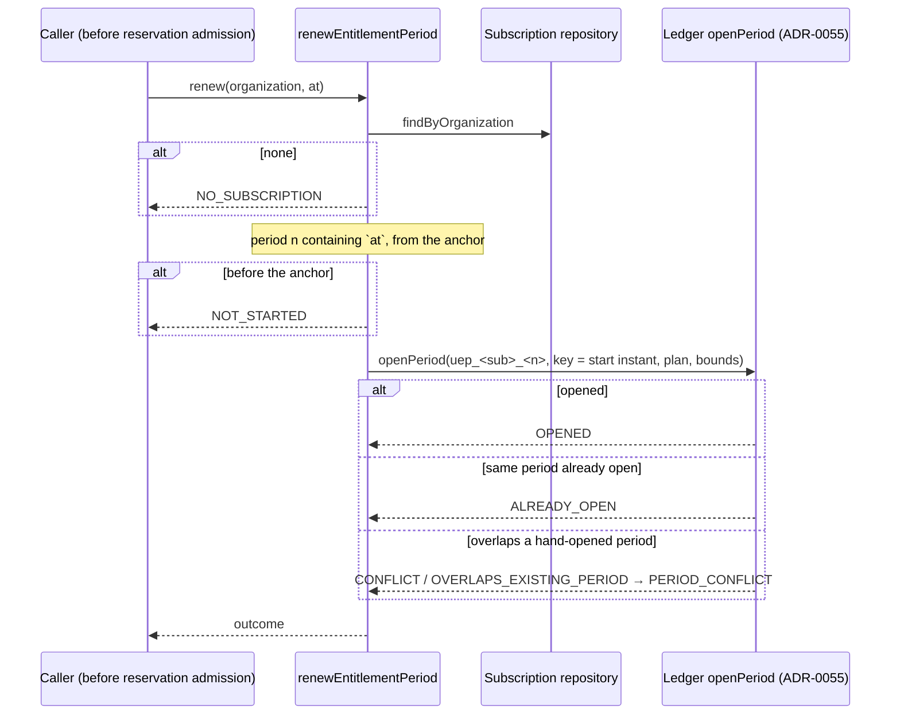

# Phase 6B completion — the organization subscription and period renewal

Branch: `claude/project-thread-az06z2`
Base: `2c529555095966a6cf5921fd4665197942567259` (PR #74 merge commit on `main`)
ADR: `docs/decisions/0056-organization-subscription-and-period-renewal.md`
Gap analysis: `docs/phase-6b-gap-analysis.md`

This is the completion record of the second Phase 6 milestone, not of Phase 6.
Later Phase 6 packages are listed under *Carried forward*.

Commits, oldest first:

| Commit | What it carries |
| --- | --- |
| `b416f4a` | the gap analysis |
| `382b8ca` | migration 18, the domain module, the repository, the suites, the advanced migration tripwires |
| `2da28fe` | ADR-0056 and the phase documentation |
| *(this commit)* | this record, and the branch name in the gap analysis's status line |

The exact head SHA is reported with the pull request rather than written into a
file that would have to contain its own hash.

## What this phase adds

- **Migration 18** — `organization_subscriptions` and the `SubscriptionChannel`
  enum: plan, channel, renewal anchor and commercial reference, one row per
  organization. A CHECK keeps Enterprise sales-assisted only and the commercial
  reference non-empty; the organization foreign key is `RESTRICT`. Additive only.
- **The domain module** (`packages/domain/src/entitlement/subscription.ts`) —
  monthly period bounds from the anchor (UTC, clamped to month end, no drift),
  the period containing an instant, deterministic period identity, provisioning
  validation, and `renewEntitlementPeriod`.
- **The repository** (`packages/database/src/subscription-repository.ts`) —
  `provision` (written once, replay-safe, race-safe, audited) and
  `findByOrganization`.

## The renewal sequence

## Lock order

Unchanged. Renewal takes only what `openPeriod` already takes — its own
organization-scoped period-opening lock, and nothing after it. Provisioning takes
no advisory lock: the unique organization id orders two first provisions. The
shape test that keeps every advisory-lock formula in `cost-admission-lock.ts`
still passes.

## Verification

Measured on the committed tree `8dd0a60` (commit `2da28fe`), against a local
PostgreSQL 16 configured like CI.

| Check | Result |
| --- | --- |
| `pnpm lint` | clean |
| `pnpm typecheck` (root, all packages, `tests/integration`) | clean |
| `pnpm test` | **4715 / 4715**, 150 files (subscription: 21 arithmetic/renewal + 4 shape/dormancy) |
| `pnpm test:db` | **1205 / 1205**, 39 files (the subscription suite: 20) |
| `pnpm build` | Next.js production build succeeded |
| `prisma migrate status` | 19 migrations, schema up to date |
| `prisma migrate diff --from-migrations … --to-schema-datamodel --exit-code` | no difference |

CI on the pull request's exact head is reported with the pull request.

## Mutation ledger

One textual edit per definition, at an anchor that must occur exactly once, run
against the entitlement unit suite and/or the subscription database suite; every
mutated file is restored and re-hashed, and a SHA-256 manifest of all 717 files
in the working tree is compared before and after the pass.

**Authoritative: 31 run, 31 killed, 0 survivors, 0 anchor-missing**, in one
uninterrupted pass against the tree `8dd0a60` — the reviewed runtime tree. The
only later commit is this record (with a one-line branch-name correction in the
gap analysis), which changes no runtime, test, schema or migration file. All 717 files were byte-identical after the pass.

| ID | Category | Mutation | File | Killed by |
| --- | --- | --- | --- | --- |
| S01 | provision | a subscription with no commercial reference is accepted | `subscription.ts` | unit: 1 failing |
| S02 | provision | Enterprise is accepted on self-service | `subscription.ts` | unit: 1 failing |
| S03 | provision | an invalid anchor is accepted | `subscription.ts` | unit: 1 failing |
| S04 | months | the day is not clamped to the month's end | `subscription.ts` | unit: 6 failing |
| S05 | months | the month length is the previous month's | `subscription.ts` | unit: 7 failing |
| S06 | months | the time of day is dropped | `subscription.ts` | unit: 7 failing |
| S07 | months | months past December do not carry into the year | `subscription.ts` | unit: 5 failing |
| S08 | months | a period ends two months after it starts | `subscription.ts` | unit: 5 failing |
| S09 | boundary | the anchor instant itself is before the first period | `subscription.ts` | unit: 1 failing |
| S10 | boundary | a period's start instant belongs to the previous period | `subscription.ts` | unit: 3 failing |
| S11 | boundary | early in a month the instant is given the not-yet-started period | `subscription.ts` | unit: 4 failing |
| S12 | identity | the cycle key is the period's end | `subscription.ts` | unit: 2 failing |
| S13 | identity | the period id does not name the period | `subscription.ts` | unit: 2 failing |
| S14 | renewal | renewal records an actor | `subscription.ts` | unit: 1 failing |
| S15 | renewal | renewal opens every period on Enterprise | `subscription.ts` | unit: 1 failing |
| S16 | renewal | an overlapping hand-opened period is not surfaced | `subscription.ts` | unit: 1 failing |
| S17 | renewal | an organization with no subscription is not answered | `subscription.ts` | unit: 1 failing |
| R01 | replay | a different anchor is a replay | `subscription-repository.ts` | db: 1 failing |
| R02 | replay | a different channel is a replay | `subscription-repository.ts` | db: 1 failing |
| R03 | replay | a different subscription id is a replay | `subscription-repository.ts` | db: 2 failing |
| R04 | replay | a different plan is a replay | `subscription-repository.ts` | db: 1 failing |
| R05 | replay | a different commercial reference is a replay | `subscription-repository.ts` | db: 1 failing |
| R06 | provision | an unknown organization is not refused | `subscription-repository.ts` | db: 1 failing |
| R07 | audit | provisioning writes no audit entry | `subscription-repository.ts` | db: 2 failing |
| R08 | race | a subscription id held by another organization surfaces an error | `subscription-repository.ts` | db: 1 failing |
| R09 | race | the loser of an identical race is answered as a conflict | `subscription-repository.ts` | db: 1 failing |
| R10 | race | a unique violation is not recognised | `subscription-repository.ts` | db: 3 failing |
| R11 | mapping | a Standard row reads back as Premium | `subscription-repository.ts` | db: 4 failing |
| R12 | tenant | the subscription read is not scoped to the organization | `subscription-repository.ts` | db: 3 failing |
| R13 | provision | the plan is written as Standard whatever was sold | `subscription-repository.ts` | db: 2 failing |
| D01 | schema | the Enterprise channel CHECK is removed from the migration | `migration.sql` | unit: 1 failing |

"Killed by" names the first suite that failed and how many of its tests did.
S-mutations run the unit suite first, then the database suite; R-mutations run
the database suite only. Both race paths (R08–R10) are reproduced
**deterministically**: a Prisma query extension commits the rival provision from
another connection exactly between the contender's existence read and its insert.

Not defined, because they are equivalent by design: removing the repository's
existence read before the insert (the unique index and the catch answer the same
outcome, and the rolled-back transaction writes no audit entry), and passing the
caller's organization id instead of the subscription's to `openPeriod` (they are
equal whenever a subscription is found).

## Required phase documentation

| Item | Where |
| --- | --- |
| Architecture diagram | `docs/architecture.md` status table (Phase 6B row) |
| Entity-relationship diagram | `docs/er-diagram.md`, *Phase 6B — the organization subscription* |
| Critical sequence diagram | this record, *The renewal sequence* |
| OpenAPI / API change summary | **Not applicable** to HTTP: no route changed. Internal API: new `SubscriptionRepository` (`provision`, `findByOrganization`) and `renewEntitlementPeriod`; `@app/database` exports `createSubscriptionRepository` and `SUBSCRIPTION_AUDIT_ACTION` |
| Change log / release notes | the commit list above and the pull request description |
| Database migration notes | `docs/migration-notes.md`, *Phase 6B — the organization subscription* |
| Phase completion report | this file |

## Activation status

**Dormant.** No application code provisions a subscription or calls renewal, and
`reserve()` still has no production caller, so nothing in this phase changes what
any customer is charged. No timer, cron or loop is introduced. Paid Provider
Activation, production Provider credentials, production paid AI calls, production
scheduler activation and live Stripe charges all remain **BLOCKED**.

## Carried forward

- **Open decision gates:** what a customer regeneration costs in Units (from
  Phase 6A), and what happens to a self-service renewal whose payment fails (new;
  must be settled before self-service billing).
- Later Phase 6 packages: the customer-approved Unit purchase that grants a block;
  cancellation; upgrade (Base ceiling replacement, which needs a rule for the
  period already open) and downgrade; seats and storage blocks; Stripe
  self-service and sales-assisted billing; charged disclosure recomposition; the
  internal recovery budget; the Cost Safety Guard threshold; reconciliation and
  admin controls.
- The future reservation-admission caller should call `renewEntitlementPeriod`
  with the same instant it passes to `reserve()`.
