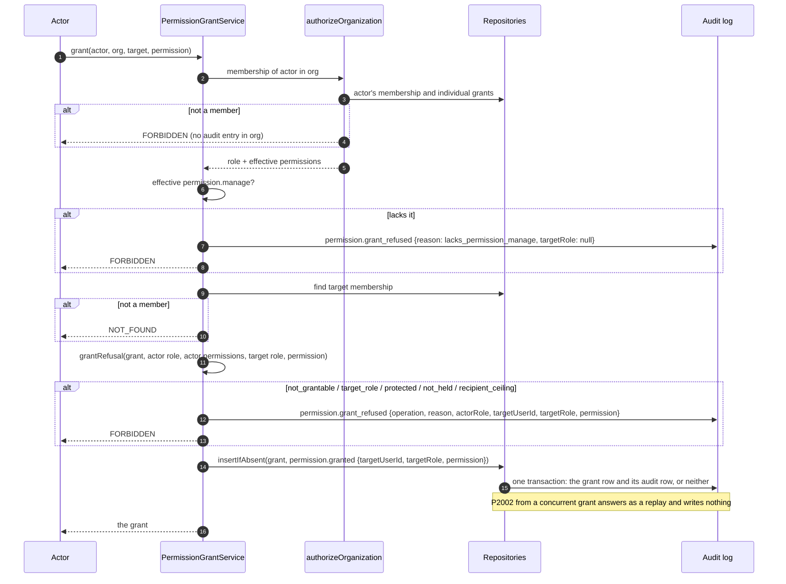

# Phase 6D completion — individual permission grants and the grant ceiling

Branch: `claude/project-thread-az06z2`
Base: `6f1aaafd81e2da786c9cee33ec2f386673d56379` (PR #76 merge commit on `main`)
ADR: `docs/decisions/0058-individual-permission-grants.md`
Gap analysis: `docs/phase-6d-gap-analysis.md`

This is the completion record of the second authorization package of Phase 6,
not of Phase 6. Later packages are listed under *Carried forward*.

Commits, oldest first:

| Commit | What it carries |
| --- | --- |
| `119b7c4` | the gap analysis |
| `69439d7` | migration 20, effective permissions and the grant ceiling, `PermissionGrantService`, the Prisma and in-memory repositories, the membership paths and web gates on effective permissions, the suites, the advanced migration tripwires |
| `45cae0d` | two database tests: cross-organization reads and single-permission revocation |
| `065e8f3` | ADR-0058, the phase documentation and this record |
| `6f024fe` | each grant change committed together with its audit entry (review of PR #77), with database tests that make the audit write fail |
| `2a59412` | this record, ADR-0058 and `TODO.md` updated for `6f024fe`, and the re-run mutation pass |
| *(this commit)* | ADR-0058 states what a concurrent membership change between the ceiling and the write can end in (second review of PR #77); `TODO.md` records the Phase 6C last-`OWNER` race |

The exact head SHA is reported with the pull request rather than written into a
file that would have to contain its own hash.

## What this phase adds

- **Migration 20**: `member_permission_grants`, one row per (organization, user,
  permission). A CHECK admits the 26 grantable permissions (never
  `video.share`), and the membership foreign key cascades. Additive only.
- **Effective permissions** (`effectivePermissions`, `effectivePermissionsOf`):
  the template plus the individual grants. `property.create` is never effective
  for `VIEWER` or `BILLING`.
  - `authorizeOrganization` checks effective permissions and returns them on
    the auth context, so every existing call site honours grants.
  - So do the membership paths (ADR-0057).
  - So do the three web control gates, through `listForUser`.
- **The grant ceiling** (`grantRefusal`) and **`PermissionGrantService`**
  (`grant`, `revoke`, `listForMember`):
  - granting or revoking needs `permission.manage`;
  - the target's role must be one the actor may manage;
  - `permission.manage`, `billing.manage` and `disclosure.none` are `OWNER`-only;
  - a non-`OWNER` delegates only what it holds;
  - `property.create` is never granted to `VIEWER` / `BILLING`;
  - `video.share` is never granted.

  Every refusal is audited as `permission.grant_refused`. A grant or
  revocation is written in one transaction with its own audit entry, so a crash
  or a failed audit write leaves neither; each is audited exactly once, also
  under concurrency.

Behavior a member can notice: none yet. No route or page grants or revokes, so
every member's effective permissions still equal its template's.

## The grant sequence

A revocation follows the same path, judged as `revoke` (so `property.create` can
be taken back from a `VIEWER` or `BILLING` member). It deletes the row and
records `permission.revoked` in one transaction, and answers `NOT_FOUND`,
writing nothing, when there was no row.

## Verification

Measured on the committed tree `e6fa9b9` (commit `6f024fe`), against a local
PostgreSQL 16 configured like CI.

| Check | Result |
| --- | --- |
| `pnpm lint` | clean |
| `pnpm typecheck` (root, all packages, `tests/integration`) | clean |
| `pnpm test` | **4884 / 4884**, 156 files (identity: 169, including the grant ceiling 26, the grant service 37 and the shape test 5) |
| `pnpm test:db` | **1230 / 1230**, 41 files (the permission-grants suite: 14) |
| `pnpm build` | Next.js production build succeeded |
| `prisma migrate status` | 21 migrations, schema up to date |
| `prisma migrate diff --from-migrations … --to-schema-datamodel --exit-code` | no difference |

CI on the pull request's exact head is reported with the pull request.

## Mutation ledger

One textual edit per definition, at an anchor that must occur exactly once, run
against the suite or suites listed for it; every mutated file is restored and
re-hashed, and a SHA-256 manifest of all 735 files in the working tree is
compared before and after the pass.

**Authoritative: 48 run, 48 killed, 0 survivors, 0 anchor-missing**, in one
uninterrupted pass against the tree `e6fa9b9` (commit `6f024fe`), the reviewed
runtime tree. The later commits, `2a59412` and this one, change documentation
only. All 735 files were byte-identical after the pass.

It supersedes the first pass (40 of 40 killed against `d1ff987`, commit
`45cae0d`): `6f024fe` moved the grant and revocation audit writes into the
repositories, so V04, V05, V07 and V11 were re-anchored there, and V14 to V16
and R06 to R10 were added for the audit entry and the shared transaction.

| ID | Category | Mutation | File | Killed by |
| --- | --- | --- | --- | --- |
| E01 | effective | effective permissions ignore individual grants | `roles.ts` | identity: 14 failing |
| E02 | effective | `property.create` becomes effective for every role | `roles.ts` | identity: 3 failing |
| E03 | effective | `BILLING` may hold `property.create` | `roles.ts` | identity: 3 failing |
| G01 | vocabulary | `video.share` becomes grantable | `roles.ts` | identity: 9 failing |
| G02 | protected | `billing.manage` is not protected | `roles.ts` | identity: 3 failing |
| G03 | protected | `disclosure.none` is not protected | `roles.ts` | identity: 2 failing |
| G04 | protected | `permission.manage` is not protected | `roles.ts` | identity: 2 failing |
| G05 | ceiling | the target's role is not asked | `roles.ts` | identity: 10 failing |
| G06 | ceiling | an `ADMIN` gets an `OWNER`'s grant authority | `roles.ts` | identity: 9 failing |
| G07 | ceiling | a non-`OWNER` may delegate what it does not hold | `roles.ts` | identity: 1 failing |
| G08 | ceiling | `property.create` may be granted to a `VIEWER` or `BILLING` member | `roles.ts` | identity: 4 failing |
| G09 | ceiling | `property.create` cannot be taken back from a `VIEWER` or `BILLING` member | `roles.ts` | identity: 3 failing |
| G10 | vocabulary | the grantable vocabulary is not asked | `roles.ts` | identity: 7 failing |
| Z01 | authorize | authorization checks the template only | `authorization.ts` | identity: 10 failing |
| Z02 | authorize | the auth context reports the template only | `authorization.ts` | identity: 2 failing |
| Z03 | authorize | a role change's permission check reads the template only | `membership-service.ts` | identity: 1 failing |
| Z04 | authorize | the organization list reports template permissions only | `organization-service.ts` | identity: 1 failing |
| V01 | service | `permission.manage` is not required | `permission-grant-service.ts` | identity: 4 failing |
| V02 | audit | a refusal writes no audit entry | `permission-grant-service.ts` | identity: 17 failing |
| V03 | audit | a refusal does not refuse | `permission-grant-service.ts` | identity: 17 failing |
| V04 | audit | a repeated grant is audited again (in-memory repository) | `in-memory.ts` | identity: 1 failing |
| V05 | audit | a grant writes no audit entry (in-memory repository) | `in-memory.ts` | identity: 2 failing |
| V06 | service | revoking a grant that does not exist succeeds | `permission-grant-service.ts` | identity: 2 failing |
| V07 | audit | a revocation writes no audit entry (in-memory repository) | `in-memory.ts` | identity: 1 failing |
| V08 | service | a revocation is judged as a grant | `permission-grant-service.ts` | identity: 4 failing |
| V09 | service | listing grants needs only membership | `permission-grant-service.ts` | identity: 1 failing |
| V10 | service | listing a non-member's grants is not NOT_FOUND | `permission-grant-service.ts` | identity: 1 failing |
| V11 | audit | a grant change's audit entry omits the target's role | `permission-grant-service.ts` | identity: 2 failing |
| V12 | service | the grant records its recipient as its granter | `permission-grant-service.ts` | identity: 1 failing |
| V13 | service | a target that is not a member is not NOT_FOUND | `permission-grant-service.ts` | identity: 1 failing |
| V14 | audit | a grant is audited as a revocation | `permission-grant-service.ts` | identity: 3 failing |
| V15 | audit | a revocation is audited as a grant | `permission-grant-service.ts` | identity: 1 failing |
| V16 | audit | a grant change is attributed to its target, not its actor | `permission-grant-service.ts` | identity: 2 failing |
| I01 | cascade | removing an in-memory membership keeps its grants | `in-memory.ts` | identity: 1 failing |
| R01 | repository | every insert failure is answered as a replay | `repositories.ts` | db: 2 failing |
| R02 | repository | a replayed grant is reported as created | `repositories.ts` | db: 1 failing |
| R03 | repository | removal always reports a grant removed | `repositories.ts` | db: 2 failing |
| R04 | repository | a member's grants are read across organizations | `repositories.ts` | db: 1 failing |
| R05 | repository | revoking one permission removes every grant of the member | `repositories.ts` | db: 1 failing |
| R06 | atomic audit | a grant writes no audit row | `repositories.ts` | db: 3 failing |
| R07 | atomic audit | the grant row commits outside its audit entry's transaction | `repositories.ts` | db: 1 failing |
| R08 | atomic audit | the revocation commits outside its audit entry's transaction | `repositories.ts` | db: 1 failing |
| R09 | atomic audit | a revocation writes no audit row | `repositories.ts` | db: 2 failing |
| R10 | atomic audit | a replayed grant writes an audit row | `repositories.ts` | db: 2 failing |
| S20 | call site | starting a scene needs only `unit.consume` | `generation-service.ts` | generation: 1 failing |
| W01 | web | the review board offers decisions to a video viewer | `review-view.ts` | review-view: 2 failing |
| D01 | migration | the CHECK admits `video.share` | `migration.sql` | identity: 1 failing |
| D02 | migration | removing a membership is restricted, not cascaded | `migration.sql` | identity: 1 failing |

"Killed by" names the first suite that failed and how many of its tests did.
Mutations with both suites listed run the identity unit suites first, then the
permission-grants database suite.

**S20**, which Phase 6C recorded as equivalent under the templates, is killed
now. A `VIEWER` granted `unit.consume` but not `video.generate` is refused a
scene start, so dropping `video.generate` from the check is observable.

Not defined, because they are equivalent by design:

- **The inviter's effective permissions at acceptance.** Reading the inviter's
  template instead gives the same answer: only `OWNER` and `ADMIN` may assign any
  role, and both hold `member.manage` by template.
- **Either half of the repository's replay guard on its own.** For a non-unique
  failure, the `P2002` test and the "row not found after the conflict" test each
  rethrow the error, so removing one leaves the other. R01 removes both and is
  killed.
- **The unknown-permission guard in the row mapper.** The table's CHECK makes it
  unreachable.

## Required phase documentation

| Item | Where |
| --- | --- |
| Architecture diagram | `docs/architecture.md` status table (Phase 6D identity row) |
| Entity-relationship diagram | `docs/er-diagram.md`, `MEMBER_PERMISSION_GRANTS` and *Phase 6D — individual permission grants* |
| Critical sequence diagram | this record, *The grant sequence* |
| OpenAPI / API change summary | **Not applicable** to HTTP: no route was added, removed or changed. Internal API: `PermissionGrantService` (`grant`, `revoke`, `listForMember`), `PermissionGrantRepository` on `IdentityRepositories`, `GRANTABLE_PERMISSIONS`, `PROTECTED_PERMISSIONS`, `isPermission`, `effectivePermissions`, `grantRefusal`, `effectivePermissionsOf`. `AuthContext` and `UserOrganization` gain `permissions`; `buildReviewBoard` takes effective permissions instead of a role |
| Change log / release notes | the commit list above and the pull request description |
| Database migration notes | `docs/migration-notes.md`, *Phase 6D — individual permission grants* |
| Phase completion report | this file |

## Activation status

**Dormant.** No HTTP route or page grants or revokes, so no member holds a
grant and every effective permission equals the template's. Nothing commercial
is built, Mode C is not built, and no timer, cron or loop is introduced. Paid
Provider Activation, production Provider credentials, production paid AI calls,
production scheduler activation and live Stripe charges all remain **BLOCKED**.

## Carried forward

- **Authorization still to build:**
  - groups and group permissions. Each group path asks the same ceiling, no
    group may carry `disclosure.none`, and group deletion is `OWNER`/`ADMIN`-only.
  - Property-rooted row Scope (the responsible-user and group assignments).

  Until then every role reaches every Property of its organization.
- **MFA** for `OWNER`, `ADMIN` and every holder of `permission.manage` or
  `billing.manage`, before any member-management or grant UI ships.
- The Phase 6C and 6D choices ADR-0052 did not make, recorded in
  `docs/decisions/TODO.md` for confirmation.
- The Phase 6C membership changes (role change, removal, invitation
  acceptance) still append their audit entry after the change, not in its
  transaction. Their last-`OWNER` check is not race-free either: two `OWNER`s
  demoting each other at once could leave none. Both are recorded in
  `docs/decisions/TODO.md`; no route calls these changes yet.
- **Open decision gates** from earlier packages:
  - what a customer regeneration costs in Units;
  - what happens to a self-service renewal whose payment fails.
- Later Phase 6 commercial packages:
  - the customer-approved Unit purchase;
  - cancellation, upgrade and downgrade;
  - seats and storage blocks;
  - Stripe billing;
  - charged disclosure recomposition and Mode C admission;
  - the internal recovery budget;
  - the Cost Safety Guard threshold;
  - reconciliation and admin controls.
