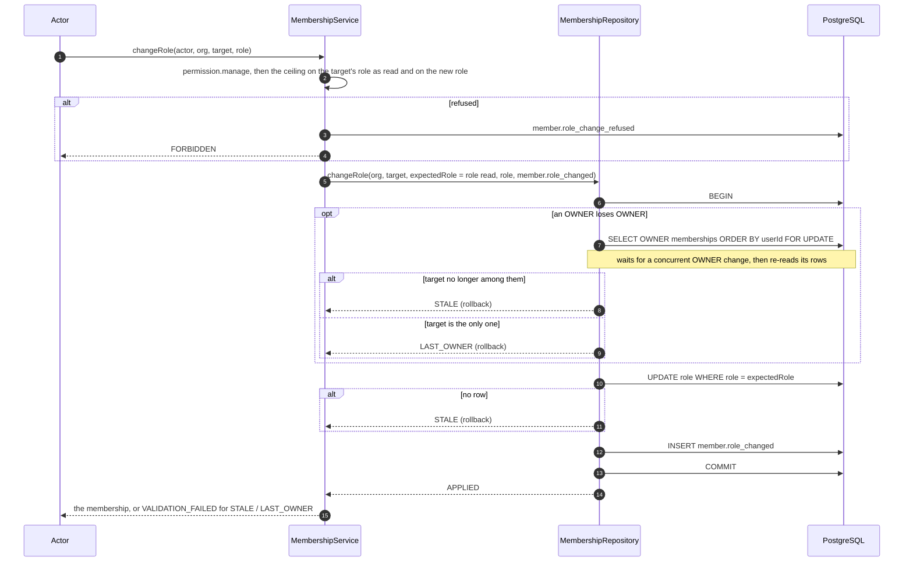

# Phase 6E completion — membership changes made atomic and race-free

Branch: `claude/project-thread-az06z2`
Base: `0f0dd53` (PR #77 merge commit on `main`)
ADR: `docs/decisions/0059-atomic-membership-changes.md`
Gap analysis: `docs/phase-6e-gap-analysis.md`

This is the completion record of the third authorization package of Phase 6,
not of Phase 6. Later packages are listed under *Carried forward*.

Commits, oldest first:

| Commit | What it carries |
| --- | --- |
| `072fc32` | the gap analysis |
| `d8e988c` | the repository ports, their Prisma and in-memory implementations, and `MembershipService` on top of them |
| `19a5a1d` | the unit and database suites |
| `bb3f497` | the lifecycle database test asserts each audit row's resource, not their order |
| `944e133` | ADR-0059, the phase documentation and this record |
| `a8d4fba` | an acceptance's membership conflict is classified from the error itself, not by reading the membership again (review of PR #78) |
| *(this commit)* | this record updated for `a8d4fba`, with the re-run checks and mutation pass |

The exact head SHA is reported with the pull request rather than written into a
file that would have to contain its own hash.

## What this phase changes

- **One transaction per membership change.** The repository writes the change
  and its audit entry together, or neither:
  - an invitation and `invitation.created` (`InvitationRepository.create`);
  - an acceptance: the invitation `ACCEPTED`, the membership and
    `invitation.accepted` (`InvitationRepository.accept`);
  - a role change and `member.role_changed` (`MembershipRepository.changeRole`);
  - a removal, its grants by cascade, and `member.removed`
    (`MembershipRepository.remove`).
- **A change applies only to what it was checked against.** A role change or
  removal names the role its ceiling saw and writes nothing if the member holds
  another now (`STALE`, answered `VALIDATION_FAILED`). An invitation leaves
  `PENDING` exactly once; expiry no longer overwrites an acceptance.
- **The last `OWNER` under a lock.** Demoting or removing an `OWNER` locks the
  organization's `OWNER` memberships in `userId` order, counts them, and writes,
  in one transaction (`LAST_OWNER`, answered `VALIDATION_FAILED` as before).
- `MembershipRepository.updateRole` and `InvitationRepository.update` are gone;
  the service no longer counts `OWNER`s itself.

Behavior a member can notice: none. No route or page calls these operations,
and every sequential outcome, message and audit entry is what it was.

## The role change sequence

A removal follows the same path with `DELETE … WHERE role = expectedRole` (its
grants cascade) and `member.removed`. An acceptance moves the invitation with
`UPDATE … WHERE status = 'PENDING'`, creates the membership (a unique-key
conflict rolls everything back as `ALREADY_MEMBER`) and writes
`invitation.accepted`.

## Verification

Measured on the committed tree `506b73b` (commit `a8d4fba`), against a local
PostgreSQL 16 configured like CI.

| Check | Result |
| --- | --- |
| `pnpm lint` | clean |
| `pnpm typecheck` (root, all packages, `tests/integration`) | clean |
| `pnpm test` | **4890 / 4890**, 157 files (identity: 175, including the new concurrency suite 6) |
| `pnpm test:db` | **1245 / 1245**, 42 files (the membership-changes suite: 15) |
| `pnpm build` | Next.js production build succeeded |
| `prisma migrate status` | 21 migrations, schema up to date (no new migration) |

CI on the pull request's exact head is reported with the pull request.

The racing tests are deterministic. A third transaction locks the contested rows
and is released only once every contender is waiting on a lock, so each
contender has read what it checks before any writes. With `FOR UPDATE` removed,
both `OWNER` races fail (L01).

## Mutation ledger

One textual edit per definition, at an anchor that must occur exactly once, run
against the suite or suites listed for it; every mutated file is restored and
re-hashed, and a SHA-256 manifest of all 738 files in the working tree is
compared before and after the pass.

**Authoritative: 41 run, 41 killed, 0 survivors, 0 broken, 0 anchor-missing**,
in one uninterrupted pass against the tree `506b73b` (commit `a8d4fba`), the
reviewed runtime tree. The only later commit is this one, which changes
documentation only. All 740 files were byte-identical after the pass.

It supersedes two earlier passes:
- On the tree `32a2117` (commit `bb3f497`), a first pass reported 40 of 40
  killed, but S01 and S02 were "killed" by mutants that did not parse
  (`void (…,)`), not by a failing test. They were redefined to a no-op call
  (`Array.of(…)`), and the harness now counts a kill only when tests ran and
  failed; anything else is reported as broken.
- The second pass on that tree killed all 40 with none broken.
- `a8d4fba` then replaced the acceptance's second read with a check of the
  conflict's model, so P08 was added for that check.

| ID | Category | Mutation | File | Killed by |
| --- | --- | --- | --- | --- |
| L01 | lock | the `OWNER` rows are counted without a lock | `repositories.ts` | db: 2 failing |
| L02 | last owner | one remaining `OWNER` may be taken away | `repositories.ts` | db: 3 failing |
| L03 | last owner | a member who is no `OWNER` is answered `LAST_OWNER`, not `STALE` | `repositories.ts` | db: 1 failing |
| L04 | last owner | a role change takes an `OWNER` away unchecked | `repositories.ts` | db: 2 failing |
| L05 | last owner | a removal takes an `OWNER` away unchecked | `repositories.ts` | db: 2 failing |
| L06 | last owner | a role change ignores the refusal | `repositories.ts` | db: 2 failing |
| L07 | last owner | a removal ignores the refusal | `repositories.ts` | db: 2 failing |
| C01 | stale role | a role change applies whatever role the member now holds | `repositories.ts` | db: 1 failing |
| C02 | stale role | a removal applies whatever role the member now holds | `repositories.ts` | db: 1 failing |
| A01 | atomic audit | a role change commits outside its audit entry's transaction | `repositories.ts` | db: 3 failing |
| A02 | atomic audit | a removal commits outside its audit entry's transaction | `repositories.ts` | db: 3 failing |
| A03 | atomic audit | an invitation commits outside its audit entry's transaction | `repositories.ts` | db: 1 failing |
| A04 | atomic audit | an acceptance marks the invitation outside its audit entry's transaction | `repositories.ts` | db: 2 failing |
| A05 | atomic audit | an acceptance creates the membership outside its audit entry's transaction | `repositories.ts` | db: 1 failing |
| A06 | atomic audit | a role change writes no audit row | `repositories.ts` | db: 3 failing |
| A07 | atomic audit | a removal writes no audit row | `repositories.ts` | db: 3 failing |
| A08 | atomic audit | an invitation writes no audit row | `repositories.ts` | db: 2 failing |
| A09 | atomic audit | an acceptance writes no audit row | `repositories.ts` | db: 4 failing |
| P01 | acceptance | an invitation is accepted whatever its status | `repositories.ts` | db: 2 failing |
| P02 | acceptance | an acceptance of an invitation no longer pending still writes | `repositories.ts` | db: 2 failing |
| P03 | acceptance | an accepted invitation stays `PENDING` | `repositories.ts` | db: 3 failing |
| P04 | acceptance | an acceptance grants a role other than the invitation's | `repositories.ts` | db: 2 failing |
| P05 | acceptance | an acceptance by an existing member fails instead of answering `ALREADY_MEMBER` | `repositories.ts` | db: 1 failing |
| P06 | expiry | expiry overwrites an accepted invitation | `repositories.ts` | db: 1 failing |
| P07 | expiry | expiry leaves a pending invitation pending | `repositories.ts` | db: 1 failing |
| P08 | acceptance | a membership conflict is not recognized by its model | `repositories.ts` | db: 1 failing |
| S01 | service | a role change that wrote nothing is answered as done | `membership-service.ts` | identity: 4 failing |
| S02 | service | a removal that wrote nothing is answered as done | `membership-service.ts` | identity: 3 failing |
| S03 | service | `LAST_OWNER` is not refused | `membership-service.ts` | identity: 4 failing |
| S04 | service | `STALE` is not refused | `membership-service.ts` | identity: 2 failing |
| S05 | service | a role change is checked against the requested role, not the one the ceiling saw | `membership-service.ts` | identity: 9 failing |
| S06 | service | an acceptance of a used invitation is not refused | `membership-service.ts` | identity: 1 failing |
| S07 | service | an acceptance by an existing member is not refused | `membership-service.ts` | identity: 1 failing |
| S08 | service | an expired invitation is not marked expired | `membership-service.ts` | identity: 1 failing |
| S09 | service | an acceptance is attributed to the inviter | `membership-service.ts` | db: 1 failing |
| S10 | service | an invitation's audit entry names the organization, not the invitation | `membership-service.ts` | db: 1 failing |
| I01 | in-memory | the last `OWNER` may be taken away (in-memory repository) | `in-memory.ts` | identity: 4 failing |
| I02 | in-memory | a role change applies whatever role the member now holds (in-memory repository) | `in-memory.ts` | identity: 1 failing |
| I03 | in-memory | a removal applies whatever role the member now holds (in-memory repository) | `in-memory.ts` | identity: 1 failing |
| I04 | in-memory | an invitation is accepted whatever its status (in-memory repository) | `in-memory.ts` | identity: 1 failing |
| I05 | in-memory | an existing member's acceptance writes (in-memory repository) | `in-memory.ts` | identity: 1 failing |

"Killed by" names the first suite that failed and how many of its tests did.
Mutations with both suites listed run the identity unit suites first, then the
membership-changes database suite.

Not defined, because they are equivalent or not observable by a test:

- **Dropping `ORDER BY "userId"` from the lock.** It prevents a deadlock between
  two lockers that scan the `OWNER` rows in different orders. One scan of a
  handful of rows returns them in one physical order, so no test can make two
  scans disagree.
- **Dropping the model check from the acceptance's `ALREADY_MEMBER` guard**,
  leaving `P2002` alone. Inside the acceptance only the membership insert can
  raise `P2002`: the invitation update changes no unique column, and audit ids
  are generated. P08, which names the wrong model, is killed.

## Required phase documentation

| Item | Where |
| --- | --- |
| Architecture diagram | `docs/architecture.md` status table (Phase 6E identity row) |
| Entity-relationship diagram | **Not applicable**: no entity, column or constraint changed (`docs/er-diagram.md` says so under *Phase 6E*) |
| Critical sequence diagram | this record, *The role change sequence* |
| OpenAPI / API change summary | **Not applicable** to HTTP: no route was added, removed or changed. Internal API: `MembershipRepository.changeRole` and `remove` take the expected role and the audit entry and return `MembershipChangeOutcome`; `updateRole` is gone. `InvitationRepository.create` takes the audit entry; `update` is replaced by `expire` and `accept` (`InvitationAcceptance`). New types `MembershipChangeAudit`, `MembershipChangeOutcome`, `InvitationAcceptance` |
| Change log / release notes | the commit list above and the pull request description |
| Database migration notes | `docs/migration-notes.md`, *Phase 6E*: **Not applicable**, no migration |
| Phase completion report | this file |

## Activation status

**Dormant.** No HTTP route or page invites, accepts, changes a role or removes a
member. No timer, cron or loop is introduced. Paid Provider Activation,
production Provider credentials, production paid AI calls, production scheduler
activation and live Stripe charges all remain **BLOCKED**.

## Carried forward

- **Authorization still to build:**
  - groups and group permissions. Each group path asks the ceiling under a lock
    on what the ceiling reads (ADR-0059), no group may carry `disclosure.none`,
    and group deletion is `OWNER`/`ADMIN`-only;
  - Property-rooted row Scope (the responsible-user and group assignments).

  Until then every role reaches every Property of its organization.
- **MFA** for `OWNER`, `ADMIN` and every holder of `permission.manage` or
  `billing.manage`, before any member-management or grant UI ships.
- Recorded in `docs/decisions/TODO.md`:
  - two concurrent invitations of the same email can both be created (a partial
    unique index, that is, a migration, would close it);
  - organization creation (`POST /api/organizations`) writes the
    organization, its founding `OWNER` and `organization.created` separately.
- The Phase 6C and 6D choices ADR-0052 did not make, recorded in `TODO.md` for
  confirmation.
- **Open decision gates** from earlier packages:
  - what a customer regeneration costs in Units;
  - what happens to a self-service renewal whose payment fails.
- Later Phase 6 commercial packages:
  - the customer-approved Unit purchase;
  - cancellation, upgrade and downgrade;
  - seats and storage blocks;
  - Stripe billing;
  - charged disclosure recomposition and Mode C admission;
  - the internal recovery budget;
  - the Cost Safety Guard threshold;
  - reconciliation and admin controls.
