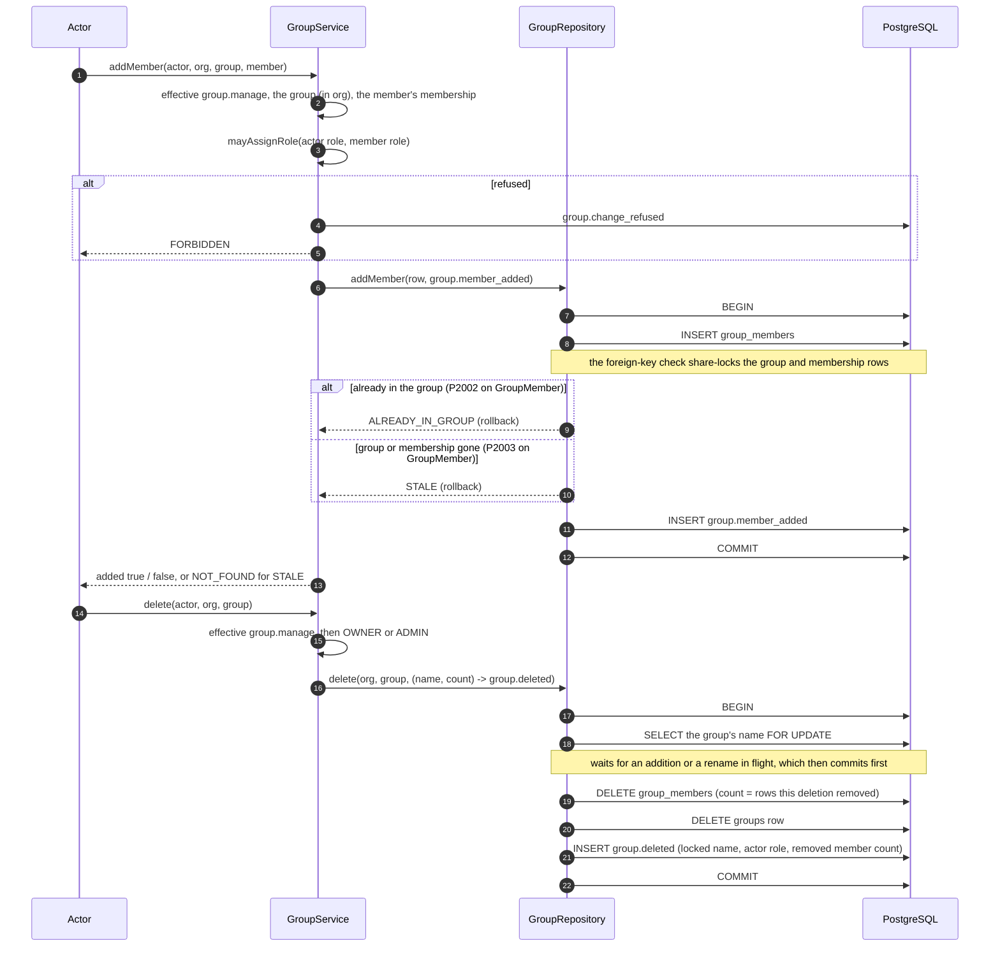

# Phase 6F completion — groups and group membership

Branch: `claude/project-thread-az06z2`
Base: `95cbedd` (PR #78 merge commit on `main`)
ADR: `docs/decisions/0060-groups-and-group-membership.md`
Gap analysis: `docs/phase-6f-gap-analysis.md`

This is the completion record of the fourth authorization package of Phase 6,
not of Phase 6. Later packages are listed under *Carried forward*.

Commits, oldest first:

| Commit | What it carries |
| --- | --- |
| `bc1fd39` | the gap analysis |
| `7163f70` | migration 21, the Prisma models, the `GroupRepository` port with its Prisma and in-memory implementations, `GroupService`, its unit suite and shape test, and the earlier phases' migration pins moved to migration 21 |
| `d522bb8` | the database suite |
| `0544035` | a racing deletion, and the in-memory repository's constraints, under test |
| `3758c9e` | ADR-0060, the phase documentation and the first version of this record |
| `49ad77c` | the deletion's audit entry names the group as the deletion locked it (review of PR #79) |
| *(this commit)* | this record and ADR-0060, updated for `49ad77c` |

The exact head SHA is reported with the pull request rather than written into a
file that would have to contain its own hash.

## What this phase changes

- **Migration 21: `groups` and `group_members`.**
  - A group belongs to one organization, and its name is unique there, trimmed
    and 1 to 100 characters (a CHECK).
  - A member row's two composite foreign keys both carry the organization, so
    it can never link a group of one organization to a member of another.
  - Deleting a group, or removing a member from the organization, removes the
    member rows.
- **`GroupService`.** It creates, renames, deletes and lists groups, and adds,
  removes and lists members:
  - `group.view` to list;
  - `group.manage` to change;
  - deletion also needs the `OWNER` or `ADMIN` role;
  - a membership change also needs the role-assignment ceiling on the member's
    role.
- **Audit.** Each change commits with its `group.*` audit entry in one
  transaction. Every refusal of a member is audited as `group.change_refused`.
- **Concurrency.**
  - A rename applies only to the name it was checked against.
  - A deletion locks the group row, then counts the members it removes and
    records the name it locked.
  - A repeated addition is a no-op.
  - An addition whose group or member is gone writes nothing.

Behavior a member can notice: none. No route or page calls `GroupService`, and a
group confers no permission and no row access.

## The membership addition and deletion sequence

## Verification

Measured on the committed tree `0af52bc` (commit `49ad77c`), against a local
PostgreSQL 16 configured like CI.

| Check | Result |
| --- | --- |
| `pnpm lint` | clean |
| `pnpm typecheck` (root, all packages, `tests/integration`) | clean |
| `pnpm test` | **4959 / 4959**, 159 files (the group service suite: 63; the shape test: 6) |
| `pnpm test:db` | **1273 / 1273**, 43 files (the groups suite: 28) |
| `pnpm build` | Next.js production build succeeded |
| `prisma migrate diff` (migrations → schema) | no difference |
| `prisma migrate status` | 22 migrations, schema up to date |

CI on the pull request's exact head is reported with the pull request.

A full `pnpm test:db` run on the pull request's first tree, `93216da`, failed
one test outside this phase: "gives two PROCESSING runners one history and at
most one transfer", in the provider-output suite. Its race allows an
interleaving the assertion does not, and the product behaves correctly under it.
It is recorded in `docs/decisions/TODO.md` (*Found in Phase 6F*). The re-run on
that tree passed, as did the run above.

The database races are deterministic. A third transaction holds the contested
lock, or runs the competing change and holds it uncommitted, until every
contender is waiting on a lock. By then each contender has read what it checks,
and none has written.

## Mutation ledger

One textual edit per definition, at an anchor that must occur exactly once, run
against the suite or suites listed for it. Every mutated file is restored and
re-hashed. A SHA-256 manifest of all 750 files in the working tree is
compared before and after the pass. A kill counts only when tests ran and
failed; a mutant that does not parse would count as broken.

**Authoritative: 59 run, 59 killed, 0 survivors, 0 broken, 0
anchor-missing**, in one uninterrupted pass against the tree `0af52bc` (commit
`49ad77c`), the reviewed runtime tree. The only later commit is this one, which
changes documentation only. All 750 files were byte-identical after the
pass.

| ID | Category | Mutation | File | Killed by |
| --- | --- | --- | --- | --- |
| S01 | authority | a change needs no `group.manage` | `group-service.ts` | identity: 11 failing |
| S02 | protected delete | any holder of `group.manage` may delete a group | `group-service.ts` | identity: 2 failing |
| S03 | protected delete | a `MANAGER`, not an `ADMIN`, may delete a group | `group-service.ts` | identity: 4 failing |
| S04 | ceiling | a membership change skips the role-assignment ceiling | `group-service.ts` | identity: 7 failing |
| S05 | ceiling | the ceiling is asked the wrong way round | `group-service.ts` | identity: 21 failing |
| S06 | refusal | a refusal is audited as a deletion | `group-service.ts` | identity: 18 failing |
| S07 | refusal | a refusal lets the change through | `group-service.ts` | identity: 20 failing |
| S08 | refusal | a name is validated before the actor's authority | `group-service.ts` | identity: 1 failing |
| S09 | listing | listing groups needs no `group.view` | `group-service.ts` | identity: 1 failing |
| S10 | listing | listing members needs no `group.view` | `group-service.ts` | identity: 1 failing |
| N01 | name | a name is stored untrimmed | `group-service.ts` | identity: 5 failing |
| N02 | name | a name one character too long is accepted | `group-service.ts` | identity: 1 failing |
| N03 | name | an empty name is accepted | `group-service.ts` | identity: 2 failing |
| N04 | name | a taken name is not refused at creation | `group-service.ts` | identity: 2 failing |
| N05 | name | a taken name is not refused at rename | `group-service.ts` | identity: 1 failing |
| N06 | rename | a rename to the current name is written and audited | `group-service.ts` | identity: 1 failing |
| N07 | rename | a stale rename is answered as done | `group-service.ts` | identity: 2 failing |
| N08 | rename | a rename records the new name as the previous one | `group-service.ts` | identity: 2 failing |
| O01 | deletion | a deletion of a group already gone is answered as done | `group-service.ts` | identity: 2 failing |
| O02 | deletion | a deletion records no member count | `group-service.ts` | identity: 2 failing |
| O07 | deletion | a deletion records the name read before the group was locked | `group-service.ts` | identity: 1 failing |
| O03 | addition | a stale addition is answered as done | `group-service.ts` | db: 2 failing |
| O04 | addition | a repeated addition is answered as an addition | `group-service.ts` | identity: 2 failing |
| O05 | removal | removing a member not in the group is answered as done | `group-service.ts` | identity: 2 failing |
| O06 | audit | a membership change records the actor's role as the target's | `group-service.ts` | identity: 9 failing |
| L01 | lock | a deletion counts its members without locking the group | `group-repository.ts` | db: 2 failing |
| L02 | lock | a deletion counts members a concurrent removal took out | `group-repository.ts` | db: 1 failing |
| L03 | deletion | a deletion of a group that is gone still writes | `group-repository.ts` | db: 3 failing |
| T01 | tenant | find ignores the organization | `group-repository.ts` | db: 1 failing |
| T02 | tenant | listing groups ignores the organization | `group-repository.ts` | db: 1 failing |
| T03 | tenant | a rename ignores the organization | `group-repository.ts` | db: 1 failing |
| T04 | tenant | a deletion ignores the organization | `group-repository.ts` | db: 2 failing |
| T05 | tenant | listing members ignores the organization | `group-repository.ts` | db: 1 failing |
| T06 | tenant | a removal ignores the organization | `group-repository.ts` | db: 1 failing |
| C01 | rename | a rename applies whatever the group is now named | `group-repository.ts` | db: 2 failing |
| C02 | addition | a member already in the group is not recognized | `group-repository.ts` | db: 2 failing |
| C03 | addition | a missing group or member is not recognized | `group-repository.ts` | db: 3 failing |
| C04 | addition | an audit row's missing organization is taken for a missing group | `group-repository.ts` | db: 4 failing |
| C05 | name | a name conflict is not recognized by its model | `group-repository.ts` | db: 4 failing |
| C06 | removal | a removal of a member not in the group still writes | `group-repository.ts` | db: 1 failing |
| A01 | atomic audit | a creation commits outside its audit entry's transaction | `group-repository.ts` | db: 1 failing |
| A02 | atomic audit | a rename commits outside its audit entry's transaction | `group-repository.ts` | db: 1 failing |
| A03 | atomic audit | a deletion removes members outside its audit entry's transaction | `group-repository.ts` | db: 1 failing |
| A04 | atomic audit | an addition commits outside its audit entry's transaction | `group-repository.ts` | db: 1 failing |
| A05 | atomic audit | a removal commits outside its audit entry's transaction | `group-repository.ts` | db: 1 failing |
| A06 | atomic audit | a creation writes no audit row | `group-repository.ts` | db: 3 failing |
| A07 | atomic audit | a rename writes no audit row | `group-repository.ts` | db: 3 failing |
| A08 | atomic audit | a deletion writes no audit row | `group-repository.ts` | db: 5 failing |
| A09 | atomic audit | an addition writes no audit row | `group-repository.ts` | db: 3 failing |
| A10 | atomic audit | a removal writes no audit row | `group-repository.ts` | db: 2 failing |
| I01 | in-memory | a taken name is accepted (in-memory repository) | `in-memory.ts` | identity: 2 failing |
| I02 | in-memory | a rename applies whatever the group is now named (in-memory repository) | `in-memory.ts` | identity: 2 failing |
| I03 | in-memory | a repeated addition writes again (in-memory repository) | `in-memory.ts` | identity: 2 failing |
| I04 | in-memory | a non-member joins a group (in-memory repository) | `in-memory.ts` | identity: 1 failing |
| I05 | in-memory | a member joins a missing group (in-memory repository) | `in-memory.ts` | identity: 1 failing |
| I06 | in-memory | a member removed from the organization stays in its groups (in-memory repository) | `in-memory.ts` | identity: 1 failing |
| I07 | in-memory | a deletion counts no members (in-memory repository) | `in-memory.ts` | identity: 2 failing |
| G01 | migration text | the name `CHECK` is dropped | `migration.sql` | identity: 1 failing |
| G02 | migration text | a group member's group key drops the organization | `migration.sql` | identity: 1 failing |

"Killed by" names the first suite that failed and how many of its tests failed.
Mutations with both suites listed run the identity unit suites first, then the
groups database suite. G01 and G02 edit the migration's text and are killed by
the shape test. The migration as applied is what the database suite tests.

Not defined, because they are not observable by a test:

- **Dropping the key check from the unique-conflict test**, leaving the model
  alone. Inside a group's creation or rename, a `P2002` on the `Group` model can
  only be the name: ids are generated. C05, which names the wrong model, is
  killed.
- **Dropping `ORDER BY` from a listing.** The orders are a convenience for
  callers, not a rule. One test asserts the name order of the in-memory listing,
  but none depends on the database's.

## Required phase documentation

| Item | Where |
| --- | --- |
| Architecture diagram | `docs/architecture.md` status table (Phase 6F identity row) |
| Entity-relationship diagram | `docs/er-diagram.md`: `GROUPS` and `GROUP_MEMBERS` in the implemented schema, and *Phase 6F* |
| Critical sequence diagram | this record, *The membership addition and deletion sequence* |
| OpenAPI / API change summary | **Not applicable** to HTTP: no route was added, removed or changed. Internal API: `GroupService` (`create`, `rename`, `delete`, `list`, `listMembers`, `addMember`, `removeMember`); `GroupRepository` and its outcome types `GroupCreation`, `GroupRename`, `GroupDeletion` (with `DeletedGroup`), `GroupMemberAddition`; `GroupChangeAudit`; `IdentityRepositories.groups`; the `Group` and `GroupMember` types; six `group.*` audit actions |
| Change log / release notes | the commit list above and the pull request description |
| Database migration notes | `docs/migration-notes.md`, *Phase 6F* (migration 21) |
| Phase completion report | this file |

## Activation status

**Dormant.** No HTTP route or page creates a group or changes its members. No
timer, cron or loop is introduced. Paid Provider Activation, production Provider
credentials, production paid AI calls, production scheduler activation and live
Stripe charges all remain **BLOCKED**.

## Carried forward

- **Group permissions:**
  - they are additive, with the grant ceiling on every group path;
  - an addition becomes a grant of each of the group's permissions, checked
    under a lock on the group row;
  - `disclosure.none` is impossible on a group;
  - `property.create` stays ineffective for `VIEWER` and `BILLING`.
- **Property-rooted row Scope.** It covers the responsible user and a
  Property's group, the `GROUP` and `OWN` predicates, and the creation-time
  assignments. After it, a group deletion ungroups its Properties and records
  how many. Until then every role reaches every Property of its organization.
- **MFA** for `OWNER`, `ADMIN` and every holder of `permission.manage` or
  `billing.manage`, before any member-management, grant or group UI ships.
- The Phase 6C, 6D and 6F choices ADR-0052 did not make, recorded in `TODO.md`
  for confirmation.
- Recorded in `TODO.md` from Phase 6E:
  - two concurrent invitations of the same email can both be created;
  - organization creation writes its rows separately.
- **Open decision gates** from earlier packages:
  - what a customer regeneration costs in Units;
  - what happens to a self-service renewal whose payment fails.
- Later Phase 6 commercial packages:
  - the customer-approved Unit purchase;
  - cancellation, upgrade and downgrade;
  - seats and storage blocks;
  - Stripe billing;
  - charged disclosure recomposition and Mode C admission;
  - the internal recovery budget;
  - the Cost Safety Guard threshold;
  - reconciliation and admin controls.
