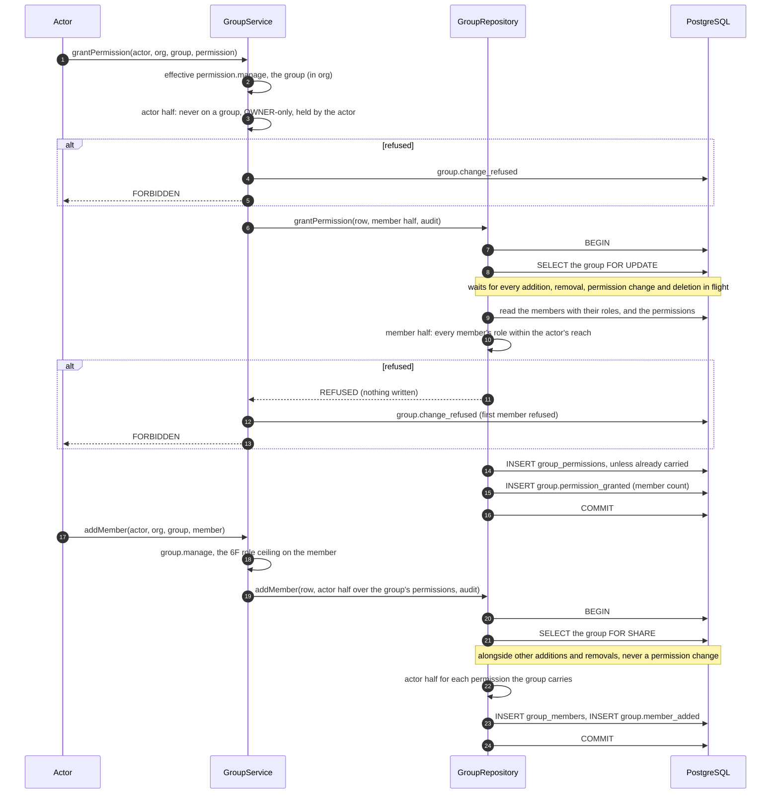

# Phase 6G completion — group permissions

Branch: `claude/project-thread-az06z2`
Base: `b5deb17` (PR #79 merge commit on `main`)
ADR: `docs/decisions/0061-group-permissions.md`
Gap analysis: `docs/phase-6g-gap-analysis.md`

This is the completion record of the fifth authorization package of Phase 6,
not of Phase 6. Later packages are listed under *Carried forward*.

Commits, oldest first:

| Commit | What it carries |
| --- | --- |
| `e5e3c05` | the gap analysis |
| `7ad8513` | migration 22, the Prisma model, the ceiling helpers in `roles.ts`, effective permissions with group permissions, the `GroupRepository` port with its Prisma and in-memory implementations, `GroupService`'s permission operations and the checks on the 6F paths, the unit suite and shape test, and the earlier phases' migration pins moved to migration 22 |
| `874bba9` | a member's group permissions read in one indexed join |
| `046ba24` | the database suite |
| `baa7829` | a revocation, and a grant on a deleted group, raced under test |
| *(this commit)* | ADR-0061, the phase documentation and this record |

The exact head SHA is reported with the pull request rather than written into a
file that would have to contain its own hash.

## What this phase changes

- **Migration 22: `group_permissions`.**
  - A row is one permission one group carries; the key is (group, permission).
  - Its foreign key carries the organization and cascades from the group.
  - A CHECK admits the grantable vocabulary less `disclosure.none` and the
    reserved `video.share`.
- **Effective permissions** are the template's, the individual grants and every
  group's permissions. A group never confers `disclosure.none` or `video.share`,
  whatever is stored, and `property.create` stays ineffective for `VIEWER` and
  `BILLING`.
- **`GroupService`** gives and takes a group's permissions (`permission.manage`)
  and lists them (`group.view`).
- **One rule on every group path.** Giving or taking a group permission, adding
  or removing a member of a group that carries any, and deleting such a group
  are each checked as if every member reached were granted, or revoked, each
  permission directly: `OWNER`-only protected permissions, the actor's own
  holdings, and the role-assignment ceiling on each member.
- **Concurrency.** Each check runs inside the change's transaction, on the group
  as locked: `FOR UPDATE` for permission changes and deletion, `FOR SHARE` for
  additions and removals.
- **Audit.** `group.permission_granted` and `group.permission_revoked` record the
  permission and how many members it reached, committed with the change. Every
  refusal is `group.change_refused`, naming the permission and the first member
  refused.

Behavior a member can notice: none. No route or page calls the new operations,
and no group carries a permission, so every authorization reads an empty set.

## The ceiling under the group lock

A deletion runs as the grant does, under `FOR UPDATE`, asking both halves of
every permission the group carries.

## Verification

Measured on the committed tree `96d247ab92f56b310284573677b3dcbfd8c55ef1` (commit `baa7829b0581976f4c641715ff85ad98a461ea87`), against a local
PostgreSQL 16 configured like CI.

| Check | Result |
| --- | --- |
| `pnpm lint` | clean |
| `pnpm typecheck` (root, all packages, `tests/integration`) | clean |
| `pnpm test` | **5021 / 5021**, 161 files (the group permissions suite: 57; the shape test: 5) |
| `pnpm test:db` | **1294 / 1294**, 44 files (the group permissions suite: 21; the groups suite: 28) |
| `pnpm build` | Next.js production build succeeded |
| `prisma migrate diff` (migrations → schema) | no difference |
| `prisma migrate status` | 23 migrations, schema up to date |

CI on the pull request's exact head is reported with the pull request.

The database races are deterministic. A third transaction runs the competing
change and holds it uncommitted, with the group locked as the repository locks
it, until every contender is waiting on a lock. Each case pairs a change with
one that would invalidate its check:
- an addition, and a deletion, waiting on a grant of `billing.manage`;
- a removal waiting on the revocation of `billing.manage`;
- a grant and a revocation waiting on the addition of an `OWNER`;
- a deletion waiting on the addition of an `OWNER`;
- a grant and a revocation waiting on the group's deletion;
- two grants of one permission.

## Mutation ledger

One textual edit per definition, at an anchor that must occur exactly once, run
against the suite or suites listed for it. Every mutated file is restored and
re-hashed. A SHA-256 manifest of all 755 files in the working tree is
compared before and after the pass. A kill counts only when tests ran and
failed; a mutant that does not parse would count as broken.

**Authoritative: 74 run, 74 killed, 0 survivors, 0 broken, 0
anchor-missing**, in one uninterrupted pass against the tree `96d247ab92f56b310284573677b3dcbfd8c55ef1` (commit
`baa7829b0581976f4c641715ff85ad98a461ea87`), the reviewed runtime tree. The only later commit is this one, which
changes documentation only. All 755 files were byte-identical after the
pass.

| # | Area | Mutation | File | Suites | Killed by |
| --- | --- | --- | --- | --- | --- |
| R01 | vocabulary | a group may carry disclosure.none | `roles.ts` | identity + group database | identity: 3 of 308 failed |
| R02 | vocabulary | the actor half lets anything outside a group's vocabulary through | `roles.ts` | identity + group database | identity: 2 of 306 failed |
| R03 | vocabulary | the actor half asks the individual vocabulary | `roles.ts` | identity + group database | identity: 1 of 306 failed |
| R04 | delegation | an OWNER is held to the delegation rules | `roles.ts` | identity + group database | identity: 19 of 306 failed |
| R05 | delegation | anyone may give an OWNER-only permission | `roles.ts` | identity + group database | identity: 14 of 306 failed |
| R06 | delegation | anyone may give what it does not hold | `roles.ts` | identity + group database | identity: 2 of 306 failed |
| R07 | effective | a group's permissions confer nothing | `roles.ts` | identity + group database | identity: 5 of 306 failed |
| R08 | effective | a group confers a stored permission it may not carry | `roles.ts` | identity + group database | identity: 1 of 306 failed |
| R09 | effective | a group's property.create escapes the recipient ceiling | `roles.ts` | identity + group database | identity: 2 of 306 failed |
| Z01 | effective | authorization reads no group permissions | `authorization.ts` | identity + group database | identity: 4 of 306 failed |
| P01 | authority | a permission change needs no permission.manage | `group-service.ts` | identity + group database | identity: 4 of 306 failed |
| P02 | authority | a permission change needs group.manage instead | `group-service.ts` | identity + group database | identity: 1 of 306 failed |
| P03 | actor half | a permission change skips the actor half | `group-service.ts` | identity + group database | identity: 5 of 306 failed |
| P04 | member half | a grant skips the member half | `group-service.ts` | identity + group database | identity: 4 of 306 failed |
| P05 | member half | a revocation skips the member half | `group-service.ts` | identity + group database | identity: 3 of 306 failed |
| P06 | refusal | a grant refused under the lock is answered as done | `group-service.ts` | identity + group database | identity: 4 of 306 failed |
| P07 | refusal | a revocation refused under the lock is answered as done | `group-service.ts` | identity + group database | identity: 3 of 306 failed |
| P08 | stale | a grant to a group deleted meanwhile is answered as done | `group-service.ts` | identity + group database | group database: 1 of 49 failed |
| P09 | stale | a revocation from a group deleted meanwhile is answered as done | `group-service.ts` | identity + group database | group database: 1 of 49 failed |
| P10 | revocation | revoking a permission not carried is answered as done | `group-service.ts` | identity + group database | identity: 1 of 306 failed |
| P11 | grant | a repeated grant is answered as a grant | `group-service.ts` | identity + group database | identity: 1 of 306 failed |
| P12 | audit | a grant records no member count | `group-service.ts` | identity + group database | identity: 1 of 306 failed |
| P13 | audit | a revocation is audited as a grant | `group-service.ts` | identity + group database | identity: 1 of 306 failed |
| P14 | audit | a grant's refusal under the lock names no member | `group-service.ts` | identity + group database | identity: 3 of 306 failed |
| P15 | listing | listing a group's permissions needs no group.view | `group-service.ts` | identity + group database | identity: 1 of 306 failed |
| P16 | tenant | listing permissions reaches another organization's group id | `group-service.ts` | identity + group database | identity: 1 of 306 failed |
| K01 | member half | the member half is asked the wrong way round | `group-service.ts` | identity + group database | identity: 12 of 306 failed |
| K02 | actor half | the actor half asks only the first permission | `group-service.ts` | identity + group database | identity: 1 of 306 failed |
| K03 | member half | a change giving nothing still reaches its members | `group-service.ts` | identity + group database | identity: 3 of 306 failed |
| M01 | addition | an addition skips the group's permissions | `group-service.ts` | identity + group database | identity: 3 of 306 failed |
| M02 | removal | a removal skips the group's permissions | `group-service.ts` | identity + group database | identity: 2 of 306 failed |
| M03 | refusal | an addition refused under the lock is answered as done | `group-service.ts` | identity + group database | identity: 3 of 306 failed |
| M04 | refusal | a removal refused under the lock is answered as done | `group-service.ts` | identity + group database | identity: 2 of 306 failed |
| M05 | audit | an addition's refusal records the actor's role as the member's | `group-service.ts` | identity + group database | identity: 2 of 306 failed |
| M06 | removal | removing a member not in the group is answered as done | `group-service.ts` | identity + group database | identity: 2 of 306 failed |
| M07 | addition | a stale addition is answered as done | `group-service.ts` | identity + group database | group database: 2 of 49 failed |
| M08 | addition | a repeated addition is answered as an addition | `group-service.ts` | identity + group database | identity: 2 of 306 failed |
| D01 | deletion | a deletion skips the actor half | `group-service.ts` | identity + group database | identity: 1 of 306 failed |
| D02 | deletion | a deletion skips the member half | `group-service.ts` | identity + group database | identity: 3 of 306 failed |
| D03 | refusal | a deletion refused under the lock is answered as done | `group-service.ts` | identity + group database | identity: 4 of 306 failed |
| D04 | deletion | a deletion of a group already gone is answered as done | `group-service.ts` | identity + group database | identity: 2 of 306 failed |
| L01 | lock | additions and removals take no lock on the group | `group-repository.ts` | group database | group database: 2 of 49 failed |
| L02 | lock | permission changes and deletions take no lock on the group | `group-repository.ts` | group database | group database: 7 of 49 failed |
| L03 | lock | a grant only share-locks the group | `group-repository.ts` | group database | group database: 2 of 49 failed |
| L04 | lock | a revocation only share-locks the group | `group-repository.ts` | group database | group database: 1 of 49 failed |
| L05 | lock | a deletion only share-locks the group | `group-repository.ts` | group database | group database: 2 of 49 failed |
| L06 | lock | a check sees the group's members without their roles | `group-repository.ts` | group database | group database: 3 of 49 failed |
| L07 | lock | a check sees none of the group's permissions | `group-repository.ts` | group database | group database: 6 of 49 failed |
| C01 | grant | a repeated grant writes again | `group-repository.ts` | group database | group database: 2 of 49 failed |
| C02 | revocation | revoking a permission not carried still writes | `group-repository.ts` | group database | group database: 1 of 49 failed |
| C03 | refusal | a refused grant still writes | `group-repository.ts` | group database | group database: 2 of 49 failed |
| C04 | refusal | a refused revocation still writes | `group-repository.ts` | group database | group database: 2 of 49 failed |
| C05 | refusal | a refused addition still writes | `group-repository.ts` | group database | group database: 3 of 49 failed |
| C06 | refusal | a refused removal still writes | `group-repository.ts` | group database | group database: 1 of 49 failed |
| C07 | refusal | a refused deletion still writes | `group-repository.ts` | group database | group database: 3 of 49 failed |
| C08 | stale | a grant to a group that is gone proceeds | `group-repository.ts` | group database | group database: 2 of 49 failed |
| T01 | tenant | listing a group's permissions ignores the organization | `group-repository.ts` | group database | group database: 1 of 49 failed |
| T02 | tenant | a member's group permissions ignore the organization | `group-repository.ts` | group database | group database: 1 of 49 failed |
| T03 | tenant | the exclusive group lock ignores the organization | `group-repository.ts` | group database | group database: 3 of 49 failed |
| A01 | atomic audit | a grant commits outside its audit entry's transaction | `group-repository.ts` | group database | group database: 3 of 49 failed |
| A02 | atomic audit | a revocation commits outside its audit entry's transaction | `group-repository.ts` | group database | group database: 1 of 49 failed |
| A03 | atomic audit | a grant writes no audit row | `group-repository.ts` | group database | group database: 3 of 49 failed |
| A04 | atomic audit | a revocation writes no audit row | `group-repository.ts` | group database | group database: 2 of 49 failed |
| I01 | in-memory | a grant skips its check (in-memory repository) | `in-memory.ts` | identity | identity: 4 of 306 failed |
| I02 | in-memory | a revocation skips its check (in-memory repository) | `in-memory.ts` | identity | identity: 3 of 306 failed |
| I03 | in-memory | an addition skips its check (in-memory repository) | `in-memory.ts` | identity | identity: 3 of 306 failed |
| I04 | in-memory | a removal skips its check (in-memory repository) | `in-memory.ts` | identity | identity: 2 of 306 failed |
| I05 | in-memory | a deletion skips its check (in-memory repository) | `in-memory.ts` | identity | identity: 4 of 306 failed |
| I06 | in-memory | a deletion leaves the group's permissions (in-memory repository) | `in-memory.ts` | identity | identity: 1 of 306 failed |
| I07 | in-memory | a member's group permissions ignore the organization (in-memory repository) | `in-memory.ts` | identity | identity: 1 of 306 failed |
| I08 | in-memory | a check sees the group's members without their roles (in-memory repository) | `in-memory.ts` | identity | identity: 6 of 306 failed |
| G01 | migration text | the CHECK admits disclosure.none | migration 22 | identity | identity: 1 of 306 failed |
| G02 | migration text | a permission row's group key drops the organization | migration 22 | identity | identity: 1 of 306 failed |
| G03 | migration text | deleting a group is refused while it carries permissions | migration 22 | identity | identity: 1 of 306 failed |

"Killed by" names the first suite that failed and how many of its tests failed.
Mutations with both suites listed run the identity unit suites first, then the
two group database suites. G01 to G03 edit the migration's text and are killed
by the shape test; the migration as applied is what the database suite tests.

Not defined, because they are not observable by a test:

- **An addition or removal taking `FOR UPDATE` instead of `FOR SHARE`.** It would
  serialize additions with each other, which costs concurrency but changes no
  outcome.
- **The shared-lock read ignoring the organization.** A member row's write is
  scoped by organization and its foreign key carries it, so an addition or
  removal against another organization's group writes nothing either way.
- **The lock's member read ignoring the organization.** The member rows' foreign
  key already binds them to the group's organization.
- **The in-memory repository's mirror of the CHECK.** The service refuses
  `disclosure.none` and `video.share` before any repository call; the database
  suite tests the CHECK itself.

## Required phase documentation

| Item | Where |
| --- | --- |
| Architecture diagram | `docs/architecture.md` status table (Phase 6G identity row) |
| Entity-relationship diagram | `docs/er-diagram.md`: `GROUP_PERMISSIONS` in the implemented schema, and *Phase 6G* |
| Critical sequence diagram | this record, *The ceiling under the group lock* |
| OpenAPI / API change summary | **Not applicable** to HTTP: no route was added, removed or changed. Internal API: `GroupService.grantPermission`, `revokePermission`, `listPermissions`; `GroupRepository.grantPermission`, `revokePermission`, `listPermissions`, `listPermissionsForMember`, and a ceiling check on `addMember`, `removeMember` and `delete`; the outcome types `GroupPermissionGrant`, `GroupPermissionRevocation`, `GroupMemberRemoval`, `GroupChangeRefused` (on every changing outcome); `LockedGroup`, `GroupCeilingCheck`, `GroupCeilingRefusal`; the `GroupPermission` type; `GROUP_GRANTABLE_PERMISSIONS`, `groupGrantRefusal`, and `effectivePermissions`'s group source; two `group.permission_*` audit actions |
| Change log / release notes | the commit list above and the pull request description |
| Database migration notes | `docs/migration-notes.md`, *Phase 6G* (migration 22) |
| Phase completion report | this file |

## Activation status

**Dormant.** No HTTP route or page gives a group a permission. No timer, cron or
loop is introduced. Paid Provider Activation, production Provider credentials,
production paid AI calls, production scheduler activation and live Stripe
charges all remain **BLOCKED**.

## Carried forward

- **Property-rooted row Scope.** It covers the responsible user and a
  Property's group, the `GROUP` and `OWN` predicates, and the creation-time
  assignments. After it, a group deletion ungroups its Properties and records
  how many. Until then every role reaches every Property of its organization.
- **MFA** for `OWNER`, `ADMIN` and every holder of `permission.manage` or
  `billing.manage`, before any member-management, grant or group UI ships.
- The Phase 6C, 6D, 6F and 6G choices ADR-0052 did not make, recorded in
  `TODO.md` for confirmation.
- Recorded in `TODO.md` from earlier packages:
  - two concurrent invitations of the same email can both be created;
  - organization creation writes its rows separately;
  - a provider-output race test asserts too much (test-only).
- **Open decision gates** from earlier packages:
  - what a customer regeneration costs in Units;
  - what happens to a self-service renewal whose payment fails.
- Later Phase 6 commercial packages:
  - the customer-approved Unit purchase;
  - cancellation, upgrade and downgrade;
  - seats and storage blocks;
  - Stripe billing;
  - charged disclosure recomposition and Mode C admission;
  - the internal recovery budget;
  - the Cost Safety Guard threshold;
  - reconciliation and admin controls.
