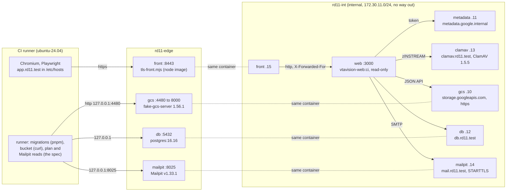
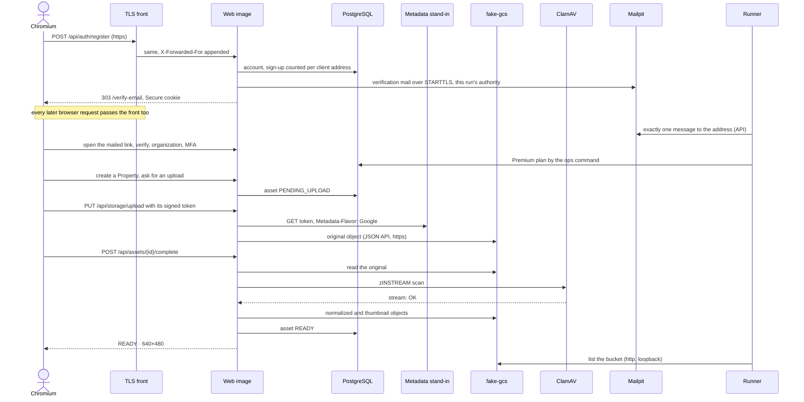

# Completion: production readiness, part 1

Plan: `/mnt/project-files/cto/production-readiness-proposal.md`, approved
by the product owner on 2026-11-16 with its defaults
Base: `main @ 148b6f6` (PR #173, AT-12)
Gap analysis: `docs/production-readiness-gap-analysis.md`
ADRs: ADR-0150 to ADR-0178 (listed below); no ADR-0179 was needed

The product owner approved a production build that starts and serves
sign-up, uploads and invitations safely against local stand-ins for
Google Cloud, in eleven milestones (RD-1 to RD-11). RD-1 merged on the
owner's yes. Every later milestone merged under the owner's standing
approval of 2026-11-16 08:08Z: a milestone of an approved plan is merged
without asking again once CI is green on its head and an independent
review finds nothing blocking. Each lettered milestone wrote an API
change summary, a Roadmap paragraph and a migration-notes section; most
also wrote an ADR of their own, and the rest name the ADR they were
built under. #179 recorded itself only in its pull request. This report
closes the plan.
The plan works toward Phase 7 but is not a Roadmap phase, so it receives
no `phase-N-complete` tag (see "Release tag").

## RD-11c: this report

Base: `c9444fc` (PR #218 merge commit on `main`). It was drafted on the
tree of #218's earlier head `0ace998e` and checked again on `c9444fc`
(see "Test results"). No ADR, no migration, no code: documents only.
RD-11c adds this file; three `TODO.md` amendments and one checkbox flip
for the decisions under "Remaining work", and one new item, "Open in
RD-11c"; a pointer in `docs/Roadmap.md` and in the gap analysis's RD-11
row; and its section in `docs/migration-notes.md`.

## RD-11: the production-mode test

RD-11a (#217) and RD-11b (#218), ADR-0178, no migration. Their API
change summaries record nothing changed under `apps/*/src` or
`packages/*/src`.

### What RD-11a and RD-11b do

- **One CI job, `production-mode`**, on every push and pull request,
  builds the web image again with the guarded command and runs it as
  built: its entrypoint and start check, `--read-only`, `--cap-drop
  ALL`, `no-new-privileges` (ADR-0178 Decisions 1 to 3). It amends
  ADR-0175 Decision 1 for a stand-in job, and
  `tests/container-images.test.ts` holds it step by step. A pull
  request shows 16 checks.
- **Two networks** (Decision 4). The web container, ClamAV and a
  metadata stand-in sit only on `rd11-int`, created `--internal`, where
  `storage.googleapis.com` and `metadata.google.internal` are aliases
  of stand-ins. PostgreSQL, the Cloud Storage emulator, Mailpit and the
  TLS front join it by fixed address from `rd11-edge`.
- **One authority per run** (Decision 5), trusted by the web container
  only through `NODE_EXTRA_CA_CERTS`; curl checks the front's
  certificate without `-k`; Chromium uses `ignoreHTTPSErrors` in the
  production configuration and on the invitee's page.
- **A TLS front** (`tests/production/tls-front.mjs`, Decision 6) serves
  `https://app.rd11.test:8443`, appends one `X-Forwarded-For` entry,
  and the app runs with `FORWARDED_FOR_TRUSTED_ENTRIES=1`. ADR-0174's
  planned `http://localhost` run could not happen, because production
  requires an `https` `APP_BASE_URL`; ADR-0178 records it.
- **RD-11a's checks, no browser:** liveness through the front, the
  container still running 5 s later, readiness `401` without the token
  and `ready` with five checks and storage `adapter=gcs, answers`, both
  Google names at their stand-ins, no route out (`ENETUNREACH` or
  `EHOSTUNREACH`), at least one metadata token request and no credential
sent,
  ClamAV's `PONG` at the web app's address, and a log with no listed
  value (Decision 10).
- **RD-11b's browser and workflow steps:** Chromium runs
  `tests/production/sign-up-to-storage.spec.ts` through the front; six
  sign-ins then hold the client limit; the database is stopped and
  started again; `tests/production/log-report.mjs` reports the
  server's log by its fields; the web log is printed only when it holds
  none of the run's listed values.

### The run's topology

From `.github/workflows/ci.yml`, job `production-mode`, and ADR-0178
Decision 4. Addresses on `rd11-int` are fixed; ports on the runner are
published on `127.0.0.1` only.



### Sign-up to a stored photo, as the spec runs it



The fourth upload, a JPEG with the EICAR file in a ZIP behind it, gets
`FOUND` from ClamAV; its row reads `QUARANTINED`, the page says "Malware
scan flagged this file", and no derivative is written. The spec then
reads one normalized photo whole and by ranges, invites a colleague who
joins from the mailed link, signs out and in again with the next code,
and checks the production page policy.

### What the run showed

**Lab results, not CI's.** RD-11b was measured in a lab
(`/mnt/project-files/cto/rd-11/rd11b/build-report.md`): a production
`next build` run with a read-only filesystem behind the job's own
`tls-front.mjs`, with the job's settings, against PostgreSQL 16,
fake-gcs over https as `storage.googleapis.com`, the metadata stand-in,
Mailpit v1.33.1 with STARTTLS and ClamAV 1.5.5. Chromium build 1243
stood in for revision 1194, and a shim stood in for `docker logs web`,
`stop db` and `start db`. In that lab:

- the spec passed in 8.1 s (8.7 s on the re-run after the review
  fixes); it recorded `original.bin` kept for 4 of 4 uploads and 0 of
  11 scripts on the 404 page carrying its nonce;
- five sign-ins answered `303 /login?error=Invalid+email+or+password`,
  and the sixth was refused with one `RATE_LIMITED` line naming
  `"dimension":"client"`;
- with the database stopped, readiness answered `503` with `database`
  not ok, a sign-in answered `303 /login?error=Sign+in+failed`, and
  readiness answered `200` again after one try;
- upload worked on the read-only filesystem with no tmpfs, and the
  `Secure` session cookie held under `ignoreHTTPSErrors`.

The lab's log report had one row for each of these:

| level | component | code | route | errorName | causeName | dimension |
| --- | --- | --- | --- | --- | --- | --- |
| error | request | P1017 | POST /api/auth/login | RateLimiterUnavailable | PrismaClientKnownRequestError | |
| warn | rate-limit | RATE_LIMITED | | | | client |
| warn | readiness | P1001 | | | | |

It exited 1 for one raw line only, nodemailer's `Failed to resolve IPv4
addresses with current network`, written because the lab's network
namespace had only `lo`; with that line removed it exited 0 against all
of the run's listed values. CI's run did not produce the line (below);
`TODO.md` keeps it open for networks like the lab's ("Open in RD-11b").

**What CI measured.** On #218's first head (`0ace998e`, runs
45744495141 and 45744538702) the browser, the live limit and the
outage passed, and the log report failed: readiness's database probe
logged `P1017` (the stopped server closed the connection it held)
before `P1001`, where the lab had logged only `P1001`. `60da2e2`
accepts both codes for that one probe and nothing else, and on it all
16 checks passed (runs 45744972828 and 45744977732). That run's log
report, read from the job's log for this report:

| level | component | code | route | errorName | causeName | dimension |
| --- | --- | --- | --- | --- | --- | --- |
| error | request | P1017 | POST /api/auth/login | RateLimiterUnavailable | PrismaClientKnownRequestError | |
| warn | rate-limit | RATE_LIMITED | | | | client |
| warn | readiness | P1001 | | | | |
| warn | readiness | P1017 | | | | |

It printed "No finding", and no raw line but Next.js's start lines, so
nodemailer's line did not appear on CI's networks. The last step
printed the web log, as it does only when no listed value is in it.
The artifact upload was not exercised: the browser step did not fail.

**`TODO.md`, "No stack is logged"** (open in the unknown-failure PR),
asked whether RD-11 shows that a name and a code are not enough. As far
as measured, in the lab: the run's one error line named
`RateLimiterUnavailable`, Prisma's `P1017` and the cause's name, which
was enough to tell why the sign-in failed; no stack was needed. CI's
run on #218's merged head logged the same error line. No unknown
failure occurred in either run, so whether a stack is ever needed is
not shown; the item stays open with that amendment.

### The worker image is not run

The worker image's default command exits 2: the worker has no
production runtime until part 2 (ADR-0176), and part 1's upload is
processed in the web process (`AssetService.completeUpload`). ADR-0178
Decision 11 leaves it out of `production-mode`; the `worker-image` job
runs its own checks.

## The plan: complete

Its goal, from the gap analysis (`:18-26`): a production build, started
against local stand-ins for Google Cloud (a storage emulator, a mail
catcher, ClamAV), lets a person sign up, verify their address, upload
photos that are scanned and stored, and invite a colleague, with every
development adapter refused and every sensitive request rate-limited.
Nothing is deployed, no email leaves a machine, and no paid service,
outside account or credential is used.

It is met as far as part 1 can prove it, on every push in
`production-mode` (all 16 checks green on #218's merged head, above).
Two parts of the goal are met only partly: the offline image analysis
and prompt moderation adapters are allowed in production, and some
routes are not limited (see "Known limitations").

| Part of the goal | What proves it |
| --- | --- |
| a production build against a storage emulator, a mail catcher and ClamAV | steps "Build the web image", "Start the stand-ins", "Start the web app behind the front" |
| it starts | "Start the web app behind the front": running 5 s after liveness; readiness `ready`, five checks, storage `adapter=gcs, answers` ("Check liveness, readiness, the names and the way out") |
| sign up, verify the address | `sign-up-to-storage.spec.ts:32` (one mail, read from Mailpit; `Secure` cookie) |
| upload photos that are scanned and stored | spec `:52-100` (three `READY · 640×480`, derivatives in the bucket; a disguised EICAR `QUARANTINED`) |
| invite a colleague | spec `:134-163` (one invitation mail; a second browser signs up, verifies and joins) |
| every development adapter refused | the start check (ADR-0151) ends a production start on a development storage, scanner or email adapter; the image passes it with Cloud Storage, ClamAV and SMTP; `apps/web/src/lib/adapters.test.ts`. The offline image analysis and prompt moderation adapters are allowed (`startup.ts:23-25`) |
| every sensitive request rate-limited | the requests the plan named (RD-7, RD-8): live, "Hold the sign-in limit by the front's entry"; the rest by the unit and database suites of RD-7 and RD-8 (ADR-0169 to ADR-0173). Routes not limited are under "Known limitations" |
| nothing deployed | no push, registry output or secret in the job (the guard's `BANNED_WORKFLOW`, `tests/container-images.test.ts`) |
| no email leaves a machine | Mailpit is given no relay setting (the job's own comment: "Mailpit relays nothing") |
| no outside service or credential | the egress probe (`ENETUNREACH`); Google's names are aliases of stand-ins; images pulled anonymously by digest |

### What a production build does now

These are the release notes of part 1.

- **Starts only when production-ready.** A production start ends with
  exit code 1 and its reasons when a development adapter is chosen or
  `DATABASE_URL`, `MFA_SECRET_KEY`, `APP_BASE_URL` or
  `FORWARDED_FOR_TRUSTED_ENTRIES` is missing (ADR-0151, ADR-0170).
- **Readiness** asks the provider adapter, the MFA key, the database
  (within a limit, with its own client) and storage, and says what the
  start check refuses (ADR-0152 to ADR-0155).
- **Google Cloud Storage** holds the web app's objects over the JSON
  API, with a token from the metadata server and its own connections;
  the emulator is refused in production (ADR-0156 to ADR-0159). The
  worker's reads, first-wins writes and staging upload work on it, for
  part 2 to assemble (ADR-0160 to ADR-0162).
- **ClamAV** scans every upload; only a clean verdict goes on, and the
  upload panel can retry a failed scan (ADR-0163 to ADR-0165).
- **SMTP** sends verification, reset and invitation mail with TLS
  required and the certificate checked (ADR-0166 to ADR-0168).
- **Rate limits** in PostgreSQL (migration 35): sign-in per typed
  address and per client address, wrong MFA codes, reset and
  verification emails, sign-up per client address, and per account:
  invitations, uploads, analyses, downloads, video starts and Unit
  purchase approvals (ADR-0169 to ADR-0173).
- **Same-origin** on every cookie-based change, compared with
  `APP_BASE_URL`; app-wide security headers, an API policy and a page
  Content Security Policy with a nonce (ADR-0174).
- **Container images**, built in CI and pushed nowhere: the web image,
  run and smoked (ADR-0175), and the worker's runtime layer with
  Debian 13's FFmpeg, whose default command refuses (ADR-0176). Route
  handlers redirect to a path (RD-10b). Next.js is 15.5.28 (#213).
- **An unknown request failure** is logged as one JSON line with its
  name and code, never its message (ADR-0177).
- **The production-mode test** above (ADR-0178).

### Milestone pull requests

Times are UTC. **Sources:** the merge commits and times of #174 to #215
are taken from the CTO's design note
`/mnt/project-files/cto/rd-11/shape.md` §5.4, read there with
`git log --merges 148b6f6..HEAD`; its critic spot-checked six of them
(#179, #187, #196, #206, #213, #215) against `git log --merges
148b6f6..origin/main` (`critic.md` §1.3). They were not re-read for
this report; to check them, run
`git log --merges --format='%h %cI %s' 148b6f6..main`. The ADR column
matches the ADR each milestone's Roadmap paragraph names. The merge
commits, heads and CI runs of #216 and #217 are as the CTO gave them,
not re-read for this report.

| PR | Milestone | ADR | Merge commit | Merged |
| --- | --- | --- | --- | --- |
| #174 | RD-1 the web app's adapters in one place | 0150 | `2a295276` | 2026-11-16 07:50 |
| #175 | RD-2a a production start checked | 0151 | `c8e4a1e5` | 2026-11-16 11:32 |
| #176 | RD-2b readiness asks the database and storage | 0152 | `5601c023` | 2026-11-16 17:13 |
| #177 | RD-2c readiness limited | 0153 | `01e7f41d` | 2026-11-17 00:36 |
| #178 | RD-2d readiness says what start refuses | 0154 | `69f23a8a` | 2026-11-17 07:24 |
| #179 | CI hardening (not lettered) | - | `d777a30d` | 2026-11-17 13:43 |
| #180 | RD-2e the web app's own database client | 0155 | `ae27b625` | 2026-11-18 01:32 |
| #181 | RD-3a Cloud Storage objects, JSON API | 0156 | `44480625` | 2026-11-18 05:06 |
| #182 | RD-3b Cloud Storage streamed read | 0157 | `80451ca8` | 2026-11-18 07:35 |
| #183 | RD-3c Cloud Storage credential | 0158 | `a7dee77e` | 2026-11-18 11:11 |
| #184 | RD-3d Cloud Storage in the web app | 0159 | `f702aa88` | 2026-11-18 14:42 |
| #185 | RD-4a the worker's reads and writes | 0160 | `203cb338` | 2026-11-18 19:38 |
| #186 | RD-4b the staging sink's upload | 0161 | `18216d1c` | 2026-11-18 23:36 |
| #187 | RD-4c the pipeline beside the emulator | 0162 | `3bd088e8` | 2026-11-23 23:36 |
| #188 | RD-5a the ClamAV scanner | 0163 | `a788ab6c` | 2026-11-24 01:20 |
| #189 | RD-5b ClamAV in the web app | 0164 | `eebff0b5` | 2026-11-24 02:12 |
| #190 | RD-5c the upload panel's Retry | 0165 | `5721d24c` | 2026-11-24 03:03 |
| #191 | RD-6a the SMTP sender | 0166 | `d9f902b6` | 2026-11-25 02:13 |
| #192 | RD-6b Mailpit in CI | - | `23873dc8` | 2026-11-25 02:41 |
| #193 | RD-6c the SMTP settings | 0167 | `f2175c92` | 2026-11-25 03:51 |
| #194 | RD-6d SMTP in the web app | 0168 | `cae5d81a` | 2026-11-25 04:29 |
| #195 | RD-7a the abuse-limit rule | 0169 | `46d6be96` | 2026-11-25 05:57 |
| #196 | RD-7b the counters (migration 35) | - | `9c6feaf5` | 2026-11-25 06:32 |
| #197 | RD-7c settings, client address | 0170 | `fdf77b20` | 2026-11-25 07:05 |
| #198 | RD-7d sign-in and MFA codes | 0171 | `e2f8d0ee` | 2026-11-25 07:52 |
| #199 | RD-7e reset and verification emails | 0172 | `7b11f72d` | 2026-11-25 08:43 |
| #200 | RD-8a sign-up per client address | 0173 | `2c09b4f3` | 2026-11-25 09:36 |
| #201 | RD-8b uploads, the JSON 429 | 0173 | `c62b1b6d` | 2026-11-25 10:12 |
| #202 | RD-8c invitations | 0173 | `25b3f3ee` | 2026-11-25 10:31 |
| #203 | RD-8d analyses | 0173 | `ea685dd2` | 2026-11-25 10:52 |
| #204 | RD-8e downloads | 0173 | `31221180` | 2026-11-25 11:19 |
| #205 | RD-8f video starts | 0173 | `6bb79ea5` | 2026-11-25 11:44 |
| #206 | RD-8g Unit purchase approvals | 0173 | `b92f14dc` | 2026-11-25 12:07 |
| #207 | RD-9a origin against `APP_BASE_URL` | 0174 | `ba35cea0` | 2026-11-25 13:33 |
| #208 | RD-9b the work routes' origin | 0174 | `e236c47c` | 2026-11-25 13:53 |
| #209 | RD-9c the account routes' origin | 0174 | `989d010b` | 2026-11-25 14:30 |
| #210 | RD-9d headers and the API policy | 0174 | `a196dd02` | 2026-11-25 14:43 |
| #211 | RD-9e the page CSP | 0174 | `da99d1d1` | 2026-11-25 15:35 |
| #212 | RD-10a the web image | 0175 | `297e6b67` | 2026-11-25 17:48 |
| #213 | Next.js 15.5.28 (not lettered) | - | `3b3dbd59` | 2026-11-25 19:24 |
| #214 | RD-10b relative redirects | 0175 | `280f3f59` | 2026-11-25 20:43 |
| #215 | Unknown failures logged (not lettered) | 0177 | `49b22b8d` | 2026-11-25 22:06 |
| #216 | RD-10c the worker image, with the composer fix | 0176 | `dc2d4967` | 2026-11-26 00:51 |
| #217 | RD-11a the production image against stand-ins | 0178 | `1b5875ee` | 2026-11-26 01:24 |
| #218 | RD-11b the browser through the front | 0178 | `c9444fc3` | 2026-11-26 03:01 |
| this | RD-11c this report | - | reported at merge | |

- #216: head `c0ce4f2`, CI runs 45730886778 and 45730894635.
- #217: head `39b29eb`, CI runs 45734412342 and 45734483051.
- #218: head `60da2e2`, after the log report's fix; CI runs
  45744972828 and 45744977732. The first head `0ace998e` failed only
  at the log report (above).

#179, #213 and #215 are not lettered milestones; the Roadmap records
#213 and #215 as added by the CTO. One migration in the plan:
`00000000000035_rate_limit_counters` (RD-7b). The proposal's eleven
rows became 43 lettered pull requests, RD-11c included, and with #179,
#213 and #215, 46 in all. Their sizes were not measured for this
report.

### Test results

Measured for this report on `main` at `c9444fc` with RD-11c's
changes, which are Markdown only. On #218's earlier head `0ace998e` the
same checks counted 8,546 tests; the one more is `60da2e2`'s test of
the log report:

| Check | Result |
| --- | --- |
| `pnpm run typecheck` | exit 0 |
| `pnpm run lint` | exit 0 |
| `pnpm run test -- --no-cache` | exit 0: 8,547 tests in 338 files |

The database, media, Cloud Storage, ClamAV, SMTP, browser, image and
production-mode suites need services this copy does not have; they are
CI's. Each pull request now shows 16 checks, the eight jobs of
`.github/workflows/ci.yml` on push and on pull request: `verify`,
`media`, `storage` (`test:gcs`, `test:clamav` and `test:smtp`
against the emulator, ClamAV and Mailpit), `database`, `e2e`,
`web-image`, `worker-image` and `production-mode`. The CTO reported in
the project thread that #216 merged with all 14 of its checks green
(`production-mode` came with #217), #217 with all 16 green on its first
run, and #218 with all 16 green on its merged head (2026-11-26 00:51Z,
01:25Z and 03:01Z). These results were not read from GitHub for this
report, except #218's: its runs 45744972828 and 45744977732, and
`main`'s run 1210 (45746183350) on `c9444fc`, all passed (read from
GitHub). The run on `main` after this report's merge is reported at
merge.

### Required documentation

| Item | Where |
| --- | --- |
| Architecture diagram | `docs/architecture.md`: its runtime diagram names Google Cloud Storage, ClamAV and SMTP, and its status table has rows for Cloud Storage, ClamAV, SMTP, the adapters, the start check, readiness, the headers, both images, redirects, the failure log and `production-mode`. Neither has an entry for the rate limiter or `RateLimitCounter`, and no row describes RD-9a to RD-9c's origin check (the status table mentions it only in passing, `:150`); RD-11c does not change that file (`TODO.md`, "Open in RD-11c"). The run's topology is drawn in this report, above |
| Entity-relationship diagram | `docs/er-diagram.md`, `RateLimitCounter` (RD-7b, migration 35), part 1's one new entity; RD-11: not applicable, no entity changes |
| Critical sequence diagram | sign-up to a stored photo, above; of part 1's ADRs, ADR-0158 and ADR-0161 carry their own |
| OpenAPI / API change summary | the index below; RD-11c: not applicable, no route or page changes |
| Change log | the milestone table above, and each pull request's description |
| Release notes | "What a production build does now", above; no separate file |
| Database migration notes | `docs/migration-notes.md`, *RD-1* to *RD-11c*; migration 35 under *RD-7b* |
| Completion report | this file |

**API change summaries of part 1:**
`docs/api-changes-rd-1.md`; `-rd-2a.md` to `-rd-2e.md`; `-rd-3a.md`
to `-rd-3d.md`; `-rd-4a.md` to `-rd-4c.md`; `-rd-5a.md` to
`-rd-5c.md`; `-rd-6a.md` to `-rd-6d.md`; `-rd-7a.md` to `-rd-7e.md`;
`-rd-8a.md` to `-rd-8g.md`; `-rd-9a.md` to `-rd-9e.md`; `-rd-10a.md`,
`-rd-10b.md`, `-rd-10c.md`; `-rd-11a.md`, `-rd-11b.md`; and, for the
two pull requests without a letter that wrote one,
`docs/api-changes-next-15-5-28.md` (#213) and
`docs/api-changes-unknown-failures.md` (#215). Each name is
`docs/api-changes` followed by the suffix shown.

**Migration notes of part 1:** `docs/migration-notes.md`, from *RD-1*
through *Next.js 15.5.28*, *Unknown request failures logged* and
*RD-10c* to *RD-11b*, and *RD-11c*. Only *RD-7b* holds a migration
(35, with how to roll it back); every other section says none.

Also updated: `docs/Roadmap.md` and the gap analysis.

### Release tag

**Not applicable.** `CLAUDE.md` requires `phase-N-complete` only for a
completed, merged phase. Part 1 works toward Phase 7 without completing
it (gap analysis `:13-14`), so no tag is created, as for the
accounts-and-team plan and the earlier plan reports. No remote tag is
claimed. Tag refs have never been pushable from this environment
(`docs/progress.md`, the HTTP 403 note). To inspect the real state:

```bash
git tag -l 'phase-*-complete'
git for-each-ref --format='%(refname:short) %(objecttype) %(*objectname)' \
  refs/tags/
git ls-remote --tags origin
```

### Activation status

Nothing is deployed, pushed or scheduled. No email leaves a machine:
Mailpit relays nothing, and no production mail service is chosen. Paid
Provider Activation, production Provider credentials, production paid
AI calls and production scheduler activation remain BLOCKED (ADR-0054
Decision 7). Live Stripe charges remain BLOCKED too, as the plan's gap
analysis records (`:23-26`); Decision 7 does not list them.

### Known limitations

- **Stand-ins are not Google.** IAM, quotas, Cloud Run's metadata
  server and real Cloud Storage are not proved (ADR-0178 Decision 12;
  `TODO.md`, "Check the token at the first deployment").
- **RD-11 does not test the video path or a ClamAV outage** (ADR-0178
  Decision 12; the CTO's design note `decision.md`, choice 8).
- **The front stands in for a load balancer.** One Node.js front
  appending one entry proves `FORWARDED_FOR_TRUSTED_ENTRIES=1` there
  only; the deployment's value must be measured (`TODO.md`, RD-7c).
- **No database TLS.** The job reaches PostgreSQL in plain text on its
  network (inferred: `ci.yml` sets no `sslmode`); Cloud SQL's path is
  unproved (ADR-0178 Decision 12).
- **The worker image is not run**, and the worker has no production
  runtime (above; `TODO.md`, "Give the worker image its code").
- **No email leaves a machine**; no service or sending domain is
  chosen, and readiness asks neither ClamAV nor SMTP.
- **Image analysis and prompt moderation stay offline** and are not
  refused in production; no prohibited-content check exists (gap
  analysis, ADR-0052 Decision 15).
- **Migrations in production are undecided** (`TODO.md`, "Decide how
  migrations run in production").
- **The page policy:** no CSP report endpoint, HSTS without
  subdomains, and the prerendered 404 page's scripts carry no nonce
  (`TODO.md`, "Open in RD-9").
- **No deadline on an SMTP send**; the product owner chose to decide
  it in part 2 (`TODO.md`, "Decide whether a send has a deadline of its
  own").
- **A password reset's answer time can tell whether an address has an
  account** (`TODO.md`, "Decide what a password reset answers while its
  email is sent"): the product owner's, still open.
- **The settings that widen what Node.js trusts are not refused in
  production:** `NODE_EXTRA_CA_CERTS`, `NODE_OPTIONS`, `SSL_CERT_FILE`,
  `SSL_CERT_DIR` and `OPENSSL_CONF` (`TODO.md`, "Decide whether to
  refuse the settings that widen what Node.js trusts"); part 2's.
- **Not limited:** organization and Property creation, MFA recovery
  codes, invitation cancel and the storyboard compose route; one upload
  link may be PUT many times in its 600 s (`TODO.md`, "Open in RD-8").
- **Logging:** errors no catch takes are printed raw by Next.js, and
  the logger's message bypasses `redact` (`TODO.md`, "Open in the
  unknown-failure PR").
- **What RD-11 leaves open** (`TODO.md`, "Open in RD-11a" and "Open in
  RD-11b"): the `database` and `e2e` jobs' PostgreSQL is not pinned;
  `upgrade-insecure-requests` is undecided; nodemailer can print a raw
  line; every upload's `original.bin` stays in the bucket, a
  quarantined file's too; nothing reads the front's log; the browser's
  report kept on a failure holds throwaway values.
- **Measured in the lab, then in CI:** upload on the read-only root,
  the outage's recovery and the log report all passed in CI on #218's
  merged head. CI's readiness warnings named `P1017`, then `P1001`,
  where the lab's named only `P1001` (above).

### Launch gates

The product owner decided on 2026-11-26 at 00:15Z, on a decision card in
the project thread read for this report, that two things must be in
place **before production uploads open**. The card asked
"本番でアップロードを開く前に、
容量上限の実装と、契約前の組織のアップロード禁止を必須にしますか?"
(before opening uploads in production, should the storage cap and a
ban on uploads by organizations without a contract be required?), and
the owner chose "公開前に必須" (required before going public), whose stated
consequence puts both into the plan as work done before going public.
The CTO answered at 00:15:55Z that both go into part 2's plan. Neither
is built in part 1:

1. **The storage quota**, each organization's storage cap under its
   plan (ADR-0053), tracked as `TODO.md`, "Build storage quota
   accounting and thresholds".
2. **An organization without a plan or contract cannot upload**
   (`TODO.md`, "Organization and Property creation are not limited",
   whose question this answers). Today one can.

### Remaining work

**The product owner's decisions of 2026-11-26** (decision cards in the
project thread, read for this report):

- 00:14Z "修正する" (fix it): fix the composer's FFmpeg arguments
  rather than hold RD-10c. The card promised a separate pull request
  checked locally on FFmpeg 7.1; the fix shipped inside #216.
  ADR-0176 Decision 8 records the deviation and left the 7.1.5 result
  to CI; the CTO reported that #216's media tests passed on Debian's
  FFmpeg 7.1.5, with all 14 checks green (project thread, 00:51Z).
- 00:15Z "公開前に必須": the two launch gates above.
- 00:15Z "アカウント単位のみ" (per account only): RD-8's work limits
  stay per account, as built; no organization key (ADR-0173 Decision 1,
  question PO-1; `TODO.md`, "No organization key exists", now closed).

**For the CTO** (each in `TODO.md`): how migrations run in production;
the server's keep-alive against the load balancer's; a build revision
in liveness; an image scanner and SBOM format; the production
dependencies' advisories; pinning the `database` and `e2e` jobs'
PostgreSQL; the open items of RD-11a and RD-11b above.

**What the product owner prepares for part 2.** Accounts and access only
the owner can open; several take weeks:

1. A Google Cloud billing account and project, with a budget alert, and
   the region (the proposal recommends Tokyo, `asia-northeast1`).
2. The public domain and access to its DNS: it fixes `APP_BASE_URL`,
   the HSTS scope and the sender domain.
3. A transactional mail service that accepts SMTP submission with a
   login over TLS on 465 or 587, the sender address, and SPF, DKIM and
   DMARC records in the domain's DNS.
4. A real inbox the owner controls for the first deployment's test
   mail.
5. At least two named people who hold Google Cloud owner access and the
   secrets in Secret Manager. Production needs, among them, an
   `MFA_SECRET_KEY`: a production start refuses without one.

**What the product owner should know:** the `production-mode` job runs
on every push and pull request, two runs per commit. On #218's last
head each took about two and a half minutes (2 min 25 s and 2 min
32 s, read from GitHub), inside CI runs of about eight minutes, which
the `e2e` job sets. On a private repository,
GitHub Actions minutes beyond the plan's free allowance are billed.

**What the product owner decides for part 2:** the mail service and
sending domain; the Google Cloud region and where customer data may be
kept; the content-moderation vendor (ADR-0052 Decision 15); the primary
video route, fal or WaveSpeed, with its commercial terms re-verified;
the SMTP send deadline and the metadata server's retry wait; what a
password reset answers while its email is sent; counsel review before
launch, FFmpeg licensing included.

**What stays BLOCKED until explicitly authorized:** paid Provider
Activation, production Provider credentials, production paid AI calls
and production scheduler activation, which ADR-0054 Decision 7 says
require explicit CTO authorization; and a deployment and live Stripe
charges, which this plan left out (gap analysis `:22-26`). Starting
part 2 needs the product owner's yes (gap analysis `:9-10`).

After this plan, the proposal names part 2, a later proposal that still
needs the product owner's yes: the generation runtime (polling with
backoff and a deadline for the confirmed route, the webhook once its
contract is verified, defect records and operator recovery, the
internal recovery budget, the Cost Safety Guard's inputs, the
production worker entry point, OpenTelemetry, infrastructure as code
and deployment). The two launch gates above are not yet in that list,
because part 2's proposal is not written; the CTO said they go into
part 2's plan.
