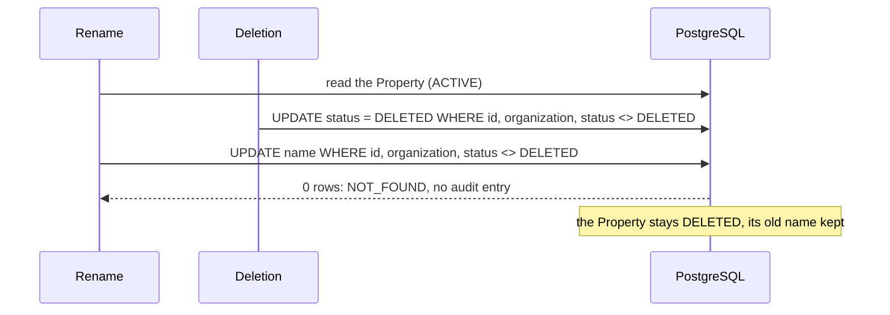

# Completion record — a Property's rename and deletion as conditional writes

Base: `aca6c5b` (PR #124 merge commit on `main`).
ADR: `docs/decisions/0101-conditional-property-rename-and-deletion.md`

Found by GS-7d-2's review; the product owner chose "直す" on 2026-10-29
08:14Z, to fix it in a pull request of its own. **No migration; no route, no
page.** No route renames or deletes a Property yet, so no customer met the bug.

Commits, oldest first:

| Commit | What it carries |
| --- | --- |
| `09f76a1` | the two conditional writes, the service's answers, the in-memory double, the tests, ADR-0101 and the documentation |
| `96661bd` | the review's answers: the rename as one conditional `UPDATE … RETURNING`, three more tests, the ADR's wording |
| this commit | this record |

The exact head SHA is reported with the pull request.

## What it does

- **A rename writes the fields it names, while the Property stands.**
  `updateDetails` writes only them, in one `UPDATE … RETURNING` on the id,
  the organization and a status other than `DELETED`, as the photos'
  `updateIfCurrent` does; Prisma's `P2025` is the lost race. A Property deleted since the rename's read is answered
  `NOT_FOUND`, with no audit entry, and stays deleted.
- **A deletion writes the status alone, once.** `markDeleted` writes
  `DELETED` alone, under the same condition. A rename saved since the
  deletion's read keeps its name. A second deletion is answered `NOT_FOUND`
  before asking for any photo's deletion, so there is one audit entry.
- **The unconditional write is gone.** `PropertyRepository.update` is removed.

## Verification

Measured locally (PostgreSQL 16 configured like CI).

| Check | Result |
| --- | --- |
| `pnpm lint` / `pnpm typecheck` | clean on `96661bd`, each exit status read |
| `pnpm test` | 6,565 tests in 241 files passed, exit 0 |
| `pnpm test:db` | 1,777 tests in 67 files passed, exit 0 (a first run stopped on a Vitest worker's closed IPC channel, before any failure; the re-run passed) |
| `pnpm test:media` | not run locally: no media code changed; CI's media job runs it |
| `pnpm build` | not run locally; CI's verify job builds |
| `prisma migrate diff` | not run: no schema or migration changed; CI's database job checks it |

New tests:

- `tests/integration/property-writes.db.test.ts` (new, 10): only the named
  fields written, an undefined one left; an archived Property kept archived; a
  change naming no field answered; nothing written for a deleted Property,
  another organization's or none; a deletion once, its status alone, never
  across tenants; and, through the service with a pause after its read, a
  rename losing to a deletion, a deletion after a rename, a second deletion,
  and two renames of different fields, each way.
- `packages/domain/src/property/property.test.ts` (7 new): the same five races
  against the in-memory double, its undefined field left as stored, and
  another organization's Property refused.
- Changed: `property-assignment.test.ts` and `property-assignment.db.test.ts`
  edit through `updateDetails`.

## Mutation testing

Each mutant applied alone, the named suite run, the file restored and its
digest checked, and the working tree's manifest compared before and after.

| Id | Mutant | Result |
| --- | --- | --- |
| P01 | the rename writes a field it does not name, from its read | killed |
| P02 | a rename that lost to a deletion answered as done | killed |
| P03 | a second deletion answered as done and audited | killed |
| P04, P05 | the double: a deleted Property renamed; deleted twice | killed |
| P06 | the double: a field passed as undefined written | killed, after the test the first run asked for |
| P07, P08, P09 | the rename always writes the name, the type or the address it read | killed, after the review's test |
| P10, P11 | the double: a rename or a deletion across tenants | killed, after the review's test |
| D01, D02 | the rename's write: of a deleted Property; across tenants | killed |
| D03 | the rename writes the status `ACTIVE` | killed, after the archived test the first run asked for |
| D05 | a refused rename thrown rather than answered `null` | killed |
| D06, D07, D08 | the deletion: twice; across tenants; a refused one answered as done | killed |

Result: **18 of 18 killed** on `96661bd`, unit and database suites each run
once per mutant. P06 and D03 survived a first run, and P07 to P11 were found
by the review; each test added since kills them. An explicit `updatedAt` the
first version wrote is gone with the `updateMany` it served.

## Review

An independent review, by a subagent reading the git objects only (Codex was
at its usage limit), found nothing blocking, and confirmed the Prisma
semantics (an `undefined` field unwritten, `null` written, the lost race
re-checked under READ COMMITTED), that no unconditional write of a Property is
left, and that a deletion is still one statement. Answered in `96661bd`:

- **Should fix: only the description was pinned as written only if named.**
  Tests now race a description-only change against a rename of the name, the
  type and the address, in both suites.
- **The rename held a connection for two round trips.** It is now one
  conditional `UPDATE … RETURNING` with `P2025` as the lost race, as
  `updateIfCurrent` is; the SQL was checked against PostgreSQL.
- **A deletion's reach is checked at the read too.** ADR-0101's *Not decided
  here* now says so for both.
- **`markDeleted` also bumps `updatedAt`.** The ADR and the API summary say so.
- **The double's tenant check was untested.** Tested now (P10, P11).
- **`property-assignment.test.ts`'s first line no longer tests anything at
  run time.** Left: the type now forbids naming the assignments, and the test
  still shows a rename and a deletion keep them.

## Required documentation

| Item | Where |
| --- | --- |
| Architecture diagram | Not applicable: no module or boundary changes |
| Entity-relationship diagram | Not applicable: no schema change |
| Critical sequence diagram | the diagram above |
| OpenAPI / API change summary | `docs/api-changes-property-writes.md`: no HTTP change; the changed exports |
| Change log / release notes | the commit list above and the pull request description |
| Database migration notes | `docs/migration-notes.md`, *Property rename and deletion as conditional writes*: no migration |
| Completion report | this file |

Also updated: `docs/decisions/TODO.md` (the item closed, and a new one: a
deletion's photos' deletion requests and audit entry in one commit).

## Activation status

Nothing paid or scheduled is activated. No route renames or deletes a
Property. Paid Provider Activation, production Provider credentials,
production paid AI calls, the production scheduler and live Stripe charges
remain BLOCKED.

## Known limitations

- **A deletion is not one commit with its photos' deletion requests and its
  audit entry** (TODO.md). A failure between them leaves photos not asked to be
  deleted, or no audit entry, and a retry is answered `NOT_FOUND`.
- **Reach is checked at the read**, as for every Property action: a
  reassignment saved after it does not stop the rename.

## Remaining work

Waits for the product owner's yes before merge. Then GS-7d-3a, as approved on
2026-10-29 (`/mnt/project-files/cto/gs-7d-3-proposal.md`).
