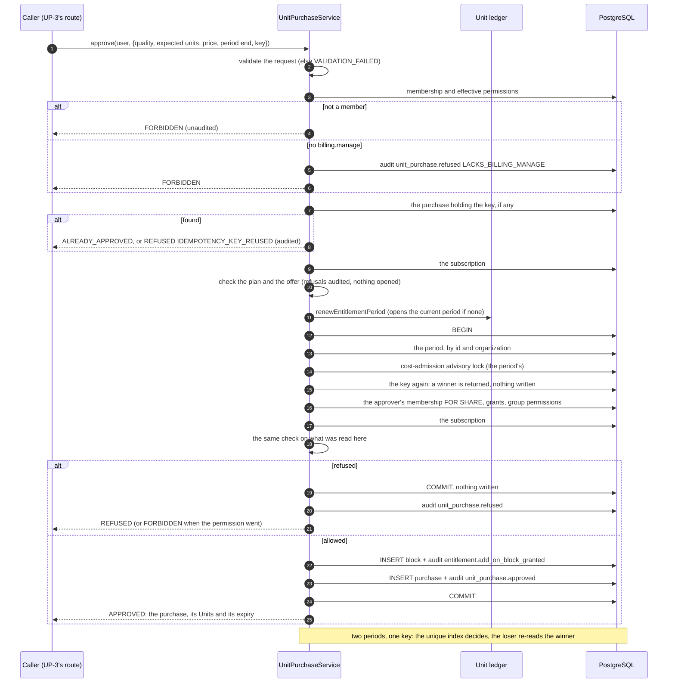
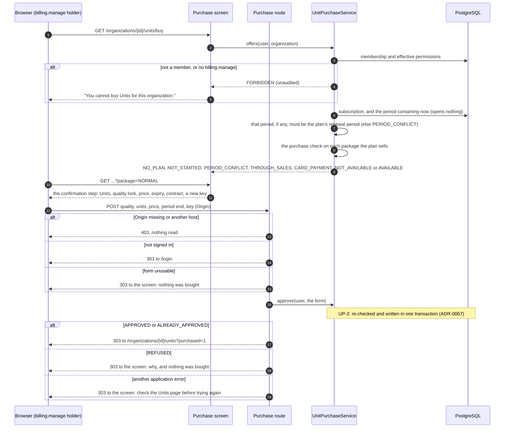
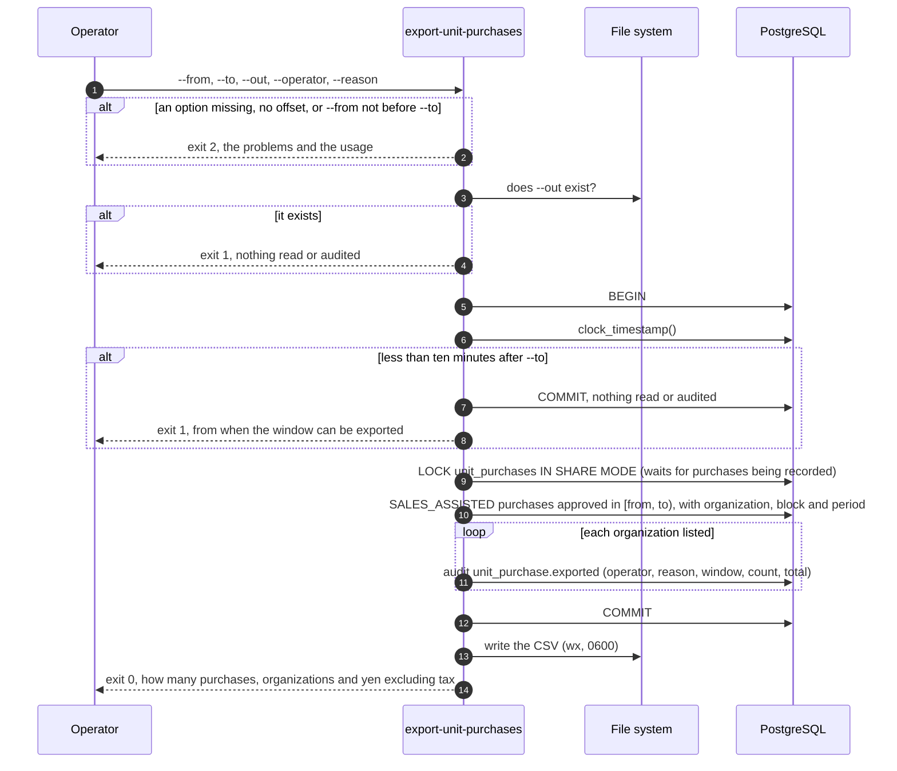

# Completion — additional Unit packages (Unit purchase)

Branch: `claude/project-thread-az06z2`
ADRs: `docs/decisions/0066-plan-provisioning-and-units-overview.md` (UP-1),
`docs/decisions/0067-unit-purchase-record-and-approval.md` (UP-2),
`docs/decisions/0068-unit-purchase-screen-and-route.md` (UP-3),
`docs/decisions/0069-unit-purchase-list-and-invoicing-export.md` (UP-4),
`docs/decisions/0070-unit-purchase-cancellation.md` (UP-5)
Gap analysis: `docs/unit-purchase-gap-analysis.md`

Unit purchase is built in four pull requests, approved by the product owner on
2026-10-16 with purchased Units usable as soon as the customer approves and
invoiced afterwards:

1. **UP-1**: an organization gets its contract's plan, and the Units page.
2. **UP-2**: the purchase record and its one-transaction grant.
3. **UP-3**: the purchase screen.
4. **UP-4**: the purchase list and the invoicing export.

The product owner then decided on 2026-10-19 how a mistaken purchase is
corrected, built as a fifth:

5. **UP-5**: an operator cancels a mistaken purchase.

Each extends this record. Unit purchase is not a Roadmap phase, so it receives
no `phase-N-complete` tag.

## UP-1 — a plan from the contract, and the Units page

Base: `a60a76d` (PR #88 merge commit on `main`).

Commits, oldest first:

| Commit | What it carries |
| --- | --- |
| `1863464` | the operator command (`apps/ops`), operator attribution in the provisioning audit, `UnitsOverviewService` and its in-memory reader, the Units page and the dashboard link, their unit, shape and database tests, ADR-0066 and the documentation updates |
| `2cb625f` | this record |
| this commit | an MFA database test made independent of row order (below), and this record |

The exact head SHA is reported with the pull request rather than written into a
file that would have to contain its own hash.

### What UP-1 does

- **An operator gives an organization its contract's plan.**
  `pnpm --filter @app/ops provision-subscription` writes the organization's one
  subscription from the contract:
  - its plan, its start (the renewal anchor, an instant with an explicit offset
    that is checked against the calendar) and the contract number;
  - always `SALES_ASSISTED`, named `sub_<organization id>`;
  - the audit entry records the operator and the reason, with no actor user.

  Running it again with the same contract writes nothing. Anything different is
  refused and shows what the organization already has. Exit codes are 0, 1 and
  2. The command lives in its own package, which neither application depends
  on (ADR-0066 Decisions 1 and 2).
- **The Units page** (`/organizations/{id}/units`, linked from the dashboard)
  shows a holder of `unit.view`:
  - the plan;
  - the current period's bounds in Japan time, and that nothing carries over;
  - the Base Units left, and how many can still fund HQ;
  - each additional block, oldest first, with what is left of it, and the
    quality lock;
  - when the plan sells no HQ package, that it does not.

  `billing.view` adds how the plan is paid and its monthly price, labelled as
  excluding tax. Without a plan, the page says VTaVision sets it up when the
  contract starts; before the start, it says when. Viewing writes nothing
  (ADR-0066 Decision 3).

Behaviour anyone can notice:
- a "Units and plan" link under each organization on the dashboard;
- the page, which says "no plan yet" until an operator runs the command.

Nothing is bought, charged, reserved or opened.

### Giving a plan, then viewing it

```mermaid
sequenceDiagram
  autonumber
  participant O as Operator
  participant C as provision-subscription
  participant DB as PostgreSQL
  participant M as Member (unit.view)
  participant P as Units page
  participant S as UnitsOverviewService

  O->>C: --organization --plan --starts --contract --operator --reason
  C->>C: parse; every option required; the start checked against the calendar
  C->>DB: BEGIN; INSERT subscription sub_<org> (SALES_ASSISTED)
  C->>DB: INSERT audit subscription.provisioned {operator, reason}; COMMIT
  alt the organization already has exactly this plan
    DB-->>C: replay: nothing written, exit 0
  else it has a different one
    C->>DB: read what it has
    C-->>O: refused, showing it; nothing written, exit 1
  end
  M->>P: GET /organizations/{id}/units
  P->>S: overview(user, organization)
  S->>DB: membership and effective permissions (unit.view, else FORBIDDEN)
  S->>DB: subscription; the ledger's period containing now
  alt a period is open
    S->>DB: its balance and blocks
  else no period yet
    S->>S: the current period as it would open: the plan's whole allowance
  end
  S-->>P: plan, period, Units left; billing only with billing.view
  Note over S,DB: nothing written: no period opened, no audit
```

### Verification

Measured on `1863464` (local PostgreSQL 16, configured like CI); the commit
after it changes this record only.

| Check | Result |
| --- | --- |
| `pnpm lint` / `pnpm typecheck` | clean, `apps/ops` included |
| `pnpm test` | **5385 / 5385**, 186 files (was 5283 on `a60a76d`) |
| `pnpm test:db` | **1375 / 1376**, 50 files: the one failure is the known race below |
| `pnpm build` | succeeded; `/organizations/[organizationId]/units` is listed |
| `prisma migrate diff` (migrations → schema) | no difference |
| `prisma migrate status` | 27 migrations, up to date |
| the command, end to end | run against a scratch organization: provisioned (exit 0), replay by another operator wrote nothing (exit 0), a different plan refused and the plan held shown (exit 1), 30 February refused (exit 2); one subscription and one audit row naming the operator and reason; then removed |

Every full database run failed one test, *gives two PROCESSING runners one
history and at most one transfer*. It is the known race recorded in `TODO.md`
since Phase 6F. The losing runner answers `OUTPUT_VERIFICATION_REPLAYED`, which
the test does not expect. UP-1 does not touch that code, and the failure is not
UP-1's:

- this time the file failed on its own too: 5 runs of 5 on this branch;
- on `main` (`a60a76d`, in a separate worktree) it failed 2 runs of 3.

It fails more often on this machine than in earlier records, which found it
mostly after other database files. The test-only fix is recorded in `TODO.md`
and needs its own pull request. One earlier full run on this code stopped
with a test-runner IPC error (`ERR_IPC_CHANNEL_CLOSED`) while the build ran
alongside it; run alone, it gave the result above.

CI run 567 on `1863464` passed both jobs, the database job included.

**CI run 569 on `2cb625f` failed one database test that UP-1 did not write:**
`mfa.db.test.ts`, "sets up, passes by authenticator and by recovery code,
replaces codes and turns off, auditing each". It read the two
`mfa.challenge_passed` audit rows with no order and expected the authenticator
pass first. Both rows carry the same instant, so PostgreSQL may return them
either way. This time it returned the recovery-code row first. The values were
right. UP-1 adds rows to the same table and deletes them again, which can change
where PostgreSQL places new rows and so the order in which an unordered read
returns them. The test now sorts the two rows by method before comparing. A
local run with the rows deliberately reversed passes. No product code changes.

CI on the pull request's exact head is reported with the pull request.

New tests:
- **the overview** (`units-overview.test.ts`, 27): who may see it, by role and
  by grant; billing facts only with `billing.view`; no plan, not started, an
  unopened period (the start at the anchor itself), an opened one; HQ fundable
  as the smaller of the Base Units and the ceiling left; blocks oldest first and
  ties by id; only the period containing now; an unreadable balance; nothing
  written;
- **provisioning** (`subscription.test.ts`, 2 more): a blank operator name or
  reason is invalid; the sales-contract call;
- **the command** (`provision-subscription.test.ts`, 52): every option
  required, trimmed and length-limited; unknown options and positionals
  refused; impossible dates, times and offsets refused, a leap day accepted;
  every outcome's exit code and message;
- **the page** (`units-page.test.tsx`, 11) and the wording helpers (3): sign-in,
  a refusal that names nothing, an unexpected failure not passed off as a
  refusal, each state, billing by role, the block list, the dashboard link;
- **shape** (`units-overview-shape.test.ts`, 6, and the Phase 6B dormancy test
  rewritten): no migration; the readers open, grant and provision nothing;
  provisioning only from the command; the command kept out of both applications
  and free of timers, network calls and payment processors;
- **live PostgreSQL** (`units-provisioning.db.test.ts`, 9): the subscription and
  its audit entry, operator and reason trimmed; replay and refusal write
  nothing; a missing organization; the overview before and after the command,
  before the start, with an opened period and blocks, and its refusals.

### Mutation ledger

**49 run, 48 killed, 1 survivor (equivalent), 0 broken, 0 anchor-missing**,
in one pass on the code of `1863464`. Each mutant weakens one guarantee at an
anchor that occurs exactly once. The suites:

- **domain**: the entitlement tests, including the overview, provisioning and
  shape tests (116 tests);
- **ops**: the command's tests (52);
- **web**: the Units page and the wording helpers (14);
- **db**: the provisioning and subscription database tests (29).

Each mutant runs against the suites listed for it until one fails. Every mutated
file was restored and re-hashed, and all 842 files were byte-identical
afterwards.

**C04 survived, and is equivalent.** It lets the command's own calendar check
accept minute 60. `Date` already rejects that instant: `new
Date("2026-11-01T23:60:00Z")` is `NaN`, and so are second 60 and offset hours
24 or minutes 60. So the command still refuses it, and the test for
`23:60` still passes. The same holds for the second and offset checks, which
have no mutant. Hour 24 is the field `Date` accepts, as the next day's midnight,
and C02 shows the explicit check catches it. The redundant checks are kept so
the rule does not depend on how a JavaScript engine parses dates.

| Mutant | Area | What it breaks | File | Tests failing |
| --- | --- | --- | --- | --- |
| O01 | who may | any member sees the Units, unit.view not required | `units-overview.ts` | 1 of 14 (web) |
| O02 | who may | billing facts shown to every holder of unit.view | `units-overview.ts` | 1 of 14 (web) |
| O03 | who may | billing facts never shown | `units-overview.ts` | 2 of 14 (web) |
| O04 | numbers | ledger HQ fundable ignores the Base Units left | `units-overview.ts` | 2 of 116 (domain) |
| O05 | numbers | unopened period's HQ fundable is the whole Base allowance | `units-overview.ts` | 2 of 116 (domain) |
| O06 | order | blocks not sorted oldest first | `units-overview.ts` | 1 of 116 (domain) |
| O07 | order | ties broken by id in reverse | `units-overview.ts` | 1 of 116 (domain) |
| O08 | numbers | Normal total counts HQ blocks | `units-overview.ts` | 1 of 116 (domain) |
| O09 | period | an unreadable balance is not an internal error | `units-overview.ts` | 1 of 116 (domain) |
| O10 | period | the ledger's period is ignored | `units-overview.ts` | 8 of 116 (domain) |
| O11 | period | a plan not yet started is shown as no plan | `units-overview.ts` | 1 of 116 (domain) |
| O12 | numbers | an unopened period shows no Base Unit left | `units-overview.ts` | 2 of 116 (domain) |
| O13 | numbers | an unopened Standard period claims to sell HQ packages | `units-overview.ts` | 1 of 116 (domain) |
| O14 | period | the unopened period is computed at the anchor, not now | `units-overview.ts` | 3 of 116 (domain) |
| S01 | operator | a blank operator name or reason is accepted | `subscription.ts` | 1 of 116 (domain) |
| S02 | operator | a blank reason is accepted | `subscription.ts` | 1 of 116 (domain) |
| S03 | channel | an operator provisions a self-service subscription | `subscription.ts` | 1 of 116 (domain) |
| S04 | replay | each run names a new subscription, so a replay is not one | `subscription.ts` | 1 of 116 (domain) |
| S05 | audit | the operator is not passed to the audit entry | `subscription.ts` | 1 of 116 (domain) |
| S06 | operator | the anchor is not the contract start | `subscription.ts` | 1 of 116 (domain) |
| R01 | audit | the audit entry drops the operator and reason | `subscription-repository.ts` | 2 of 29 (db) |
| R02 | audit | the operator's name is stored untrimmed | `subscription-repository.ts` | 1 of 29 (db) |
| C01 | validation | a day past the month's end is accepted | `provision-subscription.ts` | 3 of 52 (ops) |
| C02 | validation | hour 24 is accepted | `provision-subscription.ts` | 1 of 52 (ops) |
| C03 | validation | a start without an offset is accepted | `provision-subscription.ts` | 1 of 52 (ops) |
| C04 | validation | minute 60 is accepted | `provision-subscription.ts` | **survived: equivalent** (below) |
| C05 | validation | the organization id length is not limited | `provision-subscription.ts` | 1 of 52 (ops) |
| C06 | validation | the reason length is not limited | `provision-subscription.ts` | 1 of 52 (ops) |
| C07 | validation | a blank option counts as given | `provision-subscription.ts` | 9 of 52 (ops) |
| C08 | validation | unknown options are ignored | `provision-subscription.ts` | 1 of 52 (ops) |
| C09 | validation | positional arguments are ignored | `provision-subscription.ts` | 1 of 52 (ops) |
| C10 | validation | the plan is not checked | `provision-subscription.ts` | 6 of 52 (ops) |
| C11 | exit | a conflict exits 0 | `provision-subscription.ts` | 2 of 52 (ops) |
| C12 | exit | a replay exits 1 | `provision-subscription.ts` | 1 of 52 (ops) |
| C13 | exit | a missing organization exits 0 | `provision-subscription.ts` | 1 of 52 (ops) |
| C14 | message | the refusal names the channels the other way round | `provision-subscription.ts` | 2 of 52 (ops) |
| C15 | message | the refusal does not show what the organization has | `provision-subscription.ts` | 2 of 52 (ops) |
| P01 | page | a signed-out visitor is not sent to sign in | `units/page.tsx` | 1 of 14 (web) |
| P02 | page | any failure is shown as a refusal | `units/page.tsx` | 1 of 14 (web) |
| P03 | page | fundable HQ shown as the unused ceiling | `units/page.tsx` | 1 of 14 (web) |
| P04 | page | the HQ-not-sold note is inverted | `units/page.tsx` | 2 of 14 (web) |
| P05 | page | the empty-block note never shows | `units/page.tsx` | 1 of 14 (web) |
| P06 | page | the NOT_STARTED plan omits its start | `units/page.tsx` | 1 of 14 (web) |
| P07 | page | the expiry warning is dropped | `units/page.tsx` | 1 of 14 (web) |
| V01 | wording | times shown in UTC, labelled JST | `units-view.ts` | 4 of 14 (web) |
| V02 | wording | prices not labelled as excluding tax | `units-view.ts` | 3 of 14 (web) |
| V03 | wording | HQ named otherwise | `units-view.ts` | 2 of 14 (web) |
| V04 | wording | invoice-paid shown as card-paid | `units-view.ts` | 3 of 14 (web) |
| D01 | dashboard | the dashboard links elsewhere | `src/app/page.tsx` | 1 of 14 (web) |


### Required documentation

| Item | Where |
| --- | --- |
| Architecture diagram | `docs/architecture.md` status table: `apps/ops` and Units overview rows |
| Entity-relationship diagram | Not applicable: UP-1 changes no table or column |
| Critical sequence diagram | this section, *Giving a plan, then viewing it* |
| OpenAPI / API change summary | `docs/api-changes-up-1.md`: one page, no HTTP API; internal `UnitsOverviewService`, `provisionFromSalesContract`, `OperatorAttribution` (`@app/domain`) |
| Change log / release notes | the commit list above and the pull request description |
| Database migration notes | `docs/migration-notes.md`, *UP-1*: no migration |
| Completion report | this file |

Also updated: `docs/Roadmap.md`, `docs/decisions/TODO.md` (the closed purchase
decision, the operator console, the 6B dormancy note) and `docs/local-setup.md`
(how to run the command).

### Activation status

Nothing paid or scheduled is activated. UP-1 adds an operator command and a
read-only page: no migration, worker, scheduler, credential, environment
variable or payment integration. Its new development dependencies are `tsx` and
`@types/node`, for the command. Paid Provider Activation, production
credentials, the production scheduler and live Stripe charges remain BLOCKED.

### Known limitations

- **The operator's name is declared, not authenticated.** Anyone with the
  database credentials can run the command under any name. An operator console
  with its own sign-in replaces it (`TODO.md`).
- **The command cannot change a plan.** A plan change, an Enterprise transition
  or a corrected start date needs later work.
- **A `VIEWER` sees the dashboard link** and is told they cannot view the page
  (ADR-0066 Consequences).
- **An unopened period is computed from the catalog.** A later catalog revision
  would change what such a period shows, which is what opening it would then
  freeze.
- Nothing yet opens a period for a reservation; generation is not wired to a
  route.

### Remaining work

UP-1 waits for the product owner's yes before merge. Next: UP-2, the purchase
record (migration 27) and its one-transaction grant.

## UP-2 — the purchase record, approved in one transaction

Base: `2f8b79d` (PR #89 merge commit on `main`).
ADR: `docs/decisions/0067-unit-purchase-record-and-approval.md`

Commits, oldest first:

| Commit | What it carries |
| --- | --- |
| `b6d912a` | the approved package prices in the catalog, migration 27 (`unit_purchases`), `UnitPurchaseService` and its in-memory repository, `createUnitPurchaseRepository`, the shared block insert and group-permission read, their unit, shape and database tests, the migration-count tripwires, ADR-0067 and the documentation updates |
| this commit | this record |

The exact head SHA is reported with the pull request.

### What UP-2 does

- **The approved prices are in the catalog.** Each plan carries the price of
  its Normal package and, where it sells one, its HQ package, excluding tax:
  Standard ¥19,900 (none), Premium ¥35,900 and ¥9,000, Enterprise ¥89,400 and
  ¥22,400. A test pins each to the package price formula (ADR-0067
  Decision 1).
- **A purchase is a record.** `unit_purchases` (migration 27) holds, for each
  approved purchase, the block it bought, its period and quality, the price, how
  it is paid and under which contract, the idempotency key, who approved it and
  when. One block is bought once; a purchase can only belong to a block of its
  own period, quality and organization; the evidence is `RESTRICT`ed and the
  approver is not a foreign key (Decision 2).
- **`UnitPurchaseService.approve`** buys one package for a holder of
  `billing.manage` (Decision 3):
  - it refuses, and audits, what it must: no plan, not started, Enterprise
    (through sales), a card-paid plan (card payment is not built), HQ on
    Standard, Units or a price that are not the catalog's, and a period whose end
    is not the one shown;
  - a replay of the same approval returns the purchase and writes nothing; a key
    reused for anything else is refused;
  - it opens the current period if nothing has yet, because the block must join
    it.
- **One transaction** (Decision 4): under the period's cost-admission lock it
  looks up the key, reads the approver's membership `FOR SHARE` with its grants
  and its groups' permissions, reads the subscription, runs the same domain
  check on what it read, then writes the block, its
  `entitlement.add_on_block_granted` entry, the purchase and its
  `unit_purchase.approved` entry. Any failure writes none of them.

Nothing calls it yet: no route, page or command (Decision 5). The purchase
screen is UP-3. Nothing is charged.

### Approving a purchase



### Verification

Measured on `b6d912a` (local PostgreSQL 16, configured like CI); the commit
after it changes this record only.

| Check | Result |
| --- | --- |
| `pnpm lint` / `pnpm typecheck` | clean |
| `pnpm test` | **5446 / 5446**, 188 files (was 5385 on `2f8b79d`) |
| `pnpm test:db` | **1401 / 1401**, 51 files (was 1376, 50 files) |
| `pnpm build` | succeeded |
| `prisma migrate diff` (migrations → schema) | no difference |
| `prisma migrate status` | 28 migrations, up to date |

The known race in *gives two PROCESSING runners one history and at most one
transfer* (`TODO.md`, since Phase 6F) did not occur in this run.

CI on the pull request's exact head is reported with the pull request.

New tests:
- **the catalog** (`customer-pricing.test.ts`, 4): each plan's approved package
  prices, and their agreement with the package price formula;
- **the purchase** (`unit-purchase.test.ts`, 46): the offers; who may buy, by
  role and by grant, a member's refusal audited and an outsider's not; what a
  purchase writes; every plan, offer and period refusal; replay, including after the
  period has ended, and a key reused for something else; the re-check inside
  the write (a removed approver, another approval taking the key first, the
  facts read there, a lost period, a period that cannot be opened);
  validation; the pure check (priced from the period's plan, the anchor
  inclusive);
- **shape** (`unit-purchase-shape.test.ts`, 11): migration 27 the newest and
  additive only, with its keys and checks; dormant; one transaction, the lock
  first, the check before every write, the membership share lock; one
  block-insert path; no payment processor, network call or timer;
- **live PostgreSQL** (`unit-purchase.db.test.ts`, 25): the purchase, its block
  and both audit entries in one transaction, and nothing at all when the
  database refuses the purchase row; a double submit and a same-key race into
  two periods buying once; the HQ package; keys per organization; the
  approver's permission by role, by grant and by group, read inside the
  transaction; the check seeing the period's plan and the contract; another
  organization's period not found; the composite keys refusing another
  quality or organization, a block bought twice, a zero price, an empty
  contract and an empty or over-long key; a deleted user leaving the purchase; `RESTRICT` on the block
  and the organization.

Sixteen existing test files that count migrations, or name the newest, now
expect migration 27.

### Mutation ledger

**69 run, 69 killed, 0 survivors, 0 broken, 0 anchor-missing**, in one pass on
the code of `b6d912a`. Each mutant weakens one guarantee at an anchor that
occurs exactly once. The suites:

- **domain**: the entitlement and pricing tests, including the purchase and
  shape tests (348 tests);
- **db**: the purchase database tests (25);
- **ledger-db**: the Unit ledger database tests (33), for the shared block
  insert;
- **groups-db**: the group permission database tests, listed for G01 after
  **db**, which killed it first.

Each mutant runs against the suites listed for it until one fails. Every mutated
file was restored and re-hashed, and all 852 files were byte-identical
afterwards.

**D01 (no cost-admission lock) and D07 (no share lock on the approver's
membership) are killed by the shape test only.** The races they open need two
transactions interleaved at one exact point, which a test cannot force
reliably, so the lock order is pinned structurally instead, as for the ledger's
grants and reservations. The same-key race into two periods, which does not
depend on that timing, is exercised against PostgreSQL and killed D17.

| Mutant | Area | What it breaks | File | Tests failing |
| --- | --- | --- | --- | --- |
| C01 | price | Standard Normal package priced ¥20,000 | `customer-plan-catalog.ts` | 5 of 348 (domain) |
| C02 | price | Premium HQ package priced at the unrounded ¥8,985 | `customer-plan-catalog.ts` | 5 of 348 (domain) |
| C03 | price | Enterprise HQ package rounded down to ¥22,300 | `customer-plan-catalog.ts` | 3 of 348 (domain) |
| C04 | price | Standard given an HQ package price | `customer-plan-catalog.ts` | 2 of 348 (domain) |
| F01 | offer | a Normal package charged the monthly price | `unit-purchase.ts` | 22 of 348 (domain) |
| F02 | offer | an HQ package sells the Normal package's Units | `unit-purchase.ts` | 4 of 348 (domain) |
| F03 | offer | a plan with no HQ package offers one | `unit-purchase.ts` | 3 of 348 (domain) |
| R01 | who | the check ignores billing.manage | `unit-purchase.ts` | 2 of 348 (domain) |
| R02 | who | an approver no longer a member passes the check | `unit-purchase.ts` | 2 of 348 (domain) |
| R03 | plan | the plan starts only after its anchor | `unit-purchase.ts` | 1 of 348 (domain) |
| R04 | plan | the package priced from the subscription, not the period's frozen plan | `unit-purchase.ts` | 1 of 348 (domain) |
| R05 | plan | Enterprise bought in the app | `unit-purchase.ts` | 2 of 348 (domain) |
| R06 | plan | a card-paid plan bought by invoice | `unit-purchase.ts` | 1 of 348 (domain) |
| R07 | offer | the Units shown are not compared | `unit-purchase.ts` | 1 of 348 (domain) |
| R08 | offer | the price shown is not compared | `unit-purchase.ts` | 1 of 348 (domain) |
| R09 | period | the period shown is not compared | `unit-purchase.ts` | 2 of 348 (domain) |
| R10 | offer | a package the plan does not sell passes | `unit-purchase.ts` | 2 of 348 (domain) |
| P01 | replay | another approver's purchase counts as a replay | `unit-purchase.ts` | 2 of 348 (domain) |
| P02 | replay | another quality counts as a replay | `unit-purchase.ts` | 3 of 348 (domain) |
| P03 | replay | other Units count as a replay | `unit-purchase.ts` | 1 of 348 (domain) |
| P04 | replay | another price counts as a replay | `unit-purchase.ts` | 2 of 348 (domain) |
| P05 | replay | another expiry counts as a replay | `unit-purchase.ts` | 1 of 348 (domain) |
| P06 | replay | the replay compares the purchase's own approver | `unit-purchase.ts` | 1 of 348 (domain) |
| V01 | validation | an empty key accepted | `unit-purchase.ts` | 1 of 348 (domain) |
| V02 | validation | an over-long key accepted | `unit-purchase.ts` | 1 of 348 (domain) |
| V03 | validation | a 200-character key refused | `unit-purchase.ts` | 1 of 348 (domain) |
| V04 | validation | fractional Units accepted | `unit-purchase.ts` | 1 of 348 (domain) |
| V05 | validation | a fractional price accepted | `unit-purchase.ts` | 1 of 348 (domain) |
| V06 | validation | an invalid expiry accepted | `unit-purchase.ts` | 1 of 348 (domain) |
| V07 | validation | the key limit raised to 201 | `unit-purchase.ts` | 1 of 348 (domain) |
| A01 | who | no billing.manage check before reading | `unit-purchase.ts` | 4 of 348 (domain) |
| A02 | replay | no replay lookup before the plan checks | `unit-purchase.ts` | 3 of 348 (domain) |
| A03 | plan | a refused plan still opens the period | `unit-purchase.ts` | 4 of 348 (domain) |
| A04 | period | a period the ledger could not open is bought into | `unit-purchase.ts` | 1 of 348 (domain) |
| A05 | re-check | the write is not re-checked | `unit-purchase.ts` | 3 of 348 (domain) |
| A06 | record | the price recorded is not the one approved | `unit-purchase.ts` | 4 of 348 (domain) |
| A07 | record | the channel recorded is not the subscription's | `unit-purchase.ts` | 1 of 348 (domain) |
| A08 | record | the contract recorded is not the subscription's | `unit-purchase.ts` | 1 of 348 (domain) |
| A09 | record | the approval instant is not now | `unit-purchase.ts` | 1 of 348 (domain) |
| A10 | replay | a key written first by another approval answered as approved | `unit-purchase.ts` | 1 of 348 (domain) |
| A11 | audit | a refusal under the lock neither audited nor forbidden | `unit-purchase.ts` | 2 of 348 (domain) |
| A12 | period | a lost period answered as a refusal | `unit-purchase.ts` | 1 of 348 (domain) |
| A13 | who | a member without billing.manage is refused but not forbidden | `unit-purchase.ts` | 5 of 348 (domain) |
| A14 | audit | the refusal's reason not recorded | `unit-purchase.ts` | 15 of 348 (domain) |
| A15 | audit | the refusal's expiry not recorded | `unit-purchase.ts` | 5 of 348 (domain) |
| D01 | lock | no cost-admission lock | `unit-purchase-repository.ts` | 1 of 348 (domain) |
| D02 | replay | no key lookup under the lock | `unit-purchase-repository.ts` | 1 of 25 (db) |
| D03 | who | the approver read as an OWNER | `unit-purchase-repository.ts` | 2 of 25 (db) |
| D04 | who | individual grants ignored | `unit-purchase-repository.ts` | 1 of 25 (db) |
| D05 | who | group permissions ignored | `unit-purchase-repository.ts` | 1 of 25 (db) |
| D06 | who | a removed approver read as holding billing.manage | `unit-purchase-repository.ts` | 2 of 25 (db) |
| D07 | lock | the approver's membership not share-locked | `unit-purchase-repository.ts` | 1 of 348 (domain) |
| D08 | re-check | the check sees no subscription | `unit-purchase-repository.ts` | 9 of 25 (db) |
| D09 | re-check | a refused purchase is written anyway | `unit-purchase-repository.ts` | 4 of 25 (db) |
| D10 | write | the block holds one Unit | `unit-purchase-repository.ts` | 4 of 25 (db) |
| D11 | write | the block names the key, not the purchase | `unit-purchase-repository.ts` | 1 of 25 (db) |
| D12 | write | the block's FIFO instant is not the approval's | `unit-purchase-repository.ts` | 1 of 25 (db) |
| D13 | audit | the approval audit omits the approver's role | `unit-purchase-repository.ts` | 1 of 25 (db) |
| D14 | audit | the approval audit omits the expiry | `unit-purchase-repository.ts` | 1 of 25 (db) |
| D15 | audit | the approval audit records no price | `unit-purchase-repository.ts` | 1 of 25 (db) |
| D16 | audit | the approval audit has no actor | `unit-purchase-repository.ts` | 1 of 25 (db) |
| D17 | race | a lost same-key insert surfaces as an error | `unit-purchase-repository.ts` | 1 of 25 (db) |
| D18 | race | a collision that is not the key's answered as a replay | `unit-purchase-repository.ts` | 1 of 25 (db) |
| D19 | tenant | a period of another organization is found | `unit-purchase-repository.ts` | 1 of 25 (db) |
| D20 | read | a purchase's Units are not its block's | `unit-purchase-repository.ts` | 1 of 25 (db) |
| D21 | read | a purchase's expiry is not its period's end | `unit-purchase-repository.ts` | 3 of 25 (db) |
| L01 | audit | a block is inserted without its grant audit entry | `unit-entitlement-repository.ts` | 1 of 25 (db) |
| L02 | write | a block's FIFO instant is not the one given | `unit-entitlement-repository.ts` | 32 of 33 (ledger-db) |
| G01 | who | the group read finds no permission | `group-repository.ts` | 1 of 25 (db) |

### Required documentation

| Item | Where |
| --- | --- |
| Architecture diagram | `docs/architecture.md` status table: the Unit purchase row, and the Billing row now naming UP-3 and UP-4 |
| Entity-relationship diagram | `docs/er-diagram.md`, *UP-2*: `unit_purchases` and its three keys |
| Critical sequence diagram | this section, *Approving a purchase* |
| OpenAPI / API change summary | `docs/api-changes-up-2.md`: no HTTP API; internal `UnitPurchaseService`, `addOnPackageOffer`, the catalog prices (`@app/domain`), `createUnitPurchaseRepository` (`@app/database`) |
| Change log / release notes | the commit list above and the pull request description |
| Database migration notes | `docs/migration-notes.md`, *UP-2*: migration 27, additive |
| Completion report | this file |

Also updated: `docs/Roadmap.md`, `docs/decisions/TODO.md` (the Unit accounting
item, a new open item on the price floor) and `docs/unit-purchase-gap-analysis.md`
(what building UP-2 found).

### Activation status

Nothing paid or scheduled is activated. UP-2 adds one table and a service that
nothing calls: no route, page, worker, scheduler, credential, environment
variable, dependency or payment integration. Paid Provider Activation,
production credentials, the production scheduler and live Stripe charges remain
BLOCKED.

### Known limitations

- **The approved prices are not checked against a provider cost floor.** No
  provider route is verified, so there is no cost to check against; the table
  is the price authority until one is (`TODO.md`).
- **Card payment is refused, not built.** A self-service plan's purchase is
  refused as `CARD_PAYMENT_NOT_AVAILABLE`.
- **The block's FIFO instant is the approval instant**, so two blocks bought in
  one millisecond are ordered by id, as any two blocks are.
- **Nothing corrects a purchase made in error.** A refund for VTaVision's own
  billing error must stay possible (ADR-0053 Decision 3A); the invoice can be
  corrected outside the product, but the purchase and its Units stay. How an
  operator marks one as credited is open in `TODO.md`, to settle before UP-4's
  list is used to invoice.

### Remaining work

UP-2 waits for the product owner's yes before merge. Next: UP-3, the purchase
screen, its confirmation step and the route.

## UP-3 — the purchase screen, its confirmation step and its route

Base: `2c0f653` (PR #90 merge commit on `main`).
ADR: `docs/decisions/0068-unit-purchase-screen-and-route.md`

Commits, oldest first:

| Commit | What it carries |
| --- | --- |
| `f126966` | `UnitPurchaseService.offers`, `mayBuyUnits` on the Units overview, the purchase screen and its confirmation step, the purchase route and its origin check, the form reader and its messages, the Units page link and purchase notice, their unit, page, route, shape and database tests, ADR-0068 and the documentation updates |
| `b0bab9f` | the provisioning database test expecting the buy flag (below) |
| `c422c29` | this record, first written |
| `b866105` | the review fix: no offer over a period the plan's renewal did not open (`isRenewalPeriod`), its tests, ADR-0068 Decisions 2 and 5, the API change summary and the gap analysis |
| this commit | this record, brought up to date with the review fix |

The exact head SHA is reported with the pull request.

### What UP-3 does

- **A `billing.manage` holder can buy Units in the product.** The Units page
  links an `OWNER`, a `BILLING` user, or an `ADMIN` an `OWNER` granted
  `billing.manage`, to `/organizations/{id}/units/buy`. Anyone else is told they
  cannot buy Units for the organization (ADR-0068 Decision 1).
- **The screen offers what approving accepts.** `UnitPurchaseService.offers`
  decides it with the check a purchase is written under, from the open period's
  frozen plan when there is one, and opens nothing (Decision 2):
  - an invoice-paid Standard plan sells a Normal package, Premium a Normal and an
    HQ package, each with its price excluding tax and the date it expires;
  - Enterprise packages are listed as bought through the VTaVision
    representative, with no review link;
  - a card-paid plan is told card payment is not available yet; no plan, or a
    plan not started, is said so;
  - while the ledger holds a period at now that the plan's renewal did not
    open, nothing is offered and the screen points to the representative,
    because approving would refuse to buy around it (found in review, below).
- **The confirmation step** states the Units and their quality lock, the price
  excluding tax with tax added on the invoice, the expiry in Japan time with no
  carry-over and no refund of unused Units, that the Units are ready at once and
  that VTaVision invoices the purchase under the named contract. One button,
  naming the price, approves it. Each showing carries a new idempotency key
  (Decision 3).
- **The route** (`POST /api/organizations/{id}/unit-purchases`) refuses a post
  whose `Origin` is not this host before reading anything, sends a signed-out
  visitor to sign in, checks the form's shape, and approves through the UP-2
  service. An approval, or its replay, lands on the Units page with a notice; a
  refusal returns to the screen saying why and that nothing was bought; any
  other application error says to check the Units page before trying again
  (Decision 4).

Nothing calls a payment processor or a network service. An invoice-paid
organization is invoiced under its contract; the list for that is UP-4.

### Buying a package



### Verification

Measured locally (PostgreSQL 16, configured like CI) on `b866105`, the review
fix; the commit after it changes this record only. Before the fix, the same
checks passed on `b0bab9f` (5548 unit, 1403 database tests).

| Check | Result |
| --- | --- |
| `pnpm lint` / `pnpm typecheck` | clean |
| `pnpm test` | **5556 / 5556**, 192 files (was 5446, 188 files, on `2c0f653`) |
| `pnpm test:db` | **1404 / 1404**, 51 files (was 1401) |
| `pnpm build` | succeeded; the build lists `/organizations/[organizationId]/units/buy` and `/api/organizations/[organizationId]/unit-purchases` |
| `prisma migrate diff` (migrations → schema) | no difference |
| `prisma migrate status` | 28 migrations, up to date |

`f126966` was pushed before the full database run finished. That run found one
existing test, *shows no plan until the command has run* in
`units-provisioning.db.test.ts`, whose exact expectation of the overview did not
yet name `mayBuyUnits`; `b0bab9f` adds it (the `OWNER` may buy).

CI on the pull request's exact head is reported with the pull request.

New tests (110 unit, 3 database):
- **the offers** (`unit-purchase.test.ts`, 20 new, 66 in all): a non-member and
  every role without `billing.manage` refused unaudited, an `ADMIN` granted it
  offered packages; Premium and Standard packages and their expiry, nothing
  opened or audited; Enterprise through sales; a card-paid plan; no plan and a
  plan not started; a period the renewal did not open offering nothing while
  approving buys none, and each of the six facts that tells the renewal's
  period from another; the same offer once a purchase has opened the period;
  offers to approval round trip;
- **the buy flag** (`units-overview.test.ts`, 10 new): `mayBuyUnits` by role,
  by grant, on a derived and on an open period;
- **the origin check** (`same-origin.test.ts`, 8): the addressed host
  accepted; another port, another site, another origin of the same site, an
  opaque or malformed origin, or none, refused; only the first forwarded host
  trusted;
- **the form** (`unit-purchase-form.test.ts`, 31): every field's shape, the
  period end exactly as written, the key's length, and the message for every
  refusal and failure;
- **the screen and the route** (`buy-page.test.tsx`, 29): every offer state,
  the confirmation step's words and hidden fields, a new key each showing, a
  package not sold, a returned error; the route approving, replaying,
  refusing, refusing another origin or none, sending a signed-out visitor to
  sign in, refusing a member without `billing.manage` (audited), an unusable
  form, an application error and an unexpected one;
- **the Units page** (`units-page.test.tsx`, 7 new): the link for `OWNER` and
  `BILLING` only, and the purchase notice;
- **shape** (`unit-purchase-screen-shape.test.ts`, 5): still 28 migrations; the
  service built and called only by the route, the screen and the wiring; the
  route's order; one form; `offers` writing nothing; no payment processor,
  network call or timer;
- **live PostgreSQL** (`unit-purchase.db.test.ts`, 3 new): offers on a derived
  period open nothing and the purchase it offers is approved, after which the
  same offer stands over the period the database opened; a period opened by
  hand offers nothing and approving writes nothing; an `ADMIN` is refused
  unaudited.

**Found in review.** Codex found the screen offering packages while the ledger
held a period at now that the renewal did not open; approving renews through
`renewEntitlementPeriod`, which refuses to buy around such a period, so the
customer would have approved and then been told the purchase could not be
confirmed. `b866105` makes `offers` derive the period as approving does and
return `PERIOD_CONFLICT` unless the open period is the renewal's
(`isRenewalPeriod`, the facts the ledger compares). The test that had pinned
the old behaviour, pricing from a hand-opened period's plan, is replaced.

Two existing shape tests now name the web app's purchase wiring as the one
place the purchase service and the subscription repository are built for it.

### Mutation ledger

**47 mutants, all killed, 0 broken, 0 anchor-missing**, in two passes. Each
mutant weakens one guarantee at an anchor that occurs exactly once.

- **Pass 1**, on the code committed as `f126966` (it ran before one comment in
  `unit-purchase-form.ts` was reworded): 41 run, 40 killed; U02 survived and was
  killed on re-run (below).
- **Pass 2**, on the code of `b866105`: every mutant of the offers read
  (O01–O14) and the screen's new state (P11), 15 run, 15 killed. O02 and O03
  were rewritten for the new code and O10–O14 and P11 are new; the other
  mutants' code is unchanged since pass 1, and tests were only added since.

The suites:

- **domain**: the entitlement tests, including the purchase, overview and shape
  tests (197 in pass 1, 201 after the test added below, 208 in pass 2);
- **web**: the Units page and purchase screen tests, and the origin and form
  tests (85 in pass 1, 86 in pass 2).

Each mutant runs against the suites listed for it until one fails. Every mutated
file was restored and re-hashed, and every file (861 in pass 1, 863 in pass 2)
was byte-identical after each pass.

**U02 survived the first pass.** No test read `mayBuyUnits` on a period already
in the ledger, only on one derived from the subscription, so an open period
could have offered buying to anyone. A test now checks `OWNER`, `BILLING`,
`ADMIN` and `MANAGER` on an open period; U02 and U03 were re-run against it and
both were killed.

| Mutant | Area | What it breaks | File | Tests failing |
| --- | --- | --- | --- | --- |
| O01 | who | any member sees the offers | `unit-purchase.ts` | 4 of 208 (domain) |
| O02 | period | a period the plan did not open is offered | `unit-purchase.ts` | 7 of 208 (domain) |
| O03 | period | the open period's plan not compared with the renewal's | `subscription.ts` | 1 of 208 (domain) |
| O04 | offer | HQ never offered | `unit-purchase.ts` | 2 of 208 (domain) |
| O05 | plan | Enterprise offered for purchase in the app | `unit-purchase.ts` | 1 of 208 (domain) |
| O06 | plan | a card-paid plan offered for purchase by invoice | `unit-purchase.ts` | 1 of 208 (domain) |
| O07 | record | the contract shown is the subscription's id | `unit-purchase.ts` | 1 of 208 (domain) |
| O08 | period | the expiry shown is the period's start | `unit-purchase.ts` | 2 of 208 (domain) |
| O09 | plan | no plan read as a plan not started | `unit-purchase.ts` | 1 of 208 (domain) |
| O10 | period | the open period's id not compared | `subscription.ts` | 1 of 208 (domain) |
| O11 | period | the open period's billing key not compared | `subscription.ts` | 1 of 208 (domain) |
| O12 | period | the open period's start not compared | `subscription.ts` | 1 of 208 (domain) |
| O13 | period | the open period's end not compared | `subscription.ts` | 1 of 208 (domain) |
| O14 | period | the open period's contract reference not compared | `subscription.ts` | 1 of 208 (domain) |
| U01 | who | billing.view, not billing.manage, offers buying | `units-overview.ts` | 1 of 197 (domain) |
| U02 | who | an open period always offers buying | `units-overview.ts` | 2 of 201 (domain) (re-run) |
| U03 | who | the derived period always offers buying | `units-overview.ts` | 4 of 201 (domain) |
| U04 | page | the buy link shown to everyone | `units/page.tsx` | 3 of 85 (web) |
| U05 | page | the purchase notice shown without a purchase | `units/page.tsx` | 2 of 85 (web) |
| P01 | page | a package not sold is confirmed as the first one sold | `units/buy/page.tsx` | 2 of 85 (web) |
| P02 | replay | every confirmation carries the same key | `units/buy/page.tsx` | 2 of 85 (web) |
| P03 | period | the confirmation carries now, not the period's end | `units/buy/page.tsx` | 3 of 85 (web) |
| P04 | plan | Enterprise packages get a review link | `units/buy/page.tsx` | 1 of 85 (web) |
| P05 | page | any failure shown as a refusal | `units/buy/page.tsx` | 1 of 85 (web) |
| P06 | words | the confirmation drops that unused Units are not refunded | `units/buy/page.tsx` | 1 of 85 (web) |
| P07 | words | the quality lock named the wrong way round | `units/buy/page.tsx` | 2 of 85 (web) |
| P08 | words | the confirmation drops the contract | `units/buy/page.tsx` | 1 of 85 (web) |
| P09 | page | the screen shows no refusal it was sent back with | `units/buy/page.tsx` | 1 of 85 (web) |
| P10 | record | the confirmation carries the price as the Units | `units/buy/page.tsx` | 3 of 85 (web) |
| P11 | page | a period the plan did not open shown as nothing at all | `units/buy/page.tsx` | 1 of 86 (web) |
| F01 | form | zero or zero-led amounts read | `unit-purchase-form.ts` | 3 of 85 (web) |
| F02 | form | a period end written otherwise read | `unit-purchase-form.ts` | 2 of 85 (web) |
| F03 | form | an over-long key read | `unit-purchase-form.ts` | 1 of 85 (web) |
| F04 | form | the Units and the price swapped | `unit-purchase-form.ts` | 3 of 85 (web) |
| F05 | words | a refused permission called a possible failure | `unit-purchase-form.ts` | 2 of 85 (web) |
| F06 | words | a failure after the write said to have bought nothing | `unit-purchase-form.ts` | 2 of 85 (web) |
| F07 | words | a changed offer not said to have bought nothing | `unit-purchase-form.ts` | 2 of 85 (web) |
| F08 | form | a quality outside the two read | `unit-purchase-form.ts` | 3 of 85 (web) |
| S01 | origin | every origin accepted | `same-origin.ts` | 8 of 85 (web) |
| S02 | origin | the forwarded host ignored | `same-origin.ts` | 1 of 85 (web) |
| S03 | origin | the port ignored | `same-origin.ts` | 1 of 85 (web) |
| S04 | origin | the last forwarded host trusted | `same-origin.ts` | 1 of 85 (web) |
| R01 | origin | the route skips the origin check | `unit-purchases/route.ts` | 3 of 85 (web) |
| R02 | route | a refusal lands as a purchase | `unit-purchases/route.ts` | 1 of 85 (web) |
| R03 | route | an unexpected failure turned into a message | `unit-purchases/route.ts` | 1 of 85 (web) |
| R04 | route | the purchase notice not asked for | `unit-purchases/route.ts` | 1 of 85 (web) |
| R05 | route | an unreadable form sent to the service | `unit-purchases/route.ts` | 1 of 85 (web) |

### Required documentation

| Item | Where |
| --- | --- |
| Architecture diagram | `docs/architecture.md` status table: the Unit purchase row no longer dormant, a purchase screen and route row, and the Billing row naming UP-4 |
| Entity-relationship diagram | Not applicable: UP-3 adds no table, column or relation |
| Critical sequence diagram | this section, *Buying a package* |
| OpenAPI / API change summary | `docs/api-changes-up-3.md`: the purchase screen, `POST /api/organizations/{id}/unit-purchases`, the Units page's link and notice, `UnitPurchaseService.offers`, `mayBuyUnits` |
| Change log / release notes | the commit list above and the pull request description |
| Database migration notes | `docs/migration-notes.md`, *UP-3*: no migration; what changes at deploy; the proxy must pass the addressed host |
| Completion report | this file |

Also updated: `docs/Roadmap.md`, `docs/decisions/TODO.md` (the Unit accounting
item, the rate-limiting item, and a new open item on extending the origin check)
and `docs/unit-purchase-gap-analysis.md` (what building UP-3 found).
`docs/UXFlow.md` already says what the screen does (the quality lock legible
before purchase, purchases shown only to `billing.manage` holders) and is
unchanged.

### Activation status

Nothing paid or scheduled is activated. UP-3 adds a page and a form route that
write through the UP-2 service: no worker, scheduler, credential, environment
variable, dependency or payment integration. A purchase grants Units for an
invoice-paid organization, as the product owner approved on 2026-10-16; no card
is charged. Paid Provider Activation, production credentials, the production
scheduler and live Stripe charges remain BLOCKED.

### Known limitations

- **No rate limit** on the purchase route; rate limiting is one cross-cutting
  milestone still to build (`TODO.md`).
- **The origin check covers this route only.** The other cookie-based mutation
  routes rely on `SameSite=Lax` (`TODO.md`).
- **A purchase cannot be corrected in the product.** How a purchase made in
  error is credited is an open decision before UP-4's list is used to invoice
  (`TODO.md`).
- **The purchases of the period are not listed yet.** The Units page shows each
  block's Units left; the purchase list and the invoicing export are UP-4.
- Card payment and Enterprise in-app purchase are refused, not built.
- **A hand-opened period that overlaps the current one without containing now
  is not seen by the screen.** Approving then buys nothing and says to check the
  Units page. Only ledger rows written by hand can make it; no product path
  opens a period other than the renewal (ADR-0068 Decision 5).

### Remaining work

UP-3 waits for the product owner's yes before merge. Next: UP-4, this period's
purchases on the Units page and the operator CSV for invoicing.

## UP-4 — this period's purchases, and the invoicing export

Base: `0f77141` (PR #91 merge commit on `main`).
ADR: `docs/decisions/0069-unit-purchase-list-and-invoicing-export.md`

Commits, oldest first:

| Commit | What it carries |
| --- | --- |
| `1a1b174` | the period's purchases on the Units overview and page, `listForPeriod`, the invoicing repository and its audit, the `export-unit-purchases` command and its CSV, the instant parser in its own module, their unit, page, shape and database tests, ADR-0069 and the documentation updates |
| `ce154c4` | the export's database test listing two organizations, so each audit entry counts its own; the summary counted in the singular (found running it by hand, below) |
| this commit | this record |

The exact head SHA is reported with the pull request.

### What UP-4 does

- **The period's purchases on the Units page.** A holder of `billing.view` sees
  a "Purchases this period" card: each package, its price excluding tax, when
  it was approved in Japan time, and who approved it while they are a member,
  "a former member" once they have left. With purchases, it says VTaVision
  invoices each one under the contract with consumption tax added. Anyone else
  sees no card, and the overview does not read the purchases for them
  (ADR-0069 Decision 1).
- **The invoicing export.** `pnpm --filter @app/ops export-unit-purchases`
  writes the invoice-paid purchases approved in a half-open window to a new CSV
  file, by organization, contract and approval (Decisions 2 and 3). A card-paid
  purchase is never listed. An `--out` that exists, or a window that ended less
  than ten minutes ago by the database's clock, is refused before anything is
  read.
- **No purchase in the window is recorded after the export.** The settle time
  lets every approval stamped inside the window finish its request, and the
  read runs under a `SHARE` lock on `unit_purchases`, which waits for writes in
  flight (Decision 6).
- **The file** is RFC 4180 with CRLF line ends and a UTF-8 byte order mark, its
  text cells quoted, and a cell a spreadsheet would read as a formula given a
  leading `'` (Decision 4).
- **The audit.** Each organization listed gets one `unit_purchase.exported`
  entry naming the operator, the reason, the window, the count and the total,
  in the same transaction as the read (Decision 5).

### Invoicing a month



### Verification

Measured locally (PostgreSQL 16, configured like CI) on `c8a09c5`, the review
fix (Decision 6), and before it on `1a1b174`.

| Check | Result |
| --- | --- |
| `pnpm lint` / `pnpm typecheck` | clean |
| `pnpm test` | **5619 / 5619**, 194 files on `c8a09c5` (5617 on `1a1b174`; was 5556, 192 files, on `0f77141`) |
| `pnpm test:db` | **1415 / 1415**, 52 files on `c8a09c5` (1412 on `1a1b174`; was 1404, 51) |
| `pnpm build` | succeeded |
| `prisma migrate diff` (migrations → schema) | no difference |
| `prisma migrate status` | 28 migrations, up to date |

**The review fix.** The first review found that an export could miss a
purchase approved just before `--to` but committed just after the read, and the
next window would miss it too. `c8a09c5` makes the export refuse a window that
ended less than ten minutes ago by the database's clock, and read under a
`SHARE` lock on `unit_purchases` (Decision 6). The command no longer compares
`--to` with its own machine's clock.

CI on the pull request's exact head is reported with the pull request.

**Run by hand.** Against local PostgreSQL, with an organization named
`=株式会社 "神田", 本店` holding a purchase inside a September window and one 30
minutes after it in Japan time:
- the command wrote one row, the name as `"'=株式会社 ""神田"", 本店"`;
- the file had mode `600`, began with the byte order mark and ended each line
  in CRLF;
- the audit entry held the operator, the reason, the window, 1 purchase and
  ¥35,900;
- running it again was refused because the file existed, a window ending in
  the future was refused without creating a file, and unusable arguments
  exited 2 with every problem listed.

The summary said "1 purchases for 1 organizations"; `ce154c4` counts in the
singular. The data was removed afterwards. On `c8a09c5`, a window ending at the
moment of running was refused with "the window can be exported from" ten
minutes later in Japan time, exit 1, no file and no audit entry.

New tests (63 unit, 11 database):
- **the period's purchases** (`units-overview.test.ts`, 10 new): who sees them
  by role and by a `billing.view` grant; no read without it; this period's
  only, oldest first, each approver looked up once and a former member not
  named; the current period asked for; none for an unopened period;
- **the Units page** (`units-page.test.tsx`, 4 new): the card's lines, the
  invoice note, an empty period, and no card for `MANAGER` or `CREATOR`;
- **the command** (`export-unit-purchases.test.ts`, 43): every option required,
  trimmed and length-limited; the window's offsets and order; an unknown option
  or stray argument; Japan time; every text cell rule including each formula
  character; the file's exact bytes; the summary, the singular, an empty
  window; a window not settled, a file that exists, and a file that appears
  while listing; the usage naming the settle time;
- **shape** (`unit-purchase-invoicing-shape.test.ts`, 5): still 28 migrations;
  the export one transaction writing only audit entries after its read, its
  only raw statements the clock and the lock, in the order clock, lock, read;
  invoice paid only; built and called only by the operator command. An existing shape
  test is split in two (1 new) to name the Units overview's wiring as building
  the purchase repository, and another lists the operator commands' new files;
- **live PostgreSQL** (`unit-purchase-invoicing.db.test.ts`, 11): the window's
  bounds, order and fields; no card-paid purchase; an audit entry per
  organization listed with its own count and total; nothing for an empty
  window; nothing changed by exporting; a window that ended nine minutes ago
  refused with nothing audited and one that ended eleven minutes ago exported;
  a write held open in another transaction waited for and then listed; the
  Units overview's purchases with their approvers, a former member, and one
  period of one organization.

### Mutation ledger

**38 mutants, all killed, 0 broken, 0 anchor-missing**, in one pass on the code
of `c8a09c5`. Each mutant weakens one guarantee at an anchor that occurs exactly
once, and runs against the suites listed for it until one fails:

- **domain**: the entitlement tests (224);
- **web**: the Units page and purchase screen tests (51);
- **ops**: the operator commands' tests (95);
- **db**: the export, purchase and provisioning database tests (48).

Every mutated file was restored and re-hashed, and all 873 files were
byte-identical after the pass.

| Mutant | Area | What it breaks | File | Tests failing |
| --- | --- | --- | --- | --- |
| L01 | who | purchases read and shown without `billing.view` | `units-overview.ts` | 3 of 224 (domain) |
| L02 | who | an unopened period's empty list shown to everyone | `units-overview.ts` | 2 of 224 (domain) |
| L03 | approver | an approver who has left still named | `units-overview.ts` | 1 of 224 (domain) |
| L04 | approver | each purchase looks its approver up again | `units-overview.ts` | 1 of 224 (domain) |
| L05 | period | another period's purchases listed | `units-overview.ts` | 6 of 224 (domain) |
| L06 | record | the price shown is the Units | `units-overview.ts` | 4 of 224 (domain) |
| L07 | order | the period's purchases newest first | `unit-purchase-repository.ts` | 1 of 48 (db) |
| L08 | scope | a period read without its organization | `unit-purchase-repository.ts` | 1 of 48 (db) |
| L09 | page | the purchases card shown to everyone | `units/page.tsx` | 2 of 51 (web) |
| L10 | words | an approver who has left shown as nobody at all | `units/page.tsx` | 1 of 51 (web) |
| L11 | words | the card drops that purchases are invoiced with tax | `units/page.tsx` | 1 of 51 (web) |
| L12 | page | the price shown is the Units | `units/page.tsx` | 1 of 51 (web) |
| E01 | channel | card-paid purchases listed for invoicing | `unit-purchase-invoicing-repository.ts` | 1 of 48 (db) |
| E02 | window | the window's end included | `unit-purchase-invoicing-repository.ts` | 1 of 48 (db) |
| E03 | window | the window's start excluded | `unit-purchase-invoicing-repository.ts` | 1 of 48 (db) |
| E04 | order | contract and approval order dropped | `unit-purchase-invoicing-repository.ts` | 1 of 48 (db) |
| E05 | audit | no organization audited | `unit-purchase-invoicing-repository.ts` | 2 of 48 (db) |
| E06 | audit | each audit counts every organization's purchases | `unit-purchase-invoicing-repository.ts` | 1 of 48 (db) |
| E07 | audit | the operator's name not trimmed | `unit-purchase-invoicing-repository.ts` | 1 of 48 (db) |
| E08 | audit | each audit totals every organization's purchases | `unit-purchase-invoicing-repository.ts` | 1 of 48 (db) |
| E09 | record | the organization's name listed as its id | `unit-purchase-invoicing-repository.ts` | 1 of 48 (db) |
| E10 | record | the Units listed as the price | `unit-purchase-invoicing-repository.ts` | 1 of 48 (db) |
| E11 | record | the expiry listed as the approval time | `unit-purchase-invoicing-repository.ts` | 1 of 48 (db) |
| S01 | settle | a window not yet settled exported | `unit-purchase-invoicing-repository.ts` | 1 of 48 (db) |
| S02 | settle | a window settles as soon as it ends | `unit-purchase-invoicing-repository.ts` | 1 of 48 (db) |
| S03 | lock | the read not locked against writes in flight | `unit-purchase-invoicing-repository.ts` | 2 of 224 (domain) |
| S04 | lock | a lock that waits for no write (`ACCESS SHARE`) | `unit-purchase-invoicing-repository.ts` | 1 of 224 (domain) |
| S05 | settle | a window settles a minute after it ends | `unit-purchase-invoicing.ts` | 1 of 95 (ops) |
| C01 | window | a window that has not settled written to the file | `export-unit-purchases.ts` | 1 of 95 (ops) |
| C02 | window | the refusal says the window can run from its end | `export-unit-purchases.ts` | 1 of 95 (ops) |
| C03 | file | an existing file not refused before reading | `export-unit-purchases.ts` | 1 of 95 (ops) |
| C04 | format | only `=` and `+` neutralised | `export-unit-purchases.ts` | 4 of 95 (ops) |
| C05 | format | quotes in text not doubled | `export-unit-purchases.ts` | 2 of 95 (ops) |
| C06 | format | no byte order mark | `export-unit-purchases.ts` | 2 of 95 (ops) |
| C07 | format | LF line ends | `export-unit-purchases.ts` | 2 of 95 (ops) |
| C08 | format | times written in UTC, labelled Japan time | `export-unit-purchases.ts` | 7 of 95 (ops) |
| C09 | window | an empty window accepted | `export-unit-purchases.ts` | 1 of 95 (ops) |
| C10 | format | the Units and the price swapped | `export-unit-purchases.ts` | 1 of 95 (ops) |

E06 and E08 would have survived the first version of the audit test, which
listed one organization only; `ce154c4` lists two before the pass ran. The shape
test stops S03 and S04 first; run against the database test alone, each also
fails the test that holds a write open while the export runs (1 of 11).

### Required documentation

| Item | Where |
| --- | --- |
| Architecture diagram | `docs/architecture.md` status table: the Units overview row names the purchases, a new row for the export, and the Billing row no longer names UP-4 |
| Entity-relationship diagram | Not applicable: UP-4 adds no table, column or relation |
| Critical sequence diagram | this section, *Invoicing a month* |
| OpenAPI / API change summary | `docs/api-changes-up-4.md`: the Units page's card, the command's options, exit codes and file, `listForPeriod`, `purchases` on the overview, the invoicing repository |
| Change log / release notes | the commit list above and the pull request description |
| Database migration notes | `docs/migration-notes.md`, *UP-4*: no migration; what changes at deploy; the export's scan |
| Completion report | this file |

Also updated: `docs/local-setup.md` (how to run the export), `docs/Roadmap.md`,
`docs/decisions/TODO.md` (the Unit accounting item, the open item on
correcting a purchase made in error, and the purchase-timing decision) and
`docs/unit-purchase-gap-analysis.md` (what building UP-4 found).

### Activation status

Nothing paid or scheduled is activated. UP-4 adds a read to the Units page and
an operator command that someone runs by hand: no worker, scheduler, credential,
environment variable, dependency or payment integration. Paid Provider
Activation, production credentials, the production scheduler and live Stripe
charges remain BLOCKED.

### Known limitations

- **A purchase made in error cannot be corrected in the product.** Exporting a
  window again lists a purchase credited outside the product. How it is
  corrected is with the product owner (ADR-0069 Decision 7, `TODO.md`).
- **No record of what was invoiced**: consecutive windows are the boundary.
- **The command's entry point is not unit-tested.** `src/bin/export-unit-purchases.ts`
  only wires the database and the file system to the tested module, as the
  provisioning command's does; it was run by hand (above).
- **The export scans `unit_purchases` by approval time**: the existing index
  leads with the organization.
- **An approval that stalls for more than ten minutes** between fixing its
  approval time and starting its transaction would be recorded after an export
  of its window. Nothing in the product stalls a request that long; each of its
  transactions is closed after 5 seconds (ADR-0069 Decision 6).
- **A file that appears while the purchases are read** fails the command
  without writing it, after the audit entries committed.

### Remaining work

UP-4 waits for the product owner's yes before merge. It completes the approved
Unit purchase plan. Open: the decision on correcting a purchase made in error,
and Stripe card payment, which needs the payment-failure gate settled and the
product owner's go-ahead for live charges.

## UP-5 — cancelling a mistaken purchase

Base: `47e5614` (PR #92 merge commit on `main`).
ADR: `docs/decisions/0070-unit-purchase-cancellation.md`

The product owner decided on 2026-10-19 how a purchase made by mistake is
corrected, and revised it the same day: only VTaVision's own mistake is free.
Such a purchase is cancelled whenever it is found, its unused Units are
withdrawn, its used Units stay used, and it is not invoiced. A purchase the
customer made by mistake is charged, unless it is cancelled within 10 hours of
its approval with none of its Units used. UP-5 builds that, as one pull
request after the approved four.

Commits, oldest first:

| Commit | What it carries |
| --- | --- |
| `f6d2a8c` | migration 28 and the cancellation repository, the withdrawn-block rule in the ledger, the `cancel-unit-purchase` command, the export's two columns and its total, the Units page's cancelled and withdrawn lines, their unit, page, shape and database tests |
| `73ab5a4` | the lock test releases its held lock however its check goes (found by the mutation pass, below) |
| `c3ddac6` | ADR-0070 and the documentation, for the first decision |
| `b539ee5` | the revised rule: `--fault`, the fault on the cancellation and its audit entry, the customer's refund window and usage checked under the lock; the database test's cleanup also clears export audit entries (below) |
| `32856be` | ADR-0070 and the documentation for the revised rule, and this record |
| this commit | a confirmation sent again after its purchase was cancelled no longer lands on "Your purchase is approved" (found by the review, below), and this record |

The exact head SHA is reported with the pull request.

### What UP-5 does

- **An operator cancels a purchase.** `pnpm --filter @app/ops
  cancel-unit-purchase --purchase --fault --operator --reason` shows the
  purchase and how its Units stand, and writes nothing; with `--confirm` it
  cancels it (ADR-0070 Decision 1). A card-paid purchase is refused.
- **The cancellation** is one row per purchase in
  `unit_purchase_cancellations`, inside the purchase's organization, naming
  whose mistake it was and stamped with the database's clock; the purchase and
  its block are never changed (Decision 2).
- **Whose mistake it was decides what is allowed** (Decision 3).
  `--fault vtavision` cancels whenever, however much is used.
  `--fault customer` cancels only within 10 hours of the approval, by the
  database's clock, with no Unit delivered or still generating, and is
  otherwise refused: the purchase stays invoiced and its Units usable.
- **Its unused Units are withdrawn.** A block whose purchase is cancelled has 0
  remaining, so no new reservation draws on it; generations it already funded
  settle as they would have, and a release frees nothing (Decision 4).
- **One transaction under the period's cost-admission lock**, so each
  reservation is admitted wholly before or after it, and the customer's window
  and usage are checked on what that transaction read (Decision 5). One
  `unit_purchase.cancelled` audit entry names whose mistake it was, the
  operator, the reason and the Units delivered, still generating and withdrawn
  (Decision 6).
- **Not invoiced.** The export lists a cancelled purchase with `cancelled_at`
  and 0 in `to_invoice_yen_ex_tax`, and its total leaves it out (Decision 7).
- **The Units page** marks the block "withdrawn, purchase cancelled" and, for a
  `billing.view` holder, the purchase "cancelled by VTaVision on" its date, "not
  invoiced" (Decision 8).

### Cancelling a purchase

```mermaid
sequenceDiagram
  autonumber
  participant O as Operator
  participant C as cancel-unit-purchase
  participant DB as PostgreSQL
  participant R as A reservation

  O->>C: --purchase, --fault, --operator, --reason
  C->>DB: the purchase, its block's allocations, any cancellation, now()
  C-->>O: the purchase, delivered / generating / unused, and what cancelling does or why it is refused
  O->>C: the same with --confirm
  C->>DB: BEGIN; locate the purchase's period
  C->>DB: cost-admission lock (organization, period)
  R--xDB: a reservation into the period waits for the lock
  C->>DB: the purchase, its block's allocations and now()
  alt already cancelled, card-paid, or the customer's mistake past 10 hours or used
    C->>DB: COMMIT, nothing written
    C-->>O: exit 0 already cancelled, or exit 1 refused
  end
  C->>DB: insert the cancellation with its fault; audit unit_purchase.cancelled
  C->>DB: COMMIT
  R->>DB: the balance reads the cancellation: the block has 0 left
  C-->>O: exit 0, withdrawn / kept / left to finish, not invoiced
```

### Verification

Measured locally (PostgreSQL 16, configured like CI) on `b539ee5`.

| Check | Result |
| --- | --- |
| `pnpm lint` / `pnpm typecheck` | clean |
| `pnpm test` | **5684 / 5684**, 197 files (was 5619, 194 files, on `47e5614`) |
| `pnpm test:db` | **1439 / 1439**, 53 files (was 1415, 52) |
| `pnpm build` | succeeded |
| `prisma migrate diff` (migrations → schema) | no difference |
| `prisma migrate status` | 29 migrations, up to date |

One `pnpm test:db` run on `b539ee5` stopped after three files when vitest
lost its worker process (`ERR_IPC_CHANNEL_CLOSED`), with no test failing; run
again, all 53 files passed.

CI on `32856be` passed (runs 598 and 599). CI on the pull request's exact
head is reported with the pull request.

**After the review fix**, measured again on its code: `pnpm lint` and
`pnpm typecheck` clean, `pnpm test` **5685 / 5685**, `pnpm test:db` **1439 / 1439**,
`pnpm build` succeeded, and `prisma migrate diff` found no difference.

**Run by hand.** Against local PostgreSQL, with an organization named
`ESC[2J=株式会社 "神田"` (its first character the escape character):

- *First decision, on `73ab5a4`*: two purchases of 10 Normal Units in a
  September period. Without `--confirm` the command showed the name as
  `"\u001b[2J=株式会社 \"神田\""` and wrote nothing; with `--confirm` it wrote
  one cancellation, the operator's name trimmed and stamped with the
  database's clock, and one audit entry with 0 consumed, 0 in flight and 10
  withdrawn; a second run wrote nothing; an unknown purchase was refused,
  exit 1; `--confirm=yes` exited 2. The export of the window listed both, the
  cancelled one with its `cancelled_at` and 0 to invoice, totalled ¥19,900
  "not counting 1 cancelled purchase", and audited `cancelled: 1` and
  `toInvoiceYenExTax: 19900`.
- *Revised rule, on `b539ee5`*: two purchases in the current period, approved
  2 and 11 hours earlier. With `--fault customer`, the first showed its
  refund deadline 10 hours after its approval and was cancelled with
  `--confirm`, recording `CUSTOMER` on the cancellation and in the audit
  entry; the second was refused as approved more than 10 hours ago, exit 1,
  writing nothing, and the same purchase with `--fault vtavision` was offered
  for cancelling. Running the first again said it had been cancelled as the
  customer's mistake. `--fault ours` exited 2 with the usage.

The data was removed afterwards.

**A database test that failed once.** One full `pnpm test:db` run failed the
test that exports a cancelled purchase, and every later run passed. The test
deleted the export's audit entry only at its end, so a mutated run that failed
before then left one behind, and the next run read it instead of its own. The
other suites' cleanup removed it eventually, which is why it did not repeat.
`b539ee5` deletes such entries in the file's own cleanup; with a stale entry
planted, the file passes.

New tests (65 unit, 24 database):
- **the ledger** (`allocation.test.ts`, 5 new): a withdrawn block has 0
  left even when none of it was used, and says it is withdrawn; it is passed
  over for the next eligible block, oldest first, and counts nothing towards an
  all-or-nothing plan; it keeps what it already funded and gets nothing back
  from a release; an allocation naming a block the period does not hold is
  still refused;
- **usage, invoicing and whose mistake it was**
  (`unit-purchase-cancellation.test.ts`, 14): what is delivered, still
  generating and unused for each reservation state; nothing to invoice once
  cancelled; the customer's 10 hours, refunded at exactly 10 hours and refused
  a millisecond later, refused once one Unit is delivered or still generating,
  late before used; VTaVision's own mistake never refused;
- **the command** (`cancel-unit-purchase.test.ts`, 35): every option but
  `--confirm` required, trimmed and length-limited, every problem at once;
  `--fault` only `vtavision` or `customer`; nothing written without
  `--confirm`; the preview's lines for each fault, the refund deadline in Japan
  time; control characters escaped; no such purchase, already cancelled and
  card-paid; the customer's mistake refused as late or used, with and without
  `--confirm`; what a cancellation says for each fault;
- **the export** (`export-unit-purchases.test.ts`, 2 new) and **the Units
  page** (`units-page.test.tsx`, 1 new; `units-overview.test.ts`, 1 new): the
  two columns, the total and what it left out; the withdrawn block and the
  cancelled purchase's line;
- **shape** (`unit-purchase-cancellation-shape.test.ts`, 7): migration 28 the
  newest of 29, one table, one type and one index, no rewrite of an existing
  row; the keys, the foreign key and the CHECK; the fault column and no
  stored count; one transaction writing only the cancellation and its audit
  entry, after the lock, in the order read, refusal, cancellation, audit; the
  database's clock its only raw statement, read with the purchase and stamped
  on the cancellation; the balance's read of the cancellation; built only by
  the operator command. Every earlier shape and dormancy test that pins the
  newest migration now names migration 28;
- **live PostgreSQL** (`unit-purchase-cancellation.db.test.ts`, 24): a
  cancelled block funds no new reservation, which falls to the next block or
  is refused; a reservation admitted before keeps its funding, and releasing
  it afterwards returns nothing; one released before cancelling counts as
  unused; other blocks and Base Units untouched; the record and the audit
  entry exactly, the purchase and its block unchanged; one cancellation per
  purchase, also when two run at once; a cancellation waits for a transaction
  holding the period's lock; no such purchase; card-paid refused; the purchase
  as the command shows it, before and after; the customer's mistake refunded
  at 9.9 hours by the database's clock and refused at 10.01 hours or with a
  generation running, writing nothing and leaving the Units usable;
  VTaVision's own mistake cancelled after 48 hours with a generation running;
  the foreign key, each CHECK and the delete restriction; the export and the
  Units overview's purchases reading the cancellation.

### Mutation ledger

**54 mutants, all killed, 0 broken, 0 anchor-missing**, in one pass on
the code of `b539ee5`. Each mutant weakens one guarantee at an anchor that
occurs exactly once, and runs against the suites listed for it until one fails:

- **domain**: the entitlement tests (251);
- **web**: the organization pages' tests (52);
- **ops**: the operator commands' tests (132);
- **db**: the cancellation and invoicing database tests (35).

Every mutated file was restored and re-hashed, and all 884 files were
byte-identical after the pass.

| Mutant | Area | What it breaks | File | Tests failing |
| --- | --- | --- | --- | --- |
| A01 | ledger | a withdrawn block keeps its unused Units | `allocation.ts` | 4 of 251 (domain) |
| A02 | ledger | the balance forgets which block is withdrawn | `allocation.ts` | 1 of 251 (domain) |
| A03 | loader | a cancellation never withdraws the block | `unit-entitlement-repository.ts` | 5 of 35 (db) |
| A04 | loader | one cancellation is not enough to withdraw | `unit-entitlement-repository.ts` | 5 of 35 (db) |
| U01 | usage | released Units counted as delivered | `unit-purchase-cancellation.ts` | 2 of 251 (domain) |
| U02 | usage | released Units counted as still running | `unit-purchase-cancellation.ts` | 2 of 251 (domain) |
| U03 | usage | running generations counted as unused | `unit-purchase-cancellation.ts` | 4 of 251 (domain) |
| R01 | lock | the cancellation takes no cost-admission lock | `unit-purchase-cancellation-repository.ts` | 2 of 35 (db) |
| R02 | once | a cancelled purchase cancelled again | `unit-purchase-cancellation-repository.ts` | 2 of 35 (db) |
| R03 | card | a card-paid purchase cancelled here | `unit-purchase-cancellation-repository.ts` | 1 of 35 (db) |
| R04 | record | the operator's name stored untrimmed | `unit-purchase-cancellation-repository.ts` | 1 of 35 (db) |
| R05 | record | the reason stored untrimmed | `unit-purchase-cancellation-repository.ts` | 1 of 35 (db) |
| R06 | audit | the cancellation audited as something else | `unit-purchase-cancellation-repository.ts` | 5 of 35 (db) |
| R07 | audit | the audit says every Unit was withdrawn | `unit-purchase-cancellation-repository.ts` | 1 of 35 (db) |
| R08 | card | every purchase read as invoice-paid | `unit-purchase-cancellation-repository.ts` | 1 of 35 (db) |
| R09 | usage | every allocation read as still running | `unit-purchase-cancellation-repository.ts` | 1 of 35 (db) |
| R10 | record | the purchase's period end shown as its approval | `unit-purchase-cancellation-repository.ts` | 2 of 35 (db) |
| X01 | export | the export never sees a cancellation | `unit-purchase-invoicing-repository.ts` | 1 of 35 (db) |
| X02 | audit | the export audit counts no cancellation | `unit-purchase-invoicing-repository.ts` | 1 of 35 (db) |
| X03 | audit | the export audit invoices cancelled purchases | `unit-purchase-invoicing-repository.ts` | 1 of 35 (db) |
| X04 | invoice | a cancelled purchase still invoiced | `unit-purchase-invoicing.ts` | 1 of 251 (domain) |
| X05 | csv | the CSV invoices the price whatever happened | `export-unit-purchases.ts` | 1 of 132 (ops) |
| X06 | csv | the CSV never says when it was cancelled | `export-unit-purchases.ts` | 1 of 132 (ops) |
| X07 | csv | the command's total includes cancelled purchases | `export-unit-purchases.ts` | 1 of 132 (ops) |
| X08 | csv | the command never says what it left out | `export-unit-purchases.ts` | 1 of 132 (ops) |
| P01 | list | the period's purchases never show a cancellation | `unit-purchase-repository.ts` | 1 of 35 (db) |
| O01 | overview | the overview drops the cancellation | `units-overview.ts` | 1 of 251 (domain) |
| O02 | overview | the overview drops the withdrawal | `units-overview.ts` | 1 of 251 (domain) |
| W01 | page | the page never says a purchase was cancelled | `units/page.tsx` | 1 of 52 (web) |
| W02 | page | the page shows a withdrawn block as 0 left | `units/page.tsx` | 1 of 52 (web) |
| K01 | confirm | cancelled without --confirm | `cancel-unit-purchase.ts` | 10 of 132 (ops) |
| K02 | confirm | --confirm assumed | `cancel-unit-purchase.ts` | 2 of 132 (ops) |
| K03 | preview | a cancelled purchase offered for cancelling again | `cancel-unit-purchase.ts` | 2 of 132 (ops) |
| K04 | preview | a card-paid purchase offered for cancelling | `cancel-unit-purchase.ts` | 1 of 132 (ops) |
| K05 | terminal | a name its members typed printed raw | `cancel-unit-purchase.ts` | 9 of 132 (ops) |
| K06 | limits | the command accepts what the table refuses | `unit-purchase-cancellation.ts` | 1 of 132 (ops) |
| K07 | message | the preview says nothing of what is kept | `cancel-unit-purchase.ts` | 1 of 132 (ops) |
| F01 | window | a purchase read exactly 10 hours after approval refused | `unit-purchase-cancellation.ts` | 1 of 251 (domain) |
| F02 | window | the customer's mistake refunded however late | `unit-purchase-cancellation.ts` | 2 of 251 (domain) |
| F03 | used | a generation running on it does not count as used | `unit-purchase-cancellation.ts` | 1 of 251 (domain) |
| F04 | used | a delivered Unit does not count as used | `unit-purchase-cancellation.ts` | 1 of 251 (domain) |
| F05 | fault | VTaVision's own mistake held to the customer's rule | `unit-purchase-cancellation.ts` | 1 of 251 (domain) |
| F06 | window | the customer gets 24 hours | `unit-purchase-cancellation.ts` | 1 of 251 (domain) |
| F07 | repo | the transaction ignores the customer's rule | `unit-purchase-cancellation-repository.ts` | 2 of 35 (db) |
| F08 | repo | every cancellation stored as VTaVision's mistake | `unit-purchase-cancellation-repository.ts` | 1 of 35 (db) |
| F09 | audit | the audit drops whose mistake it was | `unit-purchase-cancellation-repository.ts` | 2 of 35 (db) |
| F10 | clock | the cancellation stamped with the machine's clock | `unit-purchase-cancellation-repository.ts` | 1 of 251 (domain) |
| F11 | clock | the refund window checked against the machine's clock | `unit-purchase-cancellation-repository.ts` | 1 of 251 (domain) |
| K08 | preview | the preview offers a refusal for cancelling | `cancel-unit-purchase.ts` | 3 of 132 (ops) |
| K09 | fault | --fault customer read as VTaVision's mistake | `cancel-unit-purchase.ts` | 1 of 132 (ops) |
| K10 | message | a used purchase refused as too late | `cancel-unit-purchase.ts` | 2 of 132 (ops) |
| K11 | message | the preview's deadline is the approval itself | `cancel-unit-purchase.ts` | 1 of 132 (ops) |
| K12 | message | a cancellation always called VTaVision's mistake | `cancel-unit-purchase.ts` | 1 of 132 (ops) |
| K13 | message | an earlier cancellation's fault not read back | `cancel-unit-purchase.ts` | 1 of 132 (ops) |

Two earlier passes ran on the first decision. The first stopped at R01: with
the lock removed, the lock test's check failed before it released the
transaction holding the lock, and every later test waited on it. `73ab5a4`
releases it however the check goes, and the second pass killed all 37 of its
mutants. This pass adds F01 to F11 and K08 to K13 for the revised rule, and
runs every mutant again. The test that runs two cancellations at once passes
without the lock too, since the purchase's key alone keeps a second
cancellation out; the lock test is the one that shows a cancellation waits for
a reservation.

### Review

The automated code review did not run on the pull request: it had reached its
usage limit. An independent review of the whole diff (`47e5614..32856be`)
traced the lock key, the ledger, the 10-hour rule, the refusals, tenant
isolation, the audit, the export, the Units page and migration 28 from their
callers, and found one defect. A confirmation sent again after its purchase was
cancelled, from a page the browser kept, is answered as a replay of it, and
the customer landed on the Units page's "Your purchase is approved. Its Units
are ready to use, and VTaVision will invoice it." The fix sends it back to the
purchase screen saying VTaVision cancelled the purchase, which is not
invoiced; nothing is bought either way (ADR-0070 Decision 8). Its test, in
`buy-page.test.tsx`, fails with the check disabled by hand and passes with it.

The review also noted two things ADR-0070 means to do: the 10 hours are
checked against the start of the cancelling transaction, before it waits for
the lock, which Prisma's transaction timeout bounds to seconds; and an export
can list the customer's purchase before it is refunded, which Decision 7 leaves
to a refund or offset by hand.

### Required documentation

| Item | Where |
| --- | --- |
| Architecture diagram | `docs/architecture.md` status table: a new row for the cancellation, and the Units overview row names withdrawn blocks and cancelled purchases |
| Entity-relationship diagram | `docs/decisions/0070-unit-purchase-cancellation.md`, Decision 2; the one new table and its one relation |
| Critical sequence diagram | this section, *Cancelling a purchase* |
| OpenAPI / API change summary | `docs/api-changes-up-5.md`: the table and its type, the Units page's lines, the command's options and exit codes, the export's columns, the internal API |
| Change log / release notes | the commit list above and the pull request description |
| Database migration notes | `docs/migration-notes.md`, *UP-5*: migration 28, what changes at deploy, rolling back |
| Completion report | this file |

Also updated: `docs/local-setup.md` (how to cancel), `docs/Roadmap.md`,
`docs/decisions/TODO.md` (the item on correcting a purchase made in error,
closed, and the Unit accounting item) and `docs/unit-purchase-gap-analysis.md`
(what building UP-5 found). ADR-0053, the approved commercial contract, is
unchanged: ADR-0070 says how a cancellation stands beside its Decision 3A.

### Activation status

Nothing paid or scheduled is activated. UP-5 adds a table, a read in the
ledger's balance and an operator command that someone runs by hand: no worker,
scheduler, credential, environment variable, dependency or payment
integration. Paid Provider Activation, production credentials, the production
scheduler and live Stripe charges remain BLOCKED.

### Known limitations

- **The customer's 10 hours are counted to the moment the operator cancels**,
  not to when the customer asked. A request that arrives inside the window and
  is handled after it is refused by the command.
- **A purchase the customer partly used is not refunded at all**, not even its
  unused part.
- **A purchase already invoiced is refunded or offset by hand.** The product
  has no payment integration; the command says so when it cancels.
- **A cancellation cannot be undone.** A purchase cancelled by mistake is
  bought again.
- **After its period has ended**, VTaVision's own mistake can still be
  cancelled so that it is not invoiced; its unused Units had already expired,
  and the command still calls them withdrawn.
- **The command's entry point is not unit-tested.** `src/bin/cancel-unit-purchase.ts`
  only wires the database to the tested module, as the other commands' do; it
  was run by hand (above).
- **Reloading the Units page at the address a purchase landed on**
  (`?purchased=1`) still shows its approved banner after a cancellation; the
  cards below it say withdrawn and cancelled.
- **The customer is not notified by the product**, and the purchase screen
  does not mention the 10-hour window: whoever handled the request tells them.

### Remaining work

UP-5 waits for the product owner's yes before merge. Open after it: Stripe
card payment, which needs the payment-failure gate settled and the product
owner's go-ahead for live charges.
